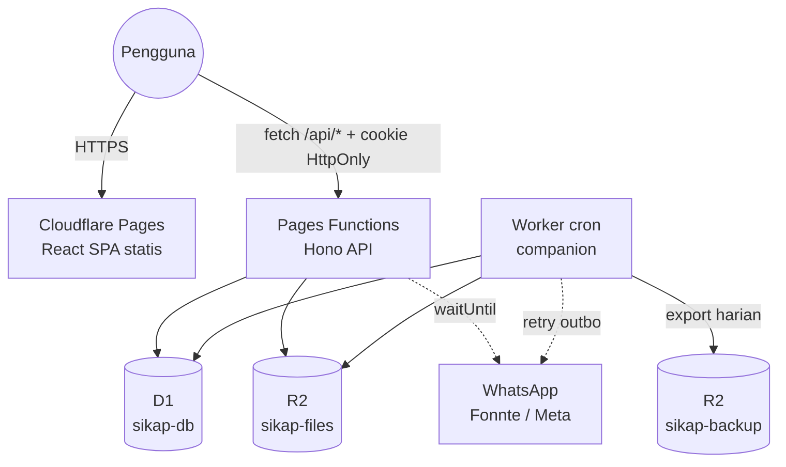

# SIKAP — Implementation Plan: Migrasi & Redesign

> Dari: GAS + Google Sheets + Google Drive (lambat, ada celah kritis)
> Ke: **React 19 + TypeScript (Vite) · Tailwind CSS v4 · shadcn/ui · Cloudflare Pages + Pages Functions · D1 · R2 (Free plan)**
> Konteks dan temuan audit ada di [`PROJECT_CONTEXT.md`](PROJECT_CONTEXT.md). ID temuan (S-xx, F-xx) merujuk ke dokumen tersebut.
> Branch kerja: **`feat/cloudflare-migration`** (dibuat dari `main`). `main` tidak disentuh sampai cutover.

## Keputusan Pemilik Produk (dikonfirmasi 15 Okt 2026)

| # | Topik | Keputusan | Implikasi desain |
|---|---|---|---|
| 1 | Database | **Opsi B**: D1 + R2 | Sheets/Drive hanya sumber migrasi |
| 2 | Plan Cloudflare | **Free**, PBKDF2 **10.000 iterasi** | Ditambah **pepper** (HMAC secret `PASSWORD_PEPPER`) sebelum PBKDF2 agar hash yang bocor tanpa secret tidak bisa di-crack offline. Lockout + rate limit wajib (§3.1). Format hash menyimpan jumlah iterasi sehingga bisa dinaikkan nanti tanpa reset |
| 3 | Dokumen wajib | Matriks wajib per status (PNS/CPNS/PPPK) + **daftar golongan PPPK** | Tabel `jenis_dokumen_wajib`. `ref_pangkat_golongan` memuat PNS I/a–IV/e dan PPPK I–XVII. Admin dapat mengubah matriks via UI |
| 4 | Versi file | File lama **tidak** dihapus saat upload ulang. File lama disimpan **3 hari** untuk rollback, lalu dihapus otomatis. Hapus file lama hanya jika file baru berhasil | Tabel `arsip_dokumen_versi` (`purge_after`). Endpoint rollback. Cron membersihkan versi kedaluwarsa. Hapus dokumen juga *soft delete* 3 hari |
| 5 | Hapus pegawai | Soft delete, retensi **7 hari** | `pegawai.deleted_at` + `purge_after`. Admin bisa memulihkan dalam 7 hari. Cron menghapus permanen (D1 + R2) setelahnya |
| 6 | Data kepegawaian & password | Pegawai **boleh mengajukan** perubahan data kepegawaian; berlaku setelah **diverifikasi admin**. Password default = 6 digit terakhir NIP, **tidak wajib** diganti; ganti lewat Pengaturan Akun | Tabel `pengajuan_perubahan` + antrean admin. Tidak ada halaman "ganti password wajib". Banner rekomendasi (non-blocking) bila masih memakai password default. Reset password admin kembali ke default |

### Konfirmasi lanjutan — 16 Oktober 2026

- **Deploy hotfix GAS sudah dijalankan**, menurut konfirmasi pemilik proyek. Status ini adalah
  laporan pemilik, bukan hasil verifikasi ulang produksi. Konfirmasi ini tidak otomatis
  membuktikan bahwa pencabutan sharing Drive, pengarsipan deployment lama, atau semua langkah
  pascadeploy di `HOTFIX_DEPLOY.md` sudah selesai.
- **NIK tetap dapat diubah sendiri oleh pegawai** sebagai data pribadi; tidak dikunci bersama
  data kepegawaian dan tidak memerlukan pengajuan perubahan.
- **Dokumen Terverifikasi yang dihapus admin hanya dapat dipulihkan admin**, baik lewat
  restore maupun rollback ke versi sebelumnya.
- **Pegawai boleh menghapus dokumen Menunggu lalu langsung mengunggah ulang**; file terhapus
  tetap menjadi versi sebelumnya sesuai masa retensi yang berlaku.
- **NIP/NIK pegawai yang dihapus tetap dicadangkan sampai purge permanen**, dengan masa
  pemulihan 7 hari. NIP/NIK belum dapat dipakai untuk pegawai baru selama baris lama masih ada.

> **Risiko yang diterima (keputusan 2 & 6):** password default dapat ditebak dari NIP dan PBKDF2 10k jauh di bawah rekomendasi OWASP (600k). Mitigasi wajib: lockout 5 gagal / 15 menit per akun, rate limit per IP, pepper, audit login gagal, banner rekomendasi ganti password, dan laporan admin "akun yang masih memakai password default".

---

## 0. Keputusan Arsitektur

### 0.1 Pilihan database & storage

| Opsi | Kecepatan | Keamanan file | Kompleksitas | Free plan | Keputusan |
|---|---|---|---|---|---|
| A. Tetap Sheets + Drive, akses via Google API dari Functions | Masih lambat (±0,3–1 detik per panggilan API, quota per menit, OAuth JWT signing per request) | Bergantung pada izin Drive | Tinggi (service account, token cache) | Ya | ✗ |
| **B. D1 (SQLite) + R2** | Query berindeks <1 ms, latensi edge | File privat, hanya disajikan oleh API terotorisasi | Rendah | Ya | **✓ Utama** |
| C. B + mirror ke Google Sheets (read-only, terjadwal) | Seperti B | Seperti B | Sedang | Ya | Opsional fase 2, untuk TU yang terbiasa dengan spreadsheet |

**Rekomendasi: Opsi B.** Google Sheets/Drive hanya dipakai sebagai sumber migrasi data, lalu diarsipkan read-only.

### 0.2 Batasan Free plan yang memengaruhi desain

| Limit (Free) | Nilai | Dampak dan mitigasi |
|---|---|---|
| Request Functions | 100.000/hari | Aset statis tidak dihitung. ±200 pegawai × ±100 request/hari masih jauh di bawah limit |
| **CPU time** | **10 ms/request** | PBKDF2-SHA256 **10k iterasi** (keputusan #2) + HMAC pepper. **Terukur di edge Cloudflare (16 Okt 2026, colo SIN, Worker sementara)**: 1 hash = **3–4 ms CPU**, 2 hash = **6–7 ms** (sesekali 11–13 ms), 4 hash = 11 ms, 8 hash = 19–36 ms — semua request tetap sukses karena Workers memberi kelonggaran untuk lonjakan sesekali. Login (1 hash) aman; ganti password (2 hash) mendekati batas tapi tetap lolos. Jangan menambah hash ketiga dalam satu request. Hindari parsing JSON besar dan PDF di server |
| Subrequest / query D1 | 50/request | Gunakan `db.batch()`, hindari N+1 |
| D1 | 500 MB/DB, 5 juta baris dibaca/hari, 100.000 baris ditulis/hari, Time Travel 7 hari | Wajib pakai indeks. Log harus di-paginate. Backup tambahan ke R2 |
| R2 | 10 GB, 1 juta Class A, 10 juta Class B per bulan, egress gratis | Estimasi 200 pegawai × 11 dokumen × ±1 MB ≈ 2,2 GB. Kompres gambar di client |
| Request body | 100 MB | Dokumen maksimal 5 MB dikirim sebagai `PUT` raw body dengan SHA-256 dari browser, diteruskan native ke R2; foto profil tetap multipart |
| `waitUntil()` | ±30 detik setelah response | Notifikasi WhatsApp dikirim di sini, tidak memblokir response |
| **Cron** | Pages Functions **tidak** mendukung cron | Buat 1 **Worker companion kecil** (`workers/cron`) dengan binding D1/R2 yang sama: bersihkan sesi, retry outbox WA, backup harian |

> Catatan: Cloudflare kini menyarankan Workers + Static Assets untuk proyek baru. Plan ini tetap memakai Pages sesuai permintaan. Struktur `server/` dibuat agnostik sehingga bisa dipindah ke Workers tanpa rewrite.

### 0.3 Stack final

| Area | Pilihan | Alasan |
|---|---|---|
| Build | Vite 6+, React 19, TypeScript strict | Sesuai permintaan |
| Routing UI | React Router (library/data mode) | Route guard per role, lazy-load per halaman |
| Server state | TanStack Query | Cache, invalidasi setelah mutasi, retry. Menggantikan cache manual 15 detik |
| Form | react-hook-form + zod (`@hookform/resolvers`) | Schema zod **dipakai bersama** frontend dan backend |
| UI | shadcn/ui: Card, Input, Select, Checkbox, Switch, Calendar+Popover (DatePicker), Dialog, AlertDialog, Sheet, Table, Tabs, Badge, Progress, Avatar, Skeleton, Sonner, DropdownMenu, Command (combobox) | Sesuai permintaan |
| Styling | Tailwind CSS v4 (`@tailwindcss/vite`, token di `@theme`) | Menggantikan v3 + CDN |
| Tabel | TanStack Table | Filter, paging, sorting di Master Data |
| Ikon | lucide-react | Bawaan shadcn. Menggantikan Material Symbols CDN |
| Crop foto | `react-easy-crop` | Lebih ringan dari Cropper.js |
| Tanggal | `date-fns` + locale `id`, `Intl` timeZone `Asia/Makassar` | Simpan UTC ISO, tampilkan dalam WITA |
| API | **Hono** di `functions/api/[[route]].ts` (`hono/cloudflare-pages`) | Router, middleware auth, validator zod, tipe end-to-end. Alternatif tanpa dependensi: file routing bawaan Pages + `_middleware.ts` |
| Validasi | zod **≥ 4.5.0** | Versi lama boros memori di Workers |
| DB access | SQL murni + helper tipis (tanpa ORM) atau Drizzle ORM (`drizzle-orm/d1`) | Skema kecil; Drizzle opsional untuk tipe dan migrasi |
| Test | Vitest, `@cloudflare/vitest-pool-workers` (D1/R2 lokal), React Testing Library, Playwright | |

---

## 1. Arsitektur Target



### 1.1 Struktur repo (single package)

```text
SIKAP/
├── src/                      # React app
│   ├── app/                  # router, providers, layout (AppShell, AuthLayout)
│   ├── features/
│   │   ├── auth/             # login, ganti password, guard
│   │   ├── dashboard/        # admin & pegawai
│   │   ├── profil/
│   │   ├── dokumen/          # arsip, upload, preview
│   │   ├── pegawai/          # master data (admin)
│   │   ├── verifikasi/
│   │   ├── log/
│   │   └── pengaturan/
│   ├── components/ui/        # shadcn generated
│   ├── components/           # StatusBadge, FileDropzone, PhotoCropper, EmptyState, PageHeader
│   ├── lib/                  # api client, query keys, format WITA
│   └── styles/globals.css    # @import "tailwindcss"; @theme {...}
├── functions/api/[[route]].ts  # entry: handle(app)
├── server/                   # Hono app (platform-agnostic)
│   ├── app.ts, env.ts
│   ├── middleware/           # session, requireRole, csrf/origin, error handler
│   ├── routes/               # auth, me, documents, admin/*
│   ├── services/             # pegawai, dokumen, verifikasi, notifikasi, audit
│   ├── lib/                  # crypto (pbkdf2, token), r2, file-sniff, time
│   └── db/                   # queries per tabel
├── shared/                   # zod schemas, enums, DTO types (dipakai src & server)
├── migrations/               # 0001_init.sql, 0002_seed_ref.sql, ...
├── workers/cron/             # scheduled(): sessions, outbox, backup
├── scripts/migrate/          # ETL Sheets/Drive → D1/R2
├── legacy-gas/               # kode GAS lama (dipindah, tidak dihapus sampai cutover selesai)
├── wrangler.toml
└── vite.config.ts
```

### 1.2 `wrangler.toml` (Pages)

```toml
name = "sikap"
compatibility_date = "2026-10-01"
compatibility_flags = ["nodejs_compat"]
pages_build_output_dir = "dist"

[[d1_databases]]
binding = "DB"
database_name = "sikap-db"
database_id = "<id>"
migrations_dir = "migrations"

[[r2_buckets]]
binding = "FILES"
bucket_name = "sikap-files"

[vars]
APP_URL = "https://sikap.uptdpenda-kupang.web.id"
SESSION_TTL_HOURS = "12"
# Secrets (wrangler pages secret put): SETTINGS_ENC_KEY, IMPORT_TOKEN
```

Buat environment `preview` terpisah dengan DB dan bucket sendiri (`sikap-db-preview`, `sikap-files-preview`). **Jangan pernah tes ke produksi** (koreksi F-11).

---

## 2. Desain Database (D1)

Prinsip:
- Gunakan ID surrogate. NIP/NIK disimpan sebagai `TEXT` (koreksi F-03).
- Waktu disimpan dalam UTC ISO-8601.
- Enum stabil memakai `CHECK`. Daftar yang bisa diubah admin memakai tabel referensi.
- Satu arsip aktif per (pegawai, jenis) dijamin oleh `UNIQUE` (koreksi F-02).

```sql
-- migrations/0001_init.sql
PRAGMA foreign_keys = ON;

CREATE TABLE ref_pangkat_golongan (
  kode        TEXT PRIMARY KEY,                  -- 'III/a', 'PPPK-IX'
  nama        TEXT NOT NULL,                     -- 'Penata Muda (III/a)'
  jenis_asn   TEXT NOT NULL CHECK (jenis_asn IN ('PNS','PPPK')),
  urutan      INTEGER NOT NULL,
  aktif       INTEGER NOT NULL DEFAULT 1
);

CREATE TABLE ref_unit_organisasi (
  id     INTEGER PRIMARY KEY,
  nama   TEXT NOT NULL UNIQUE,
  aktif  INTEGER NOT NULL DEFAULT 1
);

CREATE TABLE ref_pendidikan (
  kode   TEXT PRIMARY KEY,                       -- 'S1'
  nama   TEXT NOT NULL,                          -- 'S-1 / Sarjana'
  urutan INTEGER NOT NULL
);

CREATE TABLE pegawai (
  id                  INTEGER PRIMARY KEY,
  nip                 TEXT NOT NULL UNIQUE CHECK (length(nip) = 18 AND nip NOT GLOB '*[^0-9]*'),
  nik                 TEXT UNIQUE CHECK (nik IS NULL OR (length(nik) = 16 AND nik NOT GLOB '*[^0-9]*')),
  nama                TEXT NOT NULL,
  role                TEXT NOT NULL DEFAULT 'Pegawai' CHECK (role IN ('Admin','Pegawai')),
  status_akun         TEXT NOT NULL DEFAULT 'Aktif'   CHECK (status_akun IN ('Aktif','Nonaktif')),
  status_kepegawaian  TEXT CHECK (status_kepegawaian IN ('PNS','CPNS','PPPK')),
  pangkat_kode        TEXT REFERENCES ref_pangkat_golongan(kode),
  tmt_pangkat         TEXT,                      -- 'YYYY-MM-DD'
  jabatan             TEXT,
  jenis_jabatan       TEXT CHECK (jenis_jabatan IN ('Fungsional','Pelaksana','Struktural')),
  tmt_jabatan         TEXT,
  unit_id             INTEGER REFERENCES ref_unit_organisasi(id),
  tempat_lahir        TEXT,
  tanggal_lahir       TEXT,
  jenis_kelamin       TEXT CHECK (jenis_kelamin IN ('Laki-laki','Perempuan')),
  agama               TEXT CHECK (agama IN ('Kristen Protestan','Kristen Katholik','Islam','Hindu','Buddha','Konghucu')),
  pendidikan_kode     TEXT REFERENCES ref_pendidikan(kode),
  status_pernikahan   TEXT CHECK (status_pernikahan IN ('Belum Menikah','Menikah','Cerai')),
  golongan_darah      TEXT CHECK (golongan_darah IN ('A','B','AB','O','Tidak Tahu')),
  no_hp               TEXT,                      -- normalisasi E.164 tanpa '+': '6281234...'
  email               TEXT,
  alamat              TEXT,
  foto_r2_key         TEXT,
  created_at          TEXT NOT NULL DEFAULT (strftime('%Y-%m-%dT%H:%M:%fZ','now')),
  updated_at          TEXT NOT NULL DEFAULT (strftime('%Y-%m-%dT%H:%M:%fZ','now')),
  deleted_at          TEXT,                      -- soft delete (keputusan #5)
  deleted_by          INTEGER,
  purge_after         TEXT                       -- deleted_at + 7 hari; cron menghapus permanen
);
CREATE INDEX idx_pegawai_status ON pegawai(status_kepegawaian, status_akun) WHERE deleted_at IS NULL;
CREATE INDEX idx_pegawai_nama   ON pegawai(nama COLLATE NOCASE);

CREATE TABLE akun (
  pegawai_id            INTEGER PRIMARY KEY REFERENCES pegawai(id) ON DELETE CASCADE,
  password_hash         TEXT NOT NULL,           -- 'pbkdf2-sha256$<iter>$<salt_b64>$<hash_b64>' (input = HMAC(pepper, password))
  is_default_password   INTEGER NOT NULL DEFAULT 1, -- hanya untuk banner rekomendasi, TIDAK memblokir akses
  failed_attempts       INTEGER NOT NULL DEFAULT 0,
  locked_until          TEXT,
  password_changed_at   TEXT,
  last_login_at         TEXT
);

CREATE TABLE sesi (
  token_hash   TEXT PRIMARY KEY,                 -- SHA-256(token); token asli hanya di cookie
  pegawai_id   INTEGER NOT NULL REFERENCES pegawai(id) ON DELETE CASCADE,
  created_at   TEXT NOT NULL,
  expires_at   TEXT NOT NULL,
  last_seen_at TEXT NOT NULL,
  ip           TEXT,
  user_agent   TEXT
);
CREATE INDEX idx_sesi_pegawai ON sesi(pegawai_id);
CREATE INDEX idx_sesi_expires ON sesi(expires_at);

CREATE TABLE jenis_dokumen (
  id             TEXT PRIMARY KEY,               -- 'DOC-KTP'
  nama           TEXT NOT NULL,
  kategori       TEXT NOT NULL,                  -- 'Dokumen Pribadi' | 'Dokumen Kepegawaian' | 'Dokumen Pendidikan'
  urutan         INTEGER NOT NULL DEFAULT 0,
  aktif          INTEGER NOT NULL DEFAULT 1,
  max_size_bytes INTEGER NOT NULL DEFAULT 5242880
);

-- Dokumen wajib per status kepegawaian (koreksi F-13)
CREATE TABLE jenis_dokumen_wajib (
  jenis_dokumen_id   TEXT NOT NULL REFERENCES jenis_dokumen(id) ON DELETE CASCADE,
  status_kepegawaian TEXT NOT NULL CHECK (status_kepegawaian IN ('PNS','CPNS','PPPK')),
  PRIMARY KEY (jenis_dokumen_id, status_kepegawaian)
);

CREATE TABLE arsip_dokumen (
  id                INTEGER PRIMARY KEY,
  pegawai_id        INTEGER NOT NULL REFERENCES pegawai(id) ON DELETE CASCADE,
  jenis_dokumen_id  TEXT NOT NULL REFERENCES jenis_dokumen(id),
  status            TEXT NOT NULL CHECK (status IN ('Menunggu','Terverifikasi','Ditolak')),
  r2_key            TEXT NOT NULL,
  file_name         TEXT NOT NULL,               -- [NIP]_[Nama]_[ID].[ext]
  mime_type         TEXT NOT NULL,
  size_bytes        INTEGER NOT NULL,
  sha256            TEXT NOT NULL,
  versi             INTEGER NOT NULL DEFAULT 1,
  catatan_admin     TEXT,
  uploaded_at       TEXT NOT NULL,
  uploaded_by       INTEGER REFERENCES pegawai(id),
  verified_at       TEXT,
  verified_by       INTEGER REFERENCES pegawai(id),
  deleted_at        TEXT,                        -- soft delete 3 hari (keputusan #4)
  purge_after       TEXT,
  UNIQUE (pegawai_id, jenis_dokumen_id)
);
CREATE INDEX idx_arsip_status ON arsip_dokumen(status, uploaded_at);

-- Versi file sebelumnya, disimpan 3 hari untuk rollback (keputusan #4).
-- Dibuat HANYA setelah file baru sukses tersimpan di R2 dan baris arsip ter-update.
CREATE TABLE arsip_dokumen_versi (
  id             INTEGER PRIMARY KEY,
  arsip_id       INTEGER NOT NULL REFERENCES arsip_dokumen(id) ON DELETE CASCADE,
  versi          INTEGER NOT NULL,
  r2_key         TEXT NOT NULL,
  file_name      TEXT NOT NULL,
  mime_type      TEXT NOT NULL,
  size_bytes     INTEGER NOT NULL,
  sha256         TEXT NOT NULL,
  status         TEXT NOT NULL,                  -- status saat digantikan (dipulihkan saat rollback)
  catatan_admin  TEXT,
  uploaded_at    TEXT NOT NULL,
  verified_at    TEXT,
  verified_by    INTEGER,
  replaced_at    TEXT NOT NULL,
  reason         TEXT NOT NULL CHECK (reason IN ('REUPLOAD','DELETE')),
  purge_after    TEXT NOT NULL,                  -- replaced_at + 3 hari
  UNIQUE (arsip_id, versi)
);
CREATE INDEX idx_versi_purge ON arsip_dokumen_versi(purge_after);

-- Pengajuan perubahan data kepegawaian oleh pegawai (keputusan #6)
CREATE TABLE pengajuan_perubahan (
  id           INTEGER PRIMARY KEY,
  pegawai_id   INTEGER NOT NULL REFERENCES pegawai(id) ON DELETE CASCADE,
  perubahan    TEXT NOT NULL,                    -- JSON: { field: { lama, baru } }
  alasan       TEXT,                             -- keterangan dari pegawai
  status       TEXT NOT NULL DEFAULT 'Menunggu' CHECK (status IN ('Menunggu','Disetujui','Ditolak','Dibatalkan')),
  catatan_admin TEXT,
  created_at   TEXT NOT NULL,
  reviewed_at  TEXT,
  reviewed_by  INTEGER REFERENCES pegawai(id)
);
-- Maksimal satu pengajuan aktif per pegawai
CREATE UNIQUE INDEX uq_pengajuan_aktif ON pengajuan_perubahan(pegawai_id) WHERE status = 'Menunggu';
CREATE INDEX idx_pengajuan_status ON pengajuan_perubahan(status, created_at);

-- Riwayat verifikasi/versi (audit trail per dokumen)
CREATE TABLE arsip_dokumen_riwayat (
  id          INTEGER PRIMARY KEY,
  arsip_id    INTEGER NOT NULL,
  versi       INTEGER NOT NULL,
  aksi        TEXT NOT NULL CHECK (aksi IN ('UPLOAD','REUPLOAD','APPROVE','REJECT','DELETE','RESTORE','ROLLBACK')),
  status      TEXT,
  catatan     TEXT,
  actor_id    INTEGER,
  created_at  TEXT NOT NULL
);
CREATE INDEX idx_riwayat_arsip ON arsip_dokumen_riwayat(arsip_id);

CREATE TABLE log_aktivitas (
  id           INTEGER PRIMARY KEY,
  ts           TEXT NOT NULL,
  actor_id     INTEGER,
  actor_nip    TEXT,                             -- disimpan juga agar log tetap terbaca setelah pegawai dihapus
  actor_nama   TEXT,
  actor_role   TEXT,
  action       TEXT NOT NULL,
  target_type  TEXT,
  target_id    TEXT,
  description  TEXT,
  result       TEXT NOT NULL CHECK (result IN ('SUCCESS','FAILURE','WARNING','PARTIAL')),
  ip           TEXT
);
CREATE INDEX idx_log_ts     ON log_aktivitas(ts DESC);
CREATE INDEX idx_log_action ON log_aktivitas(action, ts DESC);

CREATE TABLE pengaturan (
  key         TEXT PRIMARY KEY,                  -- 'wa.provider', 'notif.dokumen_baru', ...
  value       TEXT NOT NULL,                     -- secret dienkripsi AES-GCM (SETTINGS_ENC_KEY)
  is_secret   INTEGER NOT NULL DEFAULT 0,
  updated_at  TEXT NOT NULL,
  updated_by  INTEGER
);

CREATE TABLE notifikasi_outbox (
  id          INTEGER PRIMARY KEY,
  channel     TEXT NOT NULL DEFAULT 'whatsapp',
  target      TEXT NOT NULL,
  template    TEXT NOT NULL,                     -- dokumen_baru_admin | dokumen_terverifikasi | dokumen_ditolak | test
  params      TEXT NOT NULL,                     -- JSON
  status      TEXT NOT NULL DEFAULT 'PENDING' CHECK (status IN ('PENDING','SENT','FAILED')),
  attempts    INTEGER NOT NULL DEFAULT 0,
  last_error  TEXT,
  created_at  TEXT NOT NULL,
  sent_at     TEXT
);
CREATE INDEX idx_outbox_pending ON notifikasi_outbox(status, created_at) WHERE status = 'PENDING';
```

**Status `Belum_Unggah`** tidak disimpan. Status ini adalah *tidak ada baris* di `arsip_dokumen` (hasil LEFT JOIN `jenis_dokumen`).

**Kelengkapan** (satu definisi, koreksi F-12):
```sql
-- % dokumen wajib terverifikasi untuk 1 pegawai
SELECT COUNT(w.jenis_dokumen_id) AS wajib_total,
       SUM(a.status = 'Terverifikasi') AS wajib_verified
FROM jenis_dokumen_wajib w
JOIN jenis_dokumen j ON j.id = w.jenis_dokumen_id AND j.aktif = 1
LEFT JOIN arsip_dokumen a ON a.jenis_dokumen_id = w.jenis_dokumen_id AND a.pegawai_id = ?1
WHERE w.status_kepegawaian = ?2;
```
UI menampilkan dua angka: **tersedia** (sudah diunggah) dan **terverifikasi**. Persentase resmi memakai *terverifikasi*.

**Layout R2**:
- Dokumen: `dokumen/{pegawai_id}/{jenis_dokumen_id}/v{versi}-{uuid}.{ext}`
- Foto: `foto/{pegawai_id}/{uuid}.webp`
- Metadata `customMetadata`: `{ nip, jenisDokumen, uploadedBy }`.
- Bucket **tidak publik**. Tidak memakai `r2.dev` maupun custom domain publik.

---

## 3. Desain API (REST)

Konvensi:
- JSON `camelCase`.
- Error memakai HTTP status + `{ error: { code, message, fields? } }`.
- `401 SESSION_EXPIRED` menggantikan pencocokan string `'Sesi'` di frontend.
- Paginasi `?page=&pageSize=` (Master Data) atau `?cursor=` (Log).

| Method & path | Role | Pengganti action GAS |
|---|---|---|
| `POST /api/auth/login` | publik | `login` |
| `POST /api/auth/logout` | login | `logout` |
| `GET /api/auth/me` | login | `checkSession`, `getUserProfile` |
| `POST /api/auth/change-password` | login | `changePassword` (`forceChangePassword` dihapus — keputusan #6) |
| `GET /api/auth/sessions` · `DELETE /api/auth/sessions/:id` · `POST /api/auth/sessions/revoke-others` | login | **baru**: kelola sesi aktif |
| `GET /api/me/profile` · `PATCH /api/me/profile` | login | `getMyProfile`, `updateMyProfile` (**hanya field pribadi & kontak**) |
| `GET /api/me/pengajuan` · `POST /api/me/pengajuan` · `DELETE /api/me/pengajuan/:id` | login | **baru** (keputusan #6): ajukan / lihat / batalkan perubahan data kepegawaian |
| `GET /api/admin/pengajuan?status` · `POST /api/admin/pengajuan/:id/approve` · `POST .../reject` | Admin | **baru**: verifikasi pengajuan; approve menerapkan perubahan ke `pegawai` secara atomik + audit |
| `POST /api/documents/:id/rollback` | pemilik (jika arsip belum `Terverifikasi`) / Admin | **baru** (keputusan #4): pulihkan versi sebelumnya dalam 3 hari |
| `POST /api/documents/:id/restore` | pemilik / Admin | **baru**: batalkan hapus dokumen dalam 3 hari |
| `POST /api/admin/pegawai/:id/restore` | Admin | **baru** (keputusan #5): pulihkan pegawai terhapus dalam 7 hari |
| `PUT /api/me/photo` (multipart) | login | `uploadFotoProfil` |
| `GET /api/me/dashboard` | Pegawai | `getMyDashboard` |
| `GET /api/me/documents` | login | `getArsipDokumenPegawai` |
| `PUT /api/me/documents/:jenisId` (raw body + `X-Content-SHA256`) | login | `uploadDokumen` |
| `DELETE /api/documents/:id` | pemilik (jika bukan `Terverifikasi`) / Admin | `hapusDokumen` |
| `GET /api/documents/:id` | pemilik / Admin | `getDokumenPreview` (metadata + riwayat) |
| `GET /api/documents/:id/file[?download=1]` | pemilik / Admin | stream dari R2, `Content-Disposition`, `Cache-Control: private, no-store` |
| `GET /api/pegawai/:id/photo` | login | stream foto (ETag) |
| `GET /api/ref` | login | daftar referensi (pangkat, unit, pendidikan, jenis dokumen) |
| `GET /api/admin/dashboard` | Admin | `adminGetDashboardStats` |
| `GET /api/admin/pegawai?q&statusKepegawaian&statusAkun&kelengkapan&belumUnggah=DOC-NPWP&page&pageSize&sort` | Admin | `adminGetAllPegawai` (+ filter "belum upload X" dari PRD) |
| `POST /api/admin/pegawai` | Admin | `adminTambahPegawai` |
| `GET` · `PATCH` · `DELETE /api/admin/pegawai/:id` | Admin | `adminGetPegawaiDetail`, `adminUpdatePegawai`, `adminDeletePegawai` |
| `POST /api/admin/pegawai/:id/status` | Admin | `adminSetStatusAkun` (juga mencabut semua sesi) |
| `POST /api/admin/pegawai/:id/reset-password` | Admin | `adminResetPassword` (kembali ke password default 6 digit terakhir NIP, cabut semua sesi) |
| `PUT /api/admin/pegawai/:id/photo` | Admin | `adminUploadFotoPegawai` |
| `GET /api/admin/pegawai/:id/documents` | Admin | `getArsipDokumenPegawai(targetNip)` |
| `GET /api/admin/verifikasi?cursor` | Admin | `adminGetVerificationQueue` |
| `POST /api/admin/verifikasi/:arsipId/approve` | Admin | `adminApproveDokumen` (hanya dari `Menunggu`, optimistic check `versi`) |
| `POST /api/admin/verifikasi/:arsipId/reject` `{alasan}` | Admin | `adminRejectDokumen` (5–500 karakter) |
| `GET /api/admin/log?cursor&q&category&result&from&to` | Admin | `adminGetLogAktivitas` |
| `GET` · `PUT /api/admin/settings/notifications` | Admin | `adminGet/SaveNotifSettings` |
| `GET` · `PUT /api/admin/settings/whatsapp` · `POST .../test` | Admin | `adminGet/SetWaProvider`, `adminSaveFonnteToken`, `adminSaveMetaConfig`, `adminTest*` |
| `CRUD /api/admin/jenis-dokumen` | Admin | **baru** (STEP 05: admin menambah jenis dokumen) |
| `CRUD /api/admin/ref/:table` | Admin | **baru** (pangkat, unit) |
| `POST /api/admin/backup` · `GET /api/admin/backup` | Admin | `adminBackupDatabase`, `adminBackupFull` |
| Import migrasi | alat offline/local-only | **Tidak membuat endpoint HTTP import publik**; perpindahan remote memerlukan langkah operator terpisah setelah dry-run tervalidasi |

### 3.1 Aturan keamanan di server (wajib)

1. **Password**:
   - Disimpan sebagai PBKDF2-SHA256 **10.000 iterasi**, salt 16 byte, input `HMAC-SHA256(PASSWORD_PEPPER, password)`, via WebCrypto. Perbandingan *constant-time*.
   - Password default = 6 digit terakhir NIP (keputusan #6); `is_default_password=1` hanya memicu banner rekomendasi.
   - Kebijakan password baru (dipilih pengguna): minimal 8 karakter, huruf besar + kecil + angka, tidak sama dengan 6 digit terakhir NIP.
2. **Login**:
   - Pesan error generik.
   - `failed_attempts` ≥ 5 mengunci akun 15 menit.
   - Tambahkan 1 aturan **WAF Rate Limiting** (gratis) di `/api/auth/login`.
   - Login gagal ikut dicatat di log (koreksi S-13).
3. **Sesi**:
   - Token 32 byte acak, disimpan di cookie `__Host-sikap_sid` (HttpOnly, Secure, SameSite=Strict, Path=/). D1 hanya menyimpan `SHA-256(token)`.
   - Sliding expiry 12 jam; `last_seen_at` diperbarui maksimal setiap 5 menit agar hemat write.
   - Ganti password, reset, atau nonaktif mencabut sesi lain (koreksi S-08).
4. **CSRF**: SameSite=Strict, ditambah cek header `Origin` sama dengan `APP_URL` untuk method non-GET.
5. **Otorisasi berbasis kepemilikan**:
   - Setiap akses `documents/:id` memeriksa `pegawai_id = session.pegawaiId OR role = 'Admin'`.
   - `PATCH /api/me/profile` memakai **zod schema whitelist** yang hanya berisi field pribadi & kontak. Field kepegawaian ditolak langsung (koreksi S-05) dan **hanya** bisa diubah lewat `POST /api/me/pengajuan` yang berlaku setelah approve admin (keputusan #6).
6. **Upload** (keputusan #4):
   - Validasi ukuran ≤ 5 MB dan **magic bytes** (`%PDF`, `FFD8FF`, `89504E47`, `RIFF....WEBP`); jangan percaya MIME dari client.
   - Hitung SHA-256 dan simpan.
   - Urutan: (1) `put` file baru ke R2 dengan key unik; (2) jika gagal, berhenti — data lama utuh; (3) `db.batch()`: salin baris arsip lama ke `arsip_dokumen_versi` (`purge_after = now + 3 hari`) + update arsip ke versi baru + riwayat + audit; (4) jika batch gagal, hapus objek baru dari R2 (kompensasi). **File lama tidak pernah dihapus di jalur request.**
   - Cron harian menghapus objek R2 + baris `arsip_dokumen_versi` yang `purge_after < now`, juga arsip yang di-soft-delete > 3 hari.
7. **Header**:
   - `_headers` Pages: CSP ketat (`default-src 'self'; frame-src 'self'; img-src 'self' data: blob:`), `X-Content-Type-Options`, `Referrer-Policy`, `Permissions-Policy`.
   - Tanpa CDN pihak ketiga.
8. **Error**: tidak mengekspos `e.message` ke client (koreksi S-10). Log internal memakai `console.error` + Workers Logs.
9. **Secret WA**:
   - Disimpan terenkripsi AES-GCM dengan `SETTINGS_ENC_KEY`, ditampilkan sebagai hint `••••1234`.
   - Notifikasi masuk ke `notifikasi_outbox` dan dikirim via `waitUntil`; yang gagal di-retry oleh cron.
10. **Audit**: setiap mutasi menulis `log_aktivitas` dalam `db.batch()` yang sama dengan mutasinya.

---

## 4. Redesign UI/UX

### 4.1 Prinsip
- Mempertahankan nilai STEP 06: formal-modern, responsive first, warna status konsisten, feedback instan.
- **Status semantik** (satu komponen `<StatusBadge>`):

| Status | Warna | Ikon |
|---|---|---|
| Belum diunggah | merah (`red-50/700`) | `CircleDashed` |
| Menunggu | kuning/amber | `Clock` |
| Terverifikasi | hijau | `CheckCircle2` |
| Ditolak | oranye | `AlertTriangle` |

- Token tema Tailwind v4 (`@theme`) diturunkan dari palet yang ada: `--color-primary: #00236f`, `--color-primary-container: #1e3a8a`, `--color-surface: #f8f9ff`, `--color-destructive: #ba1a1a`, font Inter (self-hosted via `@fontsource-variable/inter`), radius `0.5rem`. Variabel shadcn (`--background`, `--primary`, …) dipetakan ke token ini.
- Target aksesibilitas WCAG 2.2 AA: kontras, fokus terlihat, label form, `aria-live` untuk toast, navigasi keyboard di semua dialog.
- Skeleton loading menggantikan overlay layar penuh. Overlay hanya dipakai saat upload, dengan progress bar `XMLHttpRequest.upload.onprogress`.

### 4.2 Informasi Arsitektur (route)

| Route | Role | Catatan redesign |
|---|---|---|
| `/login` | publik | Split-screen (foto kantor terkompresi WebP), NIP + password, toggle show password. Teks pola password default dihapus |
| *(tidak ada halaman ganti password wajib)* | – | Keputusan #6. Diganti banner non-blocking "Anda masih memakai password default — ganti di Pengaturan Akun" |
| `/` | Pegawai | Kartu "Yang perlu Anda lakukan" (prioritas: Ditolak, lalu Belum unggah wajib, lalu Menunggu), Progress dokumen wajib, Progress profil + link field kosong |
| `/` | Admin | KPI cards (Pegawai aktif per status, Antrean verifikasi, % Kelengkapan instansi), daftar "Perlu perhatian", aktivitas terbaru |
| `/profil` | semua | Tabs **Identitas · Kepegawaian · Kontak**. Tab Kepegawaian read-only untuk Pegawai dengan tombol **"Ajukan Perubahan"** (Dialog form, alasan, status pengajuan + catatan admin). DatePicker shadcn. Dirty-state + konfirmasi saat meninggalkan halaman. Foto: Dialog crop 1:1, output WebP 512 px |
| `/dokumen` | semua | Tabs Wajib/Opsional. Card per jenis dokumen (mobile) atau Table (desktop). Aksi kontekstual: Unggah / Lihat / Ganti / Hapus. Dialog upload dengan dropzone (drag & drop asli) + progress. Sheet preview (PDF via `<iframe src="/api/documents/:id/file">`, gambar via ``), riwayat versi & verifikasi. **Versi sebelumnya** tampil dengan hitung mundur "tersedia s.d. …" + tombol **Pulihkan**; dokumen terhapus bisa dibatalkan dalam 3 hari |
| `/admin/pengajuan` | Admin | **Baru** (keputusan #6): antrean pengajuan perubahan data kepegawaian; tampilan diff lama → baru, Setujui / Tolak dengan catatan. Badge jumlah di sidebar |
| `/admin/pegawai` | Admin | TanStack Table: search, filter Select (status, akun, kelengkapan, **"belum unggah dokumen X"**, **"masih password default"**), sorting, paging. Sheet Tambah/Edit dengan form bertab. AlertDialog untuk nonaktif/hapus/reset. Tab **"Terhapus"** berisi pegawai soft-delete dengan sisa hari + tombol Pulihkan (keputusan #5) |
| `/admin/pegawai/:id` | Admin | Halaman detail: profil + dokumen pegawai (admin dapat preview/unduh) |
| `/admin/verifikasi` | Admin | Split-view 60/40 (preview kiri, data + aksi kanan). Pintasan keyboard `A` setujui, `R` tolak, `J/K` navigasi. Otomatis lanjut ke item berikutnya. Filter per jenis dokumen |
| `/admin/log` | Admin | **Ditambahkan ke sidebar.** Filter kategori/hasil/tanggal (DateRangePicker), cursor pagination |
| `/admin/jenis-dokumen` | Admin | **Baru**: CRUD jenis dokumen + matriks Checkbox "wajib untuk PNS/CPNS/PPPK" |
| `/admin/pengaturan` | Admin | Tabs: Notifikasi (Switch per jenis), WhatsApp (Select provider, Input token, tombol tes), Referensi (pangkat/unit), Backup |
| `/akun` | semua | Ganti password, daftar sesi aktif + "keluar dari semua perangkat" |

**Navigasi**: sidebar collapsible (desktop), Sheet drawer (mobile), dan bottom-nav 4 item untuk Pegawai di mobile.

Mockup `UIUX Stitch/*.html` dipakai sebagai referensi layout. Implementasi baru menggunakan komponen shadcn, bukan menyalin HTML.

---

## 5. Strategi Migrasi Data

### 5.1 Transformasi
| Sumber (Sheets) | Target (D1) | Aturan |
|---|---|---|
| `Data_Pegawai` | `pegawai` + `akun` | Buang prefix `'`. NIP/NIK hanya digit (baris tidak valid masuk laporan). `P3K` menjadi `PPPK`. Pangkat legacy (`Penata / III.c`) dipetakan ke `III/c`. Unit dan pendidikan dipetakan ke referensi. HP dinormalisasi ke `62…`. String kosong atau `-` menjadi `NULL`. `Ganti_Password` menjadi `Aktif` |
| `Password_Hash` (SHA-256 hex) | `akun.password_hash` | **Hash wrapping**: simpan `pbkdf2(hmac(pepper, sha256hex))` dengan prefix `legacy-wrap$…`. Saat login berhasil, verifikasi lalu re-hash ke format standar. Hash SHA-256 polos tidak pernah tersimpan di D1. Akun yang hash-nya sama dengan hash 6 digit terakhir NIP mendapat `is_default_password=1` |
| `Master_Dokumen` | `jenis_dokumen` + `jenis_dokumen_wajib` | `Ya` diterapkan ke status yang relevan. **Keputusan TU**: SK CPNS/SPMT/SK PNS tidak wajib untuk PPPK; SK PNS tidak wajib untuk CPNS |
| `Arsip_Dokumen` | `arsip_dokumen` + objek R2 | Hanya baris dengan file Drive valid. `Belum_Unggah` tidak dimigrasikan. Baris duplikat (pegawai, jenis): ambil `Waktu_Upload` terbaru |
| `Foto_Drive_ID` | R2 `foto/…` | Konversi ke WebP di skrip Node (sharp) |
| `Log_Aktivitas` | `log_aktivitas` | Apa adanya + `actor_nama` hasil join |
| `Sesi_Login` | – | Tidak dimigrasikan (semua pengguna login ulang) |
| Script Properties | `pengaturan` | Token WA dimasukkan ulang oleh admin melalui UI baru (tidak disalin) |

### 5.2 Mekanisme (revisi Fase 8 — local-first)
1. **GAS `exportForMigration_()`** di `scripts/migrate/gas/ExportForMigration.gs`: alat privat yang dipasang/dijalankan manual oleh operator, **bukan** bagian deployment aplikasi. Ekspor empat sheet tanpa sesi/token, serta salinan file ke folder Drive privat. Progres file dapat dilanjutkan. Format wajib mengikuti `scripts/migrate/contract.mjs`; tidak ada pembacaan produksi otomatis oleh alat pengembangan.
2. **`scripts/migrate/transform.mjs`** (Node offline): validasi, normalisasi, pemetaan referensi eksplisit, pembungkusan hash lama dengan target pepper dan salt privat; hasilkan plan sensitif, SQL, dan laporan berkode tanpa nilai PII. NIP/NIK numerik atau presisi hilang ditolak, tidak direkonstruksi. Error apa pun membuat plan tidak boleh diimpor.
3. **File lokal**: operator mengunduh ekspor/folder file privat dan mengekstraknya sendiri. Importer memeriksa nama/path, isi file, ukuran, SHA-256, dan kecocokan manifest sebelum menulis target. Tidak ada URL Drive publik, endpoint import HTTP publik, atau token import dalam aplikasi.
4. **`scripts/migrate/apply-local.mjs`**: hanya simulator D1/R2 lokal pada direktori persistence khusus. Default validasi; penulisan memerlukan `--apply`. Checkpoint terikat snapshot/digest plan/target dan disimpan bersama progres database, sehingga dapat dilanjutkan tanpa menggandakan data. Target berisi data aplikasi lain ditolak. Jalur ini tidak menerima `--remote`.
5. **`scripts/migrate/reconcile.mjs`**: cocokkan jumlah pegawai/akun/arsip per status serta checksum/ukuran byte file target. Exit nonzero bila berbeda. Dry-run sintetis yang lulus bukan izin migrasi nyata. Import remote (UAT privat/produksi), source freeze, serta UAT data asli merupakan tahap operator berikutnya yang belum dijalankan; jalur penulisan remote belum diimplementasikan, hanya preflight read-only (Fase 9).

---

## 6. Fase Implementasi

Estimasi untuk 1 developer full-time. Setiap fase diakhiri review kode dan test hijau.

### Fase 0 — Hotfix Keamanan GAS (segera, 1–2 hari) ⚠️
Sistem lama tetap berjalan beberapa minggu, sehingga celah kritis harus ditutup sekarang:
- [ ] **S-01**:
  - Ubah `doGet` agar hanya mengembalikan halaman "Silakan akses https://sikap.uptdpenda-kupang.web.id" (tanpa HTML aplikasi, sehingga `google.script.run` tidak tersedia).
  - Ganti nama semua helper internal dengan sufiks `_` (`getAllData_`, `appendRow_`, `updateCell_`, `seedData_`, …).
  - Hapus `Tests_Integration.gs` dan fungsi `test_*` dari deploy (`.claspignore`).
- [ ] **S-02**: hapus `setSharing(ANYONE_WITH_LINK)`. Cabut sharing publik folder `SIKAP_Dokumen_Kepegawaian` secara manual. Preview diganti endpoint GAS yang mengembalikan base64 untuk pemilik/admin, atau terima keterbatasan preview sementara.
- [ ] **S-03**: (keputusan #6: password default tetap, tidak dipaksa ganti) tambah lockout sederhana (CacheService: 5 gagal / 15 menit per NIP).
- [ ] **S-05**: whitelist field di `updateMyProfile` (tolak field kepegawaian).
- [ ] **S-07**: jadikan repo GitHub **private**, hapus PII contoh dari placeholder. Pertimbangkan rotasi deployment ID setelahnya.
- [ ] **F-01**: perbaiki rekursi backup (2 level), lalu jalankan backup penuh sekarang sebagai titik aman.
- [ ] Buat salinan manual spreadsheet sebelum hotfix.

### Fase 1 — Fondasi (3–4 hari)
- [x] Pindahkan kode lama ke `legacy-gas/`. Init Vite React 19 TS, Tailwind v4, `shadcn init`, ESLint, path alias `@/`.
- [x] Hono di `functions/api/[[route]].ts`, middleware error handler, `GET /api/health`.
- [x] `migrations/0001_init.sql`, `0002_seed_reference.sql` (referensi + jenis dokumen + matriks wajib).
- [x] Buat D1 `sikap-db` + `sikap-db-preview` (lokasi APAC), R2 `sikap-files`, `sikap-files-preview`, `sikap-backup` (privat, akses publik r2.dev nonaktif) — 16 Okt 2026. Migrasi sudah diterapkan ke `sikap-db-preview`; `sikap-db` (produksi) masih kosong sampai cutover.
- [x] `shared/` berisi enum dan schema zod.
- [x] Verifikasi CPU login (PBKDF2 10k + pepper) di edge: 3–4 ms/hash (lihat §0.2).
- [x] R2 diaktifkan pemilik akun (16 Okt 2026).
- [x] Project Pages **baru** `sikap-v2` dibuat; preview `https://feat-cloudflare-migration.sikap-v2.pages.dev` (D1/R2 preview + secret per environment). CPU nyata di edge: login 4 ms (13 ms saat cold start), ganti password 7–12 ms, dashboard 2–3 ms. Catatan asal: buat project Pages **baru** untuk preview (mis. `sikap-v2`) — project `sikap` yang ada melayani produksi GAS di `sikap.uptdpenda-kupang.web.id` dan tidak boleh disentuh sampai cutover. D1 Free: 6 dari 10 database terpakai; SIKAP butuh 2 (`sikap-db`, `sikap-db-preview`).
- [x] CI GitHub Actions: `typecheck`, `lint`, `vitest`, `vite build`.
- [ ] Deploy preview saat ini manual (`npm run deploy:preview`, Direct Upload). Opsional: hubungkan Git integration di `sikap-v2` untuk preview otomatis per branch/PR. Hapus workflow `gas-deploy.yml` setelah cutover.

### Fase 2 — Auth & Shell (3–4 hari)
- [x] API `auth/*`, middleware sesi, `requireRole`, cek Origin, lockout, audit login.
- [x] UI: Login, AppShell (sidebar/drawer/bottom-nav), guard route per role, banner password default, halaman Akun (ganti password, sesi aktif).
- [x] Test: login sukses/gagal/terkunci/nonaktif, sesi kedaluwarsa (401 → redirect), pencabutan sesi.

### Fase 3 — Profil & Dashboard Pegawai (3–4 hari)
- [x] `GET/PATCH /me/profile` (whitelist), `PUT /me/photo` (sniff, resize di client), `GET /ref`, `GET /me/dashboard`.
- [x] UI Profil bertab + DatePicker + crop foto + dirty guard. Dashboard pegawai.
- [x] Pengajuan perubahan data kepegawaian: `POST/GET/DELETE /me/pengajuan` + Dialog di tab Kepegawaian; antrean admin `/admin/pengajuan` (approve menerapkan perubahan atomik).

### Fase 4 — Dokumen & R2 (4–5 hari)
- [x] Upload (magic bytes, SHA-256, nama otomatis, versi, urutan tulis yang aman), `GET` metadata/stream, delete (soft, 3 hari), riwayat. **Upload memakai `PUT` raw body** (bukan multipart): diukur di edge, multipart 5 MB = 21–31 ms CPU dan loop JS = 62–70 ms; raw + `pipeTo` ke R2 dengan `put({ sha256 })` dari browser = **5–6 ms CPU** (lihat `shared/dokumen.ts`).
- [x] Versi sebelumnya 3 hari: `arsip_dokumen_versi`, `rollback`, `restore`. Upload di atas dokumen yang dihapus diizinkan (file terhapus jadi versi). Dokumen Terverifikasi yang dihapus admin hanya dapat dipulihkan admin (restore & rollback). *(Cron purge → Fase 7; aturan guard ada di `server/db/dokumen.ts`.)*
- [x] Prasyarat upload: profil lengkap, akun aktif, tidak `Menunggu` — diperiksa **sebelum** body dibaca. Response `400 VALIDATION_ERROR {_form, profile}`.
- [x] UI Arsip: tabs, dropzone + progress (hash SHA-256 di browser), Sheet preview + versi sebelumnya + riwayat, upload ulang, hapus/pulihkan.

### Fase 5 — Verifikasi & Notifikasi (3–4 hari)
Validasi integrasi (16 Okt 2026): browser Chromium **11/11 skenario desktop/mobile** lulus
pada build dengan perbaikan draft token, serta **17/17 pemeriksaan end-to-end** terhadap
Pages Functions + D1/R2 lokal terisolasi (tanpa mock API). Penyedia WhatsApp tidak diaktifkan;
pengiriman nyata tidak diuji. Worker cron sudah dibuat, `--dry-run`, tujuh test cron, dan
dua invocation lokal `--test-scheduled` (retry + cleanup) lulus; seluruh trigger masih nonaktif.
Review ulang menyatakan **PASS WITH NOTES**, tanpa blocker High/Medium setelah lease atomik,
retry terjadwal, batas durasi pengiriman, dan pesan error penyedia yang terkontrol diterapkan.
Suite final: **222 test API dan 77 test web**, typecheck/lint/build lulus, `npm audit --omit=dev` 0 kerentanan.
Deploy remote Fase 5 dan pengiriman WhatsApp sungguhan masih belum dilakukan.

- [x] Antrean (`status='Menunggu' ORDER BY uploaded_at`), approve/reject atomik (`UPDATE … WHERE status='Menunggu' AND versi=?`), aturan admin tidak memverifikasi dokumen sendiri.
- [x] Outbox + sender Fonnte/Meta (template `dokumen_baru_admin`, `dokumen_terverifikasi`, `dokumen_ditolak`), `waitUntil`, toggle notifikasi, lease atomik dan backoff retry. Token AES-GCM, hanya penghapusan eksplisit yang menghapus token.
- [x] UI split-view + pintasan keyboard, mobile Sheet, badge antrean, pengaturan provider dan pesan uji.
- [x] Kode `workers/cron`: retry outbox setiap 10 menit, hapus sesi/counter kedaluwarsa harian; cleanup maksimal 500 baris/tabel. **Aktivasi/deploy trigger belum dilakukan.**
- [ ] Terapkan migrasi `0005_outbox_leases.sql` ke D1 preview sebelum deploy Fase 5; pasang secret cron sama dengan Pages per environment. Uji pengiriman riil membutuhkan provider valid dan nomor admin.

### Fase 6 — Admin Master Data (4–5 hari)
Validasi (16 Okt 2026): **262 test API, 90 test web**, typecheck/lint/build lulus; e2e API asli
22/22 dan browser Chromium 11/11 (termasuk hapus dari halaman detail dan pulihkan dari tab
Terhapus). Review: APPROVE WITH CHANGES, 0 Critical/High; 2 Medium + 4 Low diperbaiki.

- [x] CRUD pegawai (akun dibuat dengan password default 6 digit terakhir NIP, `is_default_password=1`), status (cabut sesi), reset password ke default, buka kunci, soft delete 7 hari + restore, dokumen pegawai (lihat saja). Aturan admin aktif terakhir dijaga atomik di SQL.
- [x] Query list dengan agregat kelengkapan dalam satu SQL (CTE), filter "belum unggah X" dan "masih password default", paging dan sorting server-side (whitelist).
- [x] UI tabel + Sheet form + AlertDialog + halaman detail; dashboard admin di Beranda.
- [x] Error 409 membawa kunci `fields` (`nip` | `nik` | `stale`); klien tidak lagi mencocokkan teks pesan.
- [ ] Purge permanen pegawai (D1 + R2) setelah 7 hari → cron Fase 7. NIP/NIK pegawai terhapus tetap terkunci sampai purge.
- [ ] Upload foto pegawai oleh admin (belum dicakup; pegawai mengunggah sendiri dari Profil).

### Fase 7 — Log, Pengaturan, Referensi, Backup (3 hari)
Status integrasi 16 Oktober 2026: API admin log/referensi/jenis dokumen lolos **49/49**
pemeriksaan terhadap API lokal asli. Backup end-to-end lokal lolos **13/13** (10 langkah,
9 part pada fixture), dan Chromium desktop/mobile **16/16**, tanpa page error. Suite terbaru
setelah hardening metadata: **328 test API, 152 test web**, typecheck/lint/build bersih.
Review menemukan dan memperbaiki: PATCH aktif default yang dapat mengaktifkan ulang data,
kode pangkat tak dapat dipakai/diedit, link backup ter-normalisasi ke origin lain, dialog
tertutup saat simpan, referensi aktor yang dipakai ulang setelah purge, serta checkpoint
backup terpisah saat batas lease terlewati. Metadata backup yang rusak sekarang menyebabkan
job gagal secara terkontrol, bukan ekspor kosong yang dinyatakan selesai. Invocation cron
lokal untuk retry serta cleanup/purge/backup juga lulus; Chromium tambahan **2/2** menguji
dialog tidak tertutup saat simpan serta draft bertahan pada konflik 409. Tidak ada blocker
High/Medium yang masih terbuka pada review terakhir. **Status 17 Okt 2026: Fase 7 sudah
diimplementasikan dan di-commit lokal pada `cb4fae7`; snapshot commit diuji terpisah
(328 test API, 152 test web, typecheck/lint/build lulus). Belum ada push maupun deploy
preview/produksi, dan cron tetap nonaktif.**

Desain implementasi (16 Okt 2026):
- Log: admin-only, cursor `(ts,id)` menurun, 25 baris, filter teks literal/kategori/hasil/
  rentang tanggal WITA. Tidak ada endpoint penghapusan log.
- Referensi pangkat/unit dan jenis dokumen: kode immutable, **tanpa hard delete**; nonaktifkan
  agar data historis tetap utuh. Pendidikan tetap read-only. Perubahan matriks wajib
  berlaku retroaktif; UI harus menjelaskan dampaknya sebelum penyimpanan.
- Purge: enqueue **exact R2 keys** dan guarded DELETE dalam satu transaksi D1; drain terpisah
  dengan lease serta pemeriksaan referensi sebelum R2.delete. Tidak menggunakan prefix
  pegawai karena INTEGER PRIMARY KEY dapat dipakai ulang. Dokumen/versi milik pegawai yang
  masih dalam retensi pemulihan 7 hari tidak dipurge lebih dulu.
- Backup Free plan: job NDJSON bertahap, admin-only, retensi 30 hari, maksimal 50 MB/500 part,
  tanpa sesi login/counter/antrean pesan dan tanpa nilai secret environment. Hash password
  serta ciphertext pengaturan termasuk. **Bukan snapshot point-in-time** dan **tidak menyalin
  byte file R2**; manifest menandai `consistent:false` dan `includesFileBytes:false`.
  Recovery yang konsisten memerlukan D1 Time Travel/`wrangler d1 export` dan cadangan file
  terpisah. Kunci pepper/enkripsi wajib dicadangkan di luar repo/export.
- Binding `BACKUPS` opsional. Tanpa bucket backup yang dikonfigurasi, UI tidak menawarkan
  keberhasilan palsu. Preview tidak boleh memakai bucket backup produksi.

- [x] Log cursor + filter. Halaman pengaturan (WA terenkripsi, notifikasi, referensi, jenis dokumen + matriks wajib).
- [x] Backup: job ekspor logis NDJSON bertahap + manifest (retensi 30 hari), tombol
      "Backup sekarang"/jeda/lanjutkan + daftar/unduh bagian. Cron melanjutkan pekerjaan
      secara terbatas, bukan dump/gzip seluruh database dalam satu request. Dokumen di R2
      tidak diduplikasi; key/checksum hanya inventaris. D1 Time Travel Free 7 hari adalah
       jalur recovery terpisah dan harus diuji sebelum cutover.
- [x] Purge versi/dokumen/pegawai dan backup kedaluwarsa, antrean exact-key, perlindungan
      referensi aktor setelah ID digunakan ulang, serta retry kegagalan R2. Diuji lokal;
      belum ada aktivasi cron remote.
- [ ] Sebelum deploy: terapkan migrasi 0006–0008 pada target yang benar; sediakan bucket
      backup preview privat terpisah dan binding BACKUPS bila backup preview diperlukan.
- [ ] Sebelum aktivasi: ukur CPU backup/purge gabungan di edge memakai fixture realistis,
      uji recovery D1 dan file terpisah, serta tetapkan pembersihan objek orphan akibat
      crash di sela R2.put dan commit metadata.

### Fase 8 — Migrasi Data (2–3 hari + dry-run)
Tahap yang sedang dikerjakan: alat ekspor privat, transformasi offline, import lokal resumable,
dan rekonsiliasi dengan **fixture sintetis saja**. Source/target nyata tidak dibaca atau diubah
(status awal; salinan privat sumber nyata kemudian dibaca dengan izin pemilik data, lihat di
bawah). Status 17 Okt 2026: alat Fase 8 offline/local-only sudah diimplementasikan di branch
kerja; penulisan/import remote tidak termasuk dan belum ada.
Artefak ekspor/SQL/hash/pepper/salt/checkpoint/PII disimpan di direktori privat yang diabaikan git.

Validasi final alat lokal 16 Okt 2026: **140/140 test migrasi lulus**, termasuk pengaman referensi tabel target aktual. CLI nyata apply →
reconcile → resume sintetis berhasil (3 pegawai, 3 akun, 2 arsip, 3 file/124 byte cocok
SHA-256), termasuk direktori ber-ACL privat Windows. Vektor Node legacy-wrap diterima
verifier Workers. Aplikasi tetap 329 test API dan 152 frontend lulus; typecheck/lint/build
bersih. Review ulang exporter, transformasi, dan importer: tidak ada temuan High/Medium
terbuka. Pengaman meliputi tree symlink/case path, ACL privat, bounded reads, default kolom
keamanan, keunikan/FK seluruh plan, **referensi target aktual sebelum receipt/upload**,
checkpoint transaksional, dan rekonsiliasi penuh termasuk perubahan role/foto yang tidak
tertulis eksplisit dalam plan. Dua catatan Low: ACL/referensi lokal dapat berubah di sela
check dan pemakaian; gunakan target terisolasi tanpa penulis lain.
Rehearsal GAS sintetis telah dijalankan oleh operator dan hasil unduhannya divalidasi lokal
pada 16 Okt 2026; penyalin v2 diuji pada Google nyata dengan sumber sintetis pada 17 Okt 2026
(snapshot `76fdd9e1` lulus validasi lokal), lalu salinan privat sumber nyata dan dry-run lokalnya
lulus pada 17 Okt 2026 (snapshot `039d8212`, 46 pegawai, 63 arsip, 66 file). **Fase 8 alat, rehearsal
sintetis dan dry-run lokal data asli selesai; import preview, UAT, dan cutover belum dilakukan.**

- [x] Validasi dry-run sintetis penuh dan interoperabilitas password GAS → Workers.
- [x] Exporter memvalidasi ikatan checkpoint ke spreadsheet/folder sumber sebelum resume,
      termasuk job selesai; checkpoint lama tanpa ikatan ditolak, tidak dipromosikan diam-diam.
- [x] Persiapan rehearsal: `CreateSyntheticSandbox.gs` membuat sumber/file sintetis baru,
      menolak konfigurasi ekspor lama, serta memeriksa privasi seluruh rantai folder induk.
      Rerun menyatakan `contentVerified:false`, bukan menghitung ulang isi yang tidak dibaca.
      Helper `migrate:prepare:rehearsal` membuat pepper/salt khusus latihan pada folder privat,
      menolak overwrite, dan membersihkan berkas parsial yang baru dibuat saat gagal tulis.
      Validasi 16 Okt: **34/34 test operator** (19 exporter, 8 sandbox, 7 helper secret),
      typecheck/lint/build bersih; review ulang **PASS WITH NOTES**, tanpa High/Medium.
      Runbook langkah demi langkah dan contoh perintah ada di `README.md`.
- [x] Rehearsal GAS nyata dengan data sintetis: operator menyerahkan snapshot
      `de3a7790-d540-49b5-8838-cebfebb7b5e4`. Ekspor lengkap, 3 file available, tanpa
      pending/missing/invalid. Transformasi `ready:true`, 0 error dan 22 warning terjelaskan:
      1 NON_ATOMIC_SNAPSHOT, 11 OWNER_REQUIREMENT_MATRIX, 3 normalisasi pangkat, 3 unit,
      3 pendidikan, 1 P3K→PPPK. Dry-run, apply lokal, reconcile dan resume semuanya `ok:true`.
      Target: 3 pegawai/akun, 11 jenis, 22 aturan wajib, 2 arsip (1 Terverifikasi, 1 Ditolak),
      4 riwayat, 1 log, 3/3 checksum file cocok (739 byte). Artefak/secret ada di direktori
      privat di luar repo; folder unduhan root diabaikan git. Tidak ada panggilan Google
      atau operasi Cloudflare remote oleh alat lokal; tidak ada akses data produksi.
- [x] Alat penyalinan terkontrol `scripts/migrate/gas/CopyPrivateSource.gs`: target spreadsheet
      baru dari nilai empat tab (tanpa bound script/formula/trigger), salinan byte file privat,
      ID diperbarui hanya pada target. Inisialisasi 5×200 baris/checkpoint, file maksimal
      10 per run, mapping/data hash terikat checkpoint, validasi timezone/identitas/CAS,
      gangguan Drive tetap pending agar dapat dicoba ulang. **16/16 test aktual** lulus,
      termasuk copy→exporter→transformer, tanpa fallback. Review ulang: PASS WITH NOTES,
      tidak ada High/Medium terbuka; dua Low manifest-data/sheet-order turut diperbaiki.
      Seluruh suite migrasi terakhir sebelum konflik **174/174 lulus**, typecheck/lint/build bersih.
      **17:41 konflik penulisan terlambat:** file/test diganti subagent setelah handoff.
      Lead memulihkan implementasi dengan checkpoint **v2** dan seluruh pengaman wajib.
      Koreksi terakhir mencabut properti hasil sebelum akses Drive/verifikasi ulang serta
      mereset status selesai sebelum memeriksa target. **20/20 test copier aktual** dan
      **178/178 test migrasi** lulus, termasuk copy→exporter→transformer, >10 file,
      timestamp milidetik, dan pencabutan hasil pada drift/missing manifest.
      Review akhir v2 **PASS WITH NOTES**, tanpa High/Medium terbuka. Checkpoint v1 tidak
      kompatibel; gunakan project/folder baru. Uji Google nyata kemudian diselesaikan
      operator pada sumber sintetis, sebagaimana bukti di bawah.
- [x] Uji penyalin v2 pada Google nyata dengan sumber sintetis (17 Okt 2026, operator):
      project standalone baru "SIKAP Uji Copy v2 (sintetis)" + folder kosong baru, kedua
      file `.gs` diverifikasi SHA-256 identik dengan workspace. Copy job
      `43f56546-c4e3-454c-968e-469dc1a80cb2` selesai dalam 2 run: `isComplete:true`,
      `pendingCount:0`, `errorCount:0`, 4 tab tertulis, 3 file tersalin/terverifikasi,
      3 referensi dialihkan. Manifest: ketiga `targetFileId` berbeda dari sumber, SHA-256
      salinan identik dengan hash sumber pada snapshot `de3a7790`; spreadsheet sumber tidak
      berubah (modifikasi terakhir sebelum copy). Ekspor target → snapshot
      `76fdd9e1-427f-4c15-aff7-36da5d5ce6db` lengkap dalam 1 run (3 available, 0
      pending/missing/invalid, `readOnlyDeclared:true`). Validasi lokal unduhan: snapshot
      hanya memuat ID target, `File_URL`/`Folder_Drive_ID` kosong, byte/hash cocok;
      transform `ready:true` 0 error/22 warning (komposisi sama dengan rehearsal
      sebelumnya), dry-run/apply/reconcile/resume `ok:true`, 3/3 file 739 byte.
      Catatan operasional: popup otorisasi harus diklik operator; form Script Properties
      menolak nilai yang tidak diketik; wrapper sementara sudah dihapus. Project/folder uji
      ini tidak boleh dipakai ulang.
- [x] Salinan privat sumber nyata + dry-run lokal (17 Okt 2026, izin pemilik data tegas di chat;
      aplikasi lama tetap melayani, jadi salinan tidak konsisten point-in-time). Project standalone
      baru "SIKAP — Copy Sumber Nyata" + folder privat baru. Run pertama ditolak `COPY_NUMERIC_IDENTITY`:
      diagnostik baca-saja menemukan satu sel NIK numerik (Data_Pegawai baris 5) yang diperbaiki pemilik.
      Copy job `b8756cf1`: 15 run (~4 menit per 7–8 file, ~2,5 menit per 10 verifikasi; total ≈81 menit
      termasuk jeda), `isComplete:true`, 66 file tersalin/terverifikasi, 0 error; satu run terkena
      IllegalStateException sisi Google setelah checkpoint tersimpan dan resume berjalan bersih.
      Ekspor target pertama `8a856a01` (5 run ≈24 menit, 66 available) → transform **35 error** dari
      5 baris Data_Pegawai: NIK baris 5 hanya 1 digit (`INVALID_NIK`), 4 baris PPPK dengan
      Pangkat_Golongan "-" (`UNKNOWN_PANGKAT`); 30 `ORPHAN_NIP` adalah arsip kelima pegawai itu.
      Perbaikan: `normalize.mjs` memperlakukan "-" pada kolom referensi sebagai kosong dengan warning
      `PLACEHOLDER_*` (test baru, **179/179** test migrasi lulus); pemilik mengosongkan N5 di sumber dan
      target (NIK opsional, tidak ditebak). Ekspor ulang setelah checkpoint ekspor dihapus → snapshot
      `039d8212` (5 run ≈22 menit, 66 available, 0 missing/invalid). Lokal: transform `ready:true`,
      0 error/74 warning (1 NON_ATOMIC, 11 OWNER_REQUIREMENT_MATRIX, 1 CUSTOM_JENIS_OPTIONAL,
      6/10/10 normalisasi pangkat/unit/pendidikan, 4 PLACEHOLDER_PANGKAT, 31 MISSING_HISTORIC_LOG_ACTOR);
      dry-run 0,4 s, apply 11,3 s, reconcile 4,4 s, resume 7,5 s, reconcile ulang 4,8 s — semua `ok:true`.
      Target: 46 pegawai/akun, 12 jenis, 22 aturan wajib, 63 arsip (1 Menunggu, 59 Terverifikasi,
      3 Ditolak), 125 riwayat, 414 log, 66/66 file cocok (44.162.297 byte). Artefak di direktori privat
      di luar repo; tidak ada data pegawai di chat/repo. Estimasi copy+ekspor ≈1 jam 45 menit
      operator termasuk jeda; import lokal <1 menit. Jangan memasang trigger otomatis untuk
      mempercepat alat manual. Dry-run kedua harus memisahkan waktu aktif, jeda, dan kuota
      serta mengukur import remote; angka lokal bukan jaminan downtime cutover.
- [ ] Import ke target **UAT privat terpisah yang kosong** (bukan preview lama `sikap-v2`)
      setelah jalur penulisan/import remote diimplementasikan dan dibuktikan, lalu UAT.
      Saat ini hanya preflight remote read-only yang tersedia (lihat Fase 9). Sebelum cutover: freeze seluruh penulis, project/folder baru, perbaiki data sumber yang masih
      "-"/kosong bila diperlukan, NIK baris 5 diisi pemilik lewat aplikasi.
- [ ] Export, transform, laporan, import ke target **UAT privat kosong**, lalu UAT dengan data
      nyata (memerlukan persetujuan data nyata tersendiri).
- [ ] Dry-run kedua untuk mengukur durasi cutover.

### Fase 9 — QA, Keamanan, Performa (3–4 hari)
**Status 17 Oktober 2026: UAT privat parsial; belum pernah `readyForImport`.** Butir di bawah
disusun kronologis; catatan "belum diuji" pada butir awal adalah status historis saat itu.

Persiapan 17 Oktober 2026 (tanpa membaca artefak pegawai atau menulis resource remote):
- Review placeholder referensi **PASS WITH NOTES**; `-` hanya menjadi null pada pangkat,
  unit dan pendidikan dengan warning. Placeholder tidak boleh dipetakan melalui override;
  identitas/tanggal/status rusak tetap error. 91 test transformer sintetis lulus.
- HEAD anonim pada preview lama: `/login` **200**, `/api/auth/me` **401 aplikasi**; tidak ada
  challenge Access. Ini bukti belum memenuhi batas privat, bukan bukti kebocoran PII.
- Pilih project **baru** `sikap-uat` beserta D1/R2 `sikap-uat-*`. Jangan memasukkan data nyata
  ke `sikap-v2` atau database preview lama: URL deployment hash historis tetap dapat diakses.
- Implementasi lokal selesai: validator target offline (denylist produksi/preview + allowlist
  account), auditor HEAD anonim yang wajib mencakup root Pages (tanpa credential, redirect
  manual, challenge harus terikat host), serta guard JWT RS256 Access pada seluruh API
  sebelum CSRF/session/body. Guard tidak menggantikan Access edge untuk static. Mode UAT
  wajib `ACCESS_REQUIRED=1` dengan team domain/AUD valid; mode absent/0 tetap legacy.
- Validasi final persiapan: **384 test API, 152 frontend, 196 migrasi, 92 staging lulus**;
  typecheck/lint/build dan cron dry-run lulus; dependency runtime audit 0 kerentanan.
  Review independen ulang PASS WITH NOTES, tanpa High/Medium terbuka. Test API nyata
  membuktikan sesi SIKAP/cookie Access saja tidak melewati guard; seluruh kunci JWT dalam
  test sintetis, bukan token layanan nyata. Tidak ada data pegawai dibaca/diunggah dalam
  persiapan ini, tidak ada perubahan konfigurasi remote, commit, push atau deploy.
- Catatan test lokal: pesan `Network connection lost` dari skenario stream terputus dan
  warning pembacaan NDJSON tetap tercetak meskipun seluruh assertion lulus. Bukan bukti
  bahwa pengujian remote atau konfigurasi Access telah dilakukan.
- Pemeriksaan descriptor dan challenge host **tidak** membuktikan seluruh policy/host/binding
  aman. `readyForImport` selalu false. Kontrol akses root Pages + wildcard alias/hash,
  pengujian pengguna diizinkan/ditolak, binding privat, cron/notifikasi nonaktif, serta
  pepper UAT cocok harus dibuktikan sebelum import. Tidak ada endpoint import publik.
- Provisioning UAT 17 Okt 2026: project baru `sikap-uat` (branch Pages production `uat`,
  bukan produksi SIKAP), D1 `sikap-uat-db` UUID `9d6ca598-057e-4297-9b8c-3ce789c5ab14`,
  R2 `sikap-uat-files`/`sikap-uat-backup` Standard APAC. r2.dev nonaktif, tidak ada custom
  domain bucket. Schema 0001–0008 diterapkan; pegawai/akun/arsip/sesi/outbox semuanya **0**,
  seed 11 jenis +34 pangkat. Tidak ada import PII atau secret aplikasi yang dipasang.
- Deployment awal holding-only `90a41e14-7ac4-48ac-b5ad-c6fd9d6767d3` di root dan hash
  `sikap-uat.pages.dev`/`90a41e14.sikap-uat.pages.dev`: semua path/method 503/no-store,
  tanpa login/aset dan tanpa akses binding. **13/13 pemeriksaan remote lulus**; ini
  penguncian sementara, bukan bukti Access. Config terpisah `ops/uat/wrangler.toml`.
  Guarded holding-deploy mematok account/config/worker SHA, cwd/proyek/branch; deploy dari
  root tidak diperbolehkan. Review ulang PASS WITH NOTES, tanpa High/Medium blocker kode.
- Access dipasang manual oleh operator 17 Okt 2026: satu aplikasi `SIKAP UAT Private`,
  root+wildcard path kosong. Team `shy-thunder-ffc9.cloudflareaccess.com`, AUD
  `50b2c68c92474c0232581b9641f9107836ca66939e439e2314f37384f4f2b3e9`.
  Policy Allow satu email penguji, tanpa Everyone/Bypass; OTP saja, instant authentication
  nonaktif, sesi 6 jam. Dibuat langsung Zero Trust (bukan tombol Pages); satu-AUD sesuai guard.
  Operator juga mengonfirmasi email Allow lolos OTP menuju holding, email lain ditolak.
- Tahap berikutnya diizinkan operator: aplikasi **kosong** diterbitkan 17 Okt 2026 sebagai
  `0adc7584-3f21-4318-bea7-3e68a33987a1` pada root/newhash. Secret PASSWORD_PEPPER dan
  SETTINGS_ENC_KEY acak khusus UAT dipasang, salinan pemulihan disimpan privat di luar repo
  `C:\Users\elwin\sikap-private\uat-keys-20261017` (ACL owner/SYSTEM/Administrators diverifikasi);
  salinan awal Temp masih ada, berkas JSON upload sementara sudah dihapus.
  Tidak ada akun fixture/PII yang diimpor. Konfigurasi remote diunduh ulang: DB9d6ca598,
  FILES/BACKUPS UAT, mode1 dan team/AUD tepat; semua6appcount (pegawai/akun/arsip/sesi/outbox/
  secretproviderWA) tetap0. 13 pemeriksaan remote root+hashbaru+hashholding/asset/API dan
  headerpalsu semuanya challenge302. Login app setelah OTP/operator dan sesi SIKAP belum diuji
  pada saat itu (historis; lihat konfirmasi operator pada butir fixture).
- Guarded fullapp entry memvalidasi JWT sebelum **ASSETS maupun API**, modeabsent/0 menolak503,
  _routes include/* exclude[], deployentryexportdefault-only (metafileesbuildcheck). Builder
  outputdist-uat-app terpisah. Uji nyata Wrangler menunjukkan subfoldercwd masih dapat memilih
  rootconfig; adapterfullapp membuat rilis temporerDI LUARrepo tanpaancestorconfig, fingerprint
  config, ledgerSHAsemuafile, envterfilter, fixedaccount/project/branch. Lokalreleaseproof
  bindingUAT+mode/team/AUD benar dan page/asset/API anonim403marker. Reviewakhir PASS WITH NOTES,
  tanpa High/Medium; staging123tests, entry11tests, typecheck/lint/build lulus.
  Activeconfig ops/uat-app/wrangler.toml; ops/uat hanyaholdingrollbackhistoris. Cronnonaktif,
  pengirimanWA nyatanonaktif/providerbelumconfig, produksi/previewlama tidakdiubah.
- Operator mengonfirmasi ketiga pemeriksaan setelah OTP (loginUI, health200, auth/me401)
  lulus, lalu mengizinkan tahap fixture. UAT kini berisi **3 akun sintetis** (Admin1,
  PegawaiPNS1/PPPK1), password acak bukan default, tanpa NIK/email/HP/foto/arsip.
  Generator INSERT-only dicek pada D1 lokal, targetremote dipastikan kosong dan guard
  SQL menolak bila nonempty. Ketiga hashremote cocok kriptografis terhadap credential
  privat+pepper UAT; tidakdicetak. Postcounts: pegawai3/akun3/Admin1/default0/PII0/arsip0/
  sesi0/outbox0, auditFIXTURE_UAT_CREATE1. Probeperimeter13/13 tetap302Access.
  Credential dan SQL privat: `C:\Users\elwin\sikap-private\uat-fixtures-20261017`.
  Saat fixture dibuat, uji login SIKAP admin/pegawai, logout dan 403 role setelah Access masih
  menunggu operator. Operator kemudian **melaporkan** login/logout SIKAP admin/pegawai dan
  penolakan 403 berbasis role lulus (lihat `README.md`). Ini konfirmasi operator, bukan bukti
  yang diverifikasi independen oleh sesi pengembangan; sesi ini tidak mengambil OTP/cookie dan
  kebijakan Access di control plane tidak diaudit independen. Data nyata tidakdipakai,
  tidakadaimportsnapshot, produksi tidakdiubah. Fixture ini bukan jalur import remote umum
  dan tidak boleh dijalankan ulang.
- Preflight remote **read-only** sudah diimplementasikan
  (`npm run staging:remote:preflight -- --inspect-uat`) dan dijalankan 17 Okt 2026 terhadap `sikap-uat-db`. Hasil: exit 2 dengan
  kode tunggal `TARGET_NOT_EMPTY`, sesuai harapan karena fixture sintetis ada;
  `migrationsMatch:true`, `referenceCountsMatch:true`, sedangkan `schemaCompared`,
  `accessVerified`, `pepperVerified` dan `transactionAtomicityVerified` bernilai `false`, serta
  `readyForImport:false`. Preflight hanya membandingkan daftar migrasi dan jumlah baris
  referensi; **tidak** membandingkan skema terhadap skema yang diharapkan dan **tidak**
  memvalidasi isi referensi. Hasil ini bukan izin import.
- Hardening alat staging: eksekusi Wrangler kini diisolasi di luar repo karena Wrangler 4.151.0
  dapat membaca `.env`/config dari cwd. Deploy holding dan app memakai config rilis
  ter-render yang dipatok beserta allowlist environment; preflight memakai path absolut config
  sumber yang dipatok dan cwd terisolasi yang kosong. Pada checkpoint historis 17 Oktober ini
  belum ada deploy sesudah hardening; deployment saat itu `0adc7584`. Status ini digantikan
  deployment UAT privat `08ccdbc2` pada bagian "Penyambungan aplikasi UAT privat" di bawah.
- Checkpoint commit lokal 17 Okt 2026: `cb4fae7` (Fase 7) dan `3a1f795` (tooling Fase 8–9).
  Belum di-push; checkpoint ini tidak menandai Fase 9 selesai atau mengizinkan import data nyata.
- Baseline validasi working tree 17 Okt 2026: `npm test` **908 test** lulus (API 400, web 152,
  migrasi 196, staging 160); lint, typecheck dan build lulus. Review independen PASS WITH NOTES,
  hanya catatan Low.
- Persiapan probe transaksi 17 Okt 2026: database D1 khusus `sikap-uat-tx-probe`
  dibuat satu kali dengan izin operator (`--update-config=false`), UUID
  `95f86a58-578b-44ac-9016-8472522e8be4`, pada account UAT yang dipatok.
  Pembacaan control plane `list` dan `info` cocok pada nama/UUID; read replication `disabled`.
  Setelah hash config lokal diperiksa, satu pembacaan remote SELECT-only terhadap `sqlite_schema`
  mencatat **0 objek pengguna** (prefix internal `sqlite_`/`_cf_` dikecualikan). Ini observasi
  kekosongan pada saat pemeriksaan, bukan bukti atomicity, izin probe tulis, atau kesiapan import.
  Database ini memakai slot terakhir akun D1 Free (**10/10**). Jangan menghapus database lain
  atau memakai probe sebagai target import untuk mengatasi kuota tanpa persetujuan eksplisit.
  Config khusus `ops/tx-probe/wrangler.toml` hanya mengikat `PROBE_DB`; SHA-256 LF
  `e1e7808f45fae903feb1f66da48bb45e6d169553c19dcd13c9d67972a1cc7ad3`
  dipatok oleh `scripts/staging/d1-tx-probe-target.mjs`. Validasi lokal kit+pin **23/23** dan
  staging **183/183** lulus; lint, typecheck, dan build lulus; review pin **PASS**.
  Kit SQL sintetis dan implementasi eksekutor `scripts/staging/d1-tx-probe-run.mjs` tersedia
  lokal; eksekutor memakai konfirmasi UUID eksplisit, pin account/config/versi, identitas control
  plane, pemeriksaan kekosongan, receipt guard positif, dan pemeriksaan hasil tiap fase.
  Sebelum eksekusi remote, tes eksekutor dengan transport tiruan
  **14/14** dan suite staging berurutan **197/197** lulus. Eksekutor menjalankan `wrangler-dist/cli.js`
  langsung (tanpa wrapper proses anak) dan memeriksa instalasi sebelum setiap spawn; smoke versi lokal
  mengonfirmasi Wrangler `4.151.0`. Review akhir **PASS WITH NOTES**, tanpa temuan Medium/High.
  Setelah pemulihan crash/OOM Windows, regresi API **400/400**, web **152/152**, migrasi offline
  **196/196**, lint, typecheck, dan build lulus (total **945 tes**, eksekutor sudah termasuk staging).
  Review/perbaikan dan tes transport tiruan tidak merupakan izin eksekusi. UUID dan nama bukan
  kredensial; OAuth yang dipakai memiliki scope account-wide `d1:write`, bukan pembatasan per database.
- Eksekusi remote sintetis satu kali 17 Okt 2026, dengan persetujuan operator: Wrangler `4.151.0`,
  transport `wrangler-d1-execute-remote-command`, database probe di atas, nonce sintetis non-secret
  `373262f0fdcf4df86d0fa1d1805ba5e2`. Identitas dan precondition kosong lulus; setup dan kontrol
  positif lulus (receipt guard `1`, marker step `1`, 3 baris positif). `guard-abort` exit `1`
  dikenali sebagai `EXPECTED_SQL_ERROR`, terikat endpoint target; inspect sesudahnya tetap identik
  dengan baseline positif. Hash bukti inspect-guard:
  `b6b4d1fdfb714221e7dcdd79b4734ea55dc38779ad6a9a6774fc56dcf157854c`.
  `constraint-abort` exit `1` diklasifikasikan `UNEXPECTED_FAILURE`, sehingga eksekutor berhenti
  exit **2**, `stateUncertain:true`, `observedTransportRollback:false`. Penyebab error constraint
  belum diketahui karena output provider mentah sengaja tidak disimpan; **jangan** menganggap
  error UNIQUE terbukti atau memperlonggar classifier berdasarkan tebakan.
  Pembacaan independen SELECT-only setelah stop mengonfirmasi identitas dan skema tepat 2 tabel
  milik kit; marker nonce/version cocok, step `1`, data total `3`, positive `3`, foreign `0`,
  fail_guard `0`, fail_constraint `0`, trailing `0`. Ini konsisten dengan baseline positif,
  tetapi tidak membuktikan fase constraint benar-benar dieksekusi lalu rollback.
  Tidak ada retry tulis, DROP/cleanup, deploy, atau import. Kedua tabel dan 3 baris sintetis
  **dibiarkan saat itu**; database pada saat stop tidak kosong (cleanup berikutnya dicatat di bawah).
  Eksekutor tidak menjalankan DROP atau retry pada
  level orkestrasi. Run baru dan cleanup memerlukan persetujuan eksplisit terpisah; jangan
  menjalankan ulang otomatis. `transactionAtomicityVerified:false`, `readyForImport:false`,
  `cleanupAuthorized:false`. Bukti guard bersifat parsial, spesifik transport/versi/run ini;
  bukan bukti Worker `env.DB.batch()` atau import `--file`.
- Diagnostik lokal pasca-stop ditambahkan pada eksekutor: `diagnoseFailure(result, kind)`
  menghasilkan schema v1 dengan enum/boolean tetap (bentuk stream/payload, kecocokan target,
  kategori kode allowlist, dan alasan penolakan). Tidak ada output provider mentah, nama key
  asing, nilai arbitrer, hash pesan, atau secret yang disalin. Diagnostik hanya hipotesis;
  `historicalCauseRecovered:false`, `evidenceAccepted:false`, `authorizesRetry:false`, dan
  `cleanupAuthorized:false`. Fungsi classifier ketat tetap byte-identik (SHA-256
  `1ea79c1fe5cbdeb88f4c3a767bae1902922e155fc5d6d8aeada4c35d95eeb753`);
  kalkulasi bukti rollback tidak dilonggarkan. Tes eksekutor **17/17**, staging berurutan
  **200/200**, API **400/400**, web **152/152**, migrasi offline **196/196** lulus (total
  **948 tes**, eksekutor termasuk staging); lint, typecheck, dan build lulus. Review kode
  **PASS WITH NOTES** (satu catatan Low: label keluarga SQL hanya kecocokan pola lokal,
  bukan konfirmasi error remote); review dokumentasi **PASS**.
  Tidak ada akses remote baru, retry, atau cleanup dalam tahap diagnostik. Penyebab error
  historis tetap tidak diketahui; pada akhir tahap diagnostik residu masih dibiarkan dan
  persetujuan run/cleanup terpisah masih diperlukan (cleanup yang disetujui berikutnya dicatat di bawah).
- Cleanup terbatas 17 Okt 2026 dengan persetujuan operator khusus untuk dua tabel kit:
  autentikasi dan scope `d1:write`, account, identitas nama/UUID, replication `disabled`, pin
  config, skema persis dua tabel, marker nonce/version lama, dan isi tepat 3 baris positif
  diperiksa ulang secara read-only. `__sikap_uat_tx_probe_data` di-DROP satu perintah;
  inspeksi independen sesudahnya membuktikan hanya marker milik kit tersisa, step `1`, tanpa
  objek asing. Sesudah verifikasi ulang identitas dan marker, `__sikap_uat_tx_probe_marker`
  di-DROP satu perintah terpisah. SELECT final mencatat **0 objek pengguna, 0 residu probe**.
  Database `95f86a58-578b-44ac-9016-8472522e8be4` tetap ada; kuota **10/10** tidak berubah.
  Tidak ada retry, run probe baru, penghapusan database, deploy, import, atau commit. Bukti
  atomicity tetap belum lengkap dan `readyForImport:false`; run ulang memerlukan persetujuan
  baru setelah cleanup ini, bukan bagian dari persetujuan cleanup.
- Run ulang kedua 17 Okt 2026 setelah cleanup, dengan persetujuan baru khusus satu run:
  nonce sintetis `c1fbd5dba5e667f28987356368eb9b3f`, target dan transport/versi tetap sama.
  Precondition kosong, setup, kontrol positif, guard-abort terikat target, dan inspect-guard
  lulus. Hash bukti inspect-guard:
  `9f57a96ca455252e6250a7116f6218494dd22526bc95f238fc14d3d65ba3f801`.
  Constraint-abort kembali exit `1`, `UNEXPECTED_FAILURE`; eksekutor berhenti exit **2**
  tanpa retry/cleanup. Diagnostik teredaksi: stdout `json`, stderr `empty`, payload `api-error`,
  targetBinding `match`, providerCode `7500`, satu note, tanpa key tambahan/meta/location/retry,
  sqlFamily `other`, reasonCodes `["MESSAGE_MISMATCH"]`. Artinya respons API cocok target tetapi
  pesan tidak cocok pola constraint yang dipatok; **bukan** bukti UNIQUE, bukan bukti non-atomic,
  dan bukan alasan otomatis memperlonggar classifier. Output pesan mentah tidak disimpan.
  Inspect independen SELECT-only dengan nonce run kedua: marker cocok step `1`, total `3`,
  positive `3`, foreign `0`, kedua fase gagal `0`, trailing `0`, skema persis 2 tabel kit.
  Database kembali **tidak kosong**; dua tabel dan tiga baris sintetis dibiarkan, cleanup berikutnya
  memerlukan persetujuan baru. `observedTransportRollback:false`, `transactionAtomicityVerified:false`,
  `readyForImport:false`; kuota D1 tetap 10/10. Jangan mengulangi run identik tanpa hipotesis
  lokal dan rencana bukti baru; tidak ada deploy, import, commit, atau perubahan classifier.
- Analisis lokal taksonomi setelah run kedua: sumber Wrangler `4.151.0`
  (`renderError`, `wrangler-dist/cli.js`) meneruskan pesan API dan menambahkan tag ` [code: N]`;
  token SQLite tidak ditulis ulang oleh Wrangler. SQLite mendokumentasikan primary/extended
  code berbeda (`SQLITE_CONSTRAINT`, `_PRIMARYKEY`, `_UNIQUE`), tetapi **belum diketahui**
  token/prefix apa yang benar-benar dikirim pada dua run remote tersebut.
  Diagnostik **schema v2** menambah `sqlMessageShape`, `sqliteSuffix`, `messageWrapper` lewat
  whitelist 20 literal penuh (wrapper opsional `D1_ERROR: `, pesan tepat tabel/id kit, suffix
  allowlist, dan tag opsional ` [code: 7500]`). Tidak ada trim/prefix stripping/case folding,
  capture arbitrary text, atau pelonggaran pola penerimaan. Varian `: SQLITE_ERROR` hanya
  hipotesis diagnostik, bukan observasi remote. Literal cocok tidak berarti error terkonfirmasi.
  Label baru hanya diisi pada non-zero exit dan satu payload bersih; APIError harus cocok target,
  tanpa key/metadata/account asing, kode none/7500. Input ambigu tetap `unknown`.
  Riwayat schema v1 tidak ditulis ulang. Classifier tetap SHA-256
  `1ea79c1fe5cbdeb88f4c3a767bae1902922e155fc5d6d8aeada4c35d95eeb753`.
  Tes eksekutor **20/20**, staging **203/203**, API **400/400**, web **152/152**, migrasi offline
  **196/196** lulus (total **951 tes**, eksekutor termasuk staging); lint, typecheck, build lulus.
  Review kode taksonomi akhir **PASS**; tidak ada temuan material tersisa.
  Percobaan reproduksi ad hoc in-memory gagal pada inisialisasi harness **sebelum SQL**;
  tidak ada bukti suffix lokal baru atau hasil rollback dari percobaan itu. Tes semantik lokal
  kit yang sudah ada tetap lulus. Tidak ada akses remote, cleanup, run baru, deploy, import,
  atau commit pada tahap analisis ini; residu run kedua tetap dibiarkan.
  Referensi: https://developers.cloudflare.com/d1/observability/debug-d1/ dan
  https://www.sqlite.org/rescode.html#constraint_primarykey.
- Perbaikan harness reproduksi lokal berikutnya: `scripts/staging/d1-tx-probe-local.mjs`
  memakai `convertV4MiniflareOptions`, sesuai tes kit yang terbukti lulus. CLI hanya menerima
  `--local-only`; database Miniflare baru di memori, loopback port acak, outbound ditolak 403,
  tanpa persistence/migrasi/R2/credential. Satu eksekusi lokal berhasil menjalankan ketujuh
  fase: precondition kosong, setup/inspect, kontrol positif + receipt `1`, inspect positif,
  batch constraint yang ditolak, dan inspect sesudahnya. Marker step `1`, total/positive `3`,
  foreign/fail_guard/fail_constraint/trailing `0`, DDL persis dua tabel; runtime berhasil disposed.
  Run awal harness baru menemukan fitur token PRIMARYKEY tetapi belum cocok 20 literal umum,
  sehingga status konservatif awalnya INCONCLUSIVE. Pemeriksaan lokal in-memory berikutnya
  mengidentifikasi bentuk penuh `: SQLITE_CONSTRAINT (extended: SQLITE_CONSTRAINT_PRIMARYKEY)`;
  error.message membawa wrapper `D1_ERROR: `, cause tidak. Whitelist **khusus lokal** kemudian
  memeriksa literal penuh bentuk tersebut; kedua sumber cocok, receipt positif terverifikasi,
  semua fase selesai, skema/marker/3 baris tetap identik. Hasil aktual CLI berikutnya:
  **LOCAL_ROLLBACK_OBSERVED**, `expectedConstraintMessageRecognized:true`,
  `localRollbackObserved:true`, `disposed:true`, sementara `runTaxonomyMatched:false`.
  Bentuk primary+extended itu observasi pada binding Miniflare `5.20261012.0-beta`/workerd lokal
  (versi package terpasang diverifikasi), bukan konfirmasi
  pesan D1 remote. Classifier dan 20 literal diagnostik remote tetap tidak berubah.
  Tidak ada pesan mentah yang dicatat, tidak ada upgrade bukti remote atau perubahan classifier.
  Remote tetap hanya dua run yang sudah dicatat; residu run kedua tidak disentuh.
  Snapshot akhir harness lokal dipatok SHA-256 source
  `421983c87e720ba4b060339790b3fa166f5eb6aaf2da3b843a72ef941852c295` dan test
  `5bbd2e129d3c9c2abe570b60946a034d26e62ef178e8cfc41009112796bf8164`.
  Tes harness **10/10**, staging berurutan **213/213**, API **400/400**, web **152/152**,
  migrasi offline **196/196** lulus (total **961 tes**, harness termasuk staging); lint,
  typecheck, dan build lulus. Receipt, urutan 7 fase, post-count non-null, constraint tertangkap,
  state identik, dan kecocokan literal penuh wajib bersama-sama untuk klaim rollback lokal.
  Review kode snapshot akhir **PASS WITH NOTES** (tanpa Medium/High); validasi independen
  mengonfirmasi hash kedua file, tes 10/10, CLI exit 0, dan runtime disposed.
- Diagnostik extended-code berikutnya tersedia lokal sebagai **schema v3**: field
  `sqliteExtendedCode` berisi enum `unknown`/`none`/`SQLITE_CONSTRAINT_PRIMARYKEY`. Whitelist
  20 literal schema v2 tetap; map terpisah berisi 4 literal primary+extended yang tepat
  (dua wrapper × tag Wrangler opsional). Bentuk tanpa tag diamati pada binding lokal; bentuk
  remote bertag masih hipotesis. Match baru hanya di konteks APIError bersih dan terikat target;
  wrapper teks biasa tetap tidak cocok map extended sehingga pengenalan harness lokal tidak berubah.
  Match hanya memperkaya diagnostik: `sqlFamily:other`, `MESSAGE_MISMATCH`, classifier/proof
  tetap menolak, semua flag izin/bukti diagnostik tetap false. `none` berarti literal dikenal
  tanpa extended code, bukan verifikasi ketiadaan code; input tak dikenal/ambigu tetap `unknown`.
  Riwayat v1/v2 tidak diinterpretasi ulang; penyebab kedua error remote belum terkonfirmasi.
  Snapshot test harness lokal memperbarui pin module run menjadi
  `02c5c4882b50c995d79dbd793f495a9be1394993778cc1de5dd98d199782c6a3`
  untuk perubahan diagnostik yang disengaja; pin fungsi classifier tetap
  `1ea79c1fe5cbdeb88f4c3a767bae1902922e155fc5d6d8aeada4c35d95eeb753`.
  Validasi: staging **216/216**, API **400/400**, web **152/152**, migrasi offline **196/196**
  lulus (total **964 tes**, mencakup 23 tes eksekutor dan 10 harness lokal); lint, typecheck,
  dan build lulus. Review kode **PASS WITH NOTES**, tanpa temuan Medium/High.
  Tidak ada akses remote, cleanup, run baru, commit, deploy, atau import pada tahap schema v3;
  residu remote run kedua tetap dibiarkan dan kuota tetap 10/10.
- Checkpoint tooling probe di-commit lokal pada `c9eed3e` (12 file; validasi staging 216/216,
  lint/typecheck/whitespace lulus ulang). `.kilo/kilo.jsonc` dan `scripts/p7-api.mjs` dikecualikan;
  tidak ada push. Pada tahap berikutnya operator menyetujui **cleanup kedua saja**, bukan run baru.
  Scope tetap database `sikap-uat-tx-probe`, UUID `95f86a58-578b-44ac-9016-8472522e8be4`.
  Identitas/account/scope D1 Write/pin config diverifikasi ulang, disusul SELECT kepemilikan
  nonce run kedua `c1fbd5dba5e667f28987356368eb9b3f`: marker step 1, tepat 3 baris positif,
  skema tepat 2 tabel kit, tanpa baris fase gagal/asing atau objek asing.
  Tabel data di-DROP satu perintah setelah inspeksi baru; inspeksi independen membuktikan hanya
  marker yang cocok tersisa. Setelah verifikasi ulang identitas dan marker, marker di-DROP
  satu perintah terpisah. SELECT final: **0 objek pengguna, 0 residu probe**. Database tetap ada,
  read replication disabled, quota D1 tetap **10/10**. Tes kit/pin **23/23** lulus sebelum cleanup.
  Tidak ada retry, probe ketiga, penghapusan database, deploy, import, push, atau commit tambahan.
  Bukti atomicity tetap belum lengkap; `transactionAtomicityVerified:false`, `readyForImport:false`.
  Run diagnostik schema v3 berikutnya memerlukan persetujuan baru dan bukan bagian cleanup ini.
- Run ketiga, satu kali dengan persetujuan baru setelah cleanup kedua, memakai source commit
  `c9eed3e` tanpa perubahan classifier; schema diagnostik v3, Wrangler `4.151.0`, transport
  `wrangler-d1-execute-remote-command`. Nonce sintetis
  `7d63c820e2da9977d8f964c88d245ce7`; target UUID sama. Tes eksekutor/pin **28/28** lulus
  sebelum run; autentikasi account/D1 Write diverifikasi ulang. Identitas/precondition kosong,
  setup, kontrol positif/receipt guard 1, guard-abort terikat target, dan inspect-guard lulus.
  Hash bukti inspect-guard:
  `accabce6a9de99061755ce5506d21254b5a837cee4b07c26634cd540d6f9db8b`.
  Constraint-abort exit 1; diagnostik APIError bersih/target cocok/kode 7500/satu note/stream
  stdout JSON dan stderr kosong mengenali literal penuh sebagai `sqlMessageShape:owned-id-unique`,
  `sqliteSuffix:SQLITE_CONSTRAINT`, `sqliteExtendedCode:SQLITE_CONSTRAINT_PRIMARYKEY`,
  `messageWrapper:none`. Ini **observasi diagnostik baru pada run ketiga**, bukan penetapan ulang
  pesan run pertama/kedua; raw provider text tetap tidak disimpan. Classifier lama sengaja tidak
  menerima bentuk extended: `UNEXPECTED_FAILURE`, `MESSAGE_MISMATCH`, exit keseluruhan **2**,
  `observedTransportRollback:false`, `transactionAtomicityVerified:false`, `readyForImport:false`.
  Jangan mengubah receipt run ini menjadi PASS hanya karena diagnostik memberi label.
  Inspeksi read-only independen dengan nonce run ketiga dan identitas terverifikasi: marker
  milik kit step 1, total/positive 3, foreign/fail_guard/fail_constraint/trailing 0; tepat 2 tabel
  kit dengan DDL cocok dan tanpa objek asing. Database kembali **tidak kosong**; residu run ketiga
  dibiarkan. Tidak ada retry, cleanup ketiga, probe keempat, commit, push, deploy, atau import.
  Tindak lanjut lokal yang layak: review kompatibilitas classifier dengan bentuk extended yang
  kini teramati, lengkap dengan regresi penolakan ketat; bukan blind retry atau penerimaan pola
  longgar. Cleanup dan run baru tetap memerlukan persetujuan terpisah. Kuota D1 tetap 10/10.
- Pembaruan kompatibilitas classifier dilakukan **lokal saja** setelah run ketiga:
  policy `d1-query-constraint-extended-primarykey-v2` menambah tepat satu literal penuh untuk
  constraint tabel/id kit, primary CONSTRAINT + extended PRIMARYKEY, tanpa wrapper, dengan tag
  ` [code: 7500]`. Literal direkonstruksi dari tuple diagnostik run ketiga dan perilaku renderer
  Wrangler; tag bukan salinan verbatim pesan yang disimpan. Penerimaan baru wajib berupa
  APIError bersih dari endpoint yang dipatok, own `code` angka 7500, kind `constraint`, dan
  kecocokan byte penuh; tanpa normalisasi, prefix, wildcard atau perluasan regex lama.
  Regex legacy, 20+4 map diagnostik, pemeriksaan target/nonce/schema dan state setelah error
  tetap sama. Diagnostik v3 bila dipanggil langsung dapat tetap melaporkan MESSAGE_MISMATCH
  sebagai pandangan legacy; diagnostik tidak menentukan penerimaan policy v2.
  Receipt baru mencatat `classifierPolicy`; semua receipt tiga run lama tetap gagal dan tidak
  dinaikkan menjadi PASS. Bukti run mendatang tetap memerlukan 11 langkah lengkap dan dua
  post-read identik, bukan sekadar error yang kini dikenali. Policy v2 **belum diuji remote**.
  Pin classifier berubah secara sengaja dari SHA-256 `1ea79c1fe5cbdeb88f4c3a767bae1902922e155fc5d6d8aeada4c35d95eeb753`
  menjadi `5af4386a8fbc945d69e12b2f205eb8f4fde8e64f179f08a5e5f370c178ff8d6e`;
  pin module run final `503432aa60ab6bb0d565be50dcc0f417eab58c972f942552bb4ca37cf2b9a147`.
  Tes: eksekutor **26/26**, harness lokal **10/10**, staging **219/219**, API **400/400**,
  web **152/152**, migrasi offline **196/196** lulus (total **967 tes**, eksekutor/harness termasuk
  staging); lint, typecheck dan build lulus. Uji negatif mencakup konteks API/target/code salah,
  satu-field mutasi literal, wrapper unbound, serta post-read mismatch setelah error diterima.
  Review kode snapshot akhir **PASS**, tanpa blocker; hash module `503432aa…` dan body
  classifier `5af4386a…` dikonfirmasi lewat penghitungan lokal serta tes pin (hash antara sebelum
  komentar final tidak menjadi pin aktif).
  Tidak ada operasi remote, retry, cleanup, run keempat, deploy, push, import atau commit pada
  tahap policy v2; residu run ketiga tetap 2 tabel/3 baris sintetis. Commit patch, cleanup,
  dan run verifikasi berikutnya tetap memerlukan instruksi/persetujuan masing-masing.
- Policy v2 di-commit lokal pada `8511abc` (6 file, staging 219/219, lint/typecheck/whitespace
  lulus ulang; tanpa push). Sesudah itu operator menyetujui cleanup ketiga saja untuk residu
  nonce `7d63c820e2da9977d8f964c88d245ce7` pada database probe yang sama. Identitas/account,
  scope D1 Write, pin config, marker step 1, 3 baris positif, dan DDL dua tabel kit diverifikasi
  ulang; tidak ada baris fase gagal/asing atau objek asing. Tabel data di-DROP satu perintah,
  lalu inspeksi independen hanya menemukan marker yang cocok. Marker di-DROP satu perintah
  terpisah sesudah verifikasi ulang identitas/marker. SELECT akhir: **0 objek pengguna,
  0 residu probe**, database tetap ada, read replication disabled. Tes kit/pin **23/23** lulus.
  Inventaris `d1 list` akhir mengembalikan **11 database** (sebelumnya 10); tahap ini tidak
  membuat/menghapus database lain. Batas Free terdokumentasi 10 merupakan konteks historis,
  bukan bukti plan/kuota akun saat ini; perubahan inventaris belum diinvestigasi dan tidak
  mengizinkan penghapusan resource lain. Tidak ada retry, run keempat/verifikasi policy v2,
  deploy, import, push, atau commit tambahan. Policy v2 belum diuji remote; run berikutnya
  memerlukan persetujuan baru, terpisah dari cleanup ini. `readyForImport:false` tetap.
- Verifikasi remote policy v2, satu run keempat dengan persetujuan baru setelah cleanup ketiga:
  source commit `8511abc`, policy `d1-query-constraint-extended-primarykey-v2`, Wrangler `4.151.0`,
  transport `wrangler-d1-execute-remote-command` (query API), nonce sintetis
  `ac4d90b2724463de5d031a8c017f42ba`, database probe UUID tetap sama. Tes eksekutor/pin
  **31/31** lulus; autentikasi account/D1 Write diverifikasi ulang. Seluruh **11 langkah lulus**:
  version/identitas/precondition kosong/setup/inspect-setup, kontrol positif dengan receipt guard 1,
  inspect-positive, guard-abort EXPECTED_SQL_ERROR terikat target dan inspect-guard, lalu
  constraint-abort EXPECTED_SQL_ERROR terikat target dan inspect-constraint. Exit keseluruhan **0**,
  `ok:true`, `observedTransportRollback:true`, `stateUncertain:false`, codes kosong.
  Kedua post-read menegaskan marker owned step 1, total/positive 3, foreign/fail_guard/
  fail_constraint/trailing 0, DDL/skema tepat dua tabel kit. Hash bukti inspect-guard
  `5babbf530d3cb55c3732381b324458fba3127bf1e367726b24155e3a14af3bc8`;
  inspect-constraint `c5a99cf343e62aefcde572144734fc5178efd4a8f5243dd36d2a8b6b2f319fb5`.
  Hash step-bound tidak harus sama; kesamaan state diperiksa dari counts/schema, bukan sekadar hash.
  Inspeksi independen read-only sesudah run dengan nonce yang sama mengonfirmasi identitas,
  ownership, counts dan schema identik. Database kini kembali **tidak kosong**: 2 tabel kit dan
  3 baris positif dibiarkan; cleanup memerlukan persetujuan baru. Tidak ada retry, cleanup keempat,
  run kelima, perubahan classifier, commit, push, deploy atau import. Inventaris akun tidak
  diperiksa ulang pada run ini; observasi terakhir 11 database tetap konteks, bukan kuota terkini.
  Hasil ini bukti **rollback teramati pada satu run/transport/versi/policy tersebut**, bukan jaminan
  umum atomicity atau bukti Worker `env.DB.batch()`, import `--file`, beban besar maupun konkurensi.
  `transactionAtomicityVerified:false`, `globalAtomicityClaimed:false`, `appliesToWorkerBatch:false`,
  `appliesToFileImport:false`, `cleanupAuthorized:false`, `readyForImport:false` tetap sesuai kontrak.
  Tiga receipt historis policy v1 tetap gagal; tidak ditulis ulang oleh keberhasilan run keempat.
- Importer data remote **belum diimplementasikan**. Alat migrasi offline tetap menolak
  `--remote`; tiga run policy lama gagal-aman, satu run policy v2 lulus dengan batas bukti di atas.
  Bukti khusus transport query sudah tersedia; bukti end-to-end importer belum ada, dan tidak
  ada import atau deploy baru. Gerbang tersisa sebelum PII
  dipindahkan:
  1. Target UAT terpisah yang kosong (fixture saat ini sengaja membuat `TARGET_NOT_EMPTY`;
     jangan menghapus/menimpanya agar tampak kosong).
  2. Persetujuan operator untuk bukti batch/rollback remote sintetis pada target kosong, lalu
     bukti atomisitas transaksi dan checksum GET ulang file R2.
  3. Bukti pepper target cocok, perbandingan skema terhadap skema yang diharapkan, dan validasi
     isi referensi aktual; receipt terikat account/project/database/bucket/schema/pepper.
  4. Persetujuan eksplisit pemilik data untuk import data nyata.

#### Desain importer remote — lokal saja, belum diimplementasikan

Keputusan desain setelah run keempat tidak memberi izin import, resource baru, cleanup,
atau run sintetis tambahan. Importer tetap terpisah dari alat offline; `apply-local.mjs`
dan `reconcile.mjs` tidak mendapat flag `--remote`. Bukti run keempat tetap khusus query
SQL literal via Wrangler, bukan bukti otomatis bagi request parameterized berikut.

**Transport dan privasi.** PII, hash password, token dan pepper tidak boleh muncul di argv,
SQL literal, URL, log, telemetry, pesan error, atau output laporan. Jangan menggunakan
`wrangler --command` untuk isi plan nyata. Kandidat transport adalah client Node langsung
ke endpoint D1 `/query` yang dipatok, dengan SQL template statis dan nilai terpisah dalam
body JSON `batch: [{sql, params}]` melalui TLS; bukan endpoint import publik atau Worker
sementara. Header/token hanya dari environment terlindungi, tanpa membaca credential
Wrangler atau menyimpan token di file/manifest. Redirect, override host/proxy, debug HTTP,
body logging, retry SDK otomatis dan telemetry dimatikan/ditolak sesuai adapter yang nanti
terpilih. Header Authorization dan response provider tidak disalin ke laporan. Credential D1 dan R2
terpisah, sementara/bermasa berlaku singkat, direvoke setelah run sesuai runbook; R2 dibatasi
bucket yang disetujui, sedangkan prefix adalah pembatas importer. Granularitas scope D1 aktual
harus diverifikasi sebelum eksekusi; jika izin hanya account-wide, risiko residual itu dicatat
serta diterima operator dengan pin manifest/control-plane sebagai kompensasi, bukan diklaim
menjadi least-privilege per database secara otomatis.

Request shape ini **belum terbukti**. Encoding row (parameter per kolom atau satu parameter
JSON berisi row) masih varian compiler yang harus dipilih melalui pengujian, bukan keputusan
wire contract yang sudah terbukti. Dukungan tipe `null`/number/string, placeholder lintas
statement, perilaku `changes()`/guard, rollback seluruh request dan karakter Unicode harus
diuji sintetis pada adapter sebenarnya sebelum jalur tulis diaktifkan. Parameterisasi bukan
jaminan bahwa platform tidak menyimpan nilai pada observability; kebijakan retensi/query
insights juga gerbang privasi yang perlu diperiksa. Bila atomicity tidak terbukti, berhenti;
checkpoint terpisah dari data atau penerimaan partial writes bukan fallback yang sah.

**Manifest target dan preflight.** Descriptor privat, terversi dan hash-bound mengikat
account, UUID database, bucket/prefix, profile, commit/compiler/transport policy, hash plan
serta source, expected app DDL, expected ledger DDL, baseline reference/seed, nonce, expiry,
dan referensi bukti pepper/runtime. Validasi descriptor bukan bukti identitas atau izin.
Target awal wajib database dan bucket terpisah yang disetujui, bukan produksi/preview,
UAT fixture, atau database probe. Nama/UUID/prefix ditolak bila cocok denylist, dan diperiksa
ulang lewat control plane. Belum ada UUID target importer atau izin pembuatannya.

App tidak boleh membaca/menulis target selama import; login, cron, notifikasi, backup,
purge dan akses publik dinonaktifkan atau tidak dibinding ke target. Preflight baru harus
membandingkan DDL aktual dengan hasil menerapkan migrasi pada database ephemeral, mencakup
schema ledger secara terpisah (bukan mengabaikannya). Reference dan seed dibandingkan isi
kanonik, bukan hanya jumlah/nama migrasi. Operational/application tables harus pristine;
seed yang memang diizinkan harus persis baseline yang ditinjau pada initial apply. Pada resume,
expected seed adalah fungsi deterministik dari plan dan stage/cursor committed: upsert jenis
pada prefix stage 0 sudah diterapkan, subset wajib imported dihapus hanya setelah chunk awal
stage 0 committed, lalu hanya prefix wajib stage 1 yang committed ditambahkan. Jenis/matriks
untouched selalu cocok baseline; perubahan lain dianggap foreign dan menghentikan run.
Bukti runtime pepper memakai
challenge privat/sekali pakai dan version binding, tidak mengekspos secret atau fingerprint
HMAC tetap ke laporan publik. Mekanisme proof itu belum ada; tanpa proof, apply tetap ditolak.

**Kontrak data.** Pertahankan validator/urutan FK `IMPORT_TABLES`, canonical defaults,
row identity dan format `legacy-wrap` dari pipeline yang ada; jangan reset semua password
ke enam digit NIP atau menganggap pepper lokal pasti cocok. `consistent:false` pada export
v1 tetap jujur; pernyataan source read-only saja belum membuktikan snapshot konsisten.
Impor nyata memerlukan freeze sumber, export final dan rekonsiliasi yang disetujui pemilik data.
Karakter Unicode/quote dipertahankan, bukan dinormalisasi; NUL dan unsafe integer ditolak.
PII termasuk nama file tidak boleh masuk object key/metadata atau laporan. Key plan saat ini
`migration/{snapshotId}/…` tidak diubah diam-diam; jika dibutuhkan key opaque baru, lakukan
transform terversi dan hash plan baru yang ditinjau sebelum run, bukan rewrite saat apply.

**Seed bukan insert-only mutlak.** `jenis_dokumen` saat ini memakai upsert, dan subset
`jenis_dokumen_wajib` milik jenis yang diimpor dihapus pada stage 0 lalu diisi stage 1.
Pertahankan hanya semantik yang ditinjau itu, tanpa `REPLACE`/cascade atau overwrite data
pegawai. Jenis yang tidak diimpor beserta matriks seed-nya tetap baseline. Tahap antara
commit tidak boleh terlihat oleh app; resume memeriksa expected seed/prefix berdasarkan
stage/cursor committed seperti ketentuan preflight, dan hanya jenis untouched yang wajib
masih persis baseline. Ledger remote terpisah tidak boleh mengubah perilaku receipt lokal.

**Ledger dan checkpoint.** Desain dua tabel khusus remote (nama final/DDL belum diimplementasikan):
run singleton mengikat target/plan/source/schema/baseline/proof/policy serta nonce, epoch,
owner, stage, cursor, ordinal, status dan last-chunk hash; journal append-only menyimpan
ordinal, table/range, hash chunk, cursor sebelum/sesudah dan epoch. DDL ledger adalah artefak
versi yang dipatok dan ditinjau, bukan `CREATE IF NOT EXISTS` yang mempercayai tabel asing,
bukan perubahan otomatis pada seluruh migrasi aplikasi/local-store. Persiapan schema target
merupakan operasi terpisah yang perlu approval dan pengujian kompatibilitasnya. Initial apply
mewajibkan kedua tabel ledger ber-DDL tepat dan **nol baris**; row run hanya dibuat melalui
INSERT-only yang memeriksa ulang emptiness dan binding dalam request terjaga pertama.
Resume hanya menerima nonce/plan/target/epoch/journal yang tepat, bukan ledger asing yang
sudah memiliki cursor maju. Cursor/range journal berupa ordinal opaque dalam plan, bukan
NIP/nama/email atau primary key personal. Hash chunk adalah identitas artifact plan-relative
terikat plan digest dan ordinal, disimpan privat; jangan menerbitkan hash identifier/row PII
rendah entropi. Hash tidak menggantikan perbandingan row privat.

Retensi ledger/journal ditetapkan pada descriptor/runbook sebelum apply dan terikat approval;
status awal hanya untuk migrasi, bukan audit pegawai permanen. Setelah rekonsiliasi/acceptance,
archive privat dengan ACL dan penghapusan ledger memerlukan keputusan operator terpisah yang
mengatur jangka simpan. Tidak ada drop/arsip otomatis saat completion; tanpa keputusan retensi,
real apply tetap diblokir. Backup tidak boleh menyebarkan receipt sensitif secara tidak sengaja.

Satu request atomik yang telah terbukti harus mencakup CAS ownership/epoch/cursor dan guard
`changes()=1`, seluruh mutasi data chunk, insert journal, serta update checkpoint/guard final.
Kegagalan di mana pun harus membatalkan **data dan checkpoint bersama**. CAS awal tidak boleh
meninggalkan checkpoint maju jika insert berikutnya gagal. Jangan mengirim CAS/data/journal
sebagai request terpisah. Completion juga CAS-guarded dan hanya setelah rekonsiliasi lengkap.
Lease hanya bantuan koordinasi, bukan pengganti epoch/CAS atau bukti atomicity; clock klien
bukan otoritas untuk merebut run. Target hanya satu writer dan takeover perlu keputusan operator.

Compiler memecah chunk deterministik menurut bytes, jumlah statement, parameter dan baris,
bukan menyalin angka 200 rows dari apply lokal. Batas platform terdokumentasi: SQL statement
100.000 byte, 100 bound parameters per query, batch 30 detik. Scope parameter pada request
multi-statement dan encoding REST masih harus diuji. Kebijakan awal **internal** yang konservatif:
body JSON maksimal 64 KiB, maksimal 32 statement dan 100 parameter total per request (semua
guard/journal ikut dihitung), statement di bawah limit platform; bukan klaim limit body D1.
Satu row yang tidak muat ditolak, tidak dipotong. Angka final terikat versi compiler dan hasil
probe payload representatif, bukan alasan otomatis memperbesar limit atau retry.

**R2 sebelum referensi D1.** Bucket privat, prefix snapshot tervalidasi dan key tanpa PII;
file maksimal 5 MiB sesuai kontrak awal, tanpa multipart pada iterasi pertama. Upload melalui
S3 adapter create-only `If-None-Match: *`; konflik tidak boleh di-overwrite. Dokumen R2
menyatakan conditional PUT atomik, tetapi adapter/credential/metadata tetap diuji sintetis.
Setelah PUT atau respons tidak pasti, GET seluruh bytes dan hitung SHA-256, ukuran serta MIME;
HEAD, ETag atau metadata hash saja tidak cukup. Existing key hanya boleh dipakai kembali bila
ownership run/plan dan seluruh bytes cocok. Ownership harus dibuktikan ledger objek privat yang
terikat run/plan serta key/byte yang disetujui; custom metadata saja tidak dipercaya. Verifikasi
semua objek sebelum data D1 mereferensikannya.
D1 dan R2 tidak punya transaksi bersama: kegagalan D1 dapat meninggalkan objek milik run,
yang dikarantina dan dicatat privat; tidak ada delete/rollback otomatis atau cleanup objek asing.

**Resume dan rekonsiliasi.** Timeout/5xx/reset sesudah write berarti outcome tidak pasti;
hentikan writer, jangan resend otomatis. Read-only receipt+journal dan prefix baris diperiksa:
next ordinal/hash/prefix cocok berarti chunk teramati committed; prior ordinal dengan candidate
rows tidak ada dan prefix lama utuh hanya berarti commit belum teramati. Respons lama masih
mungkin diproses server; writer harus dipastikan quiescent dan outcome diselesaikan sebelum
keputusan operator untuk pengiriman berikutnya. Satu pembacaan cursor lama bukan izin resend.
Runbook harus menetapkan settling/fencing berbasis batas request server dan bukti primary-read;
menunggu 30 detik saja bukan bukti bahwa request tidak pernah dikirim/diantrekan. Bila outcome
atau epoch writer tidak dapat diselesaikan secara aman, target dikarantina dan tidak dilanjutkan.
State lain/foreign rows menjadi `RECEIPT_DIVERGED` dan stop. Counts JSON
bukan bukti independen karena diturunkan dari cursor. Verifikasi ulang target/schema/seed/proof
setiap resume memakai expected state berdasarkan stage/cursor yang committed (bukan memaksakan
seed awal sesudah mutasi sah); perubahan plan, template, key mapping, policy atau target
membatalkan approval lama.

Rekonsiliasi akhir membaca seluruh row yang relevan secara privat dan membandingkan nilai
kanonik/primary key, bukan hanya counts: akun/auth state, status arsip, FK serta relasi riwayat/log
juga diperiksa. GET SHA-256 ulang semua objek dan list prefix lengkap untuk mendeteksi extras.
Row/key/hash credential tetap di memori/private artifact; stdout hanya enum/kode/counts yang
allowlisted. Tidak ada endpoint atau response dump berisi data pegawai.

**Urutan implementasi dan gerbang berikutnya.**
1. Implementasi lokal pure contract/chunk compiler/ledger state machine, tanpa credential,
   network, CLI apply atau flag remote. Uji deterministic chunks, caps/Unicode/null/types,
   seed semantics, CAS, stale epoch dan recovery ambiguity dengan fixture sintetis. Hitung
   feasibility row terlebar per tabel ditambah overhead CAS/journal/checkpoint sebelum membentuk
   chunk; bila cap parameter/bytes tidak memuat satu row, blokir offline sebelum probe.
2. Adapter HTTP/R2 melalui mock saja: fixed endpoint/TLS/no redirect, redaksi error, response
   bounds, timeout stop, conditional PUT dan GET/checksum. Mock bukan bukti platform.
3. Setelah review+commit lokal, persetujuan terpisah untuk resource/cleanup dan satu rehearsal
   sintetis menggunakan **request shape dan adapter yang sama** dengan importer (tipe nilai
   dipertahankan; encoding params mengikuti keputusan versi transport pada audit 18 Oktober,
   bukan mengasumsikan native typed params; checkpoint+journal+guard, duplicate/FK/late failure,
   concurrency/stale writer dan batas bytes).
   Residu probe run keempat tetap dibiarkan sampai cleanup disetujui; tidak ada akses remote
   baru pada tahap desain ini. Inventaris terakhir 11, plan/kuota akun belum dikonfirmasi.
4. Rehearsal end-to-end sintetis D1+R2, interruption/resume, full-row/GET reconciliation dan
   review keamanan sebelum permintaan izin target/data nyata. Approval pemilik data mengikat
   plan/target/proof/masa berlaku; keputusan cutover dan produksi tetap tahap terpisah.

Review desain independen setelah koreksi seed-on-resume dan ledger **PASS WITH NOTES**,
tanpa temuan Medium/High tersisa. Ini review dokumen, bukan test implementasi atau validasi
REST remote. Dua gerbang teknis utama tetap belum terpenuhi: request parameterized atomik
pada adapter sebenarnya, dan proof pepper runtime privat sebelum write. Prosedur settling
outcome ambigu harus selesai ditinjau sebelum rehearsal sintetis; tidak ada izin resend otomatis.

Pada akhir tahap desain, implementasi belum ada dan tidak ada penambahan package,
migrasi SQL, file kode, resource, deployment atau commit. Tahap pure core lokal berikutnya
dicatat di bawah; `readyForImport:false` tetap. Referensi desain:
https://developers.cloudflare.com/api/resources/d1/subresources/database/methods/query/,
https://developers.cloudflare.com/d1/platform/limits/,
https://developers.cloudflare.com/r2/api/s3/api/.

#### Pure core importer — implementasi lokal terbatas

`scripts/import/core.mjs` menambahkan API murni `validateDescriptor`, `compileChunks`,
`summarize`, `createState`, `advanceState`, dan `classifyResume`, dengan tes sintetis pada
`core.test.mjs`. Modul hanya mengimpor crypto dan kontrak statis; tidak membaca filesystem,
environment, clock implisit, credential, atau jaringan, dan tidak memiliki CLI apply.

Descriptor terversi memakai waktu ISO eksplisit, TTL maksimal empat jam, target allow-pattern
`sikap-import-*`, account allowlist dan denylist produksi/preview/fixture/probe. Ini pemeriksaan
syntax/denylist saja: `existenceVerified:false`, `identityVerified:false`, `planHashVerified:false`.
Binding target mengikat account/DB/bucket/profile/snapshot/source/plan/schema/baseline/policy/
retention pada SQL CAS, journal, chunk hash dan pengamatan resume. Owner/epoch/nonces/expiry
tidak masuk digest stabil agar takeover tidak mengganti identitas konten, tetapi nonce/owner/
epoch tetap wajib cocok di CAS; ini tidak mengimplementasikan takeover atau membuktikan izin.

Compiler menerima **tables yang sudah canonical penuh**, bukan export GAS atau plan mentah.
Caller masa depan wajib menjalankan business validation `validatePlan`, normalisasi
`canonicalRow` dari pipeline yang ada, memverifikasi bytes/hash plan/source dan preflight;
core tidak menggantikan validasi itu. Output selalu `semanticValidationRequired:true`,
`schemaRequired:true`, `transportProven:false`, `proofRequired:true`, `remoteAuthorized:false`,
`readyForImport:false`. Artifact mengandung PII/hash password pada params sehingga bersifat
**privat**, tidak untuk log/CLI; hanya `summarize` mengeluarkan counts/flags tanpa SQL, nilai,
ID, nonce atau hash artifact.

Urutan tujuh tabel dan kolom dipatok ke kontrak apply lokal. Nilai hanya ada dalam params;
SQL dibangun dari template allowlist. NUL, Unicode tidak well-formed, unsafe integer, extra/
missing column dan duplicate primary key ditolak. Unicode/quote tidak diubah. Stage 0 first
chunk menghapus wajib hanya untuk seluruh ID jenis yang diimpor, sekali saja; zero jenis
berarti tidak ada DELETE. Jenis memakai upsert yang ditinjau; tabel lain plain INSERT.
Stage kosong tetap menghasilkan chunk advancement agar stage/cursor tidak melompati protokol.

Setiap chunk kandidat berisi claim CAS yang memeriksa `claim_seq` lama, guard tepat setelah
UPDATE, mutasi data, journal INSERT, checkpoint CAS dan guard final. Semua placeholder dan
jumlah params diperiksa. Contract ledger masih prospektif, **tidak ada DDL/schema yang dibuat**;
journal wajib unique `(run_nonce, ordinal)` saat DDL nanti diterapkan. Completion belum ada:
state stage 7/allChunksApplied tetap `complete:false`, `completeAuthorized:false` dan wajib
rekonsiliasi. State machine saat ini simulasi murni, bukan bukti SQL batch benar-benar atomik.

Caps internal per request tetap 64 KiB body JSON UTF-8, 32 statement, 100 parameter dan
maksimal 64 row, semua overhead CAS/journal/seed ikut dihitung. Chunk hash berantai mengikat
binding target/policy, plan, ordinal/range dan data. Ukuran dicadangkan untuk epoch selebar
safe integer agar takeover tidak mengubah boundary/hash. Row tunggal yang tidak muat ditolak.
Artifact dan state di-deep-freeze, dan fungsi state hanya menerima artifact/chunk milik core.

Resume membandingkan receipt/journal tepat dengan urutan/hashes/binding/epoch dan prefix
attestation: next state cocok memberi `COMMITTED_OBSERVED`; prior state belum settled tetap
`HOLD_UNCERTAIN`; prior state dengan attestation quiescent/prefix pun hanya
`NOT_COMMITTED_OBSERVED_OPERATOR_REQUIRED`, tidak mengizinkan pengiriman. Foreign/malformed/
state mismatch menjadi `DIVERGED`. Semua hasil selalu `authorizesRetry:false`,
`authorizesSend:false`, `autoResendAllowed:false`; boolean caller bukan bukti remote atau izin.

`test:import` ditambahkan ke `npm test`, lint glob dan CI, tanpa dependency/lockfile berubah.
Run penuh `npm test` lulus **980 tes**: API 400, web 152, migrasi offline 196, staging 219,
core 13. Lint, typecheck, build, dan whitespace (`git diff --check`) lulus. Review kode core
independen **PASS WITH NOTES**, tanpa blocker; review SQL dan dokumentasi juga tidak menemukan
blocker. Catatan Low: business validator wajib menolak primary key bertipe salah (misalnya
angka vs string pada kolom TEXT), urutan epoch journal belum diuji monoton, dan masih ada
celah tes boundary seed multi-chunk/epoch-size/PRIMARY contract. Descriptor expiry baru dicek
saat compile; adapter masa depan wajib memeriksa ulang sebelum tiap send/resume, bukan
menganggap artifact lama tetap berizin. Catatan ini tidak mengaktifkan adapter atau apply.
Ada warning tooling Workers/Vitest
lama dan diagnostic network-loss dari mock test yang sudah ada; command tetap exit 0,
semua test lulus. Belum ada HTTP/R2 adapter nyata atau mock adapter, transport proof baru,
ledger DDL, bootstrap receipt, full semantic validation, credential, atau importer CLI.
Tidak ada akses remote, cleanup, resource, deploy, import, push atau commit pada tahap ini.
Residu probe run keempat tetap dibiarkan, dan jalur REST parameterized masih belum terbukti.

#### Hardening core dan mock adapter — simulasi lokal saja

Tahap berikutnya memperketat primary key berdasarkan skema: jenis dan dua key matriks wajib
adalah TEXT non-empty; key tabel lain INTEGER safe, tanpa coercion/trim atau penerimaan `-0`.
`PRIMARY` dan `KEY_TYPES` diekspor frozen dan dipatok ke apply lokal serta tipe kolom DDL.
Epoch journal harus monoton non-decreasing, safe/nonnegative, tidak `-0`, tidak melampaui epoch
binding dan tepat untuk entry saat ini. Semua mismatch tetap `DIVERGED`, bukan izin retry.
Lima tes baru menutup type-affinity collision, seed 40 jenis multi-chunk (DELETE tetap satu
kali meliputi seluruh jenis imported), boundary tepat 64 KiB pada epoch 0/MAX_SAFE_INTEGER,
serta receipt/journal epoch yang stale atau mundur. Tes core menjadi **18/18**.

`scripts/import/mock-adapter.mjs` menambahkan `createMockAdapter({artifact,descriptor,now,seed?})`
dengan capability frozen `send`, `inspect`, `settle`, `summary`. Ini bukan HTTP/R2 adapter:
hanya state private in-memory, tanpa SQL engine, credential, filesystem, environment, network,
timer atau clock implisit. Constructor memvalidasi descriptor dan seluruh parameter binding
claim/journal/checkpoint dari artifact core yang dikenal. Seed hanya dua tabel jenis/matriks
canonical dengan type key sesuai core; tidak ada implicit apply saat constructor.

Setiap `send` memeriksa ulang expiry/`now` monoton sebelum attempt, menuntut chunk asli tepat
pada ordinal sekarang. Typed operations dari template statis dijalankan pada draft clone;
publish data+receipt+journal terjadi sekaligus hanya pada simulated success. Injected rollback
setelah claim/data/journal membuang draft. Konflik primary key dimodelkan, tetapi UNIQUE lain,
FK dan CHECK skema **tidak diemulasikan**; mock tidak membuktikan validitas SQL atau constraint
D1 yang sesungguhnya. Semua hasil berlabel `localOnly:true`, `simulated:true`,
`transportProof:false`, `remoteAuthorized:false`, `readyForImport:false` dan tanpa izin send/retry.

Fault timeout-before, timeout-after, pending, HTTP 429/500 dan malformed response memberi
`AMBIGUOUS_SIMULATED` dan mengunci instance; tidak ada resend otomatis. Sebagian scenario
sengaja memodelkan belum dieksekusi, sebagian sudah commit: ini pilihan simulasi, bukan klaim
outcome server dari status HTTP. `settle(commit|abort)` hanya kontrol menyelesaikan draft
pending (termasuk late commit); tidak membuka halted atau memberi izin. Waktu yang berlalu
setelah request tidak menghapus kemungkinan late commit, sehingga settle bukan send baru
atau mekanisme melewati expiry.

`inspect()` bersifat **privat** dan menghasilkan receipt/journal hash/nonce, row counts, serta
prefix equality yang dihitung ulang dari seed + artifact committed. Jangan log output ini.
Sebelum pending settle, `writerQuiescent:false` membuat core menahan state; sesudah late commit
core mengamati committed prefix, sesudah abort core hanya menghasilkan keputusan operator
required. `summary`/hasil send/settle hanya counts, enum dan safety flags; tidak mengandung PII,
parameter, SQL, ID, nonce atau hash chunk. `complete:false` tetap meski semua chunk diaplikasikan.

Validasi akhir tahap: core **18/18**, mock **14/14**, `test:import` **32/32**. Seluruh `npm test`
lulus **999 tes** (API 400, web 152, migrasi offline 196, staging 219, import 32), lint,
typecheck, build dan whitespace lulus. Review core dan mock **PASS WITH NOTES**, tanpa
Medium/High; scope bukti hanya pure state machine dan simulasi. Tidak ada client HTTP/R2 nyata,
bootstrap/DDL ledger, importer CLI, resource, credential, cleanup, deploy, import atau commit.
Residu probe run keempat tetap 2 tabel/3 baris dan REST parameterized belum dibuktikan.

#### Ledger DDL dan integrasi SQL — lokal, belum remote

Paket core/mock dan dokumentasi sebelumnya di-commit lokal pada `72f947f` (10 file), tanpa
push. Validasi ulang saat commit: `npm test` 999 tes, lint, typecheck, build dan whitespace
lulus. `.kilo/kilo.jsonc` serta `scripts/p7-api.mjs` tidak disertakan.

Tahap ledger memisahkan schema kandidat di `ops/import/ledger.v1.sql` dari migrasi aplikasi.
Target pengujian hanya Miniflare in-memory melalui binding `db.batch()`; tidak ada deployment,
credential, database/prefix remote atau penerapan schema ke target nyata. SQL chunk compiler
yang telah ada dipertahankan; `migrations/` aplikasi global dan SQL core tidak diubah. Ledger harus mendukung state claim sementara sebelum checkpoint,
journal unik per nonce/ordinal dan FK ke binding run; kolom completion belum diaktifkan.
Kontrak hash kandidat hanya memeriksa kecocokan file DDL; pin final
`d535092f2854e35823e1bda430e13ebfda9a871aca65ce900b8f5be6251050e9`
sudah cocok pada pemeriksaan lokal. Ini tidak membuktikan schema atau identitas database
remote. Schema v1 menetapkan complete 0 saja dan pemeriksaan byte-length nonce/hash untuk
menolak NUL tersembunyi; penegakan pada engine lokal terverifikasi oleh tes di bawah.

Tes integrasi kini tersedia untuk full-row roundtrip, collision DDL, CAS stale, guard,
constraint UNIQUE/FK/CHECK dan kegagalan setelah journal/checkpoint. Setiap abort harus menjaga
snapshot lengkap data aplikasi, receipt, serta journal identik. Run awal 10 tes menghasilkan
8 lulus/2 gagal karena fault menarget indeks chunk tetap, bukan tabel arsip yang sebenarnya;
target dynamic dan verifikasi full-row/prefix kemudian diperbaiki. Versi sementara sempat
mengalami regresi expected seed/prefix; penulisan kemudian distabilkan pada satu pemilik.
Snapshot berikutnya **14/14 lulus** dengan cause-specific error matcher, journal FK yang tidak
tertutup collision PK, snapshot schema+data, persist false, serta NUL/overflow/completion CHECK.
Review final **PASS WITH NOTES**, tanpa temuan Medium/High. Simulasi lost-response kemudian
diikat langsung pada actual send chunk ketiga yang commit, baru exception sintetis dilempar;
resume membaca state itu tanpa mengirim ulang. Tes file final dipatok SHA-256
`f516f66037fb2ad19b9264055391422beb3cba3098f2f280e1c591de870c79ea`.
Setelah koreksi ini, importer **46/46** (ledger **14/14**) dan seluruh `npm test` lulus ulang
pada file final yang sama; lint, typecheck, build dan whitespace juga lulus. Total
**1.013 tes** (API 400, web 152, migrasi offline 196, staging 219, importer 46 = core 18 + mock 14
+ ledger integration 14); lint, typecheck, build dan whitespace lulus. Bukti tetap lokal binding
`db.batch()`, bukan REST query/remote; `transportProven:false` pada contract ledger tetap.
`transportProof:false` pada mock adalah flag berbeda; keduanya tetap false dan tidak memberi izin.
Label langkah CI diubah menjadi
`Test importer (synthetic, local Miniflare)` agar tidak mengklaim seluruh suite tetap pure test.

Tidak ada akses remote, cleanup residu probe, push, commit tambahan, deploy atau import.
Residu run keempat (2 tabel/3 baris) tetap dibiarkan; tidak ada izin cleanup pada tahap ini.
`readyForImport:false` tetap berlaku.

#### Paket adapter dan rehearsal terpadu — lokal, synthetic-only

Untuk mengejar target penggunaan malam hari, pekerjaan lokal dibundel pada adapter D1/R2,
tes transport tiruan, review dan perbaikan, bukan mengulang probe remote yang sama. GAS tetap
sistem operasional data nyata; UAT Cloudflare tetap pilot privat dengan fixture sintetis.
Urgensi tidak mengizinkan akses source privat, cutover, bypass pepper/access atau import PII.

`scripts/import/d1-rest.mjs` menyediakan adapter D1 sekali-kirim: endpoint `/query` tetap,
SQL/params dari artifact core yang dikenal, token eksplisit di closure, fetch wajib di-inject,
profile selain `synthetic` ditolak. Payload parameterized `{batch}` belum diuji Cloudflare nyata.
Respons diterima hanya jika envelope, jumlah statement dan kedua receipt guard tepat; hasil
`RESPONSE_ACCEPTED` bukan bukti commit dan selalu `READBACK_REQUIRED`. Setelah satu send
instance dihentikan, termasuk pada kegagalan validasi; timeout/error/429/5xx tidak di-retry.
Stream dibatasi 2 MiB, timeout mencakup header/body, early/late response dibatalkan best-effort,
descriptor snapshot frozen diperiksa ulang, dan output tidak memuat token/SQL/params/provider text.
Tes adapter D1 terakhir **13/13** lulus dengan fetch stub; review kode **PASS WITH NOTES**.

`scripts/import/r2-s3.mjs` disiapkan sebagai transfer satu objek synthetic-only: SigV4 native,
endpoint account/bucket dipatok, key opaque probe-only, create-only PUT `If-None-Match:*`,
lalu GET penuh untuk memeriksa size/SHA-256/MIME. Tidak ada DELETE, overwrite, HEAD atau retry.
Bentuk key ini bukan pengganti diam-diam `r2_key` pada plan nyata. Credential eksplisit di
closure, tidak ada default fetch/environment, dan ownership tidak dianggap terbukti hanya
dari bytes yang cocok. Typed-array type/length dibaca lewat intrinsic getter sebelum alokasi,
private copy memakai intrinsic set, dan stream chunk juga diperiksa agar ukuran tidak dipalsukan.
Tes R2 **15/15**, gabungan D1+R2 **28/28** lulus, termasuk signature vector, concurrent lock,
konflik 412, timeout/late response, oversize dan read-back mismatch. Review kedua adapter
**PASS WITH NOTES**, tanpa Medium/High tersisa. SigV4 signer mengembalikan Authorization
untuk pemanggil internal; ini bukan laporan teredaksi dan tidak boleh di-log. R2 timeout per
request PUT/GET (hingga dua kali timeout total), bukan satu deadline untuk seluruh transfer.
Belum ada klaim R2 remote atau rehearsal importer lengkap yang lulus pada catatan ini.

Rehearsal terpadu lokal pada `scripts/import/rehearsal.integration.test.mjs` menyambungkan
adapter D1 ke fake HTTP di atas binding Miniflare dan adapter R2 ke object store in-memory.
Lima skenario awal lulus, kemudian review menutup dua assertion alur yang belum bermakna:
D1 counter setelah R2 conflict kini terhubung ke shared pipeline helper, dan row prefix nyata
menentukan gate rekonsiliasi. R2 GET memverifikasi bytes/hash/size sebelum dan sesudah tamper.
Snapshot final **5/5 lulus**, review **PASS WITH NOTES**, tanpa Medium/High. Gate ini **hanya
di file tes**, bukan orchestrator produksi. Row mismatch terbukti menghentikan helper;
file mismatch terdeteksi lewat GET tetapi belum menjadi enforcement gate runtime.
D1 stub memakai hasil/guard asli Miniflare, bukan memalsukan respons guard. Simulasi lost
response terjadi sesudah batch benar-benar commit, lalu receipt/prefix dibaca tanpa resend.
Ini menguji urutan objek → chunk → independent read-back → rekonsiliasi secara lokal saja,
tanpa membuktikan wire REST/R2 Cloudflare nyata.

Validasi final setelah koreksi: **1.046 tes lulus** (API 400, web 152, migrasi offline 196,
staging 219, importer 79 = core 18 + mock 14 + ledger 14 + D1 13 + R2 15 + rehearsal 5).
Lint, typecheck, build dan whitespace lulus. Catatan Low yang tersisa: cancellation D1 pada
microtask race masih best-effort, dan sebagian gate rehearsal baru helper tes. Tidak ada
penambahan dependency atau perubahan core/app migrations. Saat itu (riwayat sebelum runner) orchestrator/CLI apply, real target
preflight/pepper proof, serta uji request parameterized dan S3 layanan nyata masih belum ada.
Seluruh parameter/credential tes sintetis. Tidak ada akses remote, cleanup, commit, push,
deploy atau import nyata pada paket ini; residu run keempat tetap 2 tabel/3 baris.

#### Runner sintetis dan read-back — pengembangan lokal

Tahap ini memindahkan alur dari helper tes ke modul runner kandidat lokal. Pengaman tetap
synthetic-only, target descriptor dipatok, credential/fetch/clock wajib eksplisit; tidak ada
CLI apply, default fetch, pembacaan environment atau bootstrap DDL remote.

`scripts/import/d1-readback.mjs` tersedia dengan sembilan SELECT statis dalam satu POST
(ledger run/journal dan tujuh tabel), schema optional sebagai query kesepuluh. Output full-row
frozen bersifat **privat**, bukan laporan stdout. Envelope/result/column/value divalidasi ketat,
response dibatasi 8 MiB dan string 64 KiB, row maksimal sesuai cap. Descriptor frozen diperiksa
ulang setiap read, expiry/clock mundur ditolak, concurrent read menghentikan instance. Error
berupa kode tertutup, tanpa provider text/SQL/params. Tes final reader **9/9 lulus** memakai
fetch stub; intrinsic typed-array tag/length/set mencegah spoofed byteLength dan buffer mutable,
dan late response body dibatalkan lewat finally handler. Pin reader
`a4237657ef77a1ac5611d6f265950d8fcfaecc0f3089818794633ab9d082aa48`;
tes `df8dc6b5e40442d2710025296c0c609461434afa32c9246fdebfb65b5378b8a3`.
Review sumber final **PASS** dengan catatan concurrent call dapat menghentikan instance tanpa
membatalkan read pertama yang sudah berjalan; semua read tetap non-authorizing/private.
Suite modul yang sudah tersedia setelah reader lulus **1.055 tes** (importer **88**); lint,
typecheck, build dan whitespace lulus. Angka ini riwayat sebelum runner ditambahkan.

Runner `scripts/import/synthetic-runner.mjs` kini tersedia sebagai modul runner kandidat lokal
(bukan helper tes, bukan enforcement produksi): pemeriksaan baseline awal (digest kanonik terikat
`baselineSha256`) + bootstrap run row yang tepat dengan journal kosong, verifikasi artifact
(kompilasi ulang harus identik) dan object coverage (setiap `arsip_dokumen.r2_key` non-null tepat
satu objek dengan sha256/MIME/size sama; objek tanpa referensi ditolak; `foto_r2_key` non-null
berhenti `PHOTO_UNSUPPORTED`, kini dipatok tes dengan artifact dikompilasi ulang), seluruh objek terverifikasi di R2
sebelum write D1 pertama, send satu chunk, lalu independent full read-back sebelum dan sesudah
setiap chunk. Hasil ambigu berhenti tanpa resend dengan satu observation read; observation yang
gagal dilaporkan `STOPPED_READBACK_FAILED` dengan `ambiguousOutcomeObserved` dan
`manualRecoveryRequired` true (dipatok tes). Pembanding read-back mewajibkan identitas primary
key unik per tabel, jumlah sama, dan nilai sama, sehingga row duplikat tidak dapat menyamarkan row
hilang. Final GET-only memeriksa bytes/hash/MIME dengan batas tepat `size`, tanpa redirect/retry;
reader macet dibatalkan saat timeout dan respons terlambat dibuang tanpa dibaca. Laporan hanya
berisi kode status/alasan tertutup, hitungan dan flag; semua flag otoritas (`ready`,
`readyForImport`, `remoteAuthorized`, `transportProven`, `authorizesRetry`,
`authorizesResume`) tetap false. `COMPLETE_SYNTHETIC_RECONCILED` hanya berarti simulasi protokol
lokal lulus.

Snapshot runner awal **8/8 lulus** (riwayat sebelum perluasan tes/guard kapasitas;
Miniflare in-memory + fetch stub D1/R2): happy path, baseline/
bootstrap salah, artifact/coverage mismatch, R2 412/verify GET 404 tanpa write D1/DELETE, lost
response setelah commit + observation gagal, tamper row dan row duplikat, final GET tamper/macet/
terlambat, serta expiry/clock mundur/profile `real-data` diblokir. Review sumber dua putaran:
satu HIGH (row duplikat) dan perbaikan GET macet ditutup; status akhir **PASS WITH NOTES** tanpa
temuan tersisa. Pin runner
`79db6de57237ed2ef7e5bfe9611efe18ecdaa7194473962d10a0cd1825736165`;
tes `3fa4b06f873e29d8526ea7f4f1036dd9cd931562d8719c49d5f7fb4491391eec`.

Validasi penuh 18 Oktober 2026 pada snapshot pin awal di atas (riwayat): **1.063 tes lulus** (API 400, web 152,
migrasi offline 196, staging 219, importer 96 = core 18 + mock 14 + ledger 14 + D1 13 + R2 15 +
rehearsal 5 + reader 9 + runner 8). Lint, typecheck, build dan whitespace lulus. Bukti tetap
lokal; wire REST/S3 Cloudflare nyata, preflight runtime pepper, identity control-plane, target
schema proof, CLI apply dan jalur real-data tetap belum tersedia. Objek R2 yang sudah ditulis
sebelum stop dapat tertinggal (`objectsMayRemain`), tanpa cleanup otomatis. Atomicity
checkpoint+journal+data hanya terbukti pada `db.batch` Miniflare, belum pada D1 REST nyata.

Review lanjutan menemukan satu Medium pada kapasitas full read-back: batas plan dan baseline
secara terpisah belum menjamin gabungan row/journal/bytes muat pada reader. Guard
`READBACK_CAPACITY` kini dipasang sebelum adapter/fetch: jumlah baseline+plan seluruh tabel
maksimal `ROW_LIMITS.tables`, jumlah chunk maksimal `ROW_LIMITS.journal`, serta estimasi JSON
object row kanonik (termasuk nama kolom, UTF-8/escape), seluruh journal, worst-case run row dan
envelope maksimal 6 MiB (75% cap reader 8 MiB). Penghitungan baseline+plan sengaja konservatif
agar mencakup seluruh prefix termasuk seed sebelum delete/upsert, bukan hanya state final.
Algoritme linear, tanpa menyusun respons gabungan; kegagalan menghasilkan
`STOPPED_PREFLIGHT_MISMATCH`/`READBACK_CAPACITY` dengan nol request. Re-review sumber menutup
Medium; **PASS WITH NOTES** dengan dua Low di bawah. Reserve ini hanya kebijakan format JSON
kanonik lokal; encoding `\\uXXXX`, metadata/whitespace provider, row asing atau schema query
kelak dapat melampaui estimasi dan tetap wajib gagal tertutup di reader. Guard ini bukan
bukti kapasitas respons remote. Pin runner setelah guard kapasitas:
`b127cd9fc6d4c6a013580d7131693355c9dc5d8d3cc5ca878d4314943c025f17`.
Regresi kapasitas dengan 10.000 log sintetis yang row bytes-nya sendiri sudah melebihi budget
lulus: artifact asli dikompilasi ulang, exact reason `READBACK_CAPACITY`, nol D1/R2 request,
snapshot DB identik, tanpa manual recovery/residu baru. Test happy path tetap lolos sebagai
kontrol positif. Batas row/journal dan exact byte boundary belum diuji tersendiri.

Penguatan lain: foto non-null ditolak sebelum request dengan artifact yang cocok; happy path
mematok urutan penuh initial read, PUT/verify GET, setiap pre-read/write/post-read chunk, final
GET/read; enam tes final GET terpisah menutup oversize streaming walau `Content-Length` palsu,
redirect, URL asing, MIME salah dengan bytes benar, body pendek dan HTTP 500. Spy cancellation
dan daftar request exact `PUT, GET, GET` membuktikan stop/no retry, bukan counter yang dilewati
interceptor. Re-review tes menutup satu Medium pada assertion retry; **PASS WITH NOTES** tanpa
Medium/High tersisa. Urutan per-chunk pada enam jalur negatif masih diverifikasi melalui total
request, sedangkan urutan exact dipatok pada happy path.

Validasi paket setelah koreksi: **1.070 tes lulus** (API 400, web 152, migrasi offline 196,
staging 219, importer **103** = core 18 + mock 14 + ledger 14 + D1 13 + R2 15 + rehearsal 5 +
reader 9 + runner **15**). Lint, syntax runner, typecheck, build dan whitespace lulus.
Setelah dua assertion tambahan memastikan total row/journal fixture masih di bawah cap (agar
regresi benar-benar byte-cap), importer **103/103** serta lint/whitespace dijalankan ulang dan
lulus; file aplikasi tidak berubah sejak full suite. Pin tes final
`c365c5ff277ed4269e06d19f342e1201d81ec798b75510e6e6839fe49733db43`.
Dua catatan
Low tetap dibatasi: expiry dicek saat dispatch, tanpa margin deadline atau penegakan lease pada
server, sehingga request yang sudah dikirim bisa selesai setelah expiry; timeout/abort tidak
membuktikan write dibatalkan di provider. Observation yang gagal setelah send ambigu dapat
menghasilkan status readback/clock/expiry, bukan `STOPPED_D1_AMBIGUOUS`; pemulihan wajib membaca
`ambiguousOutcomeObserved` dan `manualRecoveryRequired`, bukan status saja. Kasus HTTP observation
gagal sudah dipatok tes; status tersebut sengaja tidak diubah agar kontrak pelaporan tidak
bergeser diam-diam. Semua kondisi itu tetap melarang retry/resume otomatis.

Tidak ada akses resource Cloudflare remote, cleanup residu run keempat, credential nyata,
deployment, import, push atau commit pada tahap ini. `readyForImport:false` tetap; GAS tetap sistem data nyata
sampai gerbang cutover dilalui.

#### Audit kontrak transport D1 — 18 Oktober 2026, referensi publik saja

Pemeriksaan dokumentasi resmi/SDK menegaskan bentuk `{batch:[{sql,params}]}` pada POST
`/accounts/{account_id}/d1/database/{database_id}/query` didokumentasikan, tetapi `params`
didefinisikan sebagai array **string**. Pada snapshot audit, compiler kandidat v1 menghasilkan
angka dan `null` (epoch/ordinal/cursor serta kolom nullable); adapter mengirimnya apa adanya. Karena itu
v1 belum sesuai kontrak tipe publik. Ini bukan bukti bahwa layanan pasti menolak tipe tersebut:
penerimaan aktual belum diuji. Reader memakai `params: []`, yang sudah sesuai tipe ini.

Stub lokal memetakan body langsung ke Miniflare `db.batch(prepare.bind(...params))`; karena itu
keberhasilan tes lokal tidak membuktikan tipe parameter, kesinambungan `changes()`, atau
atomicity REST. Dokumentasi REST hanya menyebut batch, sedangkan jaminan transaction/rollback
tertulis untuk Worker binding `env.DB.batch()`. Run keempat sebelumnya memakai satu SQL
literal via Wrangler `--command`, bukan request dengan `params`/`batch` parameterized. Selain itu, `meta.changes` pada referensi
REST dijelaskan sebagai `sqlite3_total_changes()` (kumulatif), sementara adapter kandidat v1
mensyaratkan `=== 1` pada checkpoint bila field hadir. Ini bisa menyebabkan false ambiguous,
bukan izin write/resend; guard SQL dan independent read-back tetap wajib.

Langkah lokal berikutnya: versi transport baru dengan template SQL statis yang membaca satu
parameter string JSON kanonik per statement memakai `json_extract`/`->>`, agar angka tetap
INTEGER, null tetap NULL, dan string tetap TEXT tanpa SQL literal/PII di argv. Perubahan wajib
mencakup version/hash artifact, caps byte/parameter, validasi artifact dan bentuk request,
mock, uji kesetaraan full-row/typeof pada Miniflare, serta seluruh fault/rollback regression.
Ledger/app migrations tidak perlu diubah. Jangan mengonversi semua nilai dengan `String(value)`
karena itu merusak null dan tipe; jangan menambah fallback SQL literal, `BEGIN`/`SAVEPOINT`,
retry atau Worker sementara tanpa keputusan terpisah. Pada waktu audit desain ini belum
diimplementasikan; status implementasi berikutnya dicatat di bawah.

Bukti remote kelak memerlukan persetujuan terpisah, target sintetis yang disetujui dan kosong,
request identik dengan adapter final, serta pengujian rollback guard/UNIQUE/FK, tipe JSON,
`changes()`, envelope/meta nyata dan retensi observability parameter. Tes tersebut tidak dapat
digantikan stub lokal. Semua flag otoritas dan `readyForImport` tetap false.

Referensi publik (bukan akses resource Cloudflare):
- https://developers.cloudflare.com/api/resources/d1/subresources/database/methods/query/
- https://raw.githubusercontent.com/cloudflare/cloudflare-typescript/main/src/resources/d1/database/database.ts
- https://developers.cloudflare.com/d1/worker-api/d1-database/
- https://developers.cloudflare.com/d1/sql-api/query-json/

#### Implementasi transport string-JSON v2 — lokal

Implementasi telah dimulai sesuai kontrak arsitektur minimal: `CORE_VERSION=2`, transport
`d1-rest-json-row-string-param-v2`, SQL template `json_extract(?1, '$[i]')`, satu parameter
string JSON array kanonik per statement bernilai, dan guard tanpa params. Seed delete tetap
memakai satu JSON list ID pada `json_each(?1)`. Decoder bersama memverifikasi SQL allowlist,
shape exact tanpa getter, JSON kanonik, arity dan nilai scalar. Urutan nilai CAS/journal tetap,
namun target/chunk hash berubah sesuai versi; artifact v1 tidak menjadi fallback.

Budget logical values tetap 100 (`valueCount`, seed dihitung satu), terpisah dari jumlah wire
string params (`parameterCount`). Batas real body JSON 64 KiB, SQL 100.000 byte, statement 32 dan
row 64 tidak dilonggarkan. Mock dan adapter wajib memakai decoder yang sama sebelum membandingkan
binding. Runner membandingkan `valueCount` saat mengompilasi ulang artifact. Adapter v2 tidak
memakai `meta.changes` sebagai bukti commit, tetapi guard SQL, envelope ketat, one-shot dan
independent read-back tetap wajib. Reader static SELECT dengan params kosong tidak perlu diubah.

Implementasi v2 lokal selesai. Importer **107/107 tes lulus**: core 19, mock 14, ledger SQL 15,
D1 adapter 15, R2 15, reader 9, rehearsal 5, runner 15. Regresi aplikasi yang tidak berubah pada
tahap yang sama juga lulus: API 400, web 152, migrasi offline 196, staging 219; total gabungan
**1.074 tes** (empat grup aplikasi dijalankan berantai, lalu importer final tersendiri, bukan
mengklaim satu `npm test` final). Lint, typecheck, build dan whitespace lulus. Review core/mock,
adapter dan integrasi **PASS WITH NOTES** tanpa Medium/High tersisa. Tidak ditambahkan review
ulang kosmetik atau tes exhaustive opsional di luar jalur kritis.

Tes SQLite aktual membuktikan NIP leading-zero tetap TEXT, null tetap NULL, safe integer
`Number.MAX_SAFE_INTEGER` tetap INTEGER, bootstrap previous hash NULL cocok pada claim pertama,
serta full-row canonical hasil sama dengan fixture (termasuk Unicode/kutip/SQL-looking text).
Nilai size yang besar itu fixture semantik SQL, bukan klaim validasi bisnis file nyata. Fault
CAS setiap field, checkpoint no-op, UNIQUE/FK/CHECK dan seed-delete/upsert tetap rollback lokal
penuh. Kesalahan encoding seed ganda pada snapshot mid-edit ditemukan pengujian dan ditutup
sebelum validasi final; wire seed sekarang tepat `[JSON.stringify(ids)]`. Envelope dengan
`meta.changes` nol/kumulatif/tidak hadir diterima hanya bila seluruh guard dan hasil lain cocok,
dan tetap `READBACK_REQUIRED`, bukan bukti commit.

Pin SHA-256 final:
- core: `3f85c5d4b2038d6b689556c7ff857b6d4cb31cab6f82d6302c2f4f7c2e09d520`
- core test: `b11df67bb10d2f3cdcc3e7577b315e83508881e28072add00e4b6f6a345c8cde`
- mock: `cc3a88e7b7b6696aae7fa48d8fa40878df9040eb15a92a3991c53f272919c8b2`
- D1 adapter: `ec67df176ce09ba9aeaa2992b271b31a1dbd779d6facc61a920a2da4892e97bd`
- D1 test: `a4cc5c605f773fa7774b09baa51ef9e2816183290878ee413eb33952a3649c21`
- ledger test: `45b2751e95fb7b5a107e3331f9086f288da79177549b97ff1f070455b369bdae`
- runner: `f05ea08aa42a789b4bbe6571739d4696092e9fd1e71007635bcac2de2473481b`

Ledger DDL/hash, migrasi aplikasi, resource dan credential tidak diubah. Reader tetap versi 1
dengan static SELECT params kosong. Bukti penerimaan/atomicity REST, kesinambungan `changes()`,
response provider dan retensi parameter tetap belum ada; semua flag otoritas false. Tidak ada
CLI apply, default fetch, pembacaan credential otomatis, endpoint import publik, retry,
deployment atau izin data nyata yang ditambahkan. Tidak ada commit/push/cleanup/akses resource
Cloudflare. Langkah wajib berikutnya sebelum import: proof runner sintetis yang memakai adapter
v2 identik dan target kosong yang disetujui, dengan operasi remote/cleanup disetujui terpisah.

#### Harness proof v2 — lokal, mensyaratkan target sintetis yang disiapkan terpisah

Tahap lanjutan dibatasi pada harness proof dengan `fetch`/clock/token eksplisit, tanpa CLI,
credential lookup, default fetch, setup DDL atau cleanup. Ini bukan importer data nyata dan bukan
izin menjalankan layanan remote. Target kelak harus database sintetis terpisah yang sesuai
allowlist descriptor, schema aplikasi + ledger sudah tersedia dan bootstrap run row state 0,
sementara tabel aplikasi hanya seed baseline yang cocok. Database probe lama ditolak core dan
residu 2 tabel/3 barisnya tetap tidak disentuh; keberadaan/kuota/target baru belum diperiksa.

Harness akan mengompilasi fixture positif serta fault CHECK/UNIQUE/FK sebagai artifact core v2
asli dengan prefix yang sama, mengirim melalui adapter D1 yang tidak diubah, dan membandingkan
full-row + receipt/journal lewat reader yang sama. Replay chunk yang sudah committed menguji
guard CAS. Lost response disimulasikan hanya pada send terakhir, diikuti satu observation
read tanpa resend atau langkah write selanjutnya. Status error fault tidak akan diklaim
membuktikan penyebab constraint tertentu hanya dari HTTP 4xx; syaratnya state tidak berubah,
positive counterpart berhasil, dan seluruh urutan cocok. Semua flag otoritas tetap false.

Penyederhanaan sengaja meniadakan manifest DDL/resource lifecycle dan harness R2 tambahan pada
tahap ini. Fixture arsip dan riwayat kosong: stage tersebut menguji checkpoint chunk kosong,
bukan upload/file/riwayat dokumen. Jalur normal dirancang 23 request (initial read, lalu 11 send
+ 11 post-read). Prepared target harus privat tanpa writer lain; post-read sebelumnya menjadi
baseline langkah berikutnya, bukan lock atau bukti quiescence. Tidak ada jaminan writer eksternal
quiescent, proof skema/identitas/pepper, atau atomicity remote; itu tetap gerbang terpisah.
Runtime `scripts/import/d1-v2-proof.mjs` kini tersedia dengan manifest PRIVATE/deep-frozen yang
terdaftar, empat artifact asli (plan/check/unique/fk), dan delapan expected state. `summarizeProof`
hanya mengeluarkan count/hash/flag; `runD1V2Proof` memakai token/fetch/clock eksplisit, lock busy,
strict monotone/expiry dan laporan kode tertutup. Baseline dibatasi 1.000 row/1 MiB, seed-only,
hash cocok dan exact initial run/journal/tables sebelum write. `planSha256` hanya konteks,
`planHashVerified`/`schemaProofVerified`/`writerQuiescenceVerified` selalu false.

Tujuh tes aktual harness **7/7 lulus**, dikonfirmasi ulang oleh test-engineer pada hash final
yang sama, pada Miniflare + REST stub: determinisme/validasi manifest,
urutan normal 11 langkah (23 request), initial state mismatch tanpa write, non-atomic partial
execution terdeteksi dan stop setelah satu send, fault accepted tidak dilanjutkan, malformed
positive envelope setelah commit diamati sekali tanpa resend, serta clock rollback/expiry.
Review assertion tes (terpisah dari review runtime) menutup dua celah (determinisme manifest
penuh dan kategori error SQLite aktual per fault, bukan HTTP 400 generik); snapshot sebelum/sesudah keempat fault identik dan error
lokal tepat CHECK/UNIQUE/FK/guard. Tes non-atomic sengaja meninggalkan perubahan untuk memastikan
divergensi terdeteksi, bukan mengklaim harness dapat membatalkan provider write.

Paket importer **114/114 tes lulus** (107 sebelumnya + 7 harness). Full `npm test` kemudian
dijalankan pada snapshot final yang sama: **1.081 tes lulus** (API 400, web 152, migrasi offline
196, staging 219, importer 114). Lint, syntax, typecheck, build dan whitespace lulus. Review
runtime final **PASS WITH NOTES**, tanpa temuan Critical/High/Medium/Low atau koreksi wajib.
Review ini source-only; test-engineer dan lead yang menjalankan pengujian, bukan reviewer.

Batas bukti final: full-state comparison hanya sembilan SELECT (run/journal + tujuh tabel
import), bukan seluruh tabel database. Constraint provider tidak diidentifikasi dari error text;
positive counterpart dan state match hanya mendukung observasi urutan, dengan
`providerErrorTypeVerified:false`. Jalur lost response tanpa commit, busy lock dan expiry di
tengah run benar secara review sumber tetapi belum dipatok tes; penguatan opsional tersebut
ditunda sesuai prioritas percepatan. Bila expiry menolak observation setelah send, state tidak
boleh diasumsikan rollback dan pemulihan manual wajib. Pada tahap harness ini (sebelum eksekusi
remote) belum ada bukti layanan remote dan status `SYNTHETIC_PROOF_OBSERVED` hanya urutan simulasi
lokal, bukan otorisasi atau proof global. Eksekusi remote berikutnya dicatat terpisah di bawah.
Pin runtime `6ecc44f3b1d7d43e113de899db4d28e8116abc646c1c7358ccf12b8c4d3e2466`;
tes `9dfa5f8eb35d5338193547bbaa7f402955cbf684eb30140f2ac2917921e009f5`.
Core, adapter, reader dan ledger DDL/hash tidak berubah pada tahap harness.

Persiapan operator sebelum eksekusi remote (belum dilakukan): identitas account/database baru
bernama `sikap-import-*` yang sesuai allowlist; inventaris kuota terkini; persetujuan membuat
resource bila diperlukan; schema+seed dan bootstrap receipt terikat descriptor/nonces; token
D1 dengan scope minimum; fingerprint manifest/descriptor dan masa berlaku; lalu persetujuan
urutan send/read sintetis yang persis sama. Tidak boleh memakai target aplikasi UAT yang berisi
fixture, preview/produksi, database probe yang dideny, atau membersihkan resource lain demi
kuota. Persetujuan setup/resource, eksekusi proof dan cleanup adalah scope berbeda. Alat wiring
credential/CLI belum tersedia; mengedit konfigurasi umum atau memakai SQL literal sebagai jalan
pintas tidak termasuk scope harness ini.

#### Eksekusi alur dipadatkan — persetujuan 18 Oktober 2026

Pemilik menyetujui alur satu proof remote sintetis, lalu import UAT privat + rekonsiliasi bila
proof lulus, diikuti smoke test dan keputusan cutover. Persetujuan ini tidak mencakup penghapusan
resource/data lama, penimpaan produksi, atau bypass gate. Inventaris/auth remote kini telah
diperiksa memakai Wrangler 4.151.0: account `04b8b2073be2f1aa21fc6489e0db36f6`, OAuth aktif
memiliki `d1:write`; scope Pages/KV tertentu tidak ada sehingga deployment lain tidak diasumsikan
tersedia. Tidak ada nilai credential dibaca ke transcript.

Database baru khusus proof dibuat tanpa perubahan config/binding:
- nama: `sikap-import-proof-20261018`
- ID: `e54f0a4a-27b3-412d-9ad0-ea8dd2c7b6c1`
- region APAC; tidak ada R2 bucket dibuat.

UAT lama diinspeksi read-only tanpa memilih row data: `pegawai=3`, `akun=3`, `sesi=1`,
`rate_limit=1`, `log_aktivitas=4`, tabel aplikasi lain nol; migrations/reference counts cocok.
`targetEmpty:false`, schema fingerprint
`da4a4b21c9aa413354589eadad2d1c1f77ec394264958be8c9b2e00c39408df7`.
Data/fixture/sesi tersebut tidak dihapus. `readyForImport:false` tetap berlaku; UAT nyata kelak
memerlukan target kosong terisolasi atau cleanup yang disetujui terpisah. Audit kode setelah
persetujuan alur menemukan adapter/reader/R2/runner masih synthetic-only; real-data opt-in yang
terikat descriptor/plan belum tersedia. Format object key runner juga belum sesuai kontrak
transform dan foto masih ditolak; normalizer/apply-local mendukung `image/webp`, sementara
runner sintetis belum. Ini blocker implementasi nyata, bukan tes kosmetik; baru
dikerjakan jika proof transport lulus. Pepper plan harus cocok dengan runtime UAT dan snapshot
untuk UAT tidak otomatis menjadi export final yang konsisten untuk cutover. Tidak ada isi
snapshot/plan pribadi atau nilai pepper yang dibuka pada audit ini.

Driver operator `run-approved-proof.mjs` terikat tepat satu target baru telah tersedia.
`--check-only` lulus tanpa credential/HTTP, 67 setup statement direncanakan; tujuh tes guard
operator lulus dengan credential/fetch tiruan (tanpa menjalankan entry point remote dari tes).
Full `npm test` pada paket operator: **1.088 tes lulus** (importer 121; grup lain tetap
400/152/196/219). Lint/typecheck/whitespace lulus; review driver **PASS**, tanpa temuan
Critical/High/Medium sebelum eksekusi. Reviewer source-only; lead menjalankan perintah remote.
Pin driver `0386ac2c99e2990f09f8d888606c2e2aad1ddbb555233cb25009d402aaad1255`;
tes guard `a86ec47bf7732f76dc3f213f0541400289a78f9738cae3b39f386bc70de54805`.
Gate pertama request baca
`{batch:[{sql:'SELECT 1 AS proof_wire',params:[]}]}` dengan endpoint identik adapter, sebelum
setup DDL. Jika wire contract ditolak, tidak ada fallback SQL literal atau penyesuaian silent;
proses berhenti dan diagnosis teredaksi dicatat sebelum mutasi. Driver membaca OAuth hanya saat
entry point eksekusi eksplisit, dari lokasi protected Wrangler yang telah dikonfirmasi `whoami`,
tanpa mengeluarkan token/refresh token/SQL/params/provider text. Semua request POST dibatasi
endpoint database baru, redirect error, budget maksimal 94 request, tanpa retry. Mock test tidak
menjalankan entry point yang dapat membaca credential asli; auth dan fetch selalu diinjeksikan.
Eksekusi remote pertama pada target tersebut kemudian **lulus**:
`SYNTHETIC_PROOF_OBSERVED`, HTTP 200, wire contract observed, empty target observed, seluruh
67 setup statement diterapkan. Total 94 request, 79 request berpotensi mutasi (67 setup,
1 bootstrap, 11 send proof), tanpa blocked request/retry. Seluruh 11 langkah proof lulus dan
12 read cocok; fault CHECK/UNIQUE/FK/replay menunjukkan state sembilan SELECT tidak berubah,
positive counterpart committed, final lost response diamati `COMMITTED_OBSERVED` tanpa resend.
Ini observasi remote nyata atas snapshot v2 yang dipatok, bukan jaminan platform universal atau
identifikasi error provider. Flag library tetap false karena tidak menjadi otorisasi global.

Schema dan row sintetis sengaja ditinggalkan pada database proof (`syntheticRowsMayRemain:true`),
tanpa cleanup atau penggunaan ulang untuk PII. Tidak ada data nyata dibaca/diimpor, R2 bucket
atau binding/deployment aplikasi diubah. Gate transport telah lulus untuk alur dipadatkan;
implementasi kompatibilitas file/real-data gate UAT sekarang dilanjutkan. Hasil remote ini tidak
membuktikan pepper, skema target UAT baru, scope credential R2 atau rekonsiliasi file nyata. `d1 info` mengonfirmasi ID/nama/region target baru, ukuran awal
12.288 byte, read replication disabled, dan query/write count nol. Angka `num_tables` dari
inventory tidak dipakai sebagai bukti kosong; driver tetap memeriksa objek schema aktual
sebelum DDL. Tidak ada database lama dihapus untuk kuota; pembuatan target baru berhasil.

#### Persiapan import UAT nyata setelah proof lulus — 18 Oktober 2026

Resource target baru dibuat tanpa binding ke app/cron dan tanpa mengubah UAT lama:
- D1 `sikap-import-uat-20261018`, ID `885b655b-3482-44fc-9d01-56ad0204bb35`, APAC.
  `d1 info` dikonfirmasi 12.288 byte, read/write query nol; belum setup schema/receipt.
- R2 `sikap-import-uat-20261018-files`, APAC, Standard; belum ada object diunggah.
  `r2.dev` public access dikonfirmasi disabled dan tidak ada custom domain terpasang.

Snapshot salinan sumber yang sebelumnya diotorisasi ditransform ulang memakai file pepper UAT
melalui CLI transform yang ada. Nilai pepper/PII tidak dicetak atau ditulis ke repo. Output
privat baru `plan-uat-20261018` siap (`ready:true`, nol error): 46 pegawai, 46 akun, 63 arsip,
66 file/44.162.297 byte, termasuk tiga foto; MIME 48 PDF, 15 JPEG, tiga PNG. Plan hash bytes
`3e078341888fc457da4bdceab304c896c677124083e352ecbe885f4ff174a12b`.

Warning teredaksi (74): `NON_ATOMIC_SNAPSHOT=1`, `OWNER_REQUIREMENT_MATRIX=11`,
`CUSTOM_JENIS_OPTIONAL=1`, `NORMALIZED_PANGKAT=6`, `NORMALIZED_UNIT=10`,
`NORMALIZED_PENDIDIKAN=10`, `PLACEHOLDER_PANGKAT=4`, `MISSING_HISTORIC_LOG_ACTOR=31`.
Snapshot `consistent:false`, `sourceReadOnlyDeclared:true`: hanya untuk UAT, bukan final
cutover. Validasi offline oleh test-engineer kemudian lulus: `validatePlan`, seluruh 66 file
melalui `readVerifiedFile` (hash/size/magic/confinement), nol missing/bad/oversized, dan 157 chunk
core berhasil dikompilasi dalam cap. Descriptor pada uji sizing memakai hash baseline/schema
dummy dan hanya membuktikan batas compiler, bukan preflight atau otorisasi target remote. Tidak ada data dihapus/dropped untuk menghilangkan warning, dan actor historis tidak
ditebak. Gate real-data, file-coverage, schema target, runtime pepper dan credential R2 masih
wajib selesai sebelum upload/write PII. Saat catatan ini ditulis target baru belum diisi schema
atau data; compat object key/foto/WEBP sedang dikerjakan, tanpa membuka profile real-data.

Credential R2 S3 belum ditemukan pada variabel proses yang diperiksa (hanya flag keberadaan,
bukan nilai). OAuth Wrangler berhasil mengelola bucket, tetapi bukan pasangan S3 Access Key ID
+ Secret Access Key untuk adapter SigV4. Tidak dibuat token broad, tidak diturunkan secret dari
OAuth dan tidak dialihkan ke upload REST yang tidak memiliki guard no-overwrite yang sama.
Sebelum upload diperlukan credential Object Read & Write khusus bucket baru, disediakan melalui
file privat/protected atau input lokal aman, tidak lewat chat/argv/repo. Credential yang
diperlukan adalah pasangan S3 Access Key ID + Secret Access Key untuk bucket
`sikap-import-uat-20261018-files`, bukan API token account-wide. Pembuatan secret dilakukan
operator di Dashboard R2; nilai tidak boleh dikirim ke transcript. Ini blocker eksternal
nyata untuk import file; dokumen resmi: https://developers.cloudflare.com/r2/api/tokens/ .

Adapter R2 lokal kini menerima key kanonik document/photo dan WEBP, tetap synthetic-only dengan
`If-None-Match:*`, verified GET, tanpa retry/DELETE. **17/17 tes lulus**, review **PASS**, tanpa
koreksi material; belum diuji pada R2 remote. Pin adapter
`fc3b3f17ebb5488df0f90776a038db5b83f551c7618fe19e813b42f0554da0f4`, tes
`739e3e9230ecc24d90921a5d2f1a31389741c7d2e2a2ed14566e16a7b7ed8e6e`.
Runner coverage/key/foto kini memakai adapter yang sama untuk seluruh object, tanpa duplikasi
uploader. Key kanonik/WEBP/photo diterima, jenis key dan referensi row harus cocok, missing/
orphan/photo yang dibagi antarkaryawan ditolak sebelum fetch; legacy probe key tetap archive-only. Binding
filename hash pada seluruh key dipertahankan. Satu image dengan fileId/bytes/hash yang sama
boleh digunakan pada document dan photo sebagai dua object key berbeda, sesuai kontrak transform.
Regresi binding legacy yang ditemukan lead dan Medium unique fileId global dari reviewer telah
diperbaiki dan dipatok tes; re-review final **PASS**, tanpa temuan material tersisa.

Runner **19/19 tes lulus**, R2 **17/17 lulus**. Full `npm test` final **1.094 tes lulus** (API
400, web 152, migrasi offline 196, staging 219, importer **127**); lint, typecheck, build dan
whitespace lulus. Pin final runner
`cfb569b6a97cec4a544f11b53b3f932f520d89d6be26ec93c7355d40bd973756`, tes
`753f74e5041ee3d006a2b26220e8e122b348d722ae12bca25fffbd1296ae02c0`.

Pin dependency runner pada driver proof diperbarui satu kali **setelah** review, tanpa perubahan
endpoint/gate/credential/setup/send logic. Maintenance review **PASS**, `--check-only` lulus
nol auth/HTTP; tidak ada eksekusi remote ulang. Hash driver maintenance
`2567f10696adcba3dcde89ebed49715f5c47182f00ac69130d2a11dd309ff239` bukan hash eksekusi proof
historis `0386ac...`; eksekusi remote tetap terikat runner historis `f05ea08a...`. Core,
D1 adapter dan reader yang dibuktikan remote tidak berubah. Profile real-data tetap ditolak. Desain real-data permit sudah dianalisis tetapi belum diimplementasikan;
profile real-data tetap diblokir, bukan dibuka dengan mengganti boolean. Gate harus mengikat
plan bytes/hash, descriptor dan target tepat; schema/reference/empty-target dicek aktual,
permit run hanya diklaim sekali namun harus tetap valid untuk request di run tersebut.
Lifecycle permit memerlukan pemisahan klaim run dan validasi session, bukan menandai spent lalu
menolak seluruh request sah berikutnya.

#### Penyambungan credential dan gate real-data — 18 Oktober 2026

Pemilik menyediakan credential R2 pada `.dev.vars`; keberadaan kedua nama
`R2_ACCESS_KEY_ID`/`R2_SECRET_ACCESS_KEY` dikonfirmasi tanpa mencetak nilai. File diabaikan Git,
tidak tracked. GET SigV4 read-only pada key preflight yang tidak ada di bucket UAT baru
menghasilkan HTTP 404 `NoSuchKey`: request diterima, bukan bukti hak write atau pembatasan token
ke satu bucket. Tidak ada object diunggah dalam pemeriksaan itu.

Implementasi gate real-data kemudian dilanjutkan: issuer memvalidasi bytes plan aktual,
schema/policy/retention pins dan target UAT tepat; permit terdaftar di WeakMap, satu klaim run,
request sah berulang selama aktif, lalu spent permanen. Reader/D1/R2 memerlukan permit untuk
profile real-data; jalur sintetis tetap terpisah. Tidak menerima boolean caller sebagai bukti
otorisasi. Gate + R2 sementara **27/27 tes lulus**; runner UAT, tes D1 tambahan dan driver
operator masih diselesaikan, belum ada klaim paket final/review final/import nyata.

Pemeriksaan ulang Wrangler D1 sempat gagal auth kode 10000. Metadata OAuth berikutnya aktif,
dan GET independen ke **UUID UAT yang tepat** kemudian berhasil HTTP 200 dengan nama/ID cocok.
Tidak ada write atau retry import akibat kegagalan tersebut. Driver tetap wajib memeriksa
masa berlaku, menolak 401/403/expiry tanpa refresh otomatis atau penggantian target.

#### Insiden isolasi tes operator UAT — eksekusi ditahan

Tes invalid-option operator sebelumnya memanggil driver tanpa seluruh dependency tiruan.
Nilai eksplisit `readFileBytes:null` diganti fallback nyata oleh operator `??`, sehingga tes
dapat membaca plan/credential dan mencapai layanan remote. Ini cacat isolasi tes dan validasi
argumen, bukan eksekusi import yang direncanakan. Fallback production telah diubah menjadi
pemeriksaan own-property sehingga `null`/`undefined` eksplisit ditolak. Tes wajib menginjeksi
seluruh loader, credential dan fetch bahkan pada jalur invalid-option; review isolasi lanjutan
sedang berlangsung. Tidak ada default-driver/CLI/test operator yang boleh dieksekusi sebelum
isolasi dikonfirmasi.

Pemeriksaan read-only UUID UAT pada sekitar 12:10 UTC menemukan **21 user object** (10 tabel,
11 index), hanya sebagian schema awal. Sepuluh tabel yang tersedia seluruhnya berjumlah nol,
termasuk pegawai/akun/arsip dan reference. Belum ada ledger atau seed reference. Karena observasi
target sebelumnya kosong, terdapat mutasi DDL yang tidak direncanakan selama fase tes. Urutan
perintah yang tepat belum seluruhnya diverifikasi; jangan menyebut target masih kosong atau
menyimpulkan tidak ada mutasi hanya dari hasil `STOPPED_EMPTY_CHECK` sesudahnya.

Import UAT **ditahan**, tanpa retry, drop, cleanup, atau melanjutkan setup parsial. Aplikasi/GAS
dan binding tidak berubah. Target kini memerlukan keputusan pemulihan eksplisit sebelum import;
guard empty-target tidak boleh dilonggarkan untuk melewati insiden. Bukti counts tidak membuka
isi row. Pemeriksaan read-only seluruh 66 key tujuan pada bucket UAT sesudah insiden menghasilkan
**66 HTTP 404**; tidak ada payload diunduh, tidak ada PUT/DELETE. Ini membuktikan tujuan manifest
belum berisi file, bukan seluruh bucket kosong. Belum ada upload selesai atau rekonsiliasi
berhasil. Klaim hasil tes sebelum perbaikan isolasi tidak dipakai untuk menyatakan seluruh
pengujian operator bebas I/O remote; snapshot tes final wajib ditinjau dan dijalankan terisolasi.

Validasi library sesudah koreksi permit final: **144/144 tes lulus**, dengan daftar file test
eksplisit yang mengecualikan kedua operator entry point dan tesnya. Gate/D1 terpisah 35/35,
R2 22/22 dan runner 27/27 tercakup. Review runner menutup HIGH final signed-GET sesudah revocation
dengan validasi permit tepat saat dispatch, bukan hanya sebelum antrean microtask. Pin runner
`5b0ec06e2d5ff8fca5bf618b06c37126b7d82d51c9cfdb45ab398d14b8192b8f`.
Lint statis, typecheck dan build lulus. Belum ada klaim full `npm test` final karena operator
tetap ditahan selama review isolasi insiden. Snapshot driver setelah fallback argumen diperbaiki
`e4b5cf02f6827bc16c77c4d07ef07792614524d12c6d827850ad143308c9ee0c`;
tes operator terisolasi source `c57f9425ca237ba847cfe265570028cc6088ae1e3398a068d22524b8725cfb7a`
belum dijalankan ulang pada saat pencatatan ini.

Koreksi final isolasi: exported `executeUatImport` kini **tidak memiliki default I/O nyata**;
kelima dependency wajib eksplisit, dan wiring plan/file/credential/fetch nyata hanya berada di
entry point CLI. Seluruh panggilan tes menginjeksi dependency tiruan. Review source **PASS**,
temuan Medium default-I/O ditutup. Review driver juga memindahkan derivasi baseline lokal,
descriptor, penerbitan permit dan compile plan **sebelum credential/HTTP/DDL**, lalu mewajibkan
baseline remote sama persis dengan baseline lokal. Review koreksi **PASS WITH NOTES**, tanpa
Critical/High/Medium tersisa. Setup 67 request tetap tidak atomic; jangan otomatis melanjutkan
schema parsial atau melonggarkan empty-target guard.

Validasi final lokal yang diizinkan: `--check-only` **CHECK_ONLY_OK**, seluruh 66 file valid,
permit/compile berhasil, nol credential/HTTP/write; tujuh tes operator yang sudah diisolasi
**7/7 lulus**, lint/whitespace lulus. Pin driver final
`d0b6c2885046fd100bf6f3a8e64debbfa85cc1130dafa6148264cb61b26261af`, tes
`b25bc264987fd722e4df78f0199008f59089d32ae7e901d8c6b861333ba25f63`.
Insiden historis tetap mencakup akses private plan/files dan credential nyata; jangan mengganti
catatan tersebut dengan klaim seluruh tes historis bebas I/O. Penyebab source terverifikasi,
namun actor/waktu tepat setiap request dan statement setup yang gagal belum dibuktikan.
HOLD remote tetap berlaku sampai pemilik menyetujui pemulihan target UAT yang parsial.

#### Persetujuan pemulihan UAT — 18 Oktober 2026, 12:37 UTC

Pemilik menyetujui rekomendasi reset hanya schema parsial pada D1 UAT
`885b655b-3482-44fc-9d01-56ad0204bb35`, dilanjutkan setup/import/rekonsiliasi.
Scope ini tidak mencakup penghapusan database/resource, R2, UAT lama, proof DB atau produksi.
Identitas D1 diperiksa ulang lewat `d1 info`: nama/UUID cocok, 10 tabel, ukuran 147.456 byte.
`--check-only` operator import kembali lulus (66 file/44.162.297 byte, nol HTTP/credential),
tujuh tes operator terisolasi lulus. EXPLAIN-only statement migration berikutnya (ordinal 22)
berhasil pada D1 tanpa mutasi schema; penyebab berhentinya setup historis tetap belum terbukti.

Reset terikat target kemudian dieksekusi setelah review **PASS WITH NOTES** dan lima tes mock
reset **5/5 lulus**. Inventaris tepat 10 tabel/11 index, DDL cocok prefix migration dan seluruh
row count nol diverifikasi sebelum DROP. Hasil **RESET_VERIFIED**, empat request, satu batch
10 DROP TABLE berurutan child-first, post-inventory **0 user object**. UUID database dipertahankan,
R2 tidak disentuh, tanpa retry. OAuth diperbarui melalui login standar sebelum operasi.

Driver import kemudian dijalankan satu kali. Seluruh **67 setup statement lulus**, schema hash,
reference contents, operational empty dan 66 tujuan file R2 yang belum ada terverifikasi. Import
berhenti **STOPPED_IMPORT / RUNNER_STOPPED**, runner **STOPPED_R2_FAILED / HALT_AMBIGUOUS** pada
transfer R2 ke-55. Laporan saat stop: 54 object verified, 55 transfer attempted, D1 sends **0**,
157 chunk belum dikirim, 247 total request operator. Tidak dilakukan retry/resume/cleanup.

Observasi independen **read-only** sesudah stop memeriksa seluruh 66 key manifest, download
streaming bounded, SHA-256/MIME/size dibandingkan tanpa mencetak key/PII: **55 object verified**,
11 missing, nol mismatch/failed, **35.260.864 byte** terverifikasi. Object ordinal 55 yang
respons uploadnya ambigu ternyata **VERIFIED**; ini bukan bukti write dibatalkan ketika timeout.
GET 404 tidak didownload, tidak ada PUT/DELETE pada observasi.

D1 dibaca ulang melalui batch count dan lima kolom receipt non-PII: pegawai/akun/arsip/riwayat/
log/journal masing-masing **0**, checkpoint **stage=0,cursor=0,ordinal=0,claim_seq=0,complete=0**.
Ada satu query observasi pertama yang salah nama tabel ledger dan ditolak 400/7500, kemudian
query diperbaiki memakai konstanta `LEDGER`; keduanya read-only, tidak mengubah schema/data.

Status aktual: schema UAT lengkap + bootstrap tersimpan, **55 dari 66 file** berada pada bucket,
termasuk **55 file dokumen/foto pegawai nyata (PII)** dari salinan sumber yang diotorisasi
di bucket `sikap-import-uat-20261018-files`; data row aplikasi belum diimpor.
Bucket tetap privat dan belum dibinding ke app. Tidak boleh menjalankan driver fresh lagi karena empty-target dan
destination-absence akan menolak state tersebut. Pemulihan berikutnya membutuhkan keputusan
eksplisit untuk memakai 55 object yang telah diverifikasi, mengunggah hanya 11 yang masih 404,
dan melanjutkan D1 dari receipt awal setelah re-validasi penuh. Tidak ada penimpaan, penghapusan,
automatic retry/resume, app binding, deployment atau cutover yang dilakukan.
Tool pemulihan terkontrol belum diimplementasikan. Persetujuan reset 12:37 sudah dilaksanakan,
bukan izin reset/cleanup kedua. Klaim belum ada upload PII pada checkpoint sebelumnya bersifat
historis; penanganan privasi sekarang wajib memperhitungkan 55 file nyata yang tersimpan.

Secara historis alat read-only `verify-uat-import.mjs` disiapkan (kini retired permanen,
lihat koreksi lokal 20 Oktober; bukan instruksi run ulang) untuk membandingkan D1 terhadap prefix yang
diklaim ledger dan membaca ulang seluruh file, tanpa PUT/DELETE atau retry. `--check-only`
lulus pada plan privat (157 chunk, nol credential/HTTP), dua pemeriksaan negatif dengan mock
eksplisit juga lulus tanpa credential/fetch. Pin
`b24634a1de3fbea528c275c7759fc3050590991b848ca84bfd8d0fb11537714e`.
Review runtime **PASS**, tanpa temuan material. Satu eksekusi remote **read-only** kemudian
menghasilkan **UAT_IMPORT_INCOMPLETE**: schema cocok, nol FK violation, nol query mismatch,
ledger ordinal **0 dari 157**, seluruh tabel import/reference/13 operational counts sama
persis dengan prefix lokal seed+bootstrap. File **55 verified**, **11 OBJECT_MISSING**,
67 request, nol blocked/write. Exit nonzero disengaja karena import belum lengkap, bukan
kesalahan rekonsiliasi tersembunyi. Ini konfirmasi independen state parsial, bukan izin resume
atau klaim import selesai. Tidak ada payload diubah selama verifikasi.
Reset dan operator import terisolasi **12/12 tes lulus**, lint/typecheck/whitespace lulus.

#### Persetujuan pemulihan object dan D1 ordinal nol — 18 Oktober 2026, 13:09 UTC

Pemilik menyetujui kelanjutan setelah laporan 55 file cocok/11 missing dan D1 receipt ordinal
nol. Scope berikutnya: verifikasi GET ulang seluruh file, gunakan kembali hanya object yang
bytes/hash/MIME/size cocok, PUT create-only hanya pada key yang baru diamati 404, lalu jalankan
D1 dari receipt awal yang tidak berubah. Tidak ada reset schema kedua, DELETE, overwrite,
takeover writer, atau retry otomatis. Receipt/journal/row prefix, schema dan reference wajib
diverifikasi ulang; ordinal yang sudah bergerak bukan scope jalur recovery ini.

Implementasi recovery terpisah sedang ditulis agar driver fresh tidak dilonggarkan. Permit baru
terikat plan/target dan nonces receipt yang ada, tetap satu klaim run; expiry boleh diperbarui
tanpa mengubah binding receipt. Hasil GET tidak cocok/ambigu, PUT 412/ambigu, receipt divergen
atau error D1 harus menghentikan proses tanpa resend. `--check-only`, tes mock dan review wajib
lulus sebelum satu eksekusi operator; pada checkpoint persiapan tersebut recovery belum dijalankan.

Implementasi recovery dua-pass selesai: GET seluruh 66 object terlebih dahulu, reuse hanya
200 yang bytes/hash/MIME/size cocok, kumpulkan 404, lalu PUT create-only hanya daftar missing.
Review menutup HIGH interleaving GET/PUT (mismatch pada object belakangan kini menjamin nol PUT),
serta tes 404 pertama + object kedua rusak. Re-review runner **PASS**, review driver **PASS WITH
NOTES**, tanpa Critical/High/Medium tersisa. **39/39 tes lokal terkait lulus** (32 runner + 7
driver), lint/typecheck/build/whitespace lulus. `--check-only` lulus pada plan dan 66 file tanpa
credential/HTTP; warning allowlist dan seluruh hash tetap dipatok. OAuth diperbarui lewat login
standar sebelum eksekusi, dengan sekitar 59 menit masa berlaku.

Pin runtime recovery:
- runner: `dad10c37d2583d4e852dde13991fa23a7f47f438aac0eae5c4c52699e23979f8`
- runner test: `fca3460c59259b856a6052f6c4ef1d8f6de442a998fb62895d8b495b65634e83`
- recovery driver: `1048d2efb54434cb82c5a55694d46780344b3dc572cbea254c1b0f4c9dc83874`
- recovery test: `d5c73213d3c67d38cfee0ce715834aba95fcaa148e9cede082c31b381f2d5eae`

Eksekusi recovery satu proses menghasilkan **COMPLETE_UAT_RECONCILED**: 628 request, nol blocked,
**55 object reused, 11 uploaded**, 66 verified lalu 66 final rechecked. Seluruh **157 chunk
D1** dikirim masing-masing sekali dan teramati committed; 316 readback runner cocok. Tidak ada
hasil ambigu, retry otomatis, overwrite, DELETE, reset, setup atau bootstrap ulang.
`writeCapableRequests=484` mencakup POST read-back sehingga bukan jumlah write D1 aktual;
write D1 aktual 157 send, file PUT 11. Scope yang disetujui selesai pada target UAT yang sama.

Regresi lokal final pasca-recovery **161/161 tes lulus** dengan daftar file eksplisit (library,
runner, reset dan recovery operator). Grup aplikasi yang tidak berubah juga lulus pada tahap
ini: API 400, web 152, migrasi offline 196, staging 219; lint/typecheck/build/whitespace lulus.
Ini validasi per grup, bukan klaim satu full `npm test`. Operator proof/fresh import historis
tetap memiliki pin snapshot lamanya dan sengaja tidak dieksekusi ulang atau dilonggarkan
agar melewati dependency runner yang kini berubah.

Verifier read-only independen kemudian menghasilkan **UAT_IMPORT_VERIFIED** (67 request, nol
write/blocked), pada schema dan reference yang cocok, nol FK violation dan nol query mismatch:
- ledger ordinal/journal **157/157**;
- `jenis_dokumen` **12**, `jenis_dokumen_wajib` **22**;
- pegawai **46**, akun **46**, arsip **63**, riwayat **125**, log **414**;
- **66/66 file manifest nyata** cocok SHA-256/MIME/ukuran, nol missing/mismatch;
- sesi/rate_limit/versi/pengajuan/outbox/purge/backup masih nol sesuai expected state.

Ini import **salinan data nyata untuk UAT**, bukan produksi. Ledger `complete=0` dan flag
authority/readiness/appBindingAllowed tetap false sesuai desain; observasi lengkap tidak
mengubahnya menjadi izin deployment. Bucket berisi PII tetap privat, belum dibinding ke app.
Pemeriksaan ulang pasca-import mengonfirmasi `r2.dev` disabled dan tidak ada custom domain.
Snapshot masih `consistent:false`; cutover kelak memerlukan export final dari sumber beku
dengan pemeriksaan awal/akhir serta acknowledgment freeze/drain operator, verifikasi
pepper/login + Access, keputusan binding UAT dan smoke test. Tidak ada deploy, app rebinding,
cleanup resource lama, commit atau push pada tahap recovery ini. Driver recovery ordinal-zero
tidak boleh dijalankan ulang karena ledger sekarang ordinal 157.

#### Penyambungan aplikasi UAT privat — persetujuan 18 Oktober 2026, 14:14 UTC

Pemilik menyetujui tahap berikutnya setelah import/recovery `UAT_IMPORT_VERIFIED`: arahkan
aplikasi **UAT saja** ke D1 `885b655b-3482-44fc-9d01-56ad0204bb35` dan bucket
`sikap-import-uat-20261018-files`, verifikasi proteksi Access/pepper/login serta smoke test.
Tidak ada persetujuan cutover produksi atau perubahan GAS. Project Pages tetap `sikap-uat`,
branch produksi **project UAT** adalah `uat`; istilah environment `production` pada project ini
bukan project produksi SIKAP.

Pemeriksaan awal read-only: account OAuth cocok dan scope Pages write tersedia; project metadata
masih memakai DB/FILES UAT lama, dan secret **nama saja** `PASSWORD_PEPPER` serta `SETTINGS_ENC_KEY`
terdaftar encrypted. Nilai secret runtime tidak dapat dibaca/dinyatakan cocok. Dua puluh HEAD
anonim pada root, alias branch dan dua URL deployment historis semuanya menghasilkan redirect
Access 302 dengan team/host terikat, tanpa mengikuti redirect atau membaca body. Daftar Access
control-plane mengembalikan kosong meski challenge teramati; ini bukan bukti policy tidak ada
dan bukan bukti allow policy lengkap.

Build guarded baru berhasil: 98 file asset, worker 639.811 byte, SHA-256
`3e6ff9705f8694dfb7db0eabc059d73055a8a01a4a3748d31d7124f5b731687f`, nol warning,
semua route tetap melalui guard. Build lama dipertahankan sebagai generated output privat-lokal,
bukan dipakai ulang. Pengecekan offline terhadap source hash privat + pepper UAT mengonfirmasi
**46/46 hash akun plan** cocok, tanpa password plaintext atau login percobaan. Ini hanya bukti
plan/pepper lokal, **bukan runtime pepper/login**.

Konfigurasi binding baru dan pin deploy sedang dikerjakan; constant UAT lama yang menjadi deny
importer tidak diubah. Binding BACKUPS lama akan dilepas agar backup tidak bercampur. Tool import
fresh/recovery harus tetap fail-closed setelah target terikat app. Tidak ada migrations apply,
reset, cleanup resource atau deploy yang dilakukan pada checkpoint persiapan ini.

Smoke terautentikasi memerlukan operator browser dengan identity Access dan satu akun sah.
`cloudflared` tidak tersedia, tidak ada sesi browser/token Access atau password akun yang
diberikan. Jangan mengakali Access, membuat service token/policy baru, menebak password default,
membuat akun canary, atau menimpa pepper tanpa bukti dan keputusan eksplisit. Login/logout
normal dapat mengubah sesi/log/akun; rekonsiliasi baseline immutable tidak boleh disalahartikan
sesudah pengujian aplikasi tersebut.

Implementasi binding selesai: `ops/uat-app/wrangler.toml` kini hanya memiliki DB/FILES UAT baru;
BACKUPS dilepas. `uat-constants.mjs` lama dan importer deny-list tetap tidak berubah; constant
app baru dipisah. Pin config source
`5cbefa7f6975b9e0aea1b7f890dab20a508c9b199896fb0eb0cb79c2946faa07`, release
`c87c60ae24aa4024e9df6ac4987d698f4c0ba5987f1a95a7eb5f7ec52fe91aa6`, deploy tool
`dab16260bb0f8d6c33d1135aff6bc341a771fe5d49424e8877ff910ecd8edbfe`.
Review **PASS WITH NOTES**, tanpa Critical/High/Medium. Release terisolasi 100 entry diverifikasi
tanpa `.env`/`.dev.vars`/secret; child env allowlist tidak membawa credential R2/pepper.

Full `npm test` final **1.143 tes lulus**: API 400, web 152, migrasi offline 196, staging 224,
importer 171. Lint, typecheck dan build lulus. Tes operator historis sekarang menegaskan penolakan
**sebelum** private plan/credential/HTTP, bukan memaksa pin lama dilonggarkan: proof/fresh import
`MODULE_PIN_MISMATCH`, recovery `APP_BINDING_PRESENT`. Preflight fixture lama sengaja retired,
`UAT_CONFIG_MISMATCH`; verifier read-only tetap dipakai untuk target import. Reset tool lama
tidak boleh dipakai lagi; guard inventaris/row count memang menolak DB populated, namun itu
bukan izin reset data app. Holding deploy masih merupakan rollback deny-all berbinding lama,
bukan langkah rutin sesudah rebinding ini.

Deployment UAT nyata **berhasil** setelah review, hanya project `sikap-uat`, branch `uat`:
- deployment ID `08ccdbc2-7ab3-4533-8bb2-90eded79b485`;
- URL deployment `https://08ccdbc2.sikap-uat.pages.dev`;
- URL aplikasi `https://sikap-uat.pages.dev`;
- metadata remote memverifikasi DB `885b655b-3482-44fc-9d01-56ad0204bb35`, FILES
  `sikap-import-uat-20261018-files`, **tidak ada BACKUPS**, Access required 1 dan AUD cocok;
  metadata **deployment ID yang tepat**, bukan hanya project default, juga mengonfirmasi
  DB/FILES/Access required/secret names pada release sukses tersebut;
- secret names `PASSWORD_PEPPER` serta `SETTINGS_ENC_KEY` tetap encrypted sesudah deploy;
  nilainya tidak diubah/dibaca, kesetaraan runtime pepper belum terbukti;
- 13 path × root/branch/deployment baru = **39/39 HEAD anonim** tetap challenge Access 302
  ke team/host yang benar, tanpa body/cookie/redirect-follow;
  enam GET anonim tambahan pada login/health/me root dan hash baru juga semuanya challenged;
- verifikasi independen D1/R2 sesudah deploy tetap **UAT_IMPORT_VERIFIED**: row counts exact,
  schema/reference cocok, FK/query mismatch nol, journal/ordinal 157, file **66/66** cocok.

Notifikasi diperiksa read-only: provider selector ada, token provider Fonnte/Meta tidak ada;
tidak ada token/URL/PII dicetak. Pages tidak memiliki cron, worker terpisah tidak diarahkan ke
target baru. Tidak ada pesan dikirim, login/update akun, perubahan data aplikasi, commit/push,
cleanup resource lama atau cutover produksi pada tahap deploy ini.

**Gate pada checkpoint deployment: smoke terautentikasi operator.** Buka URL app, selesaikan Access, login satu
kali dengan akun sah (jangan mencoba password default), periksa dashboard 46 pegawai bila
Admin, buka satu dokumen milik/berizin, lalu logout. Bila login 401, berhenti tanpa mencoba
ulang atau menimpa pepper; pisahkan kemungkinan credential salah dari pepper runtime berbeda.
Health/pepper/login/session/role/file melalui aplikasi belum dapat diklaim lulus karena tidak
ada identity Access/sesi browser dan credential login yang diberikan. Probe anonim dan metadata
binding bukan pengganti smoke tersebut. Snapshot masih UAT-only/non-atomic, bukan go-live.

#### Konfirmasi smoke UAT oleh operator — 18 Oktober 2026, 20:42 UTC

Pemilik melaporkan langsung: **login, dashboard, dokumen dan logout berhasil dan lulus**.
Keempat pemeriksaan smoke dasar ditandai lulus berdasarkan konfirmasi operator; tidak ada
eksekusi ulang agen, request remote, perubahan kode, deploy atau penulisan secret pada tahap
pencatatan ini. Bukti operasional login/sesi mendukung kesesuaian pepper runtime untuk akun
yang diuji. Ini bukan pembacaan/equality proof secret runtime atau verifikasi seluruh 46 akun.

Role akun, jumlah pegawai pada dashboard, status HTTP health, file spesifik serta pengujian
isolasi antar-role tidak dilaporkan. Jangan menambahkan klaim Admin/Pegawai keduanya lulus,
dashboard tepat 46, audit health HTTP 200, atau negative security test lulus dari konfirmasi ini.
Kebijakan Access/39 HEAD+6 GET anonim dan rekonsiliasi sebelum smoke tetap bukti tahap sebelumnya,
bukan pemeriksaan ulang pada 20:42. Tidak ada password, NIP, nama, token atau dokumen di-log.

Pemakaian aplikasi yang sah dapat menambah/menghapus sesi, menulis LOGIN/LOGOUT audit, serta
mengubah last-login/rate limit/metadata akun. Rekonsiliasi exact sebelumnya menjadi baseline
**sebelum smoke**, bukan klaim state immutable sesudahnya. Jangan reset/reimport atau mengubah
verifier agar mengabaikan drift diam-diam. Full suite terakhir tetap 1.143 tes dari tahap deploy;
tes tidak dijalankan ulang untuk perubahan dokumentasi ini.

Status: **import UAT terverifikasi, aplikasi UAT deployed privat, smoke dasar operator lulus**.
Produksi/GAS belum dipindahkan. Berikutnya persiapan cutover: jadwal/freeze mutasi sumber,
export final dari sumber beku dengan pemeriksaan awal/akhir, target/credential produksi yang
disetujui, backup/rollback, rekonsiliasi
final dan keputusan go/no-go eksplisit. Snapshot UAT `consistent:false` tidak dipromosikan
sebagai export final. Konfirmasi smoke tidak dengan sendirinya mengotorisasi deploy produksi,
pergantian domain, cleanup, commit atau push.

#### Prioritas percepatan — keputusan 18 Oktober 2026

Pemilik meminta tahap berikutnya dilanjutkan dan pekerjaan yang tidak penting dilewati agar
migrasi cepat selesai. Implementasi difokuskan pada transport string-JSON v2, tes kesetaraan
SQL/tipe/rollback dan review satu paket, bukan penguatan Low berulang atau pemolesan kosmetik.
Penambahan tes exhaustive exact-boundary kapasitas, refactor opsional, dan optimasi Lighthouse
lanjutan ditunda dari jalur kritis. Smoke journey/role isolation, verifikasi access/pepper/schema,
request atomicity, backup/rekonsiliasi dan keputusan cutover tetap gerbang wajib. Izin percepatan
bukan izin impor PII, akses resource, cleanup residu, deployment atau bypass pengaman. Semua
operasi remote tetap mengikuti persetujuan terpisah yang mengikat target dan scope.

- [ ] Playwright E2E untuk 5 journey (§7). Uji parity terhadap checklist §7.2.
- [ ] Review keamanan independen (code-reviewer): IDOR, upload, sesi, CSRF, header.
- [ ] Lighthouse ≥ 90 (Performance/Accessibility). Bundle per route < 200 KB gzip. API p95 < 300 ms.

#### Persiapan cutover setelah smoke UAT — 18 Oktober 2026, 21:01 UTC

Pemilik meminta tahap berikutnya. Scope saat ini **persiapan lokal**, bukan izin mengaktifkan
freeze, menulis/import produksi, memindah domain, menghapus data atau menghentikan GAS.
Audit source menemukan tidak ada freeze live yang telah dibuktikan. Router `doPost` bukan
satu-satunya jalur: `google.script.run` dapat memanggil handler/helper langsung; login/logout,
preview self-heal, seed/test dan cleanup sesi dapat mengubah data. Database/Drive/WhatsApp
side effect harus ditolak sebelum berjalan, bukan hanya dicegat pada helper sheet terakhir.

Pengaman GAS lokal sedang disiapkan: property `SIKAP_CUTOVER_STATE` absent/null atau `open`
berarti operasi lama boleh berjalan; `frozen` menolak semua RPC, nilai lain dan kegagalan baca
property gagal tertutup. Setiap entry diperiksa sebelum try/side effect, tanpa setter HTTP,
auto-expiry/thaw atau asumsi file-load order. Ini source preparation, belum deployed/diaktifkan.
Tidak mengunci writer Sheets/Drive eksternal, operator editor, trigger versi lama atau request
yang telah melewati guard; semuanya perlu dihentikan dan didrain secara operasional.

**Batas deployment guard:** pemeriksaan property pada setiap function termasuk formatter/helper
berulang dapat memperbanyak pembacaan PropertiesService per row. Ini bukan hanya latency:
quota habis dapat membuat state `open` gagal tertutup dengan `SIKAP_CUTOVER_STATE_UNAVAILABLE`.
Jenis account GAS dan quota aktual belum dikonfirmasi. Sebelum deployment live, ukur jumlah
property read/request dan beban normal pada sandbox dengan account yang sesuai, lalu tetapkan
apakah gate hanya dipasang dalam maintenance window. Tidak menambahkan cache diam-diam karena
kontrak saat ini membaca ulang setiap pemanggilan; perubahan kontrak perlu review terpisah.
Perilaku bisnis open dipertahankan pada uji lokal, bukan jaminan latency/quota layanan Google.
Referensi quota publik: https://developers.google.com/apps-script/guides/services/quotas ;
nilai/kelas account aktual harus diperiksa menjelang deployment, bukan diasumsikan dari sandbox.

Implementasi lokal selesai: **122 deklarasi fungsi** di 11 file backend diberi guard pertama,
ditambah satu helper private `assertCutoverOpen_` pada `Cutover.gs`. Ada 121 nama unik karena
`_formatDate` dideklarasikan dua file; keduanya dicakup terpisah. AST independen mencakup semua
38 handler `API_HANDLERS`, 83 nama di luar whitelist, tidak ada function-expression/arrow/class
top-level yang lolos enumerasi. **20/20 tes freeze lulus** (15 VM + 5 AST), tanpa Google API,
network, credential atau property write. VM membuktikan frozen/invalid/unavailable menolak
sebelum akses argumen/Google side effect; open/null mempertahankan contoh kontrak doPost/doGet.
Ini bukan uji penuh perilaku live setiap fungsi pada kondisi open.

Full `npm test` **1.163 tes lulus**: API 400, web 152, migrasi offline 216, staging 224,
importer 171; lint/typecheck/build/whitespace lulus. Review source **PASS WITH NOTES**, tidak
ada koreksi kode wajib; risiko amplifikasi quota di atas tetap penghalang deployment sebelum
diukur/diterima dalam window. Pin helper
`83171e00d283c486455a1a4bf819205cb42d2b8f9c0c2711ced6f51bf0f228c4`, VM test
`f8adfbd88be8e05ab9aa8dd80fcc242752a0c1e847489a03b4dfc73e79020ccf`, AST test
`a55a33b6e20f8712855da2498fbfc10e7cf7fbb8a27d6d736305976829b0a4c9`.
Tidak ada build GAS/package live, `clasp push`, deploy, perubahan Script Property atau freeze
aktual. Perubahan konfigurasi produksi pada tahap ini hanya komentar peringatan binding lama;
ID/bucket/cron tetap tidak diubah dan bukan target go-live yang disetujui.

Exporter yang ada secara sengaja selalu `consistent:false`. Menyetel
`MIGRATION_SOURCE_READONLY=true` tidak menegakkan freeze dan tidak mengubahnya menjadi transaksi
atomik. Tidak akan mengubah manifest menjadi `consistent:true` untuk melewati validasi. Bukti
akhir harus mengikat sumber/window, hasil copy/export baru dan hash binary serta pemeriksaan
ketidakberubahan; desain receipt final dan verifikasinya belum diimplementasikan.

Import/permit/operator yang ada hanya mengizinkan target UAT `885b...` dan sudah retired setelah
app binding. Target produksi lama `b861...`/`sikap-db`/`sikap-files` tetap di deny-list. Jalur
produksi memerlukan target baru terisolasi dengan account/ID/bucket tepat, capability serta
binding final-plan yang direview; tidak melonggarkan deny-list, mengubah ID di driver UAT, atau
menganggap resource lama kosong. Pepper produksi/SETTINGS_ENC_KEY, backup privat dan pemulihan
secret memerlukan keputusan serta penyimpanan aman; tidak memakai nilai UAT diam-diam.

Rollback dibedakan sebelum/sesudah write target pertama. DNS/deploy rollback saja tidak
mengembalikan write Cloudflare ke GAS. Jika sudah ada write baru, bekukan kedua sisi, cadangkan
target, tentukan rekonsiliasi perubahan dan dapatkan keputusan pemilik data sebelum GAS menulis
kembali. Jangan mengaktifkan dua writer sekaligus. Tidak ada operasi remote pada tahap audit.

Keputusan operator yang diperlukan sebelum mengaktifkan window (belum ditetapkan):
1. Jadwal maintenance, penanggung jawab go/no-go, batas waktu berhenti/rollback dan notifikasi
   pengguna; tidak mengaktifkan freeze diam-diam berdasarkan permintaan persiapan ini.
2. Source live GAS yang tepat dan inventaris seluruh deployment/trigger/penulis Sheets/Drive.
   Ambil salinan source ke lokasi sementara terisolasi untuk dibandingkan dengan repo; jangan
   `clasp pull` menimpa perubahan lokal atau `push` sebelum review dan persetujuan deployment.
3. Sumber otoritatif tetap GAS; tentukan apakah perubahan UAT setelah smoke memang hanya uji
   atau perlu dicatat terpisah. Jangan menggabungkannya ke sumber produksi secara otomatis.
4. Account/UUID D1/bucket **produksi baru** dan scope credential tepat; parameter plan-hash
   final harus mengikat hasil export yang baru tanpa mengedit guard untuk melewati validasi.
5. Pepper produksi dan encryption key dengan backup privat serta pemulihan yang diuji;
   nilai tidak dikirim lewat chat/argv/repo. Tentukan backup file/database dan retention.
   Token provider WhatsApp dan pengaturan notifikasi tidak ikut export. Tentukan apakah
   notifikasi tetap nonaktif saat go-live atau dikonfigurasi ulang lewat UI admin setelah
   persetujuan; jangan mengirim pesan ke nomor nyata sebagai efek samping cutover.
6. Bukti freeze/drain yang direview, perubahan sumber awal/akhir, semua file selesai/hash cocok,
   transform siap, rekonsiliasi target lengkap dan smoke sebelum membuka write publik.

Full maintenance bukan janji layanan read-only tetap tersedia: read bernama preview/dashboard
dapat berujung self-heal atau audit. Sebelum freeze live, guard harus diuji di sandbox dan
source/version yang terdeploy harus dibuktikan memuat seluruh guard. Export/copy dijalankan
melalui project standalone privat dengan helper suffix `_`, bukan route publik baru.

#### Audit source GAS read-only — 18 Oktober 2026, mulai 21:35 UTC

Pemilik meminta langkah pencocokan source live dilanjutkan. Clasp global **3.3.0** yang sudah
terpasang digunakan untuk perintah read-only `deployments` dan `clone`, tanpa install package,
`push`, `run`, versi/deployment baru atau perubahan Script Property. Target script sesuai
`.clasp.json` legacy, bukan script ID yang dipilih dari input tidak tepercaya.

Inventaris API Apps Script menampilkan deployment utama **versi 140** (deskripsi hotfix
keamanan Fase 0), deployment lain **versi 76**, dan entri HEAD tanpa versionNumber. Status
terdaftar bukan bukti URL lama masih bisa diakses atau sudah dinonaktifkan. Tidak ada request
ke handler GAS atau akses sheet/file data untuk mengecek hal tersebut pada tahap ini.

Source HEAD/v140/v76 diunduh ke folder audit baru pada TEMP di luar repo. Verifikasi ACL awal
pada root TEMP menolak permission yang terlalu luas; tidak ada clone dilakukan pada tahap yang
gagal tersebut. Hanya ACL **folder audit baru** yang dibatasi ke operator/SYSTEM/Administrators,
lalu ACL setiap folder clone diverifikasi ulang sebelum source dibaca. Root TEMP dan source
repo/GAS live tidak diubah. Credential tidak dicetak, disalin atau diubah scope-nya; clasp
dapat memperbarui access token lokal melalui refresh normal, sehingga file credential tidak
diklaim byte-identik. Tidak ada login baru dilakukan. Perintah read-only terhadap remote,
sedangkan clone memang menulis source ke folder audit lokal. Source privat tidak dicetak atau
disalin ke repo. Clone disimpan privat untuk audit; pengarsipan atau disposal setelah audit
memerlukan keputusan operator dan belum dilakukan.

Hasil metadata/hashing LF-normalized awal: HEAD **41 file**, versi 140 **41 file**, versi 76
**10 file**. HEAD dan v140 berbeda hanya pada `backend/Maintenance.js`. File maintenance itu
tidak ada dalam repo legacy yang menjadi dasar guard lokal; isi/fungsi dan hotfix lain sedang
diaudit sebelum menyimpulkan kecocokan. Repo tidak boleh di-push dengan asumsi clone live sama.
Hash paket file-name/digest v140
`c99c38cf22b92b3359e3b4f9e0d7c2bfc349895faad315e588060d4b17986bba`, v76
`afc6008f7039dfa226002de838079b8288e2c89f58a6100b2476cb8b92391b49`.
Hash clone HEAD dihitung lokal pada **21:45:04 UTC**:
`8b7794fb2133aa743ca172099ae64691d483fc10906fa050e5a2fb051d708da2`.
Ini hash source HEAD yang diambil pada awal audit, bukan fetch HEAD baru pada 21:45. Metode:
semua file clone selain entry dotfile, path relatif memakai `/`, isi UTF-8 dinormalisasi CRLF
ke LF lalu SHA-256 per file; pasangan `[path,digest]` diurutkan lexicographic dan
`JSON.stringify(sortedPairs)` di-SHA-256. Tidak memasukkan `.clasp.json`/credential. HEAD dapat
berubah setelah clone; wajib ambil/check ulang sebelum window dan identifikasi writer editor/CI.
Metode paket yang sama digunakan untuk hash v140 dan v76 di atas.
Tidak ada nilai property maintenance, secret, row pegawai, password atau token yang dibaca/
dicetak dalam inventaris/hash. Nama file maintenance bukan bukti freeze sedang aktif.
Perbandingan **lokal saja** nilai route `GAS_WEB_APP_URL` di `.dev.vars` terhadap deployment ID
yang diinventarisasi cocok versi 140, tidak versi 76; URL/nilai lain tidak dicetak. Ini bukan
verifikasi secret route pada project produksi Cloudflare atau bukti versi lama tidak reachable.

Audit isi source read-only mengidentifikasi drift keamanan kritis. Validasi AST independen
oleh lead mengonfirmasi v140 **113 function / 43 public**, HEAD **115 / 45**, lokal **123 /
122 public** (helper guard private). Setelah baris guard lokal diabaikan untuk perbandingan,
**seluruh 10 file backend bersama berbeda hash**. Live-only `Maintenance`, local-only
`Cutover`/`Tests_Integration`. **Jangan push tree legacy lokal**: ini fork sebelum hotfix
keamanan Fase 0, bukan paket deploy yang cocok dengan versi live.

Hotfix v140 yang wajib dipertahankan: helper private suffix `_`, whitelist API 40 action
(termasuk `getDokumenFile`/`getFotoPegawai`), pemeriksaan own-property action, respons client
error terpilah, login lockout dan validasi upload. `doGet` v140 menyajikan halaman statis,
bukan SPA template dengan RPC helper publik seperti lokal. Live menghapus public `seedData`
dan integration test; push lokal dapat menghidupkannya kembali serta menghapus Maintenance.
Public function di luar whitelist v140 hanya doGet/doPost/cleanExpiredSessions.

`Maintenance` live adalah alat pencabutan sharing Drive, **bukan freeze**. Tidak ada guard
`SIKAP_CUTOVER_STATE`/cutover pada source v140/HEAD yang diaudit. HEAD menambahkan dua wrapper
editor publik `tmpRevoke`/`tmpCheck` di file itu; tidak boleh ikut terbawa ke kandidat produksi
tanpa review. Tidak ada fungsi Maintenance dipanggil atau nilai Script Property dibaca.

Versi 76 masih tercantum sebagai deployment dan tidak membaca flag freeze. Source lamanya
memiliki jalur write/test/helper publik; perubahan property pada kode baru tidak menghentikan
versi itu. Reachability, permissions efektif dan penutupan/repoint deployment lama belum
diverifikasi atau diubah. Ini blocker sebelum freeze, bukan bukti eksploitasi telah terjadi.

Clone/inventaris kode tidak memberikan daftar installable trigger, nilai Script Property,
state freeze runtime, konfigurasi access/execute-as efektif tiap deployment, atau penulis
Sheets/Drive. Bagian tersebut tetap terbuka pada checklist operator; audit source tidak
menyelesaikan inventaris writer maupun membuktikan quiescence.

Status guard 122 fungsi yang diuji sebelumnya: **prototipe lokal pada baseline usang**, bukan
kandidat yang aman untuk dipush. Tes VM/AST tersebut tetap sah terhadap source lokalnya,
bukan bukti coverage live 43 entry point. Kandidat berikutnya harus dibuat dari baseline v140
yang terverifikasi, mempertahankan seluruh hotfix/Maintenance, lalu port guard dan uji ulang.
Tidak ada source live disalin/di-merge ke repo atau perubahan live otomatis pada tahap audit.

Pengukuran VM lokal tambahan **3/3 tes lulus**, review **PASS WITH NOTES**: mapper row pada
prototipe lokal melakukan **22 pembacaan property/row**; 46 row = **1.012**, 1.000 row =
**22.000**. Jalur `adminGetAllPegawai` pada 46 row melakukan **1.022** pembacaan dengan
authorization di-stub, sehingga ini **lower bound komponen**, bukan biaya request autentikasi
lengkap. Helper/formatter asli tetap berjalan dan memicu guard; tidak mengganti helper agar
angka lebih kecil. Angka adalah observasi source lokal saat ini, bukan batas konstan layanan.

Simulasi habis quota saat di tengah handler mengembalikan error sistem generik tanpa data
parsial; pemanggilan baru ditolak langsung oleh guard. Tidak ada quota/latency Google aktual
diukur. Hasil ini **bukan benchmark v140 live** dan tidak menyelesaikan gate sandbox deployment.
Baseline v140 yang akan diport harus ditentukan cakupan guard-nya dengan review baru, jangan
otomatis mengulang amplifikasi helper pada prototipe usang.

Tes freeze/prototipe lokal **23/23 lulus** (15 VM, 5 AST, 3 quota), full `npm test` terbaru
**1.166 lulus** (API 400, web 152, migrasi 219, staging 224, importer 171), lint/whitespace
lulus. Review bukti read-only **PASS WITH NOTES**, seluruh temuan wording Medium ditutup.
Tidak ada compile/push/deploy GAS, pemanggilan fungsi GAS, freeze property, resource produksi
baru atau perubahan domain. Source audit privat tetap disimpan; disposal/arsip belum diputuskan.

#### Kandidat privat berbasis v140 — persiapan 18 Oktober 2026, 22:03 UTC

Pemilik meminta langkah berikutnya setelah audit drift. Scope lokal: buat kandidat baru dari
clone **v140** yang hash-nya dipatok, bukan HEAD yang memiliki wrapper editor tambahan dan
bukan tree legacy lokal usang. Tidak ada izin push, deploy, membuat versi, menjalankan fungsi
GAS, mengaktifkan property freeze, mengubah deployment v76 atau melakukan cutover.

Kontrak kandidat: pertahankan 41 file baseline dan seluruh hotfix; tambahkan satu helper guard
private serta guard sebagai statement pertama hanya pada **43 entry point publik**. Tujuh
puluh deklarasi private asli tetap tidak diubah. doPost yang memanggil handler publik melakukan
pemeriksaan entry kedua; ini disengaja, tanpa pemeriksaan property pada setiap formatter row.
Aturan private suffix `_` mengikuti dokumentasi Google `google.script.run`, bukan asumsi
bahwa nama berawalan underscore sudah private:
https://developers.google.com/apps-script/guides/html/communication#private_functions .
Private helper yang dijalankan manual dari editor, trigger versi lama, writer eksternal dan
request in-flight tetap memerlukan penghentian/drain operator. Tidak mengklaim gate 43 entry
menghentikan semua eksekusi editor/private helper atau deployment versi 76.

Builder dan verifier offline sedang disiapkan. Output wajib direktori baru ber-ACL privat di
luar repo, tanpa `.clasp.json`, credential/config push, workflow atau script auto-deploy.
Setiap patch harus dapat dihapus dan menghasilkan kembali **bytes mentah baseline yang sama**;
frontend/manifest/Maintenance dan whitelist 40 action tidak ditulis ulang. Receipt hanya
metadata hash/inventaris lokal, bukan izin deployment atau bukti freeze runtime. Unit test
synthetic dan VM offline bukan uji kuota Google atau sandbox Apps Script nyata.
Pemeriksaan format privat oleh lead: 38 file CRLF-only, tiga LF-only, nol mixed-EOL/BOM.
Normalisasi LF hanya untuk reproduksi hash paket audit; output harus mempertahankan EOL asli
per file dan memiliki raw per-file digest. Tidak menyebut hasil normalisasi sebagai raw byte
identity. Helper pinned prototipe tetap memiliki komentar lama "semua function"; cakupan
kandidat sebenarnya hanya 43 entry publik, dan keterbatasan komentar tersebut wajib dicatat
receipt/dokumentasi, bukan dibaca sebagai coverage 70 private helper/editor.

Audit arsitektur baseline mengonfirmasi 113 deklarasi tetapi 112 nama unik (`_formatDate_`
private ada di dua file). Public set tepat 40 handler identifier `API_HANDLERS` ditambah
doGet/doPost/cleanExpiredSessions; payloadMap juga 40 action. Delapan file backend menerima
guard; 33 file lain termasuk Database/Utils/Maintenance/frontend/manifest harus raw-identik.
Tidak ada collision nama helper/property baru atau top-level callable bentuk lain pada baseline
yang diaudit. Port tidak boleh menghidupkan kembali seed/integration test yang sudah dihapus live.

Builder `scripts/migrate/prepare-gas-v140.mjs` kemudian tersedia, tujuh tes fixture sintetis
**7/7 lulus** serta lint/syntax lulus. Belum dijalankan terhadap baseline privat pada checkpoint
ini. CLI hanya menerima `--out` baru di luar repo/baseline; snapshot source dibaca sekali,
hash dipatok, EOL/raw bytes dipertahankan, dan unpatch diperiksa sebelum penulisan. ACL diperiksa
sebelum/sesudah mkdir, output exclusive-create, receipt terakhir, tanpa cleanup kegagalan.
Satu pengecualian spawn lokal adalah pemeriksaan ACL Windows read-only yang memakai helper
repo yang ada; ini bukan proses clasp atau akses network. Verifier independen masih
diselesaikan; belum ada status kandidat terverifikasi atau ready-for-deploy.

Setelah review builder **PASS WITH NOTES**, percobaan lokal pertama berhenti aman dengan
`HANDLERS_INVALID` **sebelum mkdir**; output kandidat dikonfirmasi belum ada. Pemeriksaan AST
metadata pada clone API v140 menunjukkan whitelist `API_HANDLERS` bukan variable top-level,
melainkan satu object literal 40 property di dalam block doPost. Lookup builder dikoreksi agar
mengunjungi scope doPost tersebut dan menolak deklarasi ganda/scope lain. Tidak ada hash/pin
baseline, hotfix atau source live yang diubah untuk melewati kegagalan.

Koreksi scoped-whitelist direview ulang **PASS**, delapan unit test builder **8/8 lulus**.
Eksekusi builder lokal kedua berhasil **CANDIDATE_READY**: baseline 41 file, kandidat 42 file
source + satu receipt, **8 file berubah hanya untuk 43 guard**, **33 raw-identik**, 113
deklarasi baseline (43 public/70 private). ACL output privat terverifikasi, tidak ada dotfile
push/config. Pemeriksaan independen raw digest baseline cocok dengan receipt, seluruh flag
push/deploy/remote false. Ini artefak lokal baru; tidak ada overwrite atau remote operation.
Hash package kandidat LF-normalized
`15c532a6ab336eac66a5b84d8a77b8f0062bccb25c19570bef783e84b288f7c0`, receipt
`5c0567538f447a4576f1bf3bbcbe42ff938eae1c9bb08db64a84b0b0ab0dc305`.
Builder final `eaf09555963210d993c6a2e9192f62d5d893539bcf6baa13ec2c52a66afd1dcc`, test
`afda31415bd39a731ee5fe243a11ec28ac9994761eadfebeea5e7c08469983bd`.
Verifier independen kemudian diselesaikan dan direview **PASS**, seluruh temuan High/Medium
ditutup. Baseline selalu memakai path/hash tetap dengan ACL privat, tidak dapat dioverride
caller; helper diperiksa raw SHA. Inverse AST mengembalikan bytes baseline persis, HTML/JSON
tidak berubah. Semua pemeriksaan ini selesai sebelum source kandidat dievaluasi di VM.
Fungsi fixture VM hanya memberi `VM_CHECKS_PASSED`, pemeriksaan snapshot `SNAPSHOT_PRESERVED`;
hanya jalur filesystem terikat baseline yang memberi `CANDIDATE_LOCAL_VERIFIED`.

Eksekusi verifier pada **kandidat privat yang sebenarnya** berhasil
**CANDIDATE_LOCAL_VERIFIED**, **130/130 pemeriksaan VM lulus**: masing-masing 43 public entry
pada frozen/invalid/unavailable (129), ditambah satu rangkaian perubahan state tanpa cache.
Pada frozen/invalid, setiap denial diuji dengan satu property read dan nol akses
Google/argumen/JSON. Pada unavailable, penolakan dan nol akses Google/argumen/JSON diuji,
tetapi jumlah property read tidak dipatok assertion; original private helper tidak diubah. Bukan pengujian lengkap open-state API/hotfix, quota Google atau freeze
runtime. Semua flag runtimeFrozenVerified/deploymentAuthorized/authorizesExecution/
remoteAuthorized/goLiveAuthorized tetap **false**.

Unit test builder/verifier final **16/16 lulus** (8 + 8); full `npm test` **1.182 tes lulus**
(API 400, web 152, migrasi 235, staging 224, importer 171), lint/whitespace lulus. Typecheck
dan build aplikasi juga lulus pada tahap persiapan ini. Pin verifier final
`5669f42b4dad319c9b69b264e4e3b38ff4fa63b2dd93fe060c374349bbe191b0`, test
`50c844ed96a146be6790ba3b02110dbea4bf84a74f49cdc344039f8dcb48dd86`.
Kandidat tetap privat di luar repo dengan 43 file total, tanpa `.clasp.json`/push config.
Tidak ada source live ditimpa, clasp push/run, GAS version/deployment baru, sandbox Google,
property freeze, import produksi, perubahan domain, commit atau push Git.

Pemeriksaan kandidat ini dibedakan dari deployment: receipt/hash dan status verifier lokal
tidak membuka guard produksi atau memberi izin push. Langkah sandbox Apps Script nyata,
permission account, trigger, deployment lama v76, editor/private Maintenance dan drain writer
tetap harus ditetapkan sebelum window. Setelah port, semua fungsi private tetap dapat dijalankan
operator melalui editor; jangan menafsirkan akhiran `_` sebagai kontrol terhadap editor.

#### Penutupan checkpoint setelah pemulihan sesi — 19 Oktober 2026

Empat hash builder/verifier beserta tesnya dicocokkan ulang dan tetap sama dengan pin di
atas. Regresi lokal `npm test` dijalankan ulang: **1.182 lulus** (API 400, web 152, migrasi
235, staging 224, importer 171), tanpa tes gagal/cancelled/skipped. `npm run lint`,
`npm run typecheck`, `npm run build` dan `git diff --check` lulus. Log API masih memuat
peringatan rename paket vitest-pool-workers, pembacaan NDJSON sebagai text dan dua pesan
`Network connection lost`; runner tetap melaporkan seluruh 400 tes API lulus. Peringatan
tersebut dicatat, bukan diklaim telah diperbaiki pada tahap ini.

Review independen ulang **PASS WITH NOTES**, 0 Critical/High/Medium dan empat catatan Low.
Wording property-read diperjelas di atas. Catatan tersisa: jalur byte-mismatch verifier belum
memiliki unit test langsung, CLI redaction verifier belum dipatok spawn test dan tes path
`..foo` bergantung cwd, serta isi receipt tidak divalidasi oleh verifier (bukti receipt tetap
pemeriksaan independen historis, bukan kewenangan dari status verifier). Tidak ada perubahan
runtime/tooling untuk catatan opsional tersebut; hash pin tetap berlaku.

Sesi lanjutan ini hanya validasi lokal dan pembaruan checkpoint. Kandidat privat tidak dibuat
ulang dan 130 cek terhadap kandidat sebenarnya tidak dieksekusi ulang; hasil tersebut adalah
bukti sesi sebelumnya. Tidak ada operasi remote, perubahan GAS/property/binding, impor ulang,
cleanup, commit, push atau deploy. Tahap berikutnya tetap sandbox Google terisolasi yang
disetujui serta penetapan deployment lama/writer/drain, bukan cutover otomatis.

#### Rehearsal guard pada sandbox sintetis — persiapan 19 Oktober 2026

Permintaan melanjutkan tahap berikutnya ditindaklanjuti dengan paket sandbox lokal. Tujuannya
menguji helper guard yang dipatok pada runtime Apps Script baru tanpa menyalin source aplikasi
live, data pegawai, ID spreadsheet/Drive atau konfigurasi clasp. Sandbox memakai 43 stand-in
direct dan 40 handler sintetis; jumlah tersebut mengikuti bentuk entry point, **bukan**
pengujian seluruh fungsi v140 atau jalur HTTP/RPC nyata.

Batas operasi: generator/harness disiapkan dan diuji lokal lebih dahulu. Identitas project Google
sandbox belum ditetapkan; tidak ada eksekusi Google, deployment, trigger, perubahan property
produksi atau pembekuan GAS yang diberikan oleh status artefak lokal. Pengujian Google dilakukan
operator pada project standalone baru setelah keputusan eksekusi sandbox serta memastikan
identitas/account dan scope sesuai. Helper hash mismatch atau scope tambahan wajib menghentikan
run, bukan melewati pin/menyetujui izin tambahan. Jangan menempelkan helper/harness ini ke
project operasional atau salinan source live.

Harness template kemudian tersedia dengan 19 tes VM lokal lulus. Review awal menemukan
ownership property yang terlalu luas; diperbaiki agar readback asing tidak diadopsi sebagai
milik run, state diperiksa sebelum setiap set/delete, dan absent awal tidak dihapus. Tes
foreign-readback dan mutasi antar-case mematok bahwa nilai asing tidak ditimpa/dihapus.
Template dibekukan pada SHA-256
`a24ef1bc1931626218afca3e17c90e8719182c7a55f750453744615f8b5193b3`;
tes `75388314f9c1551a4b5427d667e50b4eaa858d80bba57d64a97838e8299ede13`.
Satu eksekusi pada satu waktu tetap asumsi operator; tidak ada lock/CAS Google dan nilai asing
yang identik dengan nilai milik run tidak dapat dibedakan. Pada checkpoint awal tersebut pin generator/review masih menunggu; status final berikutnya
menggantikan pending itu.

Generator final dipatok ke template di atas. SHA-256 generator
`26177914d7d14325a5253cd03ebe16c4cfd2cdf425e66c4528b2f225a1963391`,
tes `74503eedb24051934e7fc9e77808640faa9e772bd12bf3371996aba4dfaf01a9`.
Test Engineer independen menjalankan **30/30** tes baru (19 harness + 11 generator), tanpa
skip/failure; targeted eslint lulus. Tes end-to-end memakai parent TEMP milik tes dengan ACL
privat Windows dan memeriksa tepat tiga file, helper identik, `wx` tanpa overwrite, receipt
terakhir, parent tidak privat ditolak dan kegagalan receipt meninggalkan output parsial.
Ini artefak fixture tes, bukan paket operator yang telah dibuat/dipasang ke Google.

Regresi final per grup pada sesi ini **1.212 tes lulus**: 400 API + 152 web + 265 migrasi
(termasuk 30 baru) + 224 staging + 171 importer. Grup dijalankan terpisah; bukan klaim satu
invocation `npm test` final. Lint seluruh repo, typecheck, build dan whitespace lulus. Helper
baseline, builder v140 dan verifier v140 tetap cocok hash pin; tidak ada edit pada ketiganya.
Review final independen **PASS WITH NOTES**; H1 ownership/H2 template pin/H3 tes generator
ditutup, tanpa Critical/High/Medium. Dua catatan Low di bawah tidak memblokir paket lokal.
Pada checkpoint persiapan tersebut belum ada paket operator aktual atau eksekusi Google;
lihat subbagian Paket operator aktual berikutnya. Tidak ada pembacaan property produksi,
freeze, deployment, cleanup, commit, push atau cutover. Prosedur pembuatan output privat dan eksekusi
manual sandbox ada di README; identitas project/account Google tetap perlu dipastikan sebelum
run. Catatan Low yang aman: mutasi saat restore dapat dilaporkan RESTORE_FAILED alih-alih kode
mutasi spesifik, dan satu komentar hitungan read tes belum presisi; runtime tidak berubah.

#### Paket operator aktual — 19 Oktober 2026, setelah permintaan 02:48 UTC

Hash generator/helper/template dicocokkan ulang dan identik dengan pin. Parent TEMP baru khusus
operator dibuat dengan inheritance ACL diputus dan akses hanya current user/SYSTEM/Administrators;
root TEMP, baseline audit dan folder lain tidak diubah. Generator yang dipatok dijalankan sekali
ke child baru; hasil **SANDBOX_HARNESS_READY_LOCAL**, tepat tiga file (helper, rendered harness,
receipt), 43 direct/40 handler sintetis, 40 fungsi template/0 public. Paket privat di luar repo;
nonce hanya di dalam paket privat, tidak dicetak atau dimasukkan dokumentasi. Tidak ada overwrite
atau cleanup.

SHA-256 rendered harness
`539f0c04fb0216c63f887ab147386f03eb0aa836125920f471c50b133e3f5ca1`,
receipt `cf263193ef264c970562e8961791279e3f714836e708d59c6b489b1f3d709813`.
Status ini menyatakan pembuatan artefak lokal, bukan runtime Google atau kesiapan freeze/deploy.
Pemeriksaan independen paket aktual **PASS**: ACL parent serta output privat, tepat tiga
regular file tanpa link, helper raw/function hash cocok, receipt/hash/counts/authority flags
sesuai dan rekonstruksi template+manifest menghasilkan rendered harness byte-identik. Nonce
dicocokkan internal tanpa dicetak. Tes target dijalankan ulang **30/30 lulus**, tanpa skip.
Ini bukti integritas artefak lokal, bukan bukti runtime Google atau identitas remote. Account
serta project Google sandbox belum ditetapkan. Tidak ada Google/clasp/run/deploy/property live,
akses data nyata, import/reset/cleanup, commit atau push. Tahap manual berikutnya memakai paket
ini, bukan generate ulang: project standalone baru, dua file pasted verbatim, konfirmasi nonce
privat, wrapper editor sementara, dan laporan JSON teredaksi sebagaimana README.

#### Konfirmasi operator rehearsal Google nyata — 19 Oktober 2026, 04:34 UTC

Pemilik melaporkan rehearsal pada project standalone baru `SIKAP Cutover Guard Sandbox
SYNTHETIC` berhasil, lalu berhenti. **Bukti adalah laporan operator atas execution log**, bukan
verifikasi remote independen atau pembacaan ulang file ringkasan oleh agen:

- `CUTOVER_SANDBOX_PASSED`, `stateAbsentAfterVerified:true`.
- **1.162/1.162 pemeriksaan lulus**, termasuk **996 penolakan tanpa efek samping**.
- **14/14 kasus state**, **7/7 langkah tanpa cache** lulus. Angka rehearsal Google ini terpisah
  dari 1.212 tes regresi lokal; tidak dijumlahkan menjadi satu total suite.
- Operator memakai dua file `.gs` dari paket privat yang dipatok; SHA-256 dilaporkan cocok
  sebelum run dan setelah reload. File default dihapus, tanpa deployment/trigger/clasp atau
  receipt di Google. Tidak ada permintaan izin tambahan.
- State dilaporkan absent sebelum/sesudah run, `TmpRun.gs` sudah dihapus. Akhir sandbox hanya
  dua file paket, property konfirmasi+pin dipertahankan untuk audit.
- Ringkasan JSON teredaksi disimpan privat oleh operator di luar repo. Isinya belum dibaca atau
  divalidasi agen; script ID/account tidak dicatat dan nonce tidak diminta/dicetak ulang.

Deviasi operator dipertahankan dalam audit, bukan dihapus dari riwayat: jalur server localhost
sementara untuk penyaluran file ditolak pengaman dan server dilaporkan sudah dimatikan; operator
memakai cara standar, sehingga harness yang memuat nonce melewati konteks operator. Tidak
mengklaim nonce hanya pernah berada di disk. Nonce adalah challenge sintetis untuk pengikatan
sandbox, bukan credential produksi; tidak dilaporkan ditulis ke repo/dokumen. Tidak ada
rotasi/reset/cleanup otomatis yang dijalankan atau dijadwalkan dari laporan ini. `Cutover.gs` juga dilaporkan sempat kosong; operator melaporkan
isi dipulihkan dan hash final cocok. Kejadian itu tidak
dianggap bukti integritas kontinu; laporan hash final dan run sukses adalah batas buktinya.

Gate rehearsal helper pada Google nyata kini **lulus menurut operator**, bukan deployment
kandidat v140. UNAVAILABLE, nilai non-string dan exact read-count tetap lokal-mock-only.
Fitur/open-state v140, quota, transport HTTP/RPC, guard pada deployment produksi, versi 76,
trigger/editor/private helper/writer eksternal dan drain belum dibuktikan oleh hasil ini.
Tidak ada freeze produksi/cutover yang diizinkan dari status tersebut. Operator berhenti;
tindak lanjut sesi ini hanya pencatatan dokumentasi, tanpa run ulang, pembacaan property live,
perubahan sandbox/produksi, cleanup, import, commit, push atau deploy. Tahap berikutnya tetap
penetapan inventaris writer/deployment lama serta rencana window/backup/rollback sebelum
keputusan operasi produksi terpisah; tidak dijalankan otomatis.

#### Inventaris deployment/writer dan rencana window — 19 Oktober 2026, 05:29 UTC

Permintaan lanjut ditindaklanjuti sebagai **inventaris/read-only dan perencanaan**, bukan izin
menutup v76, mengubah deployment/trigger/sharing, memasang guard atau mengaktifkan freeze.
Tahap ini tidak memerlukan tooling baru. UI operator diperlukan karena trigger installable
milik account pembuatnya; daftar satu account tidak mencakup trigger account lain.

Bukti lokal yang tersedia: `.github/workflows/ci.yml` memang ada (dikonfirmasi `git ls-files`
dan pembacaan eksplisit, bukan hasil glob hidden-directory). Workflow branch migrasi berisi
verifikasi npm/test/build dengan `contents:read`, tanpa langkah deploy. Ini **bukan** bukti
workflow `main` remote, Cloudflare Git integration, webhook, atau automasi eksternal nonaktif.
Cron pendamping menurut checkpoint belum dideploy; status control plane terkini tetap perlu
operator. v140/v76/HEAD dan route lokal dari audit 18 Oktober adalah riwayat, bukan inventaris
terkini. Manifest tree legacy usang tidak membuktikan access/execute-as deployment live.

**Status awal gerbang: NO-GO (`freezeAuthorized:false`, `goLiveAuthorized:false`).**
Status inventaris: `UNKNOWN`, `PARTIAL`, `ATTESTED` (laporan operator), `VERIFIED` (bukti spesifik
sudah diperiksa), atau `N/A` dengan alasan. Setiap baris memerlukan waktu observasi UTC/WITA,
label account anonim/pemilik, asal bukti dan cakupan. Raw evidence disimpan privat; jangan
kirim script/deployment ID penuh, email, URL bertoken, property/secret atau row pegawai.
Status tabel tidak memberi izin operasi. Ada tiga keputusan berurutan: **A persetujuan operasi
persiapan/deploy**, **B persetujuan mulai maintenance**, **C persetujuan go-live**; terpisah dari
**E gate export/import** setelah drain. Semua masih belum diberikan. W02, W10 dan W11 memerlukan rencana
review untuk A dan bukti implementasi aktual untuk B. W12-plan wajib direview untuk B;
W12-drain dan W13-final baru diwajibkan untuk E, bukan syarat yang mustahil sebelum B.
W13-ready memerlukan rencana backup+restore-test sebelum B. Pemilik menilai bukti spesifik,
bukan otomatis memberi GO dari status tabel. `UNKNOWN`/`PARTIAL` pada gerbang tahap yang sedang
dinilai, bukti usang atau bukti terbatas yang dipakai sebagai global memblokir tahap itu.
`N/A` tidak boleh dipakai untuk menghindari writer yang belum diinventarisasi.

Pemetaan gate: W01/W03–W09 wajib inventaris scoped untuk A dan diperbarui sebelum B sesuai
waktu kedaluwarsa bukti yang ditetapkan owner. W02 mengikuti pengecualian rencana spesifik di
bawah, bukan waiver umum. W10/W11 rencana untuk A, bukti perubahan yang disetujui untuk B.
W14/W15 rencana/keputusan untuk A, implementasi target/capability dan detail window terkonfirmasi
untuk B. W12-plan/W13-ready untuk B; W12-drain/W13-final untuk E. Scope A harus menyebut operasi
tertentu yang diizinkan; desain target sebelum A tidak sama dengan membuat resource sebelum
izin. Perubahan/informasi baru setelah A mewajibkan review ulang, bukan carry-over otomatis.

| ID | Inventaris/gerbang | Bukti dan batas cakupan | Status awal |
|---|---|---|---|
| W01 | Populasi editor/owner project GAS, spreadsheet, folder Drive | Daftar privat lengkap + laporan count/role per resource dan label account anonim. Parent-folder/shared-drive/domain/link/ownership ikut diperhitungkan. | UNKNOWN |
| W02 | Trigger installable lintas account | Setiap account yang diketahui dapat membuat trigger memberi laporan terpisah dari Triggers/My Triggers; jelaskan historical creator yang tidak lagi editor. Satu tampilan kosong bukan bukti global. Account yang tidak terjangkau berarti PARTIAL. | UNKNOWN |
| W03 | Script bound dan simple trigger | Spreadsheet/form/linked project terkait; fungsi onOpen/onEdit/onFormSubmit serta sumber input. Jangan menjalankannya untuk inspeksi. | UNKNOWN |
| W04 | Writer langsung/eksternal | Editor Sheets/Drive, project GAS lain, Forms/AppSheet/integrasi API, job/export/copy, upload/verifikasi app, Maintenance/private editor. Owner menegaskan batas pencarian dan disposition setiap writer. | UNKNOWN |
| W05 | CI/CD, Git integration, webhook dan deploy editor | Source aktif remote main/workflow, clasp job, Pages auto-deploy/build hook dan account pelaksana. Workflow migrasi lokal saja tidak menutup gerbang. | UNKNOWN |
| W06 | Aktivitas eksekusi | Ringkasan read-only jenis/fungsi/status pada periode yang dicatat; sebut retention/visibilitas account. Daftar kosong tidak membuktikan quiescence, bukan atribusi penggunaan v76. | UNKNOWN |
| W07 | Daftar deployment terkini | Metadata API 19 Okt 06:00:31 UTC: 3 entri (v140, v76, HEAD tanpa versionNumber). Versi/suffix teramati; bukan bukti access, route atau source. Detail checkpoint berikut. Tidak save/archive/deploy. | VERIFIED — metadata API saja, 06:00:31 UTC |
| W08 | Execute-as/access efektif per deployment | Enum dari UI dan batas policy domain; jangan menganggap manifest lokal usang atau entri HEAD sebagai bukti siapa dapat mengaksesnya. Tidak memanggil URL handler. | UNKNOWN |
| W09 | Route operasional aktual | Domain/DNS/Pages deployment/proxy GAS dari control plane terkonfirmasi; semua jalur langsung/URL lama didaftar. Jangan mencetak secret GAS_WEB_APP_URL. Route utama cocok tidak berarti URL lama mati. | UNKNOWN |
| W10 | Disposition v76 dan semua versi tanpa guard | Keputusan pemilik + rencana perubahan/rollback; pelaksanaan dan verifikasi kemudian memerlukan persetujuan tersendiri. Membiarkan jalur write tanpa guard reachable adalah NO-GO. | UNKNOWN |
| W11 | Source/version kandidat yang benar-benar dipasang | Fresh source hash/diff sebelum window, preserve hotfix, binding version-to-deployment dan coverage guard; snapshot 18 Oktober + sandbox stand-in tidak cukup. Fetch/push/deploy bukan bagian checklist lokal ini. | UNKNOWN |
| W12-plan | Rencana freeze/drain semua writer (gate B) | Account class/runtime limits tiap jalur, pause/isolasi writer, batas eksekusi terlama dan kriteria observasi/fingerprint. Jadwal tunggu tidak ditebak; review rencana tidak menyatakan drain selesai. | UNKNOWN |
| W12-drain | Bukti freeze/drain aktual (gate E) | Sesudah B dan pause writer yang disetujui: tidak ada eksekusi berjalan dalam cakupan tercatat, runtime window terpenuhi dan fingerprint awal/akhir stabil; sebelum itu tetap UNKNOWN tanpa memblokir review B. | UNKNOWN |
| W13-ready | Kesiapan backup/restore (gate B) | Rencana sheet + byte seluruh dokumen/foto, lokasi privat/custodian/retensi dan restore-test terisolasi dengan data uji/backup terdahulu. Bukan snapshot final. | UNKNOWN |
| W13-final | Backup sumber beku aktual (gate E) | Setelah drain: sheet + byte seluruh file, manifest hash/count diverifikasi sebelum export/import, disimpan privat untuk rollback. NDJSON/key inventory saja tidak cukup. Backup target/delta adalah kewajiban rollback setelah write sesuai D07/langkah 6, bukan prasyarat E. | UNKNOWN |
| W14 | Target/capability produksi | Account/DB/bucket baru ditetapkan privat, scope credential, pepper/key backup, implementasi permit produksi + rehearsal/review. Tidak retarget UAT/importer retired atau memakai fixture sebagai produksi. | UNKNOWN |
| W15 | Rollback dan window | Keputusan D01–D11, pemilik go/no-go, batas abort, notifikasi, UTC/WITA, dua cabang rollback dan kriteria menutup write. | UNKNOWN |

**Format laporan operator minimal (tanpa identitas/secret):**
`Wxx | status | observedAt UTC/WITA | account alias/role | counts/enum | cakupan dan batas | bukti privat tersedia/tidak | rencana disposition`.
Jangan mengunggah screenshot mentah, menjalankan fungsi GAS, membaca nilai Script Properties,
atau menguji v76/v140 lewat HTTP untuk mengisi tabel: login/logout/preview bisa menulis.
Jangan menambahkan helper introspeksi ke project produksi. Inspeksi UI hanya melihat; berhenti
sebelum Save/Deploy/Archive, perubahan trigger/permission atau prompt izin tambahan.

**Penutupan W02 yang terbatas:** creator trigger yang tidak terjangkau tetap dicatat sebagai
celah; jangan mengklaim trigger global nol. Alternatif rencana mitigasi yang direview
terpisah untuk A: **PARTIAL W02 boleh diajukan untuk A saja** jika creator/gap/cakupan jelas dan
rencana mitigasi spesifik disetujui; A hanya mengizinkan tindakan mitigasi yang disebutkan,
bukan start maintenance. Untuk B wajib bukti isolasi resource-level aktual: jalur bound/private/
non-guarded dianalisis, akses efektif account/integrasi ke script/sheet/Drive diisolasi dengan
tindakan yang disetujui, entry trigger tercakup guard terdeploy atau jalur resource ditutup.
Untuk E, bukti drain/fingerprint stabil diperoleh melalui W12-drain sesudah B, bukan syarat
sebelum B. Sekadar menghapus editor atau memasang guard public tidak cukup.
Bila seluruh jalur tidak dapat dibuktikan tertutup, tetap NO-GO. Hasil dapat dicatat VERIFIED
**hanya untuk mitigasi scoped** dengan daftar gap asli tetap terlihat dan persetujuan owner;
bukan VERIFIED inventaris lengkap atau N/A. Jangan melakukan mitigasi dari checklist ini.

**Inspeksi container:** membuka spreadsheet/form/document dapat mengeksekusi onOpen/installable
open trigger. Jangan membuka container untuk inventaris ini. Lihat sharing dari panel Share/
Details Drive tanpa membuka file; gunakan daftar project Apps Script untuk metadata/bound
project yang terlihat. Jika daftar itu tidak cukup, tandai PARTIAL; jangan membuka Extensions,
men-submit form atau membuat helper untuk mengakali batas. Kebutuhan membuka container memerlukan
review risiko dan persetujuan operasi terpisah karena bisa menulis. Kejadian pembukaan tidak
sengaja dicatat beserta waktu/cakupan, bukan diasumsikan read-only.

**Keputusan pemilik yang belum diisi (semua UNKNOWN):**

| ID | Keputusan yang dibutuhkan | Nilai awal |
|---|---|---|
| D01 | Tanggal/jam mulai-akhir dan abort deadline dalam WITA (UTC+8) + UTC; owner go/no-go, operator cadangan, notifikasi maintenance dan siapa berwenang membuka write | UNKNOWN |
| D02 | v76/URL lama: opsi penutupan atau repoint ke versi guarded, dampak pengguna, waktu tindakan dan rollback. Jangan melakukan perubahan dari tabel ini. | UNKNOWN |
| D03 | GAS tetap otoritatif; disposition write UAT setelah smoke (test-only/dicatat terpisah), tanpa merge otomatis | UNKNOWN |
| D04 | Editor/sharing/owner/external writer mana yang diisolasi selama window, siapa menyetujui dan memulihkan akses | UNKNOWN |
| D05 | Disposition trigger per account serta cara pemulihan jadwal/parameter tanpa menyimpan secret ke repo | UNKNOWN |
| D06 | Format backup actual bytes + sheet, lokasi privat, custodian, retensi dan hasil restore-test terisolasi sebelum window | UNKNOWN |
| D07 | Rollback: sebelum write target pertama vs setelah write; cutoff, otoritas, penyimpanan delta dan cara rekonsiliasi/pemulihan yang diuji | UNKNOWN |
| D08 | Target produksi baru dan transport/capability yang direview, Access/smoke sebelum publik, pembatasan writer hingga keputusan go-live | UNKNOWN |
| D09 | Custodian/recovery pepper produksi dan SETTINGS_ENC_KEY; jangan menyamakan dengan UAT atau mengirim nilainya | UNKNOWN |
| D10 | WhatsApp tetap off saat import/smoke atau aktivasi terpisah setelah konfigurasi/review; tidak mengirim ke nomor nyata sebagai efek samping | UNKNOWN |
| D11 | Retensi/disposal clone audit, backup, paket dan sandbox sintetis. Boleh diputuskan HOLD privat eksplisit (custodian+retensi/review date) alih-alih disposal; UNKNOWN belum menjadi keputusan. HOLD tidak melonggarkan W mana pun atau D01–D10 dan bukan izin cleanup. | UNKNOWN |

**Urutan rencana, bukan perintah eksekusi:**
1. Kumpulkan laporan UI read-only W01–W09 dan rencana W10–W15; account yang belum memberi
   cakupan/attestation tetap terbuka. Isi D01–D11; jangan mengubah konfigurasi agar tabel terlihat lulus.
2. Review inventaris, keputusan dan rencana perubahan untuk A (operasi persiapan/deploy).
   A tidak mengizinkan mulai maintenance atau go-live. Desain target/capability/rencana backup
   disiapkan tanpa resource baru; pembuatan resource/operasi restore-test nyata memerlukan scope
   persetujuan tersendiri (dapat di A bila disebutkan). Guard belum dianggap terpasang dari source/sandbox.
3. Hanya setelah A terpisah kelak: tangani deployment tanpa guard dan pasang kandidat sesuai
   tindakan yang disetujui. Bukti W10/W11 aktual, target/capability serta W12-plan/W13-ready dan
   keputusan owner direview untuk B. Tidak menganggap keputusan v76 sebagai pelaksanaan.
4. Hanya setelah B: freeze semua jalur dan pause/isolasi writer yang dijadwalkan di dalam window,
   drain sesuai runtime sebenarnya dan buktikan tidak ada eksekusi berjalan serta fingerprint
   stabil. W12-drain diverifikasi aktual untuk E; rencana atau tampilan kosong satu account
   tidak cukup. Proof gagal menahan export/import, bukan ditutupi dengan status ATTESTED.
5. Setelah drain dan sebelum export/import, buat backup sumber beku (W13-final): sheet dan byte
   file lengkap dengan manifest/hash/count terverifikasi serta penyimpanan privat. Kegagalan
   backup menahan E. Final export tetap `consistent:false`; buktikan stabilitas awal/akhir,
   transform/target permit produksi terikat snapshot lalu import/reconcile terkontrol. Jangan
   menggunakan sumber UAT atau snapshot non-atomic historis untuk menyatakan cutover final.
6. Smoke dalam akses privat sebelum membuka write publik. Tetapkan dan catat titik write
   otoritatif pertama target: login/sesi/audit/self-heal pun dapat menulis, bukan hanya edit form.
   **Rollback sebelum target menerima write baru** memerlukan verifikasi GAS/route dan keputusan
   re-open sumber, bukan DNS otomatis. **Sesudah target menerima write**, hentikan kedua sisi,
   amankan backup/delta target, rekonsiliasi terkontrol dengan owner sebelum GAS menulis lagi;
   jangan rerun importer, merge massal atau menyalakan dua writer.

Hasil tahap persiapan 05:29 UTC: checklist siap dipakai, bukan inventaris live lengkap. Pada
checkpoint persiapan itu tidak ada remote read,
credential/property/data access, shutdown writer, backup produksi baru, resource/change/deploy,
freeze, import, cleanup, commit atau push. Gerbang tetap **NO-GO** sampai bukti dan keputusan
spesifik direview; dokumen tidak memberi izin produksi otomatis. Review independen akhir
**PASS**, tanpa Critical/High/Medium/Low; pemisahan gate rencana/implementasi/drain/backup dan
closure mitigasi W02 telah direview. `git diff --check` lulus; tidak menjalankan tes runtime
karena perubahan hanya dokumentasi.

#### Pembaruan W07 melalui metadata API — 19 Oktober 2026, 06:00:31 UTC

Setelah permintaan lanjut 05:57 UTC, target legacy dicocokkan dengan konfigurasi `.clasp.json`
yang sudah ada (bukan target dari URL operator). Clasp terpasang **3.3.0**; source command
`list-deployments` diperiksa agar hanya memakai `project.listDeployments()`. Satu invocation
`clasp --json list-deployments` kemudian berhasil. Output mentah ditangkap di memory shell,
version/suffix divalidasi dan hanya ringkasan teredaksi dicetak; tidak menulis dump metadata,
deskripsi bebas, ID penuh atau credential ke repo/berkas baru.

| Label | Versi API | Suffix deployment (6 karakter) | Catatan |
|---|---|---|---|
| DEP-A | HEAD tanpa versionNumber | `hj6dZM` | Bukan bukti deployed HEAD berubah/source sama |
| DEP-B | 140 | `nhfgue` | Nomor sesuai audit historis; source baru tidak diambil |
| DEP-C | 76 | `GQR7_p` | Masih tercantum; belum membuktikan reachable/tidak reachable |

**W07 VERIFIED hanya daftar metadata dari API pada waktu observasi tersebut**, bukan
VERIFIED seluruh inventaris atau status sebelum window yang belum ditetapkan. Count/versi
konsisten dengan 18 Oktober; tidak mengklaim deskripsi/version menyatakan access atau deployment
sedang digunakan. W08 execute-as/access, W09 route aktual, W10 disposition/pelaksanaan v76,
W11 source/guard terdeploy, serta account/trigger/writer lain tetap UNKNOWN. Tidak dilakukan
probe HTTP GAS, pemanggilan handler, pengambilan source HEAD/v140, trigger enumeration, nilai
Script Property, Sheets/Drive, atau inspeksi Cloudflare pada tahap ini.

Pembacaan ini memakai autentikasi clasp yang sudah ada, tanpa login baru/penambahan scope atau
pencetakan token. Refresh token/access token normal CLI dapat mengubah cache credential lokal;
tidak mengklaim file credential byte-identik. Tidak ada push/run/deploy/version/archive/delete,
perubahan access/trigger/property, freeze, import/reset/cleanup, commit atau push Git. **NO-GO**
tetap. Langkah berikutnya laporan operator W01–W06/W08–W09 dan keputusan D01–D11 sesuai prosedur
read-only, bukan mengulang daftar API atau menganggap W07 menyelesaikan writer/route.

#### Hasil inventaris read-only dan keputusan pemilik D01–D11 — 19 Oktober 2026, 12:52–14:40 UTC

Inventaris UI read-only dijalankan oleh operator (browser app, akun pemilik ACC-A dan akun Cloudflare
CF-A). Tidak ada fungsi GAS dijalankan, tidak ada URL /exec atau /dev dibuka, container tidak dibuka,
Script Properties tidak dibaca. Bukti mentah privat di luar repo. **Status gerbang tetap NO-GO**
(`freezeAuthorized:false`, `goLiveAuthorized:false`); GAS tetap otoritatif dan operasional.

| ID | Status | Ringkasan (tanpa identitas/secret) |
|---|---|---|
| W01 | PARTIAL | Resource Drive yang terlihat: pemilik 1, tanpa editor lain; spreadsheet sumber dan Form semula link-editor publik, kini dibatasi (lihat aksi). Sharing proyek GAS "SIKAP v1.0" tidak ditemukan sebagai file mandiri; kemungkinan terikat container, belum terbukti. Shared drive belum dicek. |
| W02 | PARTIAL | 0 trigger di proyek untuk ACC-A; ada 1 form-submit trigger dengan proyek tak teridentifikasi (pemilik menyatakan miliknya) dan 1 time-driven trigger di proyek tak terkait. Creator account lain tidak terjangkau. |
| W03 | PARTIAL | Pemilik menyatakan tidak ada pemanggil `/exec` lain; tidak diverifikasi independen. Script terikat container tidak diperiksa (container tidak boleh dibuka). |
| W04 | ATTESTED (pemilik) | Link-edit ditutup; pemilik meninjau aktivitas Drive: tidak ada edit. Bukti tidak dilihat operator. |
| W05 | PARTIAL | `gas-deploy`: 52 run gagal (terakhir 2026-09-01), kini workflow dinonaktifkan dan secret `CLASPRC_JSON` dihapus; pemilik menghapus grant OAuth clasp di Google (pernyataan). Pages `sikap`: auto-deploy production dinonaktifkan, preview dibatasi Access. |
| W06 | ATTESTED | 29 eksekusi/7 hari (27 doPost v140, 2 Editor milik pemilik), tidak ada yang berjalan. |
| W07 | VERIFIED (metadata API, 06:00:31 UTC) | 3 entri deployment; tidak diperiksa ulang. |
| W08 | PARTIAL | Hanya v140 aktif terlihat (execute-as pemilik, akses siapa saja). v76/HEAD tidak terlihat di dialog; pemilik menyatakan tidak ada pemakai lain. |
| W09 | PARTIAL | Domain produksi aktif di Pages `sikap`; DNS ke proxy Cloudflare; `wrangler.toml` commit hotfix menunjuk v140. Bundle terdeploy dan endpoint tidak diperiksa. |

Aksi live yang disetujui pemilik dan dijalankan 19 Oktober 2026 (diverifikasi): akses umum spreadsheet sumber
→ dibatasi; akses editor via link Form → dihapus (responden tetap publik); Pages `sikap` auto-deploy dimatikan
dan preview dibatasi Access (domain produksi tidak diubah); workflow `gas-deploy` dinonaktifkan; secret
`CLASPRC_JSON` dihapus. **Tidak dilakukan:** push `hotfix/gas-security` (repo GitHub PUBLIC dan cabang memuat ID
deployment penuh + rincian celah); diganti `git bundle` privat. Pemilik memutuskan repo dibiarkan untuk hotfix.
Operator mencatat bahwa deployment production Pages terbaru berasal dari hotfix lokal, bukan `main` GitHub.

Keputusan pemilik: **D01** jendela dibuka 19–31 Oktober 2026, mulai segera bila siap, tanpa patokan jam;
drain berbasis bukti (0 eksekusi berjalan + jeda minimal 2× eksekusi terpanjang), durasi tidak ditebak; abort
deadline, operator cadangan dan notifikasi belum ditetapkan. **D02** tidak ada pemakai lain v76/HEAD
(pernyataan). **D03** GAS tetap otoritatif sampai tahap akhir lolos. **D04** dieksekusi. **D05** pemilik
trigger = pemilik produk; fungsi/jadwal belum tercatat. **D06** backup di akun yang sama (risiko akun tunggal
diterima), format byte+sheet, restore-test terisolasi wajib sebelum B. **D07** hanya pemilik yang memutuskan
mundur; batas waktu belum ditetapkan. **D08** target produksi baru `sikap-v2` (isi dan resource D1/R2 belum
diverifikasi kosong). **D09** pemilik produk memegang pepper/`SETTINGS_ENC_KEY`; cadangan belum ditetapkan.
**D10** WhatsApp aktif hanya setelah produksi dan migrasi selesai. **D11** backup minimal 30 hari di akun yang
sama; disposal artefak lain belum ditetapkan.

Gerbang yang masih terbuka sebelum A/B: W10 (disposition v76/versi tanpa guard), W11 (hash/diff source live
segar vs kandidat v140 tanpa kredensial clasp; pemasangan harus lewat editor), W12-plan, W13-ready (rencana +
restore-test), W14 (permit produksi importer dan target `sikap-v2` kosong; importer produksi belum
diimplementasikan), W15 (abort deadline, notifikasi, kriteria menutup write), serta pelengkap W01–W09 di atas.
Tidak ada persetujuan A, B, E atau C.

#### Pelaksanaan gerbang A — 19 Oktober 2026, ±14:45–15:30 UTC

Pemilik menyetujui gerbang A dengan lima operasi (baca source live; pasang kandidat guard via editor; deploy
versi baru + repoint; buat D1/R2 `sikap-v2` kosong; backup + restore-test). A tidak mengizinkan freeze, export final,
import atau go-live; **B, E, C belum disetujui. Status tetap NO-GO** (`freezeAuthorized:false`).

- **W11 VERIFIED (source):** 40 file source live cocok hash dengan snapshot HEAD 18 Oktober (tanpa drift).
  Kandidat 43 guard dipasang lewat editor: `Cutover.gs` baru + 43 baris sisipan di 8 file; hash tiap file cocok
  kandidat, diperiksa ulang setelah muat ulang. `Maintenance.gs` tetap versi HEAD (dua wrapper editor
   `tmpRevoke`/`tmpCheck` dipertahankan; bukan bagian kandidat terverifikasi — lihat koreksi
   coverage/public-entry pada subbagian serah-terima, bukan bukti editor-only). Property
  `SIKAP_CUTOVER_STATE` tidak dibuat (guard terbuka); tidak ada Script Properties dibaca.
- **Deployment:** deployment aktif v140 di-repoint ke **versi 141** (ID/URL tak berubah; execute-as pemilik; akses
  siapa saja). Satu GET root: HTTP 200. Rollback: pilih Versi 140 pada deployment yang sama.
- **W08/W10 koreksi:** deployment versi 76 ternyata **aktif dan publik** (inventaris sebelumnya hanya melihat satu
  aktif). Tidak ada eksekusi v76 dalam 7 hari terakhir dan pemilik menyatakan tidak ada pemakai lain → **diarsipkan**.
  Kini 1 deployment aktif (v141). HEAD/dev tetap hanya untuk editor; helper privat tetap dapat dijalankan pemilik
  dari editor (guard tidak menutupnya).
- **W14 (sebagian):** D1 `sikap-v2-db` (APAC, 0 tabel) dan bucket R2 `sikap-v2-files`, `sikap-v2-backup` dibuat kosong.
  Pages `sikap-v2` (direct upload, tanpa binding) tidak diubah. Belum ada permit produksi importer, rehearsal,
  pepper/key produksi, Access/smoke.
- **W13-ready:** operasi 5 tidak dijalankan ulang; bukti yang ada adalah backup salinan privat 17 Oktober (66 file
  diverifikasi) + restore-test lokal lulus. Salinan segar tetap wajib sebagai W13-final setelah drain.
- Masih terbuka untuk B: review W12-plan, W13-ready final, W14 implementasi (importer produksi), W15 (abort
  deadline, notifikasi).

#### Importer produksi dan W14 — 20 Oktober 2026

Persetujuan pemilik: lanjut pekerjaan importer produksi dan W14 (tanpa backup baru: pemilik menyatakan sudah membuat
3 backup). Implementasi kode dilakukan lokal; pembuatan/penghapusan resource dan konfigurasi
Access di bawah merupakan operasi control plane remote menurut laporan, bukan pekerjaan lokal.
Belum ada penulisan row aplikasi/binary pegawai melalui importer ke target produksi. B, E, C
belum disetujui; **NO-GO**.

- **Target diganti nama.** `core.mjs` hanya menerima database/bucket `sikap-import-*` dan menolak nama `sikap-v2-*`
  (fail-closed disengaja). Resource kosong `sikap-v2-db` dan `sikap-v2-files` yang dibuat 19 Oktober dihapus (kosong,
  buatan sendiri) dan diganti D1 `sikap-import-prod-20261020` serta bucket `sikap-import-prod-20261020-files`
  (0 tabel/objek). Bucket `sikap-v2-backup` dipertahankan. App kelak mengikat resource ini berdasarkan ID, bukan nama.
- **Gate:** `real-data-gate.mjs` kini punya target produksi terpin (`PROD_TARGET`, digest kebijakan dan retensi sendiri) dan
  `issueRealDataProductionPermit`; permit UAT dan produksi saling menolak (`TARGET_PIN_MISMATCH`). Skema aplikasi sama
  (migrasi 0001–0008). Runner/adapter bersama tidak diubah.
- **Driver:** `scripts/import/run-prod-import.mjs` (turunan `run-uat-import.mjs`, target dan path privat terpin, tanpa
  override). Mode: `--print-module-pins`, `--describe-plan` (hanya hitungan dan hash), `--check-only`, dan import satu-kali.
  **Semua pin plan dan modul PENDING → gagal-tertutup** sampai export final (pasca-freeze) ditransform dengan pepper
  produksi dan direview. Driver belum pernah dijalankan terhadap target; jalur import-nya belum diuji ujung-ke-ujung
  (hanya lewat runner bersama) dan butuh review independen + rehearsal sebelum E.
- **Tes menurut serah-terima (belum rerun independen saat checkpoint ini):** `run-prod-import.test.mjs` (10)
  dan 1 tes gate baru; operator melaporkan suite importer 182/182 lulus. Pin gate di
  `recover-uat-import.mjs` diperbarui (driver pensiun). Suite `scripts/staging` menunjukkan kegagalan tak stabil
  (11–17) pada tes spawn/Miniflare yang tidak menyentuh modul yang diubah; tidak ditelusuri lebih lanjut.
- **Secret produksi (D09):** pepper, salt transform, dan `SETTINGS_ENC_KEY` dibuat acak di direktori privat dengan ACL
  pemilik. **Wajib dicadangkan pemilik** (pengelola kata sandi + salinan offline); kehilangan pepper membuat semua hash
  tak bisa diverifikasi. Nilai tidak dicetak; belum dipasang ke Pages.
- **Access:** aplikasi Access "SIKAP V2 Private" melindungi `sikap-v2.pages.dev` dan `*.sikap-v2.pages.dev`
  (policy sama dengan UAT: hanya email pemilik, OTP saja); anonim → 302 ke login Access (diverifikasi dari luar).
  Login OTP pemilik belum diuji.
- **Belum ada:** app produksi di `sikap-v2`, bukti pepper runtime, rehearsal driver,
  notifikasi/abort deadline (W15), review W12-plan. Usulan lama menaruh config binding di luar
  `CONFIG_FILES` **tidak memberi proteksi APP_BINDING_PRESENT**: file di luar daftar tidak
  diperiksa. Desain guard config dan bukti binding remote harus diperbaiki sebelum penggunaan.

#### Serah-terima pemilik — 20 Oktober 2026, setelah laporan 19 Oktober 23:24 UTC

Laporan lengkap pemilik diterima sebagai konteks pekerjaan dari sesi/operator lain. Status
control plane, hash source live, v141/v76, perubahan sharing/CI/CD, backup dan resource di atas
merupakan **laporan serah-terima**, tidak diinspeksi remote ulang pada sesi ini. Label VERIFIED
historis di subbagian tersebut tidak berarti lead sesi ini telah memverifikasi independen.
Tidak ada B/E/C diberikan; persetujuan produksi berasal dari pemilik data, bukan agent.

Koreksi cakupan yang harus dipertahankan: resource dibuat/dihapus dan Access dikonfigurasi
adalah perubahan remote, meskipun kode importer belum menulis data aplikasi ke produksi.
Pernyataan token OAuth clasp dihapus adalah attestation pemilik; jangan memakai ulang clasp
atau mencoba login/refresh untuk membuktikannya. Backup tiga salinan adalah attestation,
bukan W13-final pasca-drain maupun bukti recovery pepper/key. Jangan membaca/mencetak secret
untuk validasi laporan; custody backup secret perlu konfirmasi pemilik tanpa nilainya.

**Penyimpangan source v141 penting:** Maintenance HEAD dengan `tmpRevoke`/`tmpCheck` dilaporkan
ikut terdeploy. Dua nama tanpa suffix `_` tersebut tidak boleh dianggap editor-only hanya
karena digunakan melalui editor. Reachability dari jalur lain/coverage guard perlu dibuktikan
melalui source review terikat versi, bukan probe handler live. Kandidat lokal v140 yang lulus
130 VM tidak memverifikasi wrapper tambahan; W11 harus membatasi klaim ke subset file yang
benar-benar cocok dan menahan klaim full public-entry freeze coverage sampai review selesai.
Rollback deployment ke v140 juga menghilangkan guard; tidak boleh dilakukan saat mengandalkan
freeze kecuali kedua writer tetap terisolasi dengan keputusan rollback yang disetujui.

Prioritas penilaian lokal sebelum usulan B: review independen driver/gate produksi dan happy
path yang benar-benar menjalankan orchestrator, regresi staging yang gagal belum boleh diberi
label unrelated/non-blocking tanpa diagnosis, rehearsal sintetis target terpisah lewat scope
persetujuan sendiri, desain binding Access/secret/runtime-pepper proof dan recovery/rollback.
Pin plan final tidak dapat diisi sebelum freeze/export final; review serta rehearsal mekanisme
harus selesai sebelum B, lalu binding pin artefak final diverifikasi sesudah B untuk E. Jangan
menciptakan deadlock dengan meminta snapshot final sebelum B atau membuka pin PENDING demi tes.
W12-plan/W15 dan gap W01–W09 tetap terbuka. Tidak ada kode produksi diubah, private runbook/
summary/secret dibaca, atau remote/driver CLI dipanggil pada tahap penerimaan laporan ini.

#### Penilaian lokal setelah serah-terima — temuan awal sebelum B

Test Engineer menjalankan hanya tes yang sudah diinspeksi aman:
`node --test scripts/import/run-prod-import.test.mjs scripts/import/real-data-gate.test.mjs`.
**16/16 lulus**, tanpa skip/failure (10 driver + 6 gate). Credential/fetch berupa mock penolak;
tidak menjalankan CLI operator atau private artifact nyata. Hasil membuktikan import/check-only
berhenti `RUNTIME_PIN_PENDING` sebelum plan/credential/HTTP dan pemisahan descriptor target
UAT/produksi. Bukan rerun suite importer 182/staging/full proyek. Happy path driver produksi,
request preflight/setup/bootstrap/readback/R2 dan mapping hasil runner belum dicakup tes ini.

Audit gate read-only menemukan target/policy terpisah dan full-descriptor checks tetap ada,
namun label sekali-pakai hanya satu claim per permit object dalam satu proses. Proteksi lintas
proses/ulang tergantung empty-target + ledger, bukan grant E server-side. Policy label
`no-app-binding-during-import` bukan enforcement sendiri. Scan lima file config driver tidak
mendeteksi config baru di luar daftar atau binding remote: rancangan config di luar CONFIG_FILES
harus diperbaiki, bukan dipakai melewati guard. Pin dependency transitif
`scripts/staging/uat-constants.mjs` belum ada di MODULE_FILES produksi walau core memakainya.

**Retirement UAT belum permanen:** pin gate pada `recover-uat-import.mjs` diperbarui dan
static check masih bergantung scan binding config. Ini tidak ekuivalen unconditional retired
stop; perubahan config/pin berikutnya dapat membuka barrier yang saat ini menolak. Jangan
memperbarui pin atau menjalankan driver UAT lama. Desain stop permanen + tes zero-I/O perlu
review/perbaikan lokal tersendiri; belum diterapkan pada sesi penerimaan ini. Temuan ini tidak
berarti driver telah dijalankan atau UAT diubah.

Gate permit kind/penamaan hasil produksi masih memakai entry runner/status bernama UAT;
full descriptor saat ini mencegah crossing target, tetapi bukti audit harus membedakan profile
dan target, bukan menganggap nama status memberi otorisasi. Source permit tidak membawa
credential dan tidak menggantikan custody/approval owner. Belum ada koreksi kode atau pin
produksi pada tahap penilaian ini; B/E/C tetap tidak diberikan dan **NO-GO**.

#### Review driver produksi — hasil independen, kode belum diperbaiki

**CHANGES REQUIRED: 0 Critical, 1 High, 5 Medium, 6 Low.** `PENDING` saat ini tetap menahan
import/check-only sebelum private artifact/credential/HTTP; jangan unpin atau menjalankan
import. Reviewer hanya membaca source, tidak memeriksa remote/secret. Temuan material:

| Tingkat | Temuan | Syarat penutupan lokal |
|---|---|---|
| High | Batas 1.000 request baru ditolak saat berjalan; jumlah file/chunk dapat memicu partial import yang dapat diprediksi. | Hitung budget dari urutan request aktual sebelum credential/write, uji batas dan nol I/O saat ditolak. Estimasi audit sekitar 72 + 4×file + 3×chunk perlu dipatok dari implementasi, bukan dianggap proof final. |
| Medium | Scan binding hanya 5 config, mengabaikan file hilang dan config di luar daftar; tidak membuktikan remote target bebas writer. | Fail-closed config inventory mencakup config produksi, plus bukti control plane/no-writer tersendiri sebelum E. Jangan bypass lewat lokasi config baru. |
| Medium | Pin modul tidak mencakup dependency transitif `uat-constants.mjs`. | Ikat dependency policy/account/denylist dan review hash final driver/dependency. |
| Medium | Minimum lifetime credential 15 menit tidak diselaraskan budget/descriptor/run; bisa habis setelah write. | Desain credential/run lease yang realistis dan fail preflight dengan margin terukur; jangan sekadar menaikkan angka jika token tidak mampu memenuhi. |
| Medium | CLI tanpa argumen menjadi import sesudah unpin. | Mode write eksplisit, no-args hanya usage/error; tes no credential/HTTP. Flag bukan pengganti persetujuan E pemilik. |
| Medium | Happy path pin/setup/preflight/bootstrap/status handoff driver tidak dapat diuji dengan constant PENDING. | Pisahkan orchestrator testable dari entry produksi frozen tanpa production override/backdoor; uji driver sebenarnya dengan fetch terinjeksi+data sintetis, produksi tetap PENDING. |

Catatan Low: describe-plan belum module-pinned, penamaan hasil embedded UAT/localSimulation
harus jujur pada laporan produksi, expected count shape perlu exact, permission private
artifact/credential belum dicek driver, loaded-code vs disk/self hash perlu proses review
final, dan konfirmasi read-only UUID-to-name target belum ada. Target IDs bukan credential,
namun repo publik dan keputusan tidak push hotfix harus diperhitungkan sebelum commit/push.

**Urutan tindak lanjut yang diusulkan (belum diimplementasikan; implementasi lokal memerlukan
penugasan berikutnya dan operasi remote memerlukan persetujuan scope terpisah):**
1. Koreksi lokal retirement driver UAT, binding inventory, budget/credential/CLI/pin, lalu
   seam tes yang tidak memperlonggar target atau pin entry produksi. No production pin changes.
2. Rehearsal happy/fault orchestrator lokal Miniflare/fake D1-R2; review/test independen, diagnosis
   staging failures. Rehearsal remote, bila dipilih, butuh target disposable terpin dan keputusan
   resource terpisah; jangan memakai target produksi atau reset UAT yang sudah terisi.
3. Review source v141/wrapper melalui snapshot privat yang diizinkan terpisah, bukan HTTP probe;
   review W12-plan/backup-ready/W15/custody. Belum membaca private runbook dalam sesi ini.
4. Rancang pepper proof pada runtime terisolasi tanpa binding ke import target atau login ke
   target kosong. Deploy/secret install ialah operasi remote tersendiri. Sesudah E: import,
   reconcile, bind app, smoke privat dengan first write tercatat; Access sendiri tidak
   menghentikan writer yang diizinkan atau cron. Jangan bind writer lebih awal hanya demi proof.
5. Setelah B disetujui kelak: freeze/drain + backup sumber beku, export/transform final; final
   plan facts baru boleh direview/dipatok untuk E. Pin runtime/tes mekanisme tidak menunggu
   snapshot final sehingga tidak menciptakan siklus persetujuan. Semua perubahan setelah review
   memerlukan validasi diff/hash ulang.

Review adalah penilaian keselamatan lokal, bukan pemberian B/E/C. Saat ini **NO-GO**, GAS
operasional menurut serah-terima. Tidak ada production behavior diubah atau operasi remote
baru dijalankan pada penerimaan laporan ini.

#### Koreksi lokal dimulai — permintaan 20 Oktober 2026, 00:16 UTC

Pemilik meminta melanjutkan pekerjaan berikutnya. Scope implementasi **lokal saja**: retirement
UAT permanen, koreksi driver/binding/budget/lease/CLI/pin, rehearsal orchestrator sintetis dan
diagnosis staging. Tidak mencakup pembacaan secret/private plan/runbook, resource/rehearsal
remote, pemasangan pepper, app binding, deploy atau B/E/C. Pin runtime dan plan produksi tetap
PENDING, target produksi tidak diubah. Kontrak review memisahkan profile produksi frozen dari
profile rehearsal target sintetis tetap; profile rehearsal tidak boleh menerima target produksi
atau menghasilkan status import produksi. Shared runner/adapter/core tidak diubah tanpa
penugasan korektif terpisah.

Rencana pengujian: retirement zero-I/O sebelum getter/static check, CLI write eksplisit,
inventory config bounded fail-closed, budget request sebelum credential/write, credential serta
descriptor window mencukupi timeout maksimum, happy/fault orchestrator terinjeksi I/O tanpa
network. Budget konservatif dapat menolak plan besar/OAuth yang masa berlakunya tidak cukup;
itu blocker valid, bukan alasan mengendurkan cap atau memperbarui pin agar tes lewat.
Status masih implementasi/validasi lokal berjalan, **NO-GO**; tidak ada klaim temuan audit telah
selesai sebelum hasil tes dan review independen.

#### Progres koreksi lokal — hasil parsial, belum penutupan review

Lima driver lama `run-uat-import`, `recover-uat-import`, `run-approved-proof`,
`reset-approved-uat` dan `verify-uat-import` kini memiliki stop `STOPPED_RETIRED`/`DRIVER_RETIRED` sebelum membaca
argumen/getter/static check/credential. CLI mengeluarkan retired nonzero untuk semua argv;
body historis tetap non-exported/tidak dipanggil, tanpa refresh pin. Tes owner: 21 target lulus,
suite importer saat snapshot empat driver 181/181. Setelah verifier ditutup: 26 tes retirement
lulus dan suite importer snapshot itu 186/186 tanpa skip, menurut owner. Source review lima
driver **PASS WITH NOTES** tanpa material finding; masih perlu regresi final bersama driver
produksi setelah implementasi stabil. Penamaan/count historis bukan bukti tes snapshot final.

Test Engineer staging menjalankan dua run suite lengkap **224/224 lulus** serta suite targeted
dan eslint tanpa perubahan fixture baru. Drift config UAT vs fixture historis sudah ditangani
pada working tree sebelumnya. Kontensi PowerShell ACL/Miniflare di Windows masuk diagnosis
kemungkinan flake beban; timeout lama tidak direproduksi di dua run ini, bukan jaminan bebas
flake. Parent: web **152/152**, migrasi **265/265**, typecheck/build lulus. API Vitest sempat
berhenti progres di inisialisasi RUN tanpa hasil; parent menghentikan proses. Satu rerun bounded
oleh Test Engineer kemudian **400/400 lulus** (24 file, exit 0), macet tidak direproduksi.
Penyebab hang/IPC/port/environment belum terbukti; warning network/NDJSON/paket rename tetap
terlihat meskipun tes lulus. Tidak ada klaim seluruh regresi snapshot driver final lulus atau
penjumlahan suite lintas snapshot.
Driver/gate rehearsal masih implementasi; semua pin produksi tetap PENDING dan NO-GO tetap.
Tidak ada operasi remote/private secret/driver produksi atau deployment dilakukan.

#### Penutupan koreksi lokal — 20 Oktober 2026

Implementasi berikut selesai lokal; checkpoint parsial di atas dipertahankan sebagai riwayat,
bukan status final. **Tidak ada B/E/C, pin produksi tetap PENDING dan NO-GO tetap.**

- Lima entry/CLI UAT/proof/recovery/reset/verifier retired permanen sebelum options atau
  dependency I/O; tes independen **26/26** lulus, seluruh authority flag explicit false. Body
  lama disimpan non-exported/tidak dipanggil sebagai bukti, bukan jalur retry/reset yang sah.
- `run-prod-import.mjs` kini thin entry: no-args/unknown/duplicate ditolak exit 2; write hanya
  flag eksplisit `--import-production` (bukan pengganti E). Tidak menjalankan flag tersebut
  atau CLI privat lainnya pada sesi koreksi ini. Semua mode non-print ditahan runtime PENDING.
- `prod-import-pins.mjs` mengikat daftar 13 modul termasuk orchestrator dan policy dependency
  `uat-constants.mjs`; produksi tidak menerima pin/target/path/kind override. Pin runtime dan
  PLAN_FACTS tetap PENDING/null. Describe-plan menunggu module review pins, bukan melewati pin.
- Orchestrator sama dipakai untuk profile produksi frozen dan rehearsal fixed third target.
  Permit marker serta target diperiksa; rehearsal tidak menghasilkan status/authority produksi
  dan tidak tersedia dari CLI. I/O rehearsal wajib fake terinjeksi; fungsi JS tidak dapat
  membuktikan arbitrary callback tidak melakukan jaringan. Tidak ada default fetch/credential.
- Inventory lokal bounded menolak config hilang/baru, link/junction dan limit; tree repo saat
  tes tepat lima config dan tanpa binding prod/rehearsal. Custom config `-c`, worktree lain dan
  dashboard remote di luar buktinya; `remoteBindingProof:false` tetap wajib.
- Budget tepat `67+5+4F+3C` dihitung sebelum credential, cap 1.000 request dan window konservatif
  diperiksa sebelum jaringan; count happy harus sama budget. Credential exact data-only
  disalin/frozen sekali sebelum validasi, tanpa getter/symbol/extra; mutasi reference asal
  tidak mengubah header/lease. Expected count exact/order-independent dan plan facts disalin
  deep-frozen; tambahan snapshot fix M1 sudah direview ditutup.

**Bukti rehearsal aktual lokal:** file integration menjalankan orchestrator sebenarnya melalui
Miniflare D1 memory + R2 fake memory dan synthetic fixture, tanpa production data/credential/
network. Check-only nol credential/HTTP; happy **COMPLETE_SYNTHETIC_REHEARSAL**, 3 file/3 chunk,
**93 request tepat budget**, 67 setup applied dan pemeriksaan readback/hash. Fault setup
sebelum commit berhenti tanpa resend/manual recovery true; R2 conflict menahan sebelum DDL
serta mempertahankan bytes lama. Empat tes integration lulus pada suite final; ini bukan
rehearsal Cloudflare remote. **Tidak mengklaim commit-then-loss setup diuji**: fault helper
terjadi sebelum commit. Source review final **PASS WITH NOTES**, 0 Critical/High/Medium;
4 Low berupa gap tes (post-commit setup/count, assertion transport, DB direct assertions,
stop/chunk timeout budget coverage). Coverage runner/adapters tidak menggantikan gap level
orchestrator tersebut.

Parent menjalankan `npm run test:import` final: **204/204 lulus**, tanpa skip/failure, mencakup
30 unit driver/orchestrator/gate serta 4 integration. Terpisah pada sesi ini API400, web152,
migrasi265, staging224 (dua run), lint seluruh repo, typecheck/build dan whitespace lulus.
Grup berjalan terpisah, bukan satu invocation full npm test; API run awal hang lalu satu rerun
bounded 400/400 lulus, akar hang belum terbukti. Tidak menjumlahkan ulang tes targeted sebagai
tambahan suite final. Tidak ada perubahan dependency atau test concurrency staging.

SHA-256 raw final:
- orchestrator `c1f586a44be92c0f81ca8b9204297046212b4e86047957fca4a645f5456145e8`
- pins `680a9bf72d06bec17007e45e38426ff2aa4cae62ec1ca0b7ccee4e49fc55072b`
- entry `66441a4ad195216199465eded472561047374a18ff2c7dcfd280272b3023556a`
- gate `907b010c55556545dcdf7f06d6535081115d424bcd9389ce1c2ba57fe1a2efe7`
- integration `68086eb05210064d220987f02906ea1e5a459a4afb7bb1310ca817703885daf3`
Self-sources entry/pins dan package runtime bukan self-enforced hash; tetap butuh final diff/hash
review saat pinisasi kelak. Snapshot hash ini bukan izin runtime.

**Blocker live tetap:** budget/window konservatif menolak plan besar (contoh estimasi dari
riwayat UAT B≈807 ×30s melebihi lease maksimum 4h; bukan pengukuran plan final). Batas saat
ini sekitar 460 request setelah margin; umur OAuth/scope aktual belum dibuktikan. Jangan menurunkan cap/
timeout/margin untuk memaksa GO tanpa desain/review baru. Belum ada resource rehearsal remote,
pepper proof/runtime app config/OTP owner, snapshot source v141 wrapper/coverage, W12-plan
privat, W15 abort/notifikasi/rollback serta custody secret/backup yang selesai direview.
Pekerjaan lanjut paling dekat adalah review artefak/runbook privat yang diizinkan owner dan
keputusan lease/credential desain, bukan mengisi pin atau mulai maintenance. Private artefak,
secret, data nyata, control plane/Google tidak diakses pada sesi koreksi ini; tidak ada resource,
deploy/freeze/import/reset/cleanup, commit atau push.

#### Review privat read-only dimulai — 20 Oktober 2026, permintaan 05:28 UTC

Scope kelanjutan: membaca runbook freeze/drain privat serta source backend audit yang relevan,
tanpa secret/credential/data pegawai, eksekusi fungsi, probe HTTP, pengambilan remote atau
perubahan source/deployment. Folder inventaris privat memuat `inventaris.md` dan
`runbook-freeze-drain.md`; snapshot bernama v141 belum ditemukan pada lokasi audit yang
teridentifikasi. Artefak yang tersedia ialah HEAD/v140/candidate-v140 historis. Review source
HEAD dapat menguji hipotesis wrapper yang dipertahankan berdasarkan serah-terima, tetapi
**tidak mengikat source tersebut ke deployment versi 141** dan tidak memberi W11 full VERIFIED.
Jangan menggunakan bundle hotfix atau legacy tree sebagai pengganti source v141 tanpa bukti
asal/version binding. Pada checkpoint awal ini hasil masih dikumpulkan; hasil akhir dicatat pada dua subbagian
berikut, bukan status pending yang menggantikannya. NO-GO B/E/C tetap.

#### Hasil review runbook privat — belum siap untuk B

System Architect membaca dua catatan inventaris/runbook yang diizinkan, tanpa membuka secret,
plan pegawai, account control plane atau mengubah berkas privat. **CHANGES REQUIRED** untuk
W12-plan/W15. Runbook merupakan draft sebelum A; daftar prasyarat v76/source/target di dalamnya
usang dibanding catatan pelaksanaan A. Versi runbook privat tidak diubah; temuan teredaksi ini
bukan pengganti runbook operasional final. Timestamp observasi lama tidak membuktikan kondisi T0.

| Gap | Koreksi rencana yang diperlukan sebelum usulan B |
|---|---|
| Source/version binding | Belum ada snapshot exact v141 atau binding manifest/version yang diperiksa sesi ini; HEAD historis bukan pengganti. Deviasi Maintenance/wrapper harus masuk cakupan. |
| Writer register | Daftar jalur web app, editor/private helper, HEAD/dev, Form/link responses/bound project yang keterkaitannya belum terbukti, trigger lintas account, Sheets manual, Drive/file/backup dan automasi. Setiap jalur memerlukan owner, metode pause/isolasi, bukti, gap; jangan mengubah sekarang. |
| Guard enforcement | Metode readback single key dan rejection proof harus dirancang serta disetujui terpisah saat B; tidak menjalankan handler/menulis property untuk review ini. Source helper historis tidak cache, tetapi exact deployed helper masih perlu binding. Guard tidak membatalkan request berjalan. |
| Drain | Definisikan lookback, runtime kelas jalur, admission cutoff, lock/queue dan auto-retry writer. `2× longest observed` sendiri tidak cukup; tentukan floor/runtime bounds dan sustained-zero observations dengan interval/N terpilih owner. Start ketika semua admission/writer terkontrol dan freeze terbukti, bukan ketika notifikasi dikirim. |
| Fingerprint | Definisikan source alias yang benar, canonical per-sheet content/hash dan file IDs privat/hash/size/metadata yang tersedia. Periksa sebelum/sesudah drain, backup dan export; modified time/count saja bukan bukti isi stabil. Jangan mewajibkan revision count/byte native Sheet bila tidak tersedia, jangan membuka container atau menambah helper produksi tanpa scope. |
| Backup | W13-ready dan restore terisolasi dibedakan dari W13-final setelah drain. Tiga backup owner sebelum freeze tidak membuktikan snapshot sumber beku. Backup mencakup sheet+byte dokumen/foto+manifest/hash/count; perkiraan durasi lama bukan deadline final. |
| Window/W15 | Tanggal/jam mulai-akhir WITA/UTC, batas abort per tahap, operator cadangan/single-operator decision, notifikasi channel/audience dan pesan maintenance belum final. Waktu lama yang lewat tidak dipakai sebagai izin B sekarang. |
| Rollback | Putuskan post-write forward-fix atau jalur delta-recovery yang benar-benar tersedia; tidak ada reverse-tool yang sudah terbukti. Repoint ke v140 melepas guard dan tidak boleh menjadi langkah saat freeze mengandalkannya. Domain/route propagation dan reopen sumber perlu urutan/bukti, bukan DNS otomatis. |
| Secret custody | Konfirmasi pemilik atas backup pepper/salt/key, custodian dan recovery tanpa nilai/secret hash. File credential produksi dan scope/lease belum ada bukti siap; tidak dibaca/dibuat pada review ini. |

Sumber publik Google yang dibaca pada sesi review (bukan API account):
- https://developers.google.com/apps-script/guides/html/communication#private_functions:
  hanya nama berakhiran `_` yang private untuk `google.script.run`.
- https://developers.google.com/apps-script/guides/services/quotas: Script runtime umum
  tercantum **6 menit per execution** untuk consumer/Workspace pada waktu pembacaan. Ini
  referensi batas kelas script umum, bukan bukti queue telah habis atau rekomendasi drain
  cukup enam menit. Validasi jenis eksekusi/sistem eksternal dan pengecualian yang relevan.

**Kartu gate untuk revisi runbook:** A tambahan bila perlu pengambilan snapshot/koreksi source/
deploy atau persiapan runtime tertentu; B untuk maintenance/pause/freeze/drain/fingerprint/
backup yang disebutkan jelas; E untuk export/transform/final pins/import/reconcile. Smoke
privat yang menulis harus tercakup persetujuan tersendiri atau scope E eksplisit dan dicatat
sebagai first authoritative target write **walau sebelum C/domain move**. C membuka akses/
route sesuai keputusan owner, bukan otomatis titik write pertama. Semua gate memerlukan
pernyataan owner fresh atas scope dan abort criteria; laporan peer/hasil review bukan izin.
Tidak membuat addendum privat baru atau mengedit runbook pada scope read-only ini. Penyusunan
revisi memakai dokumen yang ada memerlukan penugasan berikutnya; semua nilai belum dipilih
tetap UNKNOWN, bukan default tersirat. NO-GO B/E/C tetap dan pin produksi tetap PENDING.

#### Source wrapper: review dan verifikasi AST/hash historis — 20 Oktober

**CHANGES REQUIRED** untuk klaim freeze coverage: 2 High (writer wrapper tanpa guard secara
conditional pada v141, serta version binding yang belum ada), 1 Medium (private maintenance
writer tetap bisa dijalankan owner), 2 Low (pencarian folder by-name mencakup yang terlihat dan
log nama/ID). Reviewer membaca hanya backend audit; Test Engineer memverifikasi secara
read-only dengan TypeScript AST/Node serta SHA-256 tanpa mengeksekusi GAS atau menulis source.
Tidak ada diagnostics parse pada 11 file HEAD, 11 file v140 dan 12 file candidate-v140.
Test Engineer memberi **PASS WITH NOTES** hanya untuk validasi AST/hash artefak historis;
verdict itu tidak menutup temuan coverage/version binding.

| Tree historis | Public top-level | Private top-level | Public first-guard |
|---|---:|---:|---:|
| HEAD | 45 | 70 | 0 |
| v140 | 43 | 70 | 0 |
| candidate-v140 | 43 | 71 | 43 |

Tiga nested function declarations per tree bukan entry top-level; tidak ada top-level variable
function expression dalam cakupan AST. Kandidat memuat 40 handler di whitelist doPost + doGet,
doPost, cleanExpiredSessions. Maintenance HEAD menambah dua wrapper:
- `tmpRevoke` memanggil `revokePublicSharing_`: mengubah sharing file/folder serta checkpoint
  Script Properties; tidak ada first guard. Ini writer, walaupun efek sharing mempersempit akses.
- `tmpCheck` memanggil `checkPublicSharing_`: enumerasi/baca sharing Drive dan log metadata;
  **bukan writer Drive/Script Properties** menurut source yang diperiksa. Tetap public tanpa
  guard, sehingga melanggar full maintenance denial dan dapat mencatat nama/ID.

Whitelist doPost tidak memuat kedua wrapper. HtmlService doGet menunjukkan surface RPC
`google.script.run` yang perlu diperhitungkan; aturan trailing `_` dari dokumentasi resmi
menolak klaim editor-only bagi dua nama itu. Tidak melakukan probe runtime/auth atau mengklaim
exploit berhasil. Private helpers tetap tidak dilindungi guard dalam kandidat, jadi runbook
harus melarang maintenance/editor/private writer selama freeze sekalipun wrapper dihapus.

Raw SHA-256 Maintenance HEAD
`8588ef94d63bb1dc17c698e0c7dbb6504686d8bcaf1a06fe01d16caa6db17906`;
Maintenance v140/candidate identik
`1d46eadf071f6463137ee48387737588ee1d305d3948c3dd3b7958dfaeb21bec`.
Verifikasi byte: menghapus tepat dua declaration wrapper dan blank line dari HEAD menghasilkan
Maintenance kandidat **byte-identik**, bukan sekadar visual compare. Enam private helper text
hash juga identik. Main HEAD/v140 hash
`8aaa49d0c6ca7e999cfa7172b67de7beb02de00820d68af4b61b488be6b408a4`,
kandidat `bf7c91719f4314264e0036ae9646c4255f688452e1212831a6b98e0bd643e01a`;
API HEAD/v140 `0c0342a85279ed7264e4ac9a3c551ad4960671c0ab284f743aa371d53d6d5c13`,
kandidat `7c3f7dd32bd958b07c65f9c5d02cd156540724c88e114adef45d7f0979adf3a2`.
Helper kandidat tetap cocok pin raw/function historis. Hash tersebut bukan evidence v141.

**Kesimpulan conditional:** jika v141 benar memuat kandidat + Maintenance HEAD utuh sesuai
serah-terima, maka 45 public/43 guarded. Belum ada content exact v141/binding version yang
mengizinkan klaim tersebut sebagai fakta remote. Snapshot buatan dengan menyatukan kandidat
+HEAD hanya rekonstruksi, bukan artifact deployed. Freeze coverage v141 **BELUM TERBUKTI**.

**Usulan scope terpisah, belum disetujui/dijalankan:**
1. Scope read-only tersendiri: pemilik menyediakan snapshot versi 141 dan binding deployment/version melalui jalur read-only
   privat yang disetujui, tanpa login ulang clasp yang grant-nya sudah dicabut. Source, manifest,
   hashes dan origin/version dicocokkan; jangan menyalin secret/property/data atau publikasi repo.
2. Scope A tambahan untuk perubahan/deploy tidak ikut disetujui dari read-only langkah 1.
   Setelah gap source ditutup, pilih patch terkecil: hapus dua wrapper permanen agar Maintenance
   kembali byte-identik kandidat; alternatif guard-first pada keduanya memerlukan inventory 45
   dan tes kandidat baru. Tidak mengubah source atau membuat versi dari proposal ini.
3. Jika pemilik menyetujui perubahan/deploy spesifik kemudian, review diff/source+test dulu,
   pastikan wrapper tidak ikut version berikutnya, dan buktikan actual version-binding setelah
   repoint. Private editor writer tetap tunduk isolasi/prosedur owner, bukan dianggap tertutup.

Private runbook/inventaris tidak diubah. Temuan direkam teredaksi tanpa nama account, ID penuh,
log source atau isi secret. Pada sesi ini hanya dokumen repo checkpoint diperbarui; tidak ada
fungsi GAS/editor/container dibuka/dijalankan, property dibaca/ditulis, resource diubah, deploy,
freeze, export/import, cleanup, commit atau push. B/E/C **NO-GO**, pin produksi PENDING.

#### Revisi runbook lokal — permintaan 20 Oktober 2026, 06:32 UTC / 14:32 WITA

Kelanjutan dilaksanakan sebagai **revisi dokumen lokal**, bukan perubahan live. Runbook privat
yang sudah ada direvisi in-place: draft awal bagian 0–3 dipertahankan dan diberi label riwayat
superseded, bagian 4–12 menjadi draft berlaku. Tidak membuat file dokumentasi privat baru;
inventaris mentah, secret, source GAS, pin, credential dan resource tidak diubah. Catatan
"runbook tidak diubah" pada checkpoint review sebelumnya berlaku historis, bukan revisi ini.

Isi revisi: status fakta ATTESTED vs VERIFIED-LOCAL vs PLANNED/UNKNOWN; scope snapshot exact
version terpisah dari A patch/deploy; register writer termasuk Form/editor/private/queue;
metode guard proof dan parameter drain yang belum dipilih; fingerprint canonical sumber/file;
backup-ready vs backup-final; custody; rollback pre/post firstwrite dan field window/abort/
notifikasi. Semua keputusan yang belum tersedia tetap **UNKNOWN**, tidak mengarang waktu,
margin atau jaminan runtime. Tidak ada klaim runbook siap B hanya karena lebih lengkap.

Kartu E dibagi **E-export** (izin final export/transform sesudah B/drain/backup) dan **E-import**
(subapproval eksplisit atas plan/module pins/target/no-writer/credential lease setelah artefak
final tersedia). Belum ada izin diberikan; E-import justru membutuhkan subapproval terpisah
setelah artefak final ada. Kartu E tunggal pada checkpoint sebelumnya digantikan pemisahan
ini, yang menutup circularity meminta hash plan sebelum export atau izin import otomatis. Smoke yang menulis hanya scope eksplisit
sesudah import+reconcile dan bisa menjadi first write sebelum C.

Pemeriksaan filename terbatas folder inventaris masih tidak menemukan snapshot v141. Tidak
melakukan pencarian isi direktori secret atau membaca source baru. Operator selanjutnya dapat
mencoba melihat bukti versi bila UI menampilkan content exact-version; kemampuan tersebut
belum dipastikan. Ini penggunaan UI secara read-only, bukan UI tanpa kemampuan tulis.
Dilarang Restore/copy-to-HEAD atau tindakan pengubahan project; editor HEAD tidak cukup. Jika
UI tidak menyediakan content exact-version, berhenti dan laporkan gap, bukan login ulang clasp
atau membuat credential/API/scope baru. Catat metadata/binding version+source/manifest privat,
simpan source hanya di lokasi baru ber-ACL di luar repo; bisa memuat token/ID hardcoded, jangan
upload chat/repo. Catat cara copy/encoding/line endings dan provenance; version binding copy
UI tetap ATTESTED sampai bukti independen tersedia. Hash/AST hanya memeriksa bytes lokal,
bukan proof otomatis bytes Google. Snapshot bukan rekonstruksi kandidat+HEAD. Pengambilan source UI belum terjadi
pada sesi ini; patch/deploy tetap butuh scope persetujuan terpisah setelah review bukti.

Review menemukan dan memperbaiki gap stale-artifact: runbook kini mewajibkan continuity
frozen tanpa reopen export→import serta pre-import fingerprint cocok post-export. Abort
sebelum import (termasuk sesudah export) menginvalidasi backup-final, export, transform, plan
serta pin terkait untuk run berikutnya; artifact tetap privat sebagai bukti, tidak cleanup.
Metode single-key SET/readback, helper scope jika perlu, export tool/runtime/output/progress
writes, custody artifact, B-abort/writer restoration dan target retained-data disposition
semuanya field UNKNOWN eksplisit. Smoke disebut scope E-import atau approval terpisah.
Review final kualitas dokumen **PASS WITH NOTES**, 0 Critical/High/Medium, 2 Low kosmetik;
ini bukan persetujuan B. Hash raw runbook final sesudah review
`2ad6022e7bc3bd57fb36d6fdb62b9cbb3fe2e4e9ab9f0b4041ccde137b8cb67a`;
`git diff --check` lulus. Tidak menjalankan ulang tes runtime karena perubahan hanya dokumen.
Blocker source v141/wrapper, keputusan W12/W15, readiness
backup/custody serta lease/credential/runtime pepper/importer belum menjadi selesai. Tidak ada
B/E/C, production pins PENDING, **NO-GO** tetap. Tidak ada remote account/API, source/property
GAS, freeze/export/import/reset/cleanup/deploy/commit/push dijalankan; file yang diubah hanya
runbook privat existing dan checkpoint repo teredaksi.

#### Serah-terima salinan source v141 — laporan operator 20 Oktober 2026, 11:47 UTC

Laporan operator terbaru menggantikan status awal **hash-only**: source+manifest kini
**dilaporkan tersimpan privat**. Tidak membuka folder, source, bundle, provenance atau tabel
hash pada penerimaan ini, sesuai larangan operator source jangan dibuka/disalin ke chat/repo.
Tidak ada verifikasi ACL/hash/AST independen baru. Status provenance/version binding tetap
**ATTESTED**, bukan VERIFIED remote atau identitas byte-ke-Google.

Ringkasan aman menurut operator:
- UI Histori project menampilkan judul Versi 141 dan editor baca-saja, 42 file (manifest +
  41 source). Project dicocokkan privat; ID dan nama account tidak direproduksi.
- Pengambilan dilaporkan 11:44:48 UTC / 19:44:48 WITA lewat skrip di halaman yang membaca
  teks editor serta satu unduhan bundle. Report kedua bertanda sekitar 19:50 WITA, sedangkan
  envelope pesan sekitar 19:47:57 WITA; urutan waktu perkiraan belum diklarifikasi, tidak
  dipakai sebagai bukti kronologi presisi atau continuity freeze.
- Folder baru di luar repo berisi `files/`, `v141-bundle.json`, `PROVENANCE.md` dan evidence
  hash-only. Operator menyatakan 42 file read-only, ACL current owner/SYSTEM/Administrators;
  42/42 bytes/raw SHA/LF-normalized SHA cocok tabel serta dibaca ulang dari disk.
- Encoding UTF-8 tanpa BOM; 37 file CRLF, 5 LF. Angka 712.335 byte adalah total teks laporan
  awal, bukan 712 KB setiap file; total akhir exact belum diverifikasi. Bundle dilaporkan
  751.809 byte. Hanya hash bundle terpotong dilaporkan: tidak mengarang full digest.
- EOL campuran intra-file mungkin dinormalkan Monaco; hash lokal/raw dalam konteks ini
  membuktikan salinan hasil ekstraksi editor, bukan byte asli server Google.
- Operator menyatakan 41 hash source cocok HEAD 19 Oktober pascaguard; basis raw vs LF belum
  dipastikan pada laporan awal, jangan menafsirkan sebagai raw identity lintas EOL. Delapan file guarded
  + Cutover sesuai kandidat, Maintenance versi HEAD
  memuat `tmpRevoke`/`tmpCheck`. Ini memperkuat **attestation 45 public/43 guarded** bersama
  audit historis, bukan AST independen exact-version. W11 belum full VERIFIED.
- Tidak ada Restore/copy-to-HEAD/Save/Run/Deploy/Archive atau pembukaan handler/Sheet/Form/
  Script Properties, login clasp/token/API/scope baru menurut laporan. Skrip ekstraksi halaman
  bukan pemanggilan fungsi GAS menurut keterangan tersebut; tidak diaudit independen di sini.
- Operator memindah bundle, mencocokkan salinan lalu menghapus unduhan awal. Itu tindakan
  operator yang dilaporkan, bukan cleanup yang dijalankan agen atau izin cleanup lanjutan.

**Status gerbang:** ketersediaan salinan exact-version kini ATTESTED oleh operator (gap
"artefak belum tersimpan" tidak lagi menjadi status terkini). Review independen boleh
memeriksa artifact lokal hanya dengan scope yang diizinkan tanpa membocorkan source;
izin itu tidak diasumsikan dari penyerahan lokasi. Manifest disertakan tetapi belum dianalisis;
properties/trigger/data dan execute-as/access deployment tetap di luar cakupan.

**Tindak lanjut paling dekat:** persetujuan eksplisit untuk validasi lokal non-disclosing
(digest/AST/report counts saja) terhadap artifact v141 bila operator mengizinkan akses, lalu
rencana patch minimum menghapus dua wrapper permanen dan tes preservasi sebelum usulan A
perubahan/deploy tersendiri. Tidak meminta upload raw source/manifest/nonce ke chat. Sampai
penutupan wrapper terbukti pada version/deployment hasil yang disetujui, full freeze coverage
belum tercapai. W12/W15/backup/custody/lease/runtime pepper tetap blocker. NO-GO B/E/C dan
production pins PENDING. Penerimaan ini hanya mengubah checkpoint repo, tanpa membaca artefak
privat, source/runtime/secret/property/API account, membuat patch/deploy/freeze/export/import,
cleanup, commit atau push.

#### Validasi lokal non-disclosing dimulai — permintaan 20 Oktober 12:21/12:24 UTC

Permintaan lanjut setelah batas scope eksplisit ditindaklanjuti hanya sebagai pemrosesan
artefak privat lokal untuk digest/ACL/AST dan counts teredaksi. Source/bundle/evidence tidak
ditampilkan melalui tool baca ke konteks chat atau disalin ke repo. Test Engineer memeriksa
lokasi artefak yang ditunjuk beserta baseline kandidat backend historis yang sudah diizinkan;
bukan pembacaan secret store, credential atau data pegawai. Tidak mengeksekusi source GAS.

Hasil integrity/AST kelak hanya LOCAL_VERIFIED untuk bytes artefak yang diberi label v141.
Provenance UI/deployment binding tetap ATTESTED kecuali ada bukti independen baru; kesesuaian
hash bundle/extracted/evidence bukan bukti otomatis Google. Normalisasi LF harus dilabeli
terpisah dari perbandingan raw bytes, dan simulasi inverse wrapper tidak menghasilkan patch
atau perubahan file. Belum ada patch/deploy diizinkan dari scope validasi ini. NO-GO B/E/C,
semua pin produksi PENDING; hasil aktual dicatat setelah validation selesai, bukan dari
attestation sebelumnya. Selagi validasi artefak berjalan, regresi tooling v140 terpin dijalankan
terpisah: **16/16 unit lulus**, tanpa skip/failure; tes memakai fixture sintetis dan tidak
memverifikasi artefak v141. Hash tooling/baseline serta prod-pins dicocokkan tetap sama, tidak
di-retarget. Driver produksi+gate juga **16/16 tes lulus** terpisah, membuktikan PENDING
menahan import/check-only/describe sebelum plan/credential/clock/HTTP; tidak menjalankan CLI
operator valid mode atau membaca plan privat. Ini bukan rerun full suite atau izin produksi.
Pattern redaction checkpoint terbaru tidak menemukan pola ID/email/private-path
pada cakupan yang diperiksa; bukan pemindai secret lengkap. `git diff --check` dan lint lulus.
Regresi migrasi penuh sesi ini **265/265 lulus** (fixture lokal, exit 0); 16 tes tooling di atas
termasuk di dalam 265, bukan tambahan. Artefak v141 tidak dievaluasi/dieksekusi oleh suite ini.
Typecheck/build juga lulus; output build repo bukan paket source GAS dan tidak didistribusikan.

Pemulihan 20 Oktober 13:07 UTC: task validator terputus dengan `upstream connection lost` /
`gateway_timeout`, bukan verdict integritas gagal. Task yang sama dilanjutkan dengan konteks
sebelumnya untuk memulihkan bukti pemeriksaan yang benar-benar selesai; belum ada hasil final
artefak yang dinyatakan PASS. Regresi repo di atas tidak menutup pemeriksaan artefak yang
terputus. Scope tetap read-only/non-disclosing, tanpa patch atau operasi remote; bagian yang
belum diperiksa harus dilaporkan UNVERIFIED/PARTIAL, bukan diasumsikan lulus.

#### Hasil validator diterima — 20 Oktober 13:11 UTC, klarifikasi terbatas berjalan

Task pulih dan melaporkan pemeriksaan lokal non-disclosing selesai, tanpa source output atau
penulisan artefak. **Lokal self-consistency PASS WITH NOTES** menurut validator: bundle
751.809 byte, 42 file disk (12 `.gs`, 29 HTML, manifest), 42/42 payload bundle byte-identik
disk dan 42/42 raw/LF hash cocok evidence yang dihitung ulang. Encoding/EOL 37 CRLF/5 LF,
AST 45 public/43 first-guard/71 private, handler40, parse0; dua unguarded wrapper tetap ada.
Ini hasil artefak yang dilabeli v141, bukan provenance Google VERIFIED atau full freeze pass.

**Mismatch yang tidak ditutup dengan label PASS:** full SHA bundle hasil hitung lokal
`358df0721272e9529d2fbb825e0560bb272bcb171092f8777f0044573348a527`.
Prefix laporan `358df072` cocok, suffix laporan `27a527` **tidak cocok** dengan hasil lokal
`48a527`. Tidak menebak typo, perubahan file atau korupsi; rekonsiliasi digest laporan masih
terbuka. Kesesuaian bundle dengan hasil ekstraksi membuktikan konsistensi salinan, bukan
bahwa digest laporan asli cocok. Jangan pin paket patch dari asumsi digest terpotong cocok.

Validator melaporkan ACL privat dan nol symlink/junction. Atribut read-only 44/45 file termasuk
metadata; satu non-readonly PROVENANCE bukan otomatis pelanggaran klaim 42 source/manifest.
Cakupan exact semua42, hardlink/reparse/tree bound dan shared-global AST assertions diperjelas
melalui follow-up yang sama; yang belum ada bukti detail tetap UNVERIFIED. Klaim raw vs LF
11 backend dibanding kandidat juga diklarifikasi agar tidak menyamakan normalisasi dengan
raw identity. Helper raw/LF dilaporkan cocok pin83171e00; Maintenance inverse di memory cocok
kandidat pada basis LF. Tidak ada patch saved atau GAS dieksekusi. `tmpRevoke` adalah writer;
`tmpCheck` read/log menurut audit source historis, jangan melabeli keduanya writer.

Klarifikasi aktual berikutnya menutup ambiguitas raw/LF: semua 12 `.gs` berada di backend,
8 CRLF dan 4 LF; delapan pasangan kandidat juga CRLF sehingga **11/12 raw-match benar**,
bukan match setelah normalisasi. Maintenance pure LF raw=LF hash8588ef94 berbeda kandidat;
remove tepat98 karakter ASCII pada span yang dilaporkan menghasilkan raw=LF hash1d46eadf,
byte-identik kandidat. Semua `.gs` sudah tercakup (tidak ada `.gs` lain), public duplicates0,
top-level function expression/this/globalThis alias0. Read-only attribute42/42 source+manifest,
outer provenance writable; nlink1 semua file dan nol reparse/symlink/junction dilaporkan.
Numeric depth/node caps serta ADS scan belum dirinci, tetap UNVERIFIED, bukan klaim tree
bounds lengkap. Inverse insert-direction roundtrip memory dan full hash record comparison
pada saat itu masih ditutup; hasil final ada pada penutupan 13:16 di bawah, tanpa patch/disk write.

Reviewer menutup G2 basis dan G3 span/basis untuk artifact lokal: **LOCAL_VERIFIED 45/43**, UI/
Google/deployment tetap ATTESTED. Digest laporan literal tetap PARTIAL_MISMATCH, tidak diberi
label cocok dari kesamaan prefix saja. Tidak ada rerun resource/handler,
perubahan permission/read-only, artifact/evidence/receipt edit atau cleanup. W11 integrity
lokal berbeda dari binding versi/deployment yang tetap ATTESTED; B/E/C NO-GO, pin PENDING.

#### Penutupan validasi artefak lokal — 20 Oktober 13:16 UTC

Follow-up final memproses hanya metadata digest dan Maintenance di memory, tanpa output
source atau penulisan file. Full SHA bundle lokal cocok full digest yang tercatat dalam
PROVENANCE (`matchingFullBundleDigest:true`, satu record). Evidence hash-only memiliki 84
per-file digest (42 raw + 42 LF), bukan record digest bundle; `matching:false` di situ bukan
kegagalan integritas bundle. **Lokal bundle↔provenance full-digest parity PASS**. Literal
suffix singkat laporan chat `27a527` tetap tidak sama dengan hasil `48a527`; tidak mengubah
riwayat laporan atau mengklaim asal kesalahan diketahui. Provenance writable/operator-authored
bukan signature Google dan tidak meningkatkan deployment binding menjadi VERIFIED.

Span Maintenance tepat98 byte ASCII berisi hanya dua declaration wrapper+separator whitespace.
Penghapusan di memory raw-match kandidat; penyisipan span kembali menghasilkan original raw
byte-exact (`memoryRoundTripEqualsRaw:true`). Ini simulasi reversibel, bukan patch file.
Cap node10.000 diterapkan dengan45 file teramati; case-insensitive path collision0, hardlink/
reparse/symlink/junction0. ADS enumeration **UNVERIFIED**; numeric depth cap tidak dirinci,
jangan mengklaim semua batas filesystem telah diperiksa.42/42 source/manifest read-only
adalah atribut lokal, bukan immutability owner/Admin.

**Verdict terpisah:** integritas bundle/files/evidence dan AST atas artefak lokal berlabel
v141 LOCAL_VERIFIED dengan catatan; provenance UI/version/deployment tetap ATTESTED. Hitungan
45 public/43 guarded mengonfirmasi gap dua entry tanpa guard: **full freeze coverage tetap
CHANGES REQUIRED**, bukan pass. Tidak ada live probe, source execution, ACL/attribute edit,
artifact/evidence modification atau patch saved. Scope berikutnya bila ditugaskan eksplisit:
patch lokal write-once privat minimum dua wrapper+tes preservasi; Google patch/version/deploy
scope A tersendiri sesudah review. B/E/C NO-GO, pin produksi PENDING tetap. Blocker W12/W15,
lease/credential/runtime pepper/backup-custody tidak ditutup oleh validasi source ini.
Review penutupan bukti/dokumentasi **PASS WITH NOTES**, 0 Critical/High/Medium; dua Low
wording diperjelas. Review tersebut tidak menyatakan source coverage lulus atau memberi
izin patch/deploy. `git diff --check` lulus; tidak ada tes runtime/operasi remote tambahan.

#### Batas preservasi untuk patch lokal berikutnya — desain saja

Builder/verifier v140 lama tidak di-retarget atau diubah pin: baseline tetap v140 dan mekanisme
menambah guard tidak sesuai artefak berlabel v141 yang lokal LOCAL_VERIFIED 45/43;
provenance/version binding Google tetap ATTESTED. Jika penugasan patch lokal baru
diberikan kelak, output baru harus write-once privat di luar repo/source, sumber original tidak
diubah, semua file selain Maintenance (termasuk manifest) raw byte-identik. Satu-satunya delta
yang diizinkan ialah dua declaration wrapper tepat dan separator whitespace yang ditetapkan;
inverse di memory harus mengembalikan input byte-exact. CRLF/LF output dipertahankan, tidak
menggunakan normalisasi seluruh file untuk menyamarkan perubahan. Preconditions future patch:
validasi actual seluruh `.gs` harus tepat 45 public/43 guarded dengan unguarded set tepat
{tmpRevoke,tmpCheck}; jika berbeda, stop, bukan mengubah target agar lolos. Post-AST 43 public
seluruhnya first-guard, handler40, helper/private preservasi. Maintenance candidate dibanding
raw hanya jika EOL sama; jika beda, kesamaan LF-only wajib dilabeli bukan raw. Receipt authority flags false dan tanpa
source/ID/credential/path. Tidak ada `.clasp*`, push config atau deploy dalam paket itu.

Digest input future-builder harus berasal hasil validasi artefak lokal actual, bukan full hash
yang direkonstruksi dari potongan laporan. Aggregate mencakup source+manifest dengan nama
relatif dan basis raw yang dinyatakan: SHA256 atas UTF-8 `JSON.stringify([[relPath,rawSha256],...])`,
sorted code-unit order deterministik tanpa locale, nama ASCII/unique case-insensitive dengan
separator `/`. Future builder wajib menghitung ulang input aggregate pada run dan menolak
mismatch terhadap pin review sebelum menulis; receipt bukan pengganti pemeriksaan ini. Perbandingan LF
terpisah hanya CRLF→LF tanpa trim/perubahan newline akhir/BOM/normalisasi Unicode. Nama `.gs` vs `.js` baseline perlu
mapping eksplisit agar hash paket tidak dibandingkan seolah namespace sama. Scope backend
bukan bukti HTML/manifest. Ini definisi scope potensial, **bukan implementasi/izin membuat
patch pada langkah validasi saat ini**. Perubahan live/deploy tetap A terpisah setelah review;
B/E/C tetap NO-GO. Label read-only attribute bila dikonfirmasi hanya hint filesystem, bukan
immutability: owner/Admin dapat mengganti bytes. ACL privat membuktikan akses terbatas pada
waktu pemeriksaan, bukan write-block/freeze atau provenance Google. Jangan mengubah attribute/
ACL pada scope validasi. Definisi preservasi ini telah direview **PASS** untuk desain scope,
bukan source/deploy readiness; actual artifact result tetap datang dari validator.

#### Penyiapan patch lokal minimum — permintaan 20 Oktober 13:36 UTC

Kelanjutan setelah penutupan validasi ditindaklanjuti sebagai **penugasan patch lokal privat**:
output baru terpisah, hapus tepat tmpRevoke/tmpCheck, original tidak berubah, 41 file lainnya
termasuk manifest byte-identik. Builder khusus dan fixture sintetis disiapkan; tooling v140
terpin tidak diubah atau diarahkan ke input baru. Bundle full digest yang telah dihitung serta
parity file menjadi root-of-trust input, bukan suffix laporan yang berbeda. Builder memeriksa
ulang bytes input pada saat build; input drift menahan output sebelum write. Root-of-trust
bundle full pin + exact file parity menggantikan kebutuhan aggregate pin input terpisah pada
rancangan awal; aggregate raw-pairs boleh dilaporkan di receipt sebagai digest laporan.
Komentar yang menyebut nama wrapper tetap byte-identik; verifikasi AST menolak declaration/
call executable kedua nama, bukan menghapus kata pada komentar. Referensi RPC executable
HTML bila ditemukan menahan patch (STOP), bukan memperluas delta ke file lain. Tidak ada
source dieksekusi.

Urutan kerja: source review builder+tes terlebih dahulu, lalu satu output privat write-once,
receipt terakhir, verifikasi independen input-output/inverse raw/post-AST. Output mentah tidak
masuk repo/chat. Tidak membuat ulang bundle provenance atau mendistribusikan config push;
manifest ikut dipertahankan sebagai source tetapi bukan izin deploy. Parsial gagal ditahan
tanpa retry/overwrite/cleanup otomatis. Saat checkpoint awal ini builder sedang dibuat dan
belum ada kandidat patch aktual atau status hasil. Scope tidak memberi A perubahan HEAD/
version/deployment Google, B/E-export/E-import/C, freeze, import, resource atau credential baru.
Production pins tetap PENDING dan NO-GO. Temuan private/editor writer, W12/W15, lease/custody
runtime pepper tetap di luar penutupan patch wrapper ini. **Baseline sebelum builder baru
tersedia**, per grup terpisah: importer204/204, staging224/224, web152/152, API400/400,
migrasi265/265 lulus (exit0, tanpa skip). Lint/typecheck/build juga lulus pada baseline ini.
Tidak ada credential/plan nyata dibaca atau pin PENDING diperbarui dari tes tersebut.
Ini bukan validasi builder baru atau runtime GAS; count migrasi265 hanya baseline sebelum
file tes builder ditambahkan ke glob suite. API log masih memuat warning paket
rename/NDJSON/network meskipun exit0; tidak diperbaiki pada scope patch ini. Parent output TEMP baru dibuat dengan ACL privat
current owner/SYSTEM/Administrators tanpa mengubah ACL root TEMP atau artefak input. Child
kandidat belum dibuat sebelum builder+tes lulus review; direktori parent kosong bukan paket
patch atau bukti build. Tidak menulis source pada langkah persiapan parent.
Builder baru kemudian tersimpan dan masuk review source aktual; tes/pembuatan kandidat belum
dinyatakan selesai pada checkpoint tersebut. Tidak menganggap review kontrak awal sebagai
review implementasi. Status ini riwayat pra-build, digantikan bagian Kandidat patch aktual
dibuat di bawah yang mencatat hasil serta hash output.
Lint baseline sebelumnya lulus; targeted lint pada source builder draft sempat menemukan
unused variable dan dikirim ke owner. Owner kemudian menyimpan builder+tes final dengan
14/14 tes baru dan eslint0; bersama tes v140 tercatat30/30 menurut owner. Tes fixture tidak
mengakses private input; dry pipeline di memory pada bytes terpin dilaporkan matching tanpa
outputwrite. Hash builder `eae398b27cd27f2a0596914010cc140795d1c1acfeaad58033265afcf134f9b8`,
tes `5b7bf17e345636d04d18761ed0c9eeffa4c261048ddca789fbdac3716cd032bc`.
Parent rerun 14/14 tes builder (tanpa skip/failure) serta targeted eslint2file lulus.
Source review aktual sempat menandai Proxy options Medium; source hash di atas sudah memuat
isProxy sebelum refleksi options dan tes Proxy lulus. Re-review source aktual diminta untuk
menutup discrepancy snapshot reviewer (riwayat pra-build, digantikan hasil build di bawah).
Regresi migrasi final setelah tes baru ditambahkan **279/279 lulus**, mencakup14 tes baru
(bukan tambahan pada279). Tidak ada build kandidat actual sebelum kedua quality gate tersebut;
parent kosong pada pengecekan pra-build, bukan status child setelah kandidat dibuat.
Input aggregate raw pin `df1dbf9c89c890f83622032336d433c5610a2b1bf02f120af1646077e258c5c6`,
output aggregate expected `c57e2ba8ba8af790a9a4bccbaa6fbcec9fa96baba5fe71a5d7c0bae171589be9`;
ini digest per namespace42rawpaths JSON-pairs, bukan bundle hash atau deployment/version proof.

#### Kandidat patch aktual dibuat — 20 Oktober, sesudah source review final

Reviewer memeriksa source builder aktual dan menutup Medium Proxy options; import isProxy
serta penolakan sebelum refleksi/IO telah ada pada hash builder yang diuji. **PASS WITH NOTES**,
0 Critical/High/Medium, 4 Low fail-closed/run constraints. Source review bukan pemberian izin
live. Parent menjalankan generator tepat sekali dari repo root ke child baru pada parent ACL
privat yang sudah dicek; **LOCAL_WRAPPER_REMOVAL_PREPARED**, exit0, belum independently VERIFIED
pada checkpoint hasil build awal ini. Input original tidak ditimpa dan tidak ada cleanup.

Ringkasan hasil builder (masih menunggu verifikasi independen input-output): 42 source file
+ receipt =43 file; 41 raw-identik, satu Maintenance berubah tepat98byte, 45public/43guard
menjadi43/43, private71 dan handler40 tetap; EOL37CRLF/5LF tetap. Manifest raw-identik, tidak
ada `.clasp*`/push tooling/config, bundle/provenance tidak disalin. Receipt berisi relative
source path+hash/counts dan false authority flags; tidak ada absolute path/ID/badan source.
`appsscript.json` adalah manifest deployment-relevant yang dipertahankan, bukan izin deploy.
Receipt `version:141` menandai asal source, bukan pembuatan versi Google baru.

Aggregate raw output `c57e2ba8ba8af790a9a4bccbaa6fbcec9fa96baba5fe71a5d7c0bae171589be9`,
receipt `b5ac258658a7d66fbf92bd9194b08411827567a0cd6e1f6f8f9c2aba1f888374`.
Digest aggregate bukan hash bundle/version/deployment. Verifikasi independen non-disclosing
kandidat ditugaskan setelah build; tidak mengasumsikan source Google berubah. Belum ada
pengiriman/HEAD/version/deploy/probe/Script Properties/trigger/control-plane, freeze/export/
import, commit atau push. B/E/C NO-GO, pins PENDING. Private helpers/editor dan blocker lain
masih di luar bukti coverage publik kandidat. Source Google tetap berdasarkan attestation
terakhir v141 belum dipatch (45/43 menurut artifact binding attestation); W11 live tidak
tertutup dari hasil lokal. Caller/trigger/old versions/HEAD masih perlu bukti scoped, bukan
status UNKNOWN yang diubah otomatis saat dua declaration di file lokal hilang. Setelah kandidat dibuat, parent menjalankan
**satu invocation `npm test` final, exit0: 1.259 tes lulus** (API400 + web152 + migrasi279 +
staging224 + importer204), tanpa failure/skip pada runner. 14 tes builder termasuk migrasi279,
bukan tambahan. Lint final seluruh repo serta whitespace lulus; typecheck/build lulus pada
sesi ini. Warning API rename/NDJSON/network tetap dicatat, tidak dianggap diperbaiki atau
mengubah exit0. Tes proyek ini tidak mengeksekusi private source kandidat sebagai GAS (runtime VM existing
hanya memuat legacy-gas repo/fixture, bukan kandidat privat).

#### Verifikasi independen kandidat aktual — 20 Oktober 14:29 UTC

Test Engineer menyelesaikan pemeriksaan actual input/output secara read-only non-disclosing:
**PASS lokal**. Checkpoint build awal yang pending di atas digantikan hasil ini; bukan perubahan
Google atau pemberian izin operasi. Paket berada pada child privat yang telah dibuat; jangan
rebuild/overwrite atau cleanup paket ini.

- Bundle input raw hash358df072…3348a527 dan aggregate42file df1dbf9c…258c5c6 tetap cocok pin
  pada pembacaan ulang. Bundle payload42/42 byte-match source. Ini bukti current state input
  cocok pin, bukan jaminan immutability kontinu atau Google byte identity.
- Output43file tepat42source+receipt; aggregate c57e2ba8…1589be9 dan receipt b5ac2586…888374
  dihitung ulang independen serta cocok hasil builder. Semua per-file digest/count/flags
  receipt dicocokkan. Tidak ada `.clasp*`, push tooling/config atau bundle/provenance tambahan;
  manifest asli ikut dan raw-identik.
- 41/42 file raw-identik. Maintenance9562→9464 byte, delta98ASCII tepat dua declaration+
  separator. Inverse reinsertion memory raw-byte-exact; komentar dan private helper utuh.
  Offset byte berbeda dari indeks UTF-16 bila ada Unicode sebelumnya, tidak dipakai sebagai
  sumber pin; hasil hash dan inverse yang menentukan. EOL per-file tetap37CRLF/5LF, helper
  raw83171e00…28c4 tetap sama.
- AST seluruh12 `.gs`:43public/43firstguard,0unguarded,71private,40handler+3entry set equality,
 0publicduplicate/globalThis/function-reassignment. Zero executable wrapper reference;
  tujuh mention komentar dipertahankan, bukan dianggap fungsi yang masih callable.
- Parent/pkg/backend/frontend dan file access private owner/SYSTEM/Administrators, no links/
  reparse, nlink1 seluruh43file. ADS **UNVERIFIED**; tidak mengubah ACL atau attributes input.
  Tidak menjalankan private source kandidat sebagai GAS/VM. Source tidak ditampilkan di chat/
  repo, tidak ada receipt/edit baru oleh validator.

Status **LOCAL_VERIFIED — wrapper gap tertutup hanya pada kandidat lokal**. Receipt masih
LOCAL_WRAPPER_REMOVAL_PREPARED dengan authority/versionCreated/deployed/remote flags false.
Google source/version/deployment tetap ATTESTED, live W11/full freeze belum tertutup. Artifact
bukan nomor version Google baru dan bukan kandidat rollback live sampai operasi terpisah
benar-benar dilakukan. Tidak ada A perubahan HEAD/version/deploy, B/E-export/E-import/C diberikan.
NO-GO dan production pins PENDING. Blocker writer/private-editor, W12/W15, backup/custody,
lease/credential dan runtime pepper tetap; source patch tidak mengubahnya.

#### Batas pengajuan A sesudah kandidat lokal — proposal belum izin

Patch lokal menghapus dua surface public, bukan mematikan old deployment, editor/private
helper atau trigger/caller yang memakai nama itu. Caller/trigger pada nama yang dihapus akan
error pada version baru; owner harus memutuskan disposition sebelum deploy, jangan mencoba
menjalankannya untuk inventaris. Tidak menghapus trigger/caller otomatis; disposition adalah
keputusan owner dan implementasinya perlu scope operasi spesifik. Status absent/present/UNKNOWN dicatat per jalur.

Usulan A kelak wajib mengikat hash source bundle/input, output/receipt aktual (terverifikasi independen lokal14:29; bukan persetujuan owner),
metode drift check terhadap HEAD live tanpa revoked clasp, perubahan tepat
dua declaration, manifest/scope/runtime/access tetap, versi/deployment pointer yang dipilih,
rollback dan bukti setelah deploy. Drift menahan overwrite; persetujuan lokal bukan izin
membaca/mengubah live HEAD atau membuat credential. Auto-deploy/CI tetap disabled menurut
laporan; jangan mengaktifkannya kembali sebagai jalan pintas upload.

Rollback target harus ditinjau berdasarkan kebutuhan window: v140 tidak memiliki guard,
v141 unpatched masih memiliki dua public tanpa guard. Keduanya tidak boleh menjadi fallback
saat invariant full public freeze coverage diandalkan tanpa isolasi writer dan keputusan
owner yang sesuai. Kandidat lokal yang belum dibuat menjadi version Google bukan pilihan
rollback live. Private editor writer tetap perlu isolasi/prosedur owner sesudah patch.
Tidak ada A tambahan diberikan oleh proposal ini dan B/E/C tetap NO-GO.

**Draft permintaan A tambahan — bukan instruksi eksekusi:**
- Tujuan: release hanya penghapusan dua wrapper permanen. Nomor version baru dipilih Google
  ketika operasi benar-benar disetujui/dilakukan; jangan menamai paket lokal sebagai v142.
- Input: source berlabel v141 yang telah diperiksa lokal, bundle358df072…3348a527 dan input
  aggregate df1dbf9c…258c5c6. Output pin c57e2ba8…1589be9 + receipt b5ac2586…888374 kini cocok
  verifikasi independen; boleh menjadi bukti proposal, bukan persetujuan owner atau hasil deploy.
- Precondition: owner memastikan project/deployment yang benar secara privat; snapshot HEAD
  segar, manifest dan version pointer diperiksa tanpa revoked clasp. Basis raw/LF setiap
  perbandingan dinyatakan dan EOL hasil editor tidak disamakan Google raw. Pre-write HEAD
  harus cocok input df1dbf9c…258c5c6 pada basis raw paket lokal; bila extraction EOL berbeda,
  jangan menyatakan aggregate raw cocok — perlu review diff/basis LF terpisah sebelum write.
  Post-version content harus cocok output c57e2ba8…1589be9 pada basis yang dibuktikan, bukan
  kesamaan nomor/nama. Drift source atau
  konfigurasi yang belum direview berarti STOP, bukan overwrite seluruh paket.
- Proposed write: hanya Maintenance dari paket lokal (delta98byte), 41 file lainnya tidak
  diedit termasuk manifest, bukan bulk upload source; tidak ada perubahan properties/akses/
  trigger/runtime/scopes/URL. Owner meninjau caller/trigger ke nama yang dihapus secara
  metadata/read-only, tidak menjalankan wrapper untuk mengecek.
- Save HEAD adalah write live tersendiri; pembuatan version dan repoint deployment juga
  write tersendiri. Ketiganya harus disebut eksplisit dalam persetujuan owner. Revisi source
  yang sukses bukan bukti version/repoint berhasil, dan tidak mengizinkan probe handler.
- Setelah operasi yang disetujui: catat origin versi/pointer, ekspor/salin content terikat
  versi dan bandingkan digest/AST lokal; raw source tetap privat. Status Google tetap
  attestation kecuali bukti independen yang cocok benar-benar tersedia.
- Rollback: tindakan serta kandidat versi yang tersedia dan invariannya harus dipilih owner
  sebelum write. Nomor version terdahulu bukan otomatis aman; v140 tanpa guard dan v141
  unpatched tidak memenuhi coverage full-public. Bila tidak ada rollback yang memenuhi
  kebijakan, itu blocker keputusan A, bukan alasan menyatakan paket lokal versi live.
- Acceptance lokal yang belum selesai bukan alasan memulai A. Bila verifikasi kandidat
  mismatch/PARTIAL, paket dipertahankan privat tanpa upload, overwrite atau rebuild otomatis;
  review memperbaiki tooling/keputusan terlebih dahulu dan output baru butuh scope yang jelas.
- Abort deadline, penanggung jawab, metode transfer tanpa kebocoran dan notification jika
  mengganggu layanan masih UNKNOWN. Tidak membuat server localhost/credential baru atau
  memakai workflow auto-deploy dari proposal ini. Tidak ada A live/B/E/C otomatis.


#### Kartu release A tambahan — 20 Oktober 14:54 UTC, DRAFT belum disetujui

Kandidat lokal terverifikasi bukan release Google. Kelanjutan saat ini menyiapkan kartu scope
serta bukti pre-write; tidak menafsirkan "lanjut" sebagai Save HEAD/version/repoint. Browser
operator diperlukan; tidak ada remote read atau private artifact read baru pada penyusunan ini.

**Tindakan operator terdekat: A-read, hanya observasi/penyimpanan bukti privat.**
Batas berlaku pada seluruh A-read: tidak membuka handler/Sheet/Form/Script Properties atau
mengedit trigger/sharing; tidak membuat credential/token/scope baru. Jika terjadi efek live
tak terduga, salah Save/Restore/Run, prompt authorization/scope baru atau perubahan HEAD/
deployment saat capture: STOP, batalkan prompt tanpa menyetujui izin, jangan resave/restore/
undo atau mencoba memperbaiki keadaan. Catat waktu UTC dan state yang terlihat secara privat;
klasifikasi UNKNOWN sampai owner memutuskan recovery. Tidak ada rollback otomatis.
1. Pada project yang identitasnya dipastikan privat, ambil snapshot HEAD **terkini**, bukan
   Histori Versi141. Cara ekstraksi yang sama dengan evidence sebelumnya hanya jika tidak
   mengubah project atau meminta scope baru. Jangan Restore/copy-to-HEAD/Save/Run. Simpan di
   folder privat baru; jangan menimpa source-v141 atau paket patch. Bila UI/cara capture tidak
   cukup, STOP dan laporkan PARTIAL, bukan memakai clasp yang dicabut.
2. Dari Manage deployments catat waktu UTC/WITA, suffix anonim, versionNumber aktif,
   execute-as/access dan keadaan entry versi lama yang terlihat. Jangan Edit/Save/Archive/
   Deploy atau probe URL. Metadata UI tetap ATTESTED; raw identity tidak diumumkan.
3. Catat apakah ada editor lain/unsaved change/concurrent deployment yang diketahui. Pastikan
   seluruh file+manifest HEAD tercakup dan provenance membedakan HEAD dari Histori141.
4. Pemilik meninjau referensi nama tmpRevoke/tmpCheck pada trigger/caller/integrasi secara
   metadata/source yang diizinkan, bukan eksekusi. Catat per account/cakupan: ABSENT, PRESENT,
   atau UNKNOWN. Pending caller tidak dihapus/diubah otomatis; fungsi yang dihapus akan error
   bila tetap dipanggil. UNKNOWN tidak berubah menjadi ABSENT dari daftar satu account.
5. Kembalikan hanya lokasi privat snapshot serta waktu, counts, enum metadata, alias account,
   batas cakupan/caller dan keputusan owner. Raw source/manifest/ID/token tidak dikirim ke chat.
   Validasi berikutnya membandingkan HEAD ke input raw aggregate terpin; jika raw extraction
   berbeda EOL, klasifikasi CAPTURE_INCOMPLETE; LF-only/diff review dapat diajukan terpisah,
   bukan dasar A-save pada kartu ini tanpa keputusan/basis baru yang direview. Jangan
   menilai drift lewat satu file atau nomor version saja. Jika HEAD sudah berubah/patch dilakukan
   oleh pihak lain, STOP dan rekonsiliasi state; jangan menambahkan ulang wrapper agar match.

Klasifikasi hasil A-read: **MATCH_INPUT** bila seluruh42file raw cocok input terpin;
**MATCH_OUTPUT** bila sudah cocok kandidat (STOP, jangan unpatch); **OTHER_DRIFT** untuk
perubahan lain termasuk metadata active-version/access/execute-as menyimpang dari attestation
(STOP; premise rollback lama tidak digunakan); **CAPTURE_INCOMPLETE** jika sebagian/EOL ambigu (PARTIAL, diff review
terpisah). LF-only bukan raw MATCH_INPUT. Tidak memilih account berdasarkan index browser;
identitas/peran account dipastikan privat oleh owner dan cakupan trigger tetap account-scoped.

**Isi tetap kartu A-write (belum izin):**
- Input raw aggregate: `df1dbf9c89c890f83622032336d433c5610a2b1bf02f120af1646077e258c5c6`.
- Output raw aggregate: `c57e2ba8ba8af790a9a4bccbaa6fbcec9fa96baba5fe71a5d7c0bae171589be9`.
- Receipt: `b5ac258658a7d66fbf92bd9194b08411827567a0cd6e1f6f8f9c2aba1f888374`.
- Maintenance target raw: `1d46eadf071f6463137ee48387737588ee1d305d3948c3dd3b7958dfaeb21bec`.
- Delta hanya dua declaration + separator98byte, komentar/private helpers tetap. Total42file
  termasuk manifest; 41file selain Maintenance (manifest di dalam41) tidak diedit. EOL conversion via UI harus dicatat/direview, bukan diam-diam
  dianggap raw output match. Tidak menambah wrapper temporary/server localhost/token/scope.
- Tidak mengubah URL/execute-as/access, properties/trigger/Drive/Sheet, CI/Pages, resource,
  credential atau production-import pins. Tidak memanggil handler saat acceptance.

| Operasi | Scope yang harus disebut owner | Bukti / kondisi stop | Status |
|---|---|---|---|
| A-save | Mengubah Maintenance HEAD saja dan Save, setelah fresh drift-check lengkap + caller disposition | Copy/paste method privat disetujui, no unsaved/concurrent drift, source hasil save diverifikasi sebelum version; mismatch STOP | BELUM DISETUJUI |
| A-version | Membuat immutable version dari HEAD hasil A-save yang cocok kandidat | Nomor ditetapkan Google, tidak diasumsikan142; content+manifest version dicocokkan kandidat, mismatch jangan repoint | BELUM DISETUJUI |
| A-repoint | Mengedit deployment terpilih ke version hasil di atas, URL/execute-as/access tetap | Pointer version dan metadata diverifikasi via UI; bila tidak pasti STOP, tidak membuat deployment duplikat atau retry otomatis | BELUM DISETUJUI |
| Recovery A | Tindakan ketika save/version/repoint gagal atau hasil tidak pasti | Owner memilih tindakan/versi tersedia dan risiko; tidak restore/bulk-copy/repoint otomatis | UNKNOWN / BELUM DISETUJUI |

Owner dapat menyebut beberapa operasi A di satu approval **bersyarat checkpoint**; bila bukti
checkpoint gagal atau kedaluwarsa, approval tidak otomatis mencakup langkah berikutnya.
Perubahan HEAD walaupun belum dideploy dapat memengaruhi editor/HEAD-dev/trigger yang relevan;
karena itu A-save bukan sekadar pekerjaan lokal aman. Scope caller dan waktu harus direview.

**Field keputusan owner yang harus terisi sebelum A-write:**
- Penanggung jawab/alias account operator, waktu mulai-akhir UTC/WITA dan abort deadline.
- Keputusan caller/trigger yang PRESENT/UNKNOWN dan siapa menerima dampak penghapusan nama.
- Metode transfer privat dan bukti pre/post-write/version, tanpa raw source dalam chat/repo.
- Kebijakan recovery untuk masing-masing checkpoint, versi yang benar-benar tersedia,
  kondisi mempertahankan keadaan/hold, serta risiko yang diterima. V140 tanpa guard dan v141
  unpatched tidak memenuhi full-public freeze coverage. Di luar maintenance, pemilik dapat
  menilai rollback operasional ke v141 dengan penerimaan eksplisit risiko wrapper; itu tidak
  menutup W11, tidak membuka B dan tidak disetujui oleh dokumen ini. Tidak rollback ke versi
  tersebut saat invariant freeze diandalkan tanpa isolasi writer dan keputusan terpisah.
- Notifikasi/dampak layanan atau keputusan eksplisit tidak diperlukan beserta alasannya.
- Pernyataan owner: "A-save [scope], A-version [scope], A-repoint [scope], recovery [scope],
  source/candidate pins [yang direview], window/abort [nilai] disetujui; B/E/C tidak termasuk."
  Ini template belum diisi, **bukan** approval dari agent atau pelaporan sebelumnya.

Output tahap dokumen: kartu siap diisi dan checklist bukti jelas, bukan A-write siap dieksekusi.
Fresh HEAD/metadata/caller belum dikumpulkan pada sesi ini. Review kartu akhir **PASS WITH
NOTES**, tanpa Critical/High/Medium atau open Low; cosmetic wording diselaraskan. `git diff
--check` lulus; tes runtime tidak diulang karena perubahan hanya dokumen. Ini penilaian
kualitas kartu, bukan approval operator atau A-write. Tidak ada artefak patch baru dibuat,
source privat dibaca/diubah, Google/Cloudflare diakses, save/version/repoint/freeze/export/import,
cleanup, commit atau push. W11 live tetap belum tertutup, B/E/C NO-GO, pins produksi PENDING.

#### Penerimaan fresh HEAD — laporan 20 Oktober 15:56 UTC, validasi berjalan

Operator menyatakan snapshot HEAD (panel Versi saat ini, bukan Histori141) tersimpan pada
folder privat baru, bundle751.847byte, source42file termasuk manifest, totalraw712.335byte,
EOL37CRLF/5LF. Capture15:52:21UTC /23:52:21WITA, metadata deployment15:53:45UTC: satu aktif
version141, suffix terpilih sesuai attestation, execute-as owner/access anonim. Laporan
menyatakan HEAD42/42identik v141, tidak ada perubahan selama capture/izin baru/live write.
Semua itu **ATTESTED** saat diterima; hasil validasi bytes lokal belum ditutup pada checkpoint
awal ini. Deskripsi/UI/histori yang sama bukan proof continuity kriptografis atau kondisi saat
write kelak. Manifest enum dilaporkan tidak menggantikan access efektif control plane.

Permintaan awal memindahkan berkas diselesaikan oleh laporan berikutnya yang menyatakan
bundle sudah privat dan unduhan lama dihapus operator; agen **tidak memindahkan/menimpa/
menghapus lagi**. Koordinat teks tombol "Terapkan"/"Kelola deployment" tidak dianggap izin
klik Save/Deploy/version/repoint. Tidak ada browser action atau remote pada penerimaan ini.
Validator ditugaskan memproses bytes secara non-disclosing, tanpa raw source/manifest dalam
konteks/chat/repo. Source/bundle/extracted/evidence, ACL, aggregate raw42file dan AST
ditugaskan untuk diperiksa read-only di folder yang ditunjuk saja; input-v141 sebelumnya
hanya comparator yang diizinkan, bukan hasil verifikasi HEAD yang sudah selesai.

Caller evidence harus dipisahkan: wrapper masih didefinisikan pada Maintenance; label ABSENT
kode operator berarti tidak ada referensi caller di luar declaration/teks, bukan fungsi
absent. Trigger0 hanya ACC-A pada waktu UI; creator/account lain dan consumer library lain
UNKNOWN. Dua editor execution historis pada16Okt adalah PRESENT history menurut owner,
bukan active trigger atau kebutuhan caller sekarang. Tidak menjalankan wrapper untuk
membuktikannya, tidak menghapus trigger, tidak mengubah sharing atau membuka container.

Setelah hasil actual, kelas MATCH_INPUT hanya memungkinkan proposal A-save bersyarat, bukan
izin. Semua owner field A-write (window/abort/operator/caller disposition/transfer/recovery/
notification) tetap perlu keputusan. Tidak menafsirkan fresh evidence sebagai penandatanganan
kartu A. B/E-export/E-import/C NO-GO, pin produksi PENDING; tidak membuat patch baru, source
Google/property/trigger/CI/resource/credential tidak diubah, tidak import/cleanup/commit/push.

#### Penutupan validasi fresh HEAD lokal — 20 Oktober 16:06 UTC

Task awal selesai dengan result kosong; tidak dianggap PASS pada saat itu. Setelah resume
pada konteks yang sama, Test Engineer mengembalikan hasil pemeriksaan actual read-only
non-disclosing. **PASS lokal / MATCH_INPUT** untuk artefak capture, bukan live freshness atau
izin write. Tidak ada file dipindahkan, diedit, stream dihapus, atau source dieksekusi.

- Bundle751.847byte, full raw SHA
  `5b11204abbe9f0aab8427a5a4db41d8bceb98093160d089bff3b99d228797e7b`, cocok prefix/suffix
  laporan. Metadata hanya menyimpan digest terpotong, tidak ada full64record bundle: ini
  batas record, bukan full digest agreement independen dengan metadata.
-42/42 payload bundle byte-match disk,42raw+42LF hash cocok evidence, total712.335byte,
  UTF8tanpaBOM, EOL37CRLF/5LF tanpa mixed. Seluruh42rawfiles termasuk manifest identik
  comparator berlabel v141 dan input aggregate
  `df1dbf9c89c890f83622032336d433c5610a2b1bf02f120af1646077e258c5c6`.
  Bukan output aggregatec57e2ba8…1589be9. Perbedaan hash bundle sendiri tidak menyatakan
  drift source; bundle capture metadata dan bytes source adalah domain hash berbeda.
- AST45public/43firstguard/71private/40handler, unguarded tepat tmpRevoke/tmpCheck.0public
  duplicate; satu duplicate private `_formatDate_` dilaporkan pada shared scope, dipertahankan
  unchanged oleh kandidat. Tidak diklaim seluruh nama global unik atau masalah itu diperbaiki.
  Zero caller executable kedua wrapper di luar declaration, zero frontend references,
  tidak ada di whitelist doPost. Ini tidak mengenumerasi external/library/trigger caller.
- Manifest valid dan enum timezone/runtime sesuai laporan;3scope/0dependency. Metadata
  privat memuat version141/suffix operator menurut pemeriksaan boolean. Lokal doc equality
  bukan verifikasi execute-as/access atau pointer di Google. Dua waktu observasi tetap84detik
  terpisah dan state sesudah capture belum diketahui.
- Tree48item diperiksa; zero symlink/reparse/multi-link,42source read-only, metadata writable,
  ACL owner/SYSTEM/Administrators sesuai laporan validator. ADSsource0; bundle memiliki
  `Zone.Identifier:$DATA`26byte. ADS ini dicatat, bukan malware/corruption verdict dan tidak
  dihapus; digest di atas mencakup main data stream saja, bukan seluruh NTFS streams.

**Status bukti:** bytes/integritas/AST capture LOCAL_VERIFIED MATCH_INPUT, UI/origin/Google
HEAD/deployment ATTESTED. Snapshot bukan pembacaan state live saat write nanti atau kontinuitas
antara capture dan release. Active version/access/execute-as pada UI tetap attestation; jangan
upgrade seluruh W11 menjadi VERIFIED atau mengklaim wrapper sudah hilang di Google.

**Tindak lanjut:** owner mengisi keputusan A-save/A-version/A-repoint beserta window/abort,
operator/caller UNKNOWN disposition, transfer/recovery/notifikasi; dapat diajukan berdasarkan
pin yang cocok, tetapi belum diberikan. Pre-write verifikasi freshness/concurrent drift dan
metadata tetap checkpoint wajib pada scope yang disetujui, bukan pengambilan otomatis oleh
agen. Review penutupan bukti/dokumen **PASS WITH NOTES**,0Critical/High/Medium; fakta Low
private-name/whitelist/scope-count dicocokkan dengan result validator yang memang menyatakan
`_formatDate_`, wrapper absent dari whitelist serta3scope/0dependency. `git diff --check`
lulus; tes runtime tidak diulang untuk checkpoint dokumen ini. Koordinat UI tetap bukan permission. B/E-export/E-import/C NO-GO dan production pins
PENDING. Penerimaan/penutupan ini hanya dokumen repo; tidak ada patch baru atau Google Save/
Run/version/repoint, properties/trigger/secret/credential/resource/CI, freeze/export/import,
cleanup, commit atau push.

#### HEAD tersimpan menurut operator — laporan 20 Oktober ±17:05 UTC / 21 Oktober ±01:05 WITA

**Status terkini serah-terima: NO-GO.** Operator melaporkan penghapusan tepat98byte wrapper
pada Maintenance HEAD, Save dan reload berhasil; version Google baru **belum dibuat**, active
deployment **masih141**, repoint **belum dilakukan**. Bukti ini ATTESTED dari laporan UI/hash
operator, bukan validasi independen snapshot pasca-Save oleh agen. Lokasi disediakan tetapi
source/bundle/provenance privat baru tidak dibuka pada scope update/handoff ini.

| State | Status berdasarkan bukti tersedia |
|---|---|
| Snapshot HEAD sebelum write | LOCAL_VERIFIED MATCH_INPUT42file df1dbf9c…258c5c6; asal/live freshness ATTESTED |
| Kandidat patch lokal | LOCAL_VERIFIED c57e2ba8…1589be9,41file raw-identik, Maintenance98byte removal,43/43 AST |
| HEAD sesudah Save/reload | ATTESTED aggregatec57e2ba8…1589be9, Maintenance1d46eadf…eb21bec;43public/43guard/71private,0unguarded |
| Versioned web app aktif | ATTESTED tetap141, source original dengan45public/43guard; release penghapusan wrapper belum terpasang; dua wrapper masih ada di source version141 |
| Caller/trigger | Source/frontend caller0 lokal; historicaleditorPRESENT, ACC-Atrigger0 ATTESTED; akun lain/library UNKNOWN |
| B/E-export/E-import/C | Belum disetujui, production pins PENDING, GAS otoritatif |

Operator menyatakan pre-write HEAD/metadata fresh tanpa drift, model Maintenance sebelum
write8588ef94 dan removed span78dd352a cocok pin, modelsesudah1d46eadf, Save berstatus Disimpan,
reload source/outputaggregate cocok kandidat. Snapshotpasca42file712.237byte (712.335−98),
EOL37CRLF/5LF tanpaBOM;41filetermasukmanifest identik v141, tidak tambah/hapusfile. Bundlebaru
751.774byte dengan digest **terpotong** `fb331b90…cbcb396`; jangan mengarang fullhash atau
memakai potongan itu sebagai pin. Execution UI dilaporkan tetap31 tanpa runbaru; tidak ada
Run/Debug/Restore/copy-to-HEAD/Deploy/Archive. Source lama dan artefak patch tidak ditimpa.
Timestampsriwayat01:00 vs laporan±01:05 hanya observasi operator, bukan proof chronology
presisi, continuity atau no concurrentchanges.

**Koreksi klaim reachability:** pernyataan "wrapper v141 tidak dapat dijangkau dari web" tidak
terbukti oleh source/hash/caller0 maupun whitelistdoPost. Nama public tanpa `_` serta surface
HtmlService/google.script.run sebelumnya telah diidentifikasi; tidak ada probe runtime/auth
dalam bukti. Catat reachable/authorization impact belum dibuktikan, bukan aman/editor-only.
Save HEAD tidak mengubah immutableversion141, tetapi dapat memengaruhi HEAD-dev/editor dan
trigger/jalur HEAD yang relevan; jangan menyatakan semua produksi tak terpengaruh. W11 live
full-public coverage **belum ditutup** sampai release-version+binding dipastikan sesuai scope.
Tidak retroaktif menganggap A-save lengkap disetujui atau ownerfield window/caller/recovery
sudah terisi dari laporan eksekusi. A-save adalah tindakan operator yang dilaporkan, bukan
operasi agen; A-version/A-repoint tetap memerlukan keputusan baru yang eksplisit.

**Artefak pasca-Save:** folder privat `head-after-wrapper-removal-20261021` memuat files42,
bundle, evidence dan provenance/result menurut operator. Jangan upload raw source/manifest
ke chat/repo. Tahap pertama penerus dapat meminta/memastikan izin pemrosesan lokal
non-disclosing pada folder itu, bukan melakukan deploy atau membaca secret. Integritas hash/
AST lokal sesudah-Save belum diperiksa independen pada sesi ini.

#### Serah-terima ke Claude — urutan pekerjaan, bukan persetujuan operasi

Workspace/branch: repo SIKAP, `feat/cloudflare-migration`; banyak perubahan belum di-commit.
Jangan reset/stash/restore/commit/push atau mempublikasikan source/ID/secret tanpa penugasan.
Repo GitHub dilaporkan PUBLIC; hotfix bundleprivat/CI-off bukan izin push. Penerus membaca
checkpoint terbaru ini, PROJECT_CONTEXT, README dan runbook privat revisi hanya sesuai izin;
bagian Fase10 generik lama bukan instruksi eksekusi. Tidak membuat Agent Manager/session
baru atau memilih model dari permintaan handoff ini.

1. **Validasi artefak pasca-Save, lokal non-disclosing** setelah memastikan izin akses scope.
   Cocokkan42file dengan kandidat terverifikasi c57e2ba8…1589be9, manifest/41filepreserved,
   Maintenance1d46eadf…eb21bec, AST43/43/private71/handler40/EOL37/5 dan ACL/integritas bundle.
   Hitung fullhash actual, bukan melengkapi digestterpotong; outputcodes/counts/digests saja.
   Tidak mengeksekusi GAS dan jangan menyatakan Googleprovenance VERIFIED dari byteslokal.
   Mismatch atau captureincomplete =STOP, tidak memperbaiki sourceatau re-save otomatis.
2. **A-version**: setelah hasil/review lokal dan owner menyebut scope versioning, operator
   memeriksa freshnessHEAD/metadata/currentstate dengan metode privat read-only yang disetujui;
   drift/prompt/scopenew =STOP. Owner menetapkan window/abort/operator/caller UNKNOWN risk/
   recovery/notifikasi. Buat immutableversion dari HEADyangcocok hanya setelah izin tersebut,
   catat nomor yang Googleberikan (jangan asumsikan142). Tidak sekaligus repoint dari izin
   version-only. Verifikasi source+manifest yang terikat versionbaru terhadap kandidat.
3. **A-repoint**: setelah contentversionlulus, minta persetujuan eksplisit repoint deployment
   terpilih ke versionitu dengan URL/execute-as/access tetap. Tidak membuat deploymentduplikat,
   mengaktifkanCI/clasp, menambahcredential, Run/handlerprobe atau mengubah property. Catat
   pointer/access dan source binding pascaoperasi secara privat. Hasilverifikasi lokal/
   attestationoperator dipisahkan. Release penghapusan wrapper bukan bukti freeze/drain dan tidak membuka B.
4. **Tutup readiness sebelum B**: W12-plan/W15 fieldUNKNOWN(runbook revisi bagian4–12), writer/
   trigger/Form/private-editor isolation, source/route/access coverage, backup-ready+restore,
   custodyoffline pepper/salt/settingskey tanpa nilai; D07 recovery serta abort/notifikasi
   harus diputuskan owner. RehearsalguardGoogle operatorPASS1162historis, bukan proof runtime
   freeze live atau quota. Snapshotbackup historis bukan W13-final.
5. **Desain importer lease/credential dan app readiness**: localdriver/gate/tests selesai tetapi
   pinruntime+planmasihPENDING. Contohhistori sekitar807request pada timeout30detik melebihi
   cap4jam; jangan unpin/loosenlimit agar lolos. Scopecredential/expiry/headroombudget, runtime
   pepperproof terisolasi, AccessOTP owner, appbinding/cron/no-writercontrolplane perlu review.
   Menaruh config di luarscan bukan proteksi; Access tidak mengunci writer authorized. Jangan
   bind app ke target kosong demi loginproof; login/session/audit dapat menulis.
6. **B, hanya persetujuan owner terpisah**: notify/pause/isolasiwriter, single-keyfreeze via
   metode disetujui, enforcementproof/drain sesuai bound+queuedwriters, fingerprint dan
   backupfinal sheet+bytefile+manifest setelah drain. Seluruh liveops/tool/output/progresswrites
   dicakup scope; tidak menambah helper/scopeatau probe tak teranalisis. Continuitydan semua
   fingerprint pascadrain harus dibuktikan; kegagalan menahanE/abort sesuai keputusan owner.
7. **E-export lalu E-import**: approval export/transform terlebihdahulu setelahB-drainbackup;
   finalartifact dibentuk baru reviewdiff+tes module/planpins, targetidentity/no-writer dan
   leasecredential; baru subapprovalimport/reconcile terikat hash. Source tetap frozen tanpa
   interupsi export→import dan preimportfingerprint cocok postexport. Reopen invalidasi
   backup/export/transform/plan/pins untuk runbaru; janganreset/mergererun otomatis. Driver UAT
   lama retired permanen; jangan re-enable, retarget atau refreshpinnya.
8. **Smoke privat dan C**: sesudah import+reconcile, bindapp/smoke hanya scope E-import eksplisit
   atau izin terpisah; catat firstauthoritativewrite termasuklogin/audit sebelum C. Go-live/
   domainpublic hanyaC baru. WA tetapoff sampai setelahproduksimigrasiselesai sesuai D10 dan
   aktivasi terpisah; daftar smokeWA pada Fase10 generik bukan izin kirimpesan nyata. Rollback
   sesudahtargetwrite bukan DNS-only; tutupwriter/amankandelta lalu keputusanowner. Retensi
   minimal30hari dilaporkan bukan cleanupotomatis; disposal butuh scope tersendiri.

**Bukti lokal terakhir yang dapat diwariskan (bukan rerun pada update ini):** fullnpmtest
1.259lulus(API400/web152/migrasi279/staging224/import204),14tesbuilder termasuk279, lint/
typecheck/build/whitespace lulus pada sesi patch. WarningAPIrename/NDJSON/network masih
tercatat. SourcebuilderSHA eae398b27cd27f2a0596914010cc140795d1c1acfeaad58033265afcf134f9b8;
tes5b7bf17e345636d04d18761ed0c9eeffa4c261048ddca789fbdac3716cd032bc;
prod-pins680a9bf72d06bec17007e45e38426ff2aa4cae62ec1ca0b7ccee4e49fc55072b tetapPENDING.
Packageinputdf1dbf9c…258c5c6/outputc57e2ba8…1589be9 dan receiptb5ac2586…888374 tersedia
full di checkpoint sebelumnya. Jangan generateulang paket atau overwrite bukti.

Tugas update/handoff ini hanya mengubah dokumen repo, tidak membaca artefakbaru/private
source/runbook/secret/credential, membuatsourcepatch/resource, mengoperasikanbrowser/Google/
Cloudflare, Save/version/repoint/freeze/export/import/cleanup, commit/push. Status tetap NO-GO;
permission owner bukan berasal dari tool/peer/reviewer atau mandat "hingga selesai" penerus.
Review handoff oleh System Architect dan Code Reviewer: **PASS WITH NOTES**, tanpa
Critical/High/Medium; dua Low wording/short-doc guardrail diselaraskan. `git diff --check`
lulus, hash builder/prod-pins tetap sesuai di atas. Tidak rerun test runtime untuk update
dokumen atau mengklaim snapshot pasca-Save sudah diperiksa independen.

#### A-version/A-repoint dilaksanakan dan desain lease importer — 21 Oktober 2026 (≈01:28–02:30 WITA)

**NO-GO tetap.** Owner menyetujui operasi atomik A-version + A-repoint di chat dan mendelegasikan keputusan operator
ke Claude; B/E/C tetap perlu persetujuan eksplisit terpadu (tidak diasumsikan dari kata "seterusnya").
- **Google:** Versi **142** dibuat 21 Okt 01.28 WITA dari HEAD yang cocok (agregat `c57e2ba8…1589be9`); deployment
  aktif yang sama (…nhfgue; execute-as pemilik; akses anonim; URL tak berubah) kini menunjuk Versi 142. Verifikasi
  via panel riwayat baca-saja: agregat, Maintenance `1d46eadf…` dan manifest cocok; Eksekusi tetap 31; tanpa probe.
  Rollback = edit deployment ke Versi 141. Status bukti: ATTESTED (UI + hash di browser). Wrapper tidak ada di v142;
  jangkauan wrapper di v141 tetap UNKNOWN.
- **Lease importer (blocker 807 request × 30 s > 4 jam) — keputusan desain:** `TIMEOUT_MS` per-request 30 s → **15 s**
  untuk semua kelas request (jendela terburuk B×15 s + 5 menit; B=807 → ±3,4 jam < batas 4 jam − margin). Cap 4 jam,
  cap 1000 request, ukuran chunk dan margin TIDAK diubah. Dasar: objek terbesar (4,98 MB) terunggah ±4 s pada
  ±1,2 MB/s (diukur lokal) → timeout 15 s ±3,7× headroom; timeout yang terlampaui tetap berhenti fail-closed.
  Kredensial: token OAuth wrangler (±1 jam) **tidak dipakai lagi**; driver hanya membaca `credentials.env` privat
  (D1_API_TOKEN, D1_API_TOKEN_EXPIRES_AT, R2_ACCESS_KEY_ID, R2_SECRET_ACCESS_KEY) dari token D1 khusus dan kredensial
  R2 yang dibatasi satu bucket, keduanya bermasa berlaku pendek; baru ditambah batas **umur kredensial ≤ 12 jam**
  (`CREDENTIAL_LIFETIME_TOO_LONG`) sebelum HTTP apa pun. Langkah pembuatan/pencabutan untuk owner ada di berkas privat
  `prod-import/CREDENTIAL-STEPS.md`. Sisa risiko (token D1 tidak bisa dibatasi ke satu DB) dicatat dan diterima dengan
  TTL pendek + revoke.
- **Tes:** suite importer 204/204 (orchestrator, driver, rehearsal Miniflare); tes baru: B=807 muat dalam cap,
  ambang tepat B=920/921, batas umur kredensial. `check-only` nyata tetap `RUNTIME_PIN_PENDING` (pin PENDING).
  Bukti kompatibilitas pepper transform↔server: `test/migration-crypto.test.ts` + `test/crypto.test.ts` 9/9; build lulus.
- **Bukti pepper runtime:** diputuskan diverifikasi pasca-import oleh login owner (jalur legacy-wrap) di `sikap-v2.pages.dev`
  di belakang Access, sebelum C; bila gagal → reset target baru dan ulangi (target tidak dipakai produksi sebelum C).
  Konfigurasi app produksi (binding D1/R2, secret) dibuat setelah import, bukan sekarang, agar penjaga
  `APP_BINDING_PRESENT` dan allowlist 5-file tetap utuh.
- **Review independen (agen terpisah, baca-saja) — tidak ada temuan High.** Ditindaklanjuti: (1) Medium: kedaluwarsa kunci R2
  kini wajib (`R2_ACCESS_KEY_EXPIRES_AT`/`r2ExpiresAt`), jendela dihitung dari kredensial yang lebih dulu kedaluwarsa dan
  masing-masing dibatasi ≤ 12 jam; (2) Low: `expiresAt` harus instan UTC ketat `…Z` (zona-kosong/offset ditolak
  `CREDENTIAL_INVALID`); (3) Medium: parser kredensial diekstrak murni (`parseCredentialEnv`) dengan tes (duplikat, komentar,
  BOM/CRLF, kutip, nilai tak bocor); (4) Low: `readCredential` juga memeriksa ACL folder induk. **Tidak diubah, diterima
  dan didokumentasikan:** timeout seragam 15 s (bukan per-kelas; per-kelas butuh perubahan API runner dan R2 20 s hanya
  menambah ±5 detik) — mitigasi: cek kecepatan unggah ≥ 1 MB/s sebelum run; tidak ada driver pemulihan produksi —
  pemulihan manual = target baru + pin baru + review ulang; setelah stop D1-ambigu tunggu ≥ 2 menit sebelum menilai
  state. Catatan: pin modul `prod-import-orchestrator.mjs` berubah (pin tetap PENDING; reviewer wajib mencatat hash
  baru) dan `run-prod-import.mjs` adalah self-source (tidak ditegakkan hash).
  Suite importer **205/205**; `--check-only` nyata tetap `RUNTIME_PIN_PENDING`; tidak ada request/penulisan.

#### Checkpoint 21 Okt 2026 — jendela B/E/C dieksekusi (produksi hidup di sikap-v2)

- **B (freeze):** owner menambah Script Property `SIKAP_CUTOVER_STATE=frozen` di proyek GAS produksi (09.37 WITA). Satu GET ke
  web app dijawab `SIKAP_CUTOVER_FROZEN`; eksekusi nyata terakhir 19 Okt, 0 berjalan → drain terpenuhi berdasarkan bukti.
  GAS tetap beku sebagai rollback (set properti ke `open` atau hapus; domain harus dikembalikan ke Pages `sikap`).
- **E-export:** copier v2 pada proyek baru (folder induk baru yang kosong; folder lama tidak disentuh): 66/66 file tersalin dan
  terverifikasi, 0 error; exporter 4 run: 66 tersedia, 0 hilang/tidak valid; wrapper dihapus. ZIP diunduh owner-approved ke
  folder privat. Transform lokal dengan pepper/salt produksi: ready, 0 error, 74 warning (kode saja), 46 pegawai/akun,
  63 arsip, 66 file (44.162.297 B). Pin modul + `PLAN_FACTS` diisi; `--check-only` OK (807 request, jendela 3,45 jam);
  3 tes yang menegaskan status PENDING diperbarui; suite 205/205.
- **E-import:** percobaan 1 berhenti aman (`CREDENTIAL_INVALID`, 0 request) karena kedaluwarsa token `forever`; percobaan 2
  (04.49Z) `COMPLETE_PROD_RECONCILED` ±5 menit: 807/807 request, 157 chunk, 66/66 objek R2; baris: jenis_dokumen 12,
  jenis_dokumen_wajib 22, pegawai 46, akun 46, arsip_dokumen 63, riwayat 125, log_aktivitas 414. Token dicabut owner;
  `credentials.env` dikosongkan.
- **App + bukti pepper:** deploy terisolasi (direktori rilis sementara di luar repo) ke Pages `sikap-v2` (production), terikat
  hanya ke D1/R2 target impor; secret `PASSWORD_PEPPER`/`SETTINGS_ENC_KEY` dari berkas privat; guard `ACCESS_REQUIRED=1`.
  Owner login (OTP lalu NIP/password lama) berhasil = pepper terbukti; smoke data: 46 pegawai, satu dokumen terbuka.
- **C (domain):** redeploy dengan `APP_URL=https://sikap.uptdpenda-kupang.web.id` tanpa guard Access; domain dilepas dari
  Pages `sikap` dan dipasang ke `sikap-v2` (CNAME → `sikap-v2.pages.dev`). Smoke publik tanpa login: `/api/health` 200 (db ok),
  `/api/auth/me`, `/api/pegawai`, `/api/admin/backup` 401, CSP/nosniff/DENY ada, API `no-store`. Host `*.pages.dev` tetap di belakang Access.
- **Belum / terbuka:** binding `BACKUPS` + cron backup (D06/D11) belum dipasang; WhatsApp tetap nonaktif (D10); cadangan 3 berkas
  rahasia (D09) oleh owner; folder Drive salinan/ekspor berisi PII asli (keputusan owner); inventaris proyek lain bernama "SIKAP v1.0";
  pemantauan 30 hari.

### Fase 10 — Cutover (½ hari + 30 hari pemantauan)

Catatan: daftar generik di bawah adalah roadmap historis; kartu gate/readiness terbaru di atas
mengungguli urutan ringkas ini. Jangan menjalankan smoke WA, mengubah flag export `consistent`,
atau cleanup30hari tanpa scope operasi terpisah dan keputusan owner.
1. Umumkan jadwal dan sumber data otoritatif (GAS, bukan database UAT yang telah dipakai smoke). Siapkan serta review pengaman maintenance GAS, cocokkan source live dengan paket lokal sebelum deployment yang disetujui, lalu bekukan seluruh penulis setelah persetujuan jendela pemeliharaan. Ini full maintenance, bukan allowlist read: preview/login/logout juga dapat menulis. Hentikan trigger/penulis eksternal, cabut akses tulis manual selama window dan tunggu eksekusi lama selesai; flag tidak membatalkan request yang sudah berjalan atau deployment versi lama.
2. Export final dari sumber yang telah dikarantina penulisnya, transform dengan pepper produksi yang diamankan, import ke target produksi baru yang disetujui, rekonsiliasi. Exporter v1 tetap `consistent:false`; `readOnlyDeclared:true` hanya deklarasi operator. Status final harus disertai bukti freeze/drain, pemeriksaan source awal/akhir dan integritas seluruh binary, bukan perubahan flag JSON. Tool UAT yang telah retired tidak boleh dibuka atau di-retarget untuk produksi.
3. Pasang custom domain `sikap.uptdpenda-kupang.web.id` ke project Pages baru. Perbarui `APP_URL` di template WA.
4. Smoke test produksi (login Admin & Pegawai, upload, verifikasi, notifikasi WA).
5. Rollback sebelum target menerima write baru: kembalikan domain ke deploy lama setelah verifikasi target dan jalur GAS. Jika Cloudflare sudah menerima write, pergantian domain saja **tidak memulihkan write baru**: hentikan kedua writer, cadangkan state target, rekonsiliasi/export balik perubahan secara terkontrol dan dapatkan keputusan pemilik data sebelum GAS boleh menulis lagi. Jangan menjalankan kedua sistem sebagai writer bersamaan.
6. Setelah 30 hari: nonaktifkan deployment GAS, cabut akses Drive, arsipkan spreadsheet (read-only, akses terbatas), dan hapus alat/wrapper ekspor sementara dari Apps Script. Tidak ada endpoint import HTTP publik atau `IMPORT_TOKEN` yang perlu dipertahankan.

**Total estimasi: ±6–7 minggu kerja.**

---

## 7. Verifikasi & Acceptance

### 7.1 Journey E2E (Playwright)
1. Admin menambah pegawai; pegawai login dengan password default, melihat banner rekomendasi, lalu mengganti password di Pengaturan Akun.
2. Pegawai melengkapi profil lalu mengunggah KTP (PDF). Admin menerima WA; dokumen masuk antrean.
3. Admin menolak dengan alasan. Pegawai melihat alasan lalu mengunggah ulang; versi naik, versi lama tetap ada dan bisa dipulihkan selama 3 hari, lalu terhapus oleh cron.
3b. Pegawai mengajukan perubahan pangkat; data belum berubah sampai admin menyetujui; setelah approve data berubah dan tercatat di log.
3c. Admin menghapus pegawai, memulihkannya dalam 7 hari; pegawai lain yang dihapus terhapus permanen setelah 7 hari.
4. Admin menyetujui. Persentase kelengkapan berubah di dashboard pegawai dan admin.
5. Keamanan:
   - Pegawai A tidak bisa membaca dokumen B (403).
   - Pegawai tidak bisa memanggil `/api/admin/*` (403).
   - Pegawai tidak bisa mengubah field kepegawaian secara langsung lewat `PATCH /me/profile` (400).
   - Pegawai yang dinonaktifkan langsung keluar (401).
   - Login dikunci setelah 5 kali gagal.

### 7.2 Checklist parity (dari PROJECT_CONTEXT §5)
- [ ] Semua 38 action GAS terpetakan ke endpoint di §3, atau sengaja dihapus/digabung.
- [ ] Aturan upload (format, 5 MB, prasyarat profil, blokir saat `Menunggu`, nama otomatis).
- [ ] Self-protection admin (tidak bisa menonaktifkan/menghapus diri sendiri).
- [ ] Notifikasi 3 jenis + toggle + pesan uji untuk kedua provider.
- [ ] Filter/paging Master Data, filter/pencarian Log, antrean verifikasi urut terlama.
- [ ] Semua bug di PROJECT_CONTEXT §8.2–8.3 tidak muncul lagi (test regresi untuk F-02, F-04, F-07, F-12, F-13, toggle status, race panel edit).

### 7.3 Test otomatis minimum
- Unit (Vitest): schema zod, util NIP/NIK/HP, crypto (hash/verify/legacy-wrap), file sniffing, perhitungan kelengkapan.
- Integration (`@cloudflare/vitest-pool-workers` + D1/R2 lokal): setiap route, termasuk matriks role × kepemilikan.
- Komponen (RTL): form profil, dialog upload, StatusBadge.

---

## 8. Risiko & Mitigasi

| Risiko | Dampak | Mitigasi |
|---|---|---|
| PBKDF2 10k (di bawah OWASP) + password default dari NIP | Akun mudah diambil alih bila lockout gagal | Diterima pemilik produk. Mitigasi: pepper, lockout per akun, WAF rate limit per IP, audit login gagal, banner & laporan password default |
| Versi file 3 hari + soft delete menambah pemakaian R2 | Kuota 10 GB | Purge cron harian; monitor usage |
| Data Sheets kotor (format NIP/NIK/tanggal tidak konsisten) | Import gagal | Transform dengan laporan + dry-run berulang |
| Kuota D1 Free (100k write/hari) saat import | Import tertunda | Import di beberapa hari atau batch kecil. Update `last_seen_at` dibatasi |
| R2 penuh > 10 GB | Biaya | Kompresi gambar client-side, batas 5 MB, monitor usage (alert 80%) |
| Template Meta WA belum disetujui | Notifikasi gagal | Fonnte sebagai fallback; outbox mencatat kegagalan |
| Pengguna terbiasa UI lama | Adopsi | Pertahankan alur dan istilah. Panduan singkat untuk TU |
| Kebocoran saat transisi (S-01/S-02) | Data pribadi | **Fase 0 sebelum yang lain** |

---

## 9. Status Keputusan

Semua keputusan sudah dikonfirmasi — lihat tabel "Keputusan Pemilik Produk" di awal dokumen.
