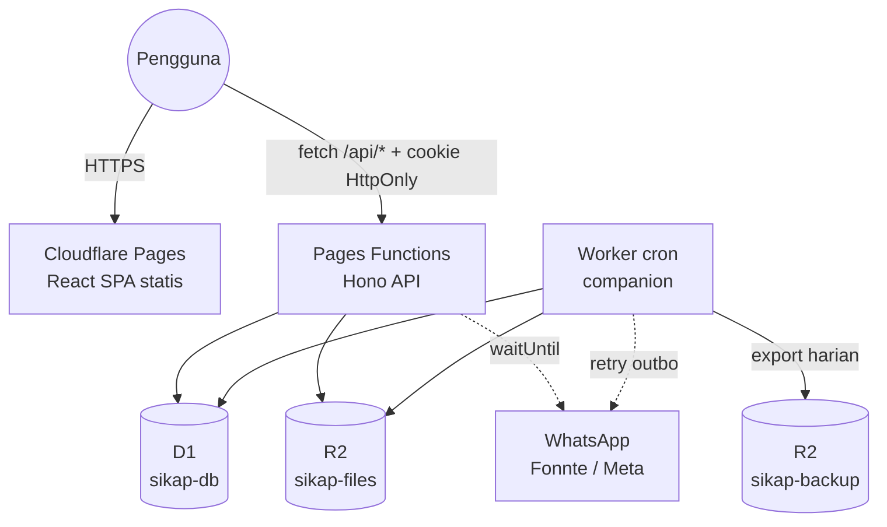

# SIKAP — Implementation Plan: Migrasi & Redesign

> Dari: GAS + Google Sheets + Google Drive (lambat, ada celah kritis)
> Ke: **React 19 + TypeScript (Vite) · Tailwind CSS v4 · shadcn/ui · Cloudflare Pages + Pages Functions · D1 · R2 (Free plan)**
> Konteks dan temuan audit ada di [`PROJECT_CONTEXT.md`](PROJECT_CONTEXT.md). ID temuan (S-xx, F-xx) merujuk ke dokumen tersebut.
> Branch kerja: **`feat/cloudflare-migration`** (dibuat dari `main`). `main` tidak disentuh sampai cutover.

## Keputusan Pemilik Produk (dikonfirmasi 15 Okt 2026)

| # | Topik | Keputusan | Implikasi desain |
|---|---|---|---|
| 1 | Database | **Opsi B**: D1 + R2 | Sheets/Drive hanya sumber migrasi |
| 2 | Plan Cloudflare | **Free**, PBKDF2 **10.000 iterasi** | Ditambah **pepper** (HMAC secret `PASSWORD_PEPPER`) sebelum PBKDF2 agar hash yang bocor tanpa secret tidak bisa di-crack offline. Lockout + rate limit wajib (§3.1). Format hash menyimpan jumlah iterasi sehingga bisa dinaikkan nanti tanpa reset |
| 3 | Dokumen wajib | Matriks wajib per status (PNS/CPNS/PPPK) + **daftar golongan PPPK** | Tabel `jenis_dokumen_wajib`. `ref_pangkat_golongan` memuat PNS I/a–IV/e dan PPPK I–XVII. Admin dapat mengubah matriks via UI |
| 4 | Versi file | File lama **tidak** dihapus saat upload ulang. File lama disimpan **3 hari** untuk rollback, lalu dihapus otomatis. Hapus file lama hanya jika file baru berhasil | Tabel `arsip_dokumen_versi` (`purge_after`). Endpoint rollback. Cron membersihkan versi kedaluwarsa. Hapus dokumen juga *soft delete* 3 hari |
| 5 | Hapus pegawai | Soft delete, retensi **7 hari** | `pegawai.deleted_at` + `purge_after`. Admin bisa memulihkan dalam 7 hari. Cron menghapus permanen (D1 + R2) setelahnya |
| 6 | Data kepegawaian & password | Pegawai **boleh mengajukan** perubahan data kepegawaian; berlaku setelah **diverifikasi admin**. Password default = 6 digit terakhir NIP, **tidak wajib** diganti; ganti lewat Pengaturan Akun | Tabel `pengajuan_perubahan` + antrean admin. Tidak ada halaman "ganti password wajib". Banner rekomendasi (non-blocking) bila masih memakai password default. Reset password admin kembali ke default |

> **Risiko yang diterima (keputusan 2 & 6):** password default dapat ditebak dari NIP dan PBKDF2 10k jauh di bawah rekomendasi OWASP (600k). Mitigasi wajib: lockout 5 gagal / 15 menit per akun, rate limit per IP, pepper, audit login gagal, banner rekomendasi ganti password, dan laporan admin "akun yang masih memakai password default".

---

## 0. Keputusan Arsitektur

### 0.1 Pilihan database & storage

| Opsi | Kecepatan | Keamanan file | Kompleksitas | Free plan | Keputusan |
|---|---|---|---|---|---|
| A. Tetap Sheets + Drive, akses via Google API dari Functions | Masih lambat (±0,3–1 detik per panggilan API, quota per menit, OAuth JWT signing per request) | Bergantung pada izin Drive | Tinggi (service account, token cache) | Ya | ✗ |
| **B. D1 (SQLite) + R2** | Query berindeks <1 ms, latensi edge | File privat, hanya disajikan oleh API terotorisasi | Rendah | Ya | **✓ Utama** |
| C. B + mirror ke Google Sheets (read-only, terjadwal) | Seperti B | Seperti B | Sedang | Ya | Opsional fase 2, untuk TU yang terbiasa dengan spreadsheet |

**Rekomendasi: Opsi B.** Google Sheets/Drive hanya dipakai sebagai sumber migrasi data, lalu diarsipkan read-only.

### 0.2 Batasan Free plan yang memengaruhi desain

| Limit (Free) | Nilai | Dampak dan mitigasi |
|---|---|---|
| Request Functions | 100.000/hari | Aset statis tidak dihitung. ±200 pegawai × ±100 request/hari masih jauh di bawah limit |
| **CPU time** | **10 ms/request** | PBKDF2-SHA256 **10k iterasi** (keputusan #2) + HMAC pepper. **Terukur di edge Cloudflare (16 Okt 2026, colo SIN, Worker sementara)**: 1 hash = **3–4 ms CPU**, 2 hash = **6–7 ms** (sesekali 11–13 ms), 4 hash = 11 ms, 8 hash = 19–36 ms — semua request tetap sukses karena Workers memberi kelonggaran untuk lonjakan sesekali. Login (1 hash) aman; ganti password (2 hash) mendekati batas tapi tetap lolos. Jangan menambah hash ketiga dalam satu request. Hindari parsing JSON besar dan PDF di server |
| Subrequest / query D1 | 50/request | Gunakan `db.batch()`, hindari N+1 |
| D1 | 500 MB/DB, 5 juta baris dibaca/hari, 100.000 baris ditulis/hari, Time Travel 7 hari | Wajib pakai indeks. Log harus di-paginate. Backup tambahan ke R2 |
| R2 | 10 GB, 1 juta Class A, 10 juta Class B per bulan, egress gratis | Estimasi 200 pegawai × 11 dokumen × ±1 MB ≈ 2,2 GB. Kompres gambar di client |
| Request body | 100 MB | Upload 5 MB aman, dikirim sebagai `multipart/form-data` (bukan base64) |
| `waitUntil()` | ±30 detik setelah response | Notifikasi WhatsApp dikirim di sini, tidak memblokir response |
| **Cron** | Pages Functions **tidak** mendukung cron | Buat 1 **Worker companion kecil** (`workers/cron`) dengan binding D1/R2 yang sama: bersihkan sesi, retry outbox WA, backup harian |

> Catatan: Cloudflare kini menyarankan Workers + Static Assets untuk proyek baru. Plan ini tetap memakai Pages sesuai permintaan. Struktur `server/` dibuat agnostik sehingga bisa dipindah ke Workers tanpa rewrite.

### 0.3 Stack final

| Area | Pilihan | Alasan |
|---|---|---|
| Build | Vite 6+, React 19, TypeScript strict | Sesuai permintaan |
| Routing UI | React Router (library/data mode) | Route guard per role, lazy-load per halaman |
| Server state | TanStack Query | Cache, invalidasi setelah mutasi, retry. Menggantikan cache manual 15 detik |
| Form | react-hook-form + zod (`@hookform/resolvers`) | Schema zod **dipakai bersama** frontend dan backend |
| UI | shadcn/ui: Card, Input, Select, Checkbox, Switch, Calendar+Popover (DatePicker), Dialog, AlertDialog, Sheet, Table, Tabs, Badge, Progress, Avatar, Skeleton, Sonner, DropdownMenu, Command (combobox) | Sesuai permintaan |
| Styling | Tailwind CSS v4 (`@tailwindcss/vite`, token di `@theme`) | Menggantikan v3 + CDN |
| Tabel | TanStack Table | Filter, paging, sorting di Master Data |
| Ikon | lucide-react | Bawaan shadcn. Menggantikan Material Symbols CDN |
| Crop foto | `react-easy-crop` | Lebih ringan dari Cropper.js |
| Tanggal | `date-fns` + locale `id`, `Intl` timeZone `Asia/Makassar` | Simpan UTC ISO, tampilkan dalam WITA |
| API | **Hono** di `functions/api/[[route]].ts` (`hono/cloudflare-pages`) | Router, middleware auth, validator zod, tipe end-to-end. Alternatif tanpa dependensi: file routing bawaan Pages + `_middleware.ts` |
| Validasi | zod **≥ 4.5.0** | Versi lama boros memori di Workers |
| DB access | SQL murni + helper tipis (tanpa ORM) atau Drizzle ORM (`drizzle-orm/d1`) | Skema kecil; Drizzle opsional untuk tipe dan migrasi |
| Test | Vitest, `@cloudflare/vitest-pool-workers` (D1/R2 lokal), React Testing Library, Playwright | |

---

## 1. Arsitektur Target



### 1.1 Struktur repo (single package)

```text
SIKAP/
├── src/                      # React app
│   ├── app/                  # router, providers, layout (AppShell, AuthLayout)
│   ├── features/
│   │   ├── auth/             # login, ganti password, guard
│   │   ├── dashboard/        # admin & pegawai
│   │   ├── profil/
│   │   ├── dokumen/          # arsip, upload, preview
│   │   ├── pegawai/          # master data (admin)
│   │   ├── verifikasi/
│   │   ├── log/
│   │   └── pengaturan/
│   ├── components/ui/        # shadcn generated
│   ├── components/           # StatusBadge, FileDropzone, PhotoCropper, EmptyState, PageHeader
│   ├── lib/                  # api client, query keys, format WITA
│   └── styles/globals.css    # @import "tailwindcss"; @theme {...}
├── functions/api/[[route]].ts  # entry: handle(app)
├── server/                   # Hono app (platform-agnostic)
│   ├── app.ts, env.ts
│   ├── middleware/           # session, requireRole, csrf/origin, error handler
│   ├── routes/               # auth, me, documents, admin/*
│   ├── services/             # pegawai, dokumen, verifikasi, notifikasi, audit
│   ├── lib/                  # crypto (pbkdf2, token), r2, file-sniff, time
│   └── db/                   # queries per tabel
├── shared/                   # zod schemas, enums, DTO types (dipakai src & server)
├── migrations/               # 0001_init.sql, 0002_seed_ref.sql, ...
├── workers/cron/             # scheduled(): sessions, outbox, backup
├── scripts/migrate/          # ETL Sheets/Drive → D1/R2
├── legacy-gas/               # kode GAS lama (dipindah, tidak dihapus sampai cutover selesai)
├── wrangler.toml
└── vite.config.ts
```

### 1.2 `wrangler.toml` (Pages)

```toml
name = "sikap"
compatibility_date = "2026-10-01"
compatibility_flags = ["nodejs_compat"]
pages_build_output_dir = "dist"

[[d1_databases]]
binding = "DB"
database_name = "sikap-db"
database_id = "<id>"
migrations_dir = "migrations"

[[r2_buckets]]
binding = "FILES"
bucket_name = "sikap-files"

[vars]
APP_URL = "https://sikap.uptdpenda-kupang.web.id"
SESSION_TTL_HOURS = "12"
# Secrets (wrangler pages secret put): SETTINGS_ENC_KEY, IMPORT_TOKEN
```

Buat environment `preview` terpisah dengan DB dan bucket sendiri (`sikap-db-preview`, `sikap-files-preview`). **Jangan pernah tes ke produksi** (koreksi F-11).

---

## 2. Desain Database (D1)

Prinsip:
- Gunakan ID surrogate. NIP/NIK disimpan sebagai `TEXT` (koreksi F-03).
- Waktu disimpan dalam UTC ISO-8601.
- Enum stabil memakai `CHECK`. Daftar yang bisa diubah admin memakai tabel referensi.
- Satu arsip aktif per (pegawai, jenis) dijamin oleh `UNIQUE` (koreksi F-02).

```sql
-- migrations/0001_init.sql
PRAGMA foreign_keys = ON;

CREATE TABLE ref_pangkat_golongan (
  kode        TEXT PRIMARY KEY,                  -- 'III/a', 'PPPK-IX'
  nama        TEXT NOT NULL,                     -- 'Penata Muda (III/a)'
  jenis_asn   TEXT NOT NULL CHECK (jenis_asn IN ('PNS','PPPK')),
  urutan      INTEGER NOT NULL,
  aktif       INTEGER NOT NULL DEFAULT 1
);

CREATE TABLE ref_unit_organisasi (
  id     INTEGER PRIMARY KEY,
  nama   TEXT NOT NULL UNIQUE,
  aktif  INTEGER NOT NULL DEFAULT 1
);

CREATE TABLE ref_pendidikan (
  kode   TEXT PRIMARY KEY,                       -- 'S1'
  nama   TEXT NOT NULL,                          -- 'S-1 / Sarjana'
  urutan INTEGER NOT NULL
);

CREATE TABLE pegawai (
  id                  INTEGER PRIMARY KEY,
  nip                 TEXT NOT NULL UNIQUE CHECK (length(nip) = 18 AND nip NOT GLOB '*[^0-9]*'),
  nik                 TEXT UNIQUE CHECK (nik IS NULL OR (length(nik) = 16 AND nik NOT GLOB '*[^0-9]*')),
  nama                TEXT NOT NULL,
  role                TEXT NOT NULL DEFAULT 'Pegawai' CHECK (role IN ('Admin','Pegawai')),
  status_akun         TEXT NOT NULL DEFAULT 'Aktif'   CHECK (status_akun IN ('Aktif','Nonaktif')),
  status_kepegawaian  TEXT CHECK (status_kepegawaian IN ('PNS','CPNS','PPPK')),
  pangkat_kode        TEXT REFERENCES ref_pangkat_golongan(kode),
  tmt_pangkat         TEXT,                      -- 'YYYY-MM-DD'
  jabatan             TEXT,
  jenis_jabatan       TEXT CHECK (jenis_jabatan IN ('Fungsional','Pelaksana','Struktural')),
  tmt_jabatan         TEXT,
  unit_id             INTEGER REFERENCES ref_unit_organisasi(id),
  tempat_lahir        TEXT,
  tanggal_lahir       TEXT,
  jenis_kelamin       TEXT CHECK (jenis_kelamin IN ('Laki-laki','Perempuan')),
  agama               TEXT CHECK (agama IN ('Kristen Protestan','Kristen Katholik','Islam','Hindu','Buddha','Konghucu')),
  pendidikan_kode     TEXT REFERENCES ref_pendidikan(kode),
  status_pernikahan   TEXT CHECK (status_pernikahan IN ('Belum Menikah','Menikah','Cerai')),
  golongan_darah      TEXT CHECK (golongan_darah IN ('A','B','AB','O','Tidak Tahu')),
  no_hp               TEXT,                      -- normalisasi E.164 tanpa '+': '6281234...'
  email               TEXT,
  alamat              TEXT,
  foto_r2_key         TEXT,
  created_at          TEXT NOT NULL DEFAULT (strftime('%Y-%m-%dT%H:%M:%fZ','now')),
  updated_at          TEXT NOT NULL DEFAULT (strftime('%Y-%m-%dT%H:%M:%fZ','now')),
  deleted_at          TEXT,                      -- soft delete (keputusan #5)
  deleted_by          INTEGER,
  purge_after         TEXT                       -- deleted_at + 7 hari; cron menghapus permanen
);
CREATE INDEX idx_pegawai_status ON pegawai(status_kepegawaian, status_akun) WHERE deleted_at IS NULL;
CREATE INDEX idx_pegawai_nama   ON pegawai(nama COLLATE NOCASE);

CREATE TABLE akun (
  pegawai_id            INTEGER PRIMARY KEY REFERENCES pegawai(id) ON DELETE CASCADE,
  password_hash         TEXT NOT NULL,           -- 'pbkdf2-sha256$<iter>$<salt_b64>$<hash_b64>' (input = HMAC(pepper, password))
  is_default_password   INTEGER NOT NULL DEFAULT 1, -- hanya untuk banner rekomendasi, TIDAK memblokir akses
  failed_attempts       INTEGER NOT NULL DEFAULT 0,
  locked_until          TEXT,
  password_changed_at   TEXT,
  last_login_at         TEXT
);

CREATE TABLE sesi (
  token_hash   TEXT PRIMARY KEY,                 -- SHA-256(token); token asli hanya di cookie
  pegawai_id   INTEGER NOT NULL REFERENCES pegawai(id) ON DELETE CASCADE,
  created_at   TEXT NOT NULL,
  expires_at   TEXT NOT NULL,
  last_seen_at TEXT NOT NULL,
  ip           TEXT,
  user_agent   TEXT
);
CREATE INDEX idx_sesi_pegawai ON sesi(pegawai_id);
CREATE INDEX idx_sesi_expires ON sesi(expires_at);

CREATE TABLE jenis_dokumen (
  id             TEXT PRIMARY KEY,               -- 'DOC-KTP'
  nama           TEXT NOT NULL,
  kategori       TEXT NOT NULL,                  -- 'Dokumen Pribadi' | 'Dokumen Kepegawaian' | 'Dokumen Pendidikan'
  urutan         INTEGER NOT NULL DEFAULT 0,
  aktif          INTEGER NOT NULL DEFAULT 1,
  max_size_bytes INTEGER NOT NULL DEFAULT 5242880
);

-- Dokumen wajib per status kepegawaian (koreksi F-13)
CREATE TABLE jenis_dokumen_wajib (
  jenis_dokumen_id   TEXT NOT NULL REFERENCES jenis_dokumen(id) ON DELETE CASCADE,
  status_kepegawaian TEXT NOT NULL CHECK (status_kepegawaian IN ('PNS','CPNS','PPPK')),
  PRIMARY KEY (jenis_dokumen_id, status_kepegawaian)
);

CREATE TABLE arsip_dokumen (
  id                INTEGER PRIMARY KEY,
  pegawai_id        INTEGER NOT NULL REFERENCES pegawai(id) ON DELETE CASCADE,
  jenis_dokumen_id  TEXT NOT NULL REFERENCES jenis_dokumen(id),
  status            TEXT NOT NULL CHECK (status IN ('Menunggu','Terverifikasi','Ditolak')),
  r2_key            TEXT NOT NULL,
  file_name         TEXT NOT NULL,               -- [NIP]_[Nama]_[ID].[ext]
  mime_type         TEXT NOT NULL,
  size_bytes        INTEGER NOT NULL,
  sha256            TEXT NOT NULL,
  versi             INTEGER NOT NULL DEFAULT 1,
  catatan_admin     TEXT,
  uploaded_at       TEXT NOT NULL,
  uploaded_by       INTEGER REFERENCES pegawai(id),
  verified_at       TEXT,
  verified_by       INTEGER REFERENCES pegawai(id),
  deleted_at        TEXT,                        -- soft delete 3 hari (keputusan #4)
  purge_after       TEXT,
  UNIQUE (pegawai_id, jenis_dokumen_id)
);
CREATE INDEX idx_arsip_status ON arsip_dokumen(status, uploaded_at);

-- Versi file sebelumnya, disimpan 3 hari untuk rollback (keputusan #4).
-- Dibuat HANYA setelah file baru sukses tersimpan di R2 dan baris arsip ter-update.
CREATE TABLE arsip_dokumen_versi (
  id             INTEGER PRIMARY KEY,
  arsip_id       INTEGER NOT NULL REFERENCES arsip_dokumen(id) ON DELETE CASCADE,
  versi          INTEGER NOT NULL,
  r2_key         TEXT NOT NULL,
  file_name      TEXT NOT NULL,
  mime_type      TEXT NOT NULL,
  size_bytes     INTEGER NOT NULL,
  sha256         TEXT NOT NULL,
  status         TEXT NOT NULL,                  -- status saat digantikan (dipulihkan saat rollback)
  catatan_admin  TEXT,
  uploaded_at    TEXT NOT NULL,
  verified_at    TEXT,
  verified_by    INTEGER,
  replaced_at    TEXT NOT NULL,
  reason         TEXT NOT NULL CHECK (reason IN ('REUPLOAD','DELETE')),
  purge_after    TEXT NOT NULL,                  -- replaced_at + 3 hari
  UNIQUE (arsip_id, versi)
);
CREATE INDEX idx_versi_purge ON arsip_dokumen_versi(purge_after);

-- Pengajuan perubahan data kepegawaian oleh pegawai (keputusan #6)
CREATE TABLE pengajuan_perubahan (
  id           INTEGER PRIMARY KEY,
  pegawai_id   INTEGER NOT NULL REFERENCES pegawai(id) ON DELETE CASCADE,
  perubahan    TEXT NOT NULL,                    -- JSON: { field: { lama, baru } }
  alasan       TEXT,                             -- keterangan dari pegawai
  status       TEXT NOT NULL DEFAULT 'Menunggu' CHECK (status IN ('Menunggu','Disetujui','Ditolak','Dibatalkan')),
  catatan_admin TEXT,
  created_at   TEXT NOT NULL,
  reviewed_at  TEXT,
  reviewed_by  INTEGER REFERENCES pegawai(id)
);
-- Maksimal satu pengajuan aktif per pegawai
CREATE UNIQUE INDEX uq_pengajuan_aktif ON pengajuan_perubahan(pegawai_id) WHERE status = 'Menunggu';
CREATE INDEX idx_pengajuan_status ON pengajuan_perubahan(status, created_at);

-- Riwayat verifikasi/versi (audit trail per dokumen)
CREATE TABLE arsip_dokumen_riwayat (
  id          INTEGER PRIMARY KEY,
  arsip_id    INTEGER NOT NULL,
  versi       INTEGER NOT NULL,
  aksi        TEXT NOT NULL CHECK (aksi IN ('UPLOAD','REUPLOAD','APPROVE','REJECT','DELETE','RESTORE','ROLLBACK')),
  status      TEXT,
  catatan     TEXT,
  actor_id    INTEGER,
  created_at  TEXT NOT NULL
);
CREATE INDEX idx_riwayat_arsip ON arsip_dokumen_riwayat(arsip_id);

CREATE TABLE log_aktivitas (
  id           INTEGER PRIMARY KEY,
  ts           TEXT NOT NULL,
  actor_id     INTEGER,
  actor_nip    TEXT,                             -- disimpan juga agar log tetap terbaca setelah pegawai dihapus
  actor_nama   TEXT,
  actor_role   TEXT,
  action       TEXT NOT NULL,
  target_type  TEXT,
  target_id    TEXT,
  description  TEXT,
  result       TEXT NOT NULL CHECK (result IN ('SUCCESS','FAILURE','WARNING','PARTIAL')),
  ip           TEXT
);
CREATE INDEX idx_log_ts     ON log_aktivitas(ts DESC);
CREATE INDEX idx_log_action ON log_aktivitas(action, ts DESC);

CREATE TABLE pengaturan (
  key         TEXT PRIMARY KEY,                  -- 'wa.provider', 'notif.dokumen_baru', ...
  value       TEXT NOT NULL,                     -- secret dienkripsi AES-GCM (SETTINGS_ENC_KEY)
  is_secret   INTEGER NOT NULL DEFAULT 0,
  updated_at  TEXT NOT NULL,
  updated_by  INTEGER
);

CREATE TABLE notifikasi_outbox (
  id          INTEGER PRIMARY KEY,
  channel     TEXT NOT NULL DEFAULT 'whatsapp',
  target      TEXT NOT NULL,
  template    TEXT NOT NULL,                     -- dokumen_baru_admin | dokumen_terverifikasi | dokumen_ditolak | test
  params      TEXT NOT NULL,                     -- JSON
  status      TEXT NOT NULL DEFAULT 'PENDING' CHECK (status IN ('PENDING','SENT','FAILED')),
  attempts    INTEGER NOT NULL DEFAULT 0,
  last_error  TEXT,
  created_at  TEXT NOT NULL,
  sent_at     TEXT
);
CREATE INDEX idx_outbox_pending ON notifikasi_outbox(status, created_at) WHERE status = 'PENDING';
```

**Status `Belum_Unggah`** tidak disimpan. Status ini adalah *tidak ada baris* di `arsip_dokumen` (hasil LEFT JOIN `jenis_dokumen`).

**Kelengkapan** (satu definisi, koreksi F-12):
```sql
-- % dokumen wajib terverifikasi untuk 1 pegawai
SELECT COUNT(w.jenis_dokumen_id) AS wajib_total,
       SUM(a.status = 'Terverifikasi') AS wajib_verified
FROM jenis_dokumen_wajib w
JOIN jenis_dokumen j ON j.id = w.jenis_dokumen_id AND j.aktif = 1
LEFT JOIN arsip_dokumen a ON a.jenis_dokumen_id = w.jenis_dokumen_id AND a.pegawai_id = ?1
WHERE w.status_kepegawaian = ?2;
```
UI menampilkan dua angka: **tersedia** (sudah diunggah) dan **terverifikasi**. Persentase resmi memakai *terverifikasi*.

**Layout R2**:
- Dokumen: `dokumen/{pegawai_id}/{jenis_dokumen_id}/v{versi}-{uuid}.{ext}`
- Foto: `foto/{pegawai_id}/{uuid}.webp`
- Metadata `customMetadata`: `{ nip, jenisDokumen, uploadedBy }`.
- Bucket **tidak publik**. Tidak memakai `r2.dev` maupun custom domain publik.

---

## 3. Desain API (REST)

Konvensi:
- JSON `camelCase`.
- Error memakai HTTP status + `{ error: { code, message, fields? } }`.
- `401 SESSION_EXPIRED` menggantikan pencocokan string `'Sesi'` di frontend.
- Paginasi `?page=&pageSize=` (Master Data) atau `?cursor=` (Log).

| Method & path | Role | Pengganti action GAS |
|---|---|---|
| `POST /api/auth/login` | publik | `login` |
| `POST /api/auth/logout` | login | `logout` |
| `GET /api/auth/me` | login | `checkSession`, `getUserProfile` |
| `POST /api/auth/change-password` | login | `changePassword` (`forceChangePassword` dihapus — keputusan #6) |
| `GET /api/auth/sessions` · `DELETE /api/auth/sessions/:id` · `POST /api/auth/sessions/revoke-others` | login | **baru**: kelola sesi aktif |
| `GET /api/me/profile` · `PATCH /api/me/profile` | login | `getMyProfile`, `updateMyProfile` (**hanya field pribadi & kontak**) |
| `GET /api/me/pengajuan` · `POST /api/me/pengajuan` · `DELETE /api/me/pengajuan/:id` | login | **baru** (keputusan #6): ajukan / lihat / batalkan perubahan data kepegawaian |
| `GET /api/admin/pengajuan?status` · `POST /api/admin/pengajuan/:id/approve` · `POST .../reject` | Admin | **baru**: verifikasi pengajuan; approve menerapkan perubahan ke `pegawai` secara atomik + audit |
| `POST /api/documents/:id/rollback` | pemilik (jika arsip belum `Terverifikasi`) / Admin | **baru** (keputusan #4): pulihkan versi sebelumnya dalam 3 hari |
| `POST /api/documents/:id/restore` | pemilik / Admin | **baru**: batalkan hapus dokumen dalam 3 hari |
| `POST /api/admin/pegawai/:id/restore` | Admin | **baru** (keputusan #5): pulihkan pegawai terhapus dalam 7 hari |
| `PUT /api/me/photo` (multipart) | login | `uploadFotoProfil` |
| `GET /api/me/dashboard` | Pegawai | `getMyDashboard` |
| `GET /api/me/documents` | login | `getArsipDokumenPegawai` |
| `POST /api/me/documents/:jenisId` (multipart) | login | `uploadDokumen` |
| `DELETE /api/documents/:id` | pemilik (jika bukan `Terverifikasi`) / Admin | `hapusDokumen` |
| `GET /api/documents/:id` | pemilik / Admin | `getDokumenPreview` (metadata + riwayat) |
| `GET /api/documents/:id/file[?download=1]` | pemilik / Admin | stream dari R2, `Content-Disposition`, `Cache-Control: private, no-store` |
| `GET /api/pegawai/:id/photo` | login | stream foto (ETag) |
| `GET /api/ref` | login | daftar referensi (pangkat, unit, pendidikan, jenis dokumen) |
| `GET /api/admin/dashboard` | Admin | `adminGetDashboardStats` |
| `GET /api/admin/pegawai?q&statusKepegawaian&statusAkun&kelengkapan&belumUnggah=DOC-NPWP&page&pageSize&sort` | Admin | `adminGetAllPegawai` (+ filter "belum upload X" dari PRD) |
| `POST /api/admin/pegawai` | Admin | `adminTambahPegawai` |
| `GET` · `PATCH` · `DELETE /api/admin/pegawai/:id` | Admin | `adminGetPegawaiDetail`, `adminUpdatePegawai`, `adminDeletePegawai` |
| `POST /api/admin/pegawai/:id/status` | Admin | `adminSetStatusAkun` (juga mencabut semua sesi) |
| `POST /api/admin/pegawai/:id/reset-password` | Admin | `adminResetPassword` (kembali ke password default 6 digit terakhir NIP, cabut semua sesi) |
| `PUT /api/admin/pegawai/:id/photo` | Admin | `adminUploadFotoPegawai` |
| `GET /api/admin/pegawai/:id/documents` | Admin | `getArsipDokumenPegawai(targetNip)` |
| `GET /api/admin/verifikasi?cursor` | Admin | `adminGetVerificationQueue` |
| `POST /api/admin/verifikasi/:arsipId/approve` | Admin | `adminApproveDokumen` (hanya dari `Menunggu`, optimistic check `versi`) |
| `POST /api/admin/verifikasi/:arsipId/reject` `{alasan}` | Admin | `adminRejectDokumen` (5–500 karakter) |
| `GET /api/admin/log?cursor&q&category&result&from&to` | Admin | `adminGetLogAktivitas` |
| `GET` · `PUT /api/admin/settings/notifications` | Admin | `adminGet/SaveNotifSettings` |
| `GET` · `PUT /api/admin/settings/whatsapp` · `POST .../test` | Admin | `adminGet/SetWaProvider`, `adminSaveFonnteToken`, `adminSaveMetaConfig`, `adminTest*` |
| `CRUD /api/admin/jenis-dokumen` | Admin | **baru** (STEP 05: admin menambah jenis dokumen) |
| `CRUD /api/admin/ref/:table` | Admin | **baru** (pangkat, unit) |
| `POST /api/admin/backup` · `GET /api/admin/backup` | Admin | `adminBackupDatabase`, `adminBackupFull` |
| `POST /api/internal/import/*` | `IMPORT_TOKEN` | hanya selama migrasi, dihapus setelah cutover |

### 3.1 Aturan keamanan di server (wajib)

1. **Password**:
   - Disimpan sebagai PBKDF2-SHA256 **10.000 iterasi**, salt 16 byte, input `HMAC-SHA256(PASSWORD_PEPPER, password)`, via WebCrypto. Perbandingan *constant-time*.
   - Password default = 6 digit terakhir NIP (keputusan #6); `is_default_password=1` hanya memicu banner rekomendasi.
   - Kebijakan password baru (dipilih pengguna): minimal 8 karakter, huruf besar + kecil + angka, tidak sama dengan 6 digit terakhir NIP.
2. **Login**:
   - Pesan error generik.
   - `failed_attempts` ≥ 5 mengunci akun 15 menit.
   - Tambahkan 1 aturan **WAF Rate Limiting** (gratis) di `/api/auth/login`.
   - Login gagal ikut dicatat di log (koreksi S-13).
3. **Sesi**:
   - Token 32 byte acak, disimpan di cookie `__Host-sikap_sid` (HttpOnly, Secure, SameSite=Strict, Path=/). D1 hanya menyimpan `SHA-256(token)`.
   - Sliding expiry 12 jam; `last_seen_at` diperbarui maksimal setiap 5 menit agar hemat write.
   - Ganti password, reset, atau nonaktif mencabut sesi lain (koreksi S-08).
4. **CSRF**: SameSite=Strict, ditambah cek header `Origin` sama dengan `APP_URL` untuk method non-GET.
5. **Otorisasi berbasis kepemilikan**:
   - Setiap akses `documents/:id` memeriksa `pegawai_id = session.pegawaiId OR role = 'Admin'`.
   - `PATCH /api/me/profile` memakai **zod schema whitelist** yang hanya berisi field pribadi & kontak. Field kepegawaian ditolak langsung (koreksi S-05) dan **hanya** bisa diubah lewat `POST /api/me/pengajuan` yang berlaku setelah approve admin (keputusan #6).
6. **Upload** (keputusan #4):
   - Validasi ukuran ≤ 5 MB dan **magic bytes** (`%PDF`, `FFD8FF`, `89504E47`, `RIFF....WEBP`); jangan percaya MIME dari client.
   - Hitung SHA-256 dan simpan.
   - Urutan: (1) `put` file baru ke R2 dengan key unik; (2) jika gagal, berhenti — data lama utuh; (3) `db.batch()`: salin baris arsip lama ke `arsip_dokumen_versi` (`purge_after = now + 3 hari`) + update arsip ke versi baru + riwayat + audit; (4) jika batch gagal, hapus objek baru dari R2 (kompensasi). **File lama tidak pernah dihapus di jalur request.**
   - Cron harian menghapus objek R2 + baris `arsip_dokumen_versi` yang `purge_after < now`, juga arsip yang di-soft-delete > 3 hari.
7. **Header**:
   - `_headers` Pages: CSP ketat (`default-src 'self'; frame-src 'self'; img-src 'self' data: blob:`), `X-Content-Type-Options`, `Referrer-Policy`, `Permissions-Policy`.
   - Tanpa CDN pihak ketiga.
8. **Error**: tidak mengekspos `e.message` ke client (koreksi S-10). Log internal memakai `console.error` + Workers Logs.
9. **Secret WA**:
   - Disimpan terenkripsi AES-GCM dengan `SETTINGS_ENC_KEY`, ditampilkan sebagai hint `••••1234`.
   - Notifikasi masuk ke `notifikasi_outbox` dan dikirim via `waitUntil`; yang gagal di-retry oleh cron.
10. **Audit**: setiap mutasi menulis `log_aktivitas` dalam `db.batch()` yang sama dengan mutasinya.

---

## 4. Redesign UI/UX

### 4.1 Prinsip
- Mempertahankan nilai STEP 06: formal-modern, responsive first, warna status konsisten, feedback instan.
- **Status semantik** (satu komponen `<StatusBadge>`):

| Status | Warna | Ikon |
|---|---|---|
| Belum diunggah | merah (`red-50/700`) | `CircleDashed` |
| Menunggu | kuning/amber | `Clock` |
| Terverifikasi | hijau | `CheckCircle2` |
| Ditolak | oranye | `AlertTriangle` |

- Token tema Tailwind v4 (`@theme`) diturunkan dari palet yang ada: `--color-primary: #00236f`, `--color-primary-container: #1e3a8a`, `--color-surface: #f8f9ff`, `--color-destructive: #ba1a1a`, font Inter (self-hosted via `@fontsource-variable/inter`), radius `0.5rem`. Variabel shadcn (`--background`, `--primary`, …) dipetakan ke token ini.
- Target aksesibilitas WCAG 2.2 AA: kontras, fokus terlihat, label form, `aria-live` untuk toast, navigasi keyboard di semua dialog.
- Skeleton loading menggantikan overlay layar penuh. Overlay hanya dipakai saat upload, dengan progress bar `XMLHttpRequest.upload.onprogress`.

### 4.2 Informasi Arsitektur (route)

| Route | Role | Catatan redesign |
|---|---|---|
| `/login` | publik | Split-screen (foto kantor terkompresi WebP), NIP + password, toggle show password. Teks pola password default dihapus |
| *(tidak ada halaman ganti password wajib)* | – | Keputusan #6. Diganti banner non-blocking "Anda masih memakai password default — ganti di Pengaturan Akun" |
| `/` | Pegawai | Kartu "Yang perlu Anda lakukan" (prioritas: Ditolak, lalu Belum unggah wajib, lalu Menunggu), Progress dokumen wajib, Progress profil + link field kosong |
| `/` | Admin | KPI cards (Pegawai aktif per status, Antrean verifikasi, % Kelengkapan instansi), daftar "Perlu perhatian", aktivitas terbaru |
| `/profil` | semua | Tabs **Identitas · Kepegawaian · Kontak**. Tab Kepegawaian read-only untuk Pegawai dengan tombol **"Ajukan Perubahan"** (Dialog form, alasan, status pengajuan + catatan admin). DatePicker shadcn. Dirty-state + konfirmasi saat meninggalkan halaman. Foto: Dialog crop 1:1, output WebP 512 px |
| `/dokumen` | semua | Tabs Wajib/Opsional. Card per jenis dokumen (mobile) atau Table (desktop). Aksi kontekstual: Unggah / Lihat / Ganti / Hapus. Dialog upload dengan dropzone (drag & drop asli) + progress. Sheet preview (PDF via `<iframe src="/api/documents/:id/file">`, gambar via ``), riwayat versi & verifikasi. **Versi sebelumnya** tampil dengan hitung mundur "tersedia s.d. …" + tombol **Pulihkan**; dokumen terhapus bisa dibatalkan dalam 3 hari |
| `/admin/pengajuan` | Admin | **Baru** (keputusan #6): antrean pengajuan perubahan data kepegawaian; tampilan diff lama → baru, Setujui / Tolak dengan catatan. Badge jumlah di sidebar |
| `/admin/pegawai` | Admin | TanStack Table: search, filter Select (status, akun, kelengkapan, **"belum unggah dokumen X"**, **"masih password default"**), sorting, paging. Sheet Tambah/Edit dengan form bertab. AlertDialog untuk nonaktif/hapus/reset. Tab **"Terhapus"** berisi pegawai soft-delete dengan sisa hari + tombol Pulihkan (keputusan #5) |
| `/admin/pegawai/:id` | Admin | Halaman detail: profil + dokumen pegawai (admin dapat preview/unduh) |
| `/admin/verifikasi` | Admin | Split-view 60/40 (preview kiri, data + aksi kanan). Pintasan keyboard `A` setujui, `R` tolak, `J/K` navigasi. Otomatis lanjut ke item berikutnya. Filter per jenis dokumen |
| `/admin/log` | Admin | **Ditambahkan ke sidebar.** Filter kategori/hasil/tanggal (DateRangePicker), cursor pagination |
| `/admin/jenis-dokumen` | Admin | **Baru**: CRUD jenis dokumen + matriks Checkbox "wajib untuk PNS/CPNS/PPPK" |
| `/admin/pengaturan` | Admin | Tabs: Notifikasi (Switch per jenis), WhatsApp (Select provider, Input token, tombol tes), Referensi (pangkat/unit), Backup |
| `/akun` | semua | Ganti password, daftar sesi aktif + "keluar dari semua perangkat" |

**Navigasi**: sidebar collapsible (desktop), Sheet drawer (mobile), dan bottom-nav 4 item untuk Pegawai di mobile.

Mockup `UIUX Stitch/*.html` dipakai sebagai referensi layout. Implementasi baru menggunakan komponen shadcn, bukan menyalin HTML.

---

## 5. Strategi Migrasi Data

### 5.1 Transformasi
| Sumber (Sheets) | Target (D1) | Aturan |
|---|---|---|
| `Data_Pegawai` | `pegawai` + `akun` | Buang prefix `'`. NIP/NIK hanya digit (baris tidak valid masuk laporan). `P3K` menjadi `PPPK`. Pangkat legacy (`Penata / III.c`) dipetakan ke `III/c`. Unit dan pendidikan dipetakan ke referensi. HP dinormalisasi ke `62…`. String kosong atau `-` menjadi `NULL`. `Ganti_Password` menjadi `Aktif` |
| `Password_Hash` (SHA-256 hex) | `akun.password_hash` | **Hash wrapping**: simpan `pbkdf2(hmac(pepper, sha256hex))` dengan prefix `legacy-wrap$…`. Saat login berhasil, verifikasi lalu re-hash ke format standar. Hash SHA-256 polos tidak pernah tersimpan di D1. Akun yang hash-nya sama dengan hash 6 digit terakhir NIP mendapat `is_default_password=1` |
| `Master_Dokumen` | `jenis_dokumen` + `jenis_dokumen_wajib` | `Ya` diterapkan ke status yang relevan. **Keputusan TU**: SK CPNS/SPMT/SK PNS tidak wajib untuk PPPK; SK PNS tidak wajib untuk CPNS |
| `Arsip_Dokumen` | `arsip_dokumen` + objek R2 | Hanya baris dengan file Drive valid. `Belum_Unggah` tidak dimigrasikan. Baris duplikat (pegawai, jenis): ambil `Waktu_Upload` terbaru |
| `Foto_Drive_ID` | R2 `foto/…` | Konversi ke WebP di skrip Node (sharp) |
| `Log_Aktivitas` | `log_aktivitas` | Apa adanya + `actor_nama` hasil join |
| `Sesi_Login` | – | Tidak dimigrasikan (semua pengguna login ulang) |
| Script Properties | `pengaturan` | Token WA dimasukkan ulang oleh admin melalui UI baru (tidak disalin) |

### 5.2 Mekanisme
1. **GAS `exportForMigration_()`** (fungsi privat, dijalankan manual dari editor): tulis JSON keempat sheet ke satu file di Drive.
2. **`scripts/migrate/transform.ts`** (Node): validasi dan transformasi JSON, lalu hasilkan `seed.sql` + `report.md` (baris ditolak, mapping yang dipakai). Dijalankan berulang sampai laporan bersih.
3. **File**: GAS `pushFilesToR2_()` iteratif dengan checkpoint di Script Properties (aman dari batas 6 menit). Setiap file di-POST ke `POST /api/internal/import/file` (header `Authorization: Bearer IMPORT_TOKEN`, cek SHA-256). Alternatif: skrip Node dengan Drive API + `wrangler r2 object put`.
4. `wrangler d1 execute sikap-db --remote --file seed.sql` (di-batch per ≤ 1000 baris).
5. **Rekonsiliasi**: hitung jumlah pegawai, arsip per status, total byte, dan checksum. Harus sama dengan laporan export.

---

## 6. Fase Implementasi

Estimasi untuk 1 developer full-time. Setiap fase diakhiri review kode dan test hijau.

### Fase 0 — Hotfix Keamanan GAS (segera, 1–2 hari) ⚠️
Sistem lama tetap berjalan beberapa minggu, sehingga celah kritis harus ditutup sekarang:
- [ ] **S-01**:
  - Ubah `doGet` agar hanya mengembalikan halaman "Silakan akses https://sikap.uptdpenda-kupang.web.id" (tanpa HTML aplikasi, sehingga `google.script.run` tidak tersedia).
  - Ganti nama semua helper internal dengan sufiks `_` (`getAllData_`, `appendRow_`, `updateCell_`, `seedData_`, …).
  - Hapus `Tests_Integration.gs` dan fungsi `test_*` dari deploy (`.claspignore`).
- [ ] **S-02**: hapus `setSharing(ANYONE_WITH_LINK)`. Cabut sharing publik folder `SIKAP_Dokumen_Kepegawaian` secara manual. Preview diganti endpoint GAS yang mengembalikan base64 untuk pemilik/admin, atau terima keterbatasan preview sementara.
- [ ] **S-03**: (keputusan #6: password default tetap, tidak dipaksa ganti) tambah lockout sederhana (CacheService: 5 gagal / 15 menit per NIP).
- [ ] **S-05**: whitelist field di `updateMyProfile` (tolak field kepegawaian).
- [ ] **S-07**: jadikan repo GitHub **private**, hapus PII contoh dari placeholder. Pertimbangkan rotasi deployment ID setelahnya.
- [ ] **F-01**: perbaiki rekursi backup (2 level), lalu jalankan backup penuh sekarang sebagai titik aman.
- [ ] Buat salinan manual spreadsheet sebelum hotfix.

### Fase 1 — Fondasi (3–4 hari)
- [x] Pindahkan kode lama ke `legacy-gas/`. Init Vite React 19 TS, Tailwind v4, `shadcn init`, ESLint, path alias `@/`.
- [x] Hono di `functions/api/[[route]].ts`, middleware error handler, `GET /api/health`.
- [x] `migrations/0001_init.sql`, `0002_seed_reference.sql` (referensi + jenis dokumen + matriks wajib).
- [x] Buat D1 `sikap-db` + `sikap-db-preview` (lokasi APAC), R2 `sikap-files`, `sikap-files-preview`, `sikap-backup` (privat, akses publik r2.dev nonaktif) — 16 Okt 2026. Migrasi sudah diterapkan ke `sikap-db-preview`; `sikap-db` (produksi) masih kosong sampai cutover.
- [x] `shared/` berisi enum dan schema zod.
- [x] Verifikasi CPU login (PBKDF2 10k + pepper) di edge: 3–4 ms/hash (lihat §0.2).
- [x] R2 diaktifkan pemilik akun (16 Okt 2026).
- [x] Project Pages **baru** `sikap-v2` dibuat; preview `https://feat-cloudflare-migration.sikap-v2.pages.dev` (D1/R2 preview + secret per environment). CPU nyata di edge: login 4 ms (13 ms saat cold start), ganti password 7–12 ms, dashboard 2–3 ms. Catatan asal: buat project Pages **baru** untuk preview (mis. `sikap-v2`) — project `sikap` yang ada melayani produksi GAS di `sikap.uptdpenda-kupang.web.id` dan tidak boleh disentuh sampai cutover. D1 Free: 6 dari 10 database terpakai; SIKAP butuh 2 (`sikap-db`, `sikap-db-preview`).
- [x] CI GitHub Actions: `typecheck`, `lint`, `vitest`, `vite build`.
- [ ] Deploy preview saat ini manual (`npm run deploy:preview`, Direct Upload). Opsional: hubungkan Git integration di `sikap-v2` untuk preview otomatis per branch/PR. Hapus workflow `gas-deploy.yml` setelah cutover.

### Fase 2 — Auth & Shell (3–4 hari)
- [x] API `auth/*`, middleware sesi, `requireRole`, cek Origin, lockout, audit login.
- [x] UI: Login, AppShell (sidebar/drawer/bottom-nav), guard route per role, banner password default, halaman Akun (ganti password, sesi aktif).
- [x] Test: login sukses/gagal/terkunci/nonaktif, sesi kedaluwarsa (401 → redirect), pencabutan sesi.

### Fase 3 — Profil & Dashboard Pegawai (3–4 hari)
- [x] `GET/PATCH /me/profile` (whitelist), `PUT /me/photo` (sniff, resize di client), `GET /ref`, `GET /me/dashboard`.
- [x] UI Profil bertab + DatePicker + crop foto + dirty guard. Dashboard pegawai.
- [x] Pengajuan perubahan data kepegawaian: `POST/GET/DELETE /me/pengajuan` + Dialog di tab Kepegawaian; antrean admin `/admin/pengajuan` (approve menerapkan perubahan atomik).

### Fase 4 — Dokumen & R2 (4–5 hari)
- [ ] Upload multipart (magic bytes, SHA-256, nama otomatis, versi, urutan tulis yang aman), `GET` metadata/stream, delete (soft, 3 hari), riwayat.
- [ ] Versi sebelumnya 3 hari: `arsip_dokumen_versi`, `rollback`, `restore`; cron purge harian.
- [ ] Prasyarat upload: profil lengkap, akun aktif, tidak `Menunggu`. Response `422 PROFILE_INCOMPLETE {fields}`.
- [ ] UI Arsip: tabs, dropzone + progress, Sheet preview, dialog alasan penolakan, upload ulang.

### Fase 5 — Verifikasi & Notifikasi (3–4 hari)
- [ ] Antrean (`status='Menunggu' ORDER BY uploaded_at`), approve/reject atomik (`UPDATE … WHERE status='Menunggu' AND versi=?`).
- [ ] Outbox + sender Fonnte/Meta (template `dokumen_baru_admin`, `dokumen_terverifikasi`, `dokumen_ditolak`), `waitUntil`, toggle notifikasi.
- [ ] UI split-view + pintasan keyboard.
- [ ] `workers/cron`: retry outbox (setiap 10 menit), hapus sesi kedaluwarsa (harian).

### Fase 6 — Admin Master Data (4–5 hari)
- [ ] CRUD pegawai (akun dibuat dengan password default 6 digit terakhir NIP, `is_default_password=1`), status (cabut sesi), reset password ke default, soft delete 7 hari + restore + purge cron (D1 + R2), foto, dokumen pegawai.
- [ ] Query list dengan agregat kelengkapan dalam satu SQL (CTE), filter "belum unggah X", paging dan sorting server-side.
- [ ] UI tabel + Sheet form + AlertDialog + halaman detail.

### Fase 7 — Log, Pengaturan, Referensi, Backup (3 hari)
- [ ] Log cursor + filter. Halaman pengaturan (WA terenkripsi, notifikasi, referensi, jenis dokumen + matriks wajib).
- [ ] Backup: cron harian mengekspor seluruh tabel ke `sikap-backup/db/YYYY-MM-DD.json.gz` (retensi 30 hari via lifecycle rule). Tombol "Backup sekarang" + daftar/unduh backup. Dokumen di R2 tidak diduplikasi; cukup inventaris (key + sha256). Tambahkan D1 Time Travel 7 hari.

### Fase 8 — Migrasi Data (2–3 hari + dry-run)
- [ ] Export, transform, laporan, import ke **preview**, lalu UAT dengan data nyata.
- [ ] Dry-run kedua untuk mengukur durasi cutover.

### Fase 9 — QA, Keamanan, Performa (3–4 hari)
- [ ] Playwright E2E untuk 5 journey (§7). Uji parity terhadap checklist §7.2.
- [ ] Review keamanan independen (code-reviewer): IDOR, upload, sesi, CSRF, header.
- [ ] Lighthouse ≥ 90 (Performance/Accessibility). Bundle per route < 200 KB gzip. API p95 < 300 ms.

### Fase 10 — Cutover (½ hari + 30 hari pemantauan)
1. Umumkan jadwal. Aktifkan **mode read-only** di GAS (flag yang menolak semua mutasi).
2. Export final, transform, import ke produksi, rekonsiliasi.
3. Pasang custom domain `sikap.uptdpenda-kupang.web.id` ke project Pages baru. Perbarui `APP_URL` di template WA.
4. Smoke test produksi (login Admin & Pegawai, upload, verifikasi, notifikasi WA).
5. Rollback plan: kembalikan domain ke deploy lama. GAS read-only bisa diaktifkan kembali karena data lama tidak diubah.
6. Setelah 30 hari: nonaktifkan deployment GAS, cabut akses Drive, arsipkan spreadsheet (read-only, akses terbatas), hapus `/api/internal/import` dan `IMPORT_TOKEN`.

**Total estimasi: ±6–7 minggu kerja.**

---

## 7. Verifikasi & Acceptance

### 7.1 Journey E2E (Playwright)
1. Admin menambah pegawai; pegawai login dengan password default, melihat banner rekomendasi, lalu mengganti password di Pengaturan Akun.
2. Pegawai melengkapi profil lalu mengunggah KTP (PDF). Admin menerima WA; dokumen masuk antrean.
3. Admin menolak dengan alasan. Pegawai melihat alasan lalu mengunggah ulang; versi naik, versi lama tetap ada dan bisa dipulihkan selama 3 hari, lalu terhapus oleh cron.
3b. Pegawai mengajukan perubahan pangkat; data belum berubah sampai admin menyetujui; setelah approve data berubah dan tercatat di log.
3c. Admin menghapus pegawai, memulihkannya dalam 7 hari; pegawai lain yang dihapus terhapus permanen setelah 7 hari.
4. Admin menyetujui. Persentase kelengkapan berubah di dashboard pegawai dan admin.
5. Keamanan:
   - Pegawai A tidak bisa membaca dokumen B (403).
   - Pegawai tidak bisa memanggil `/api/admin/*` (403).
   - Pegawai tidak bisa mengubah field kepegawaian secara langsung lewat `PATCH /me/profile` (400).
   - Pegawai yang dinonaktifkan langsung keluar (401).
   - Login dikunci setelah 5 kali gagal.

### 7.2 Checklist parity (dari PROJECT_CONTEXT §5)
- [ ] Semua 38 action GAS terpetakan ke endpoint di §3, atau sengaja dihapus/digabung.
- [ ] Aturan upload (format, 5 MB, prasyarat profil, blokir saat `Menunggu`, nama otomatis).
- [ ] Self-protection admin (tidak bisa menonaktifkan/menghapus diri sendiri).
- [ ] Notifikasi 3 jenis + toggle + pesan uji untuk kedua provider.
- [ ] Filter/paging Master Data, filter/pencarian Log, antrean verifikasi urut terlama.
- [ ] Semua bug di PROJECT_CONTEXT §8.2–8.3 tidak muncul lagi (test regresi untuk F-02, F-04, F-07, F-12, F-13, toggle status, race panel edit).

### 7.3 Test otomatis minimum
- Unit (Vitest): schema zod, util NIP/NIK/HP, crypto (hash/verify/legacy-wrap), file sniffing, perhitungan kelengkapan.
- Integration (`@cloudflare/vitest-pool-workers` + D1/R2 lokal): setiap route, termasuk matriks role × kepemilikan.
- Komponen (RTL): form profil, dialog upload, StatusBadge.

---

## 8. Risiko & Mitigasi

| Risiko | Dampak | Mitigasi |
|---|---|---|
| PBKDF2 10k (di bawah OWASP) + password default dari NIP | Akun mudah diambil alih bila lockout gagal | Diterima pemilik produk. Mitigasi: pepper, lockout per akun, WAF rate limit per IP, audit login gagal, banner & laporan password default |
| Versi file 3 hari + soft delete menambah pemakaian R2 | Kuota 10 GB | Purge cron harian; monitor usage |
| Data Sheets kotor (format NIP/NIK/tanggal tidak konsisten) | Import gagal | Transform dengan laporan + dry-run berulang |
| Kuota D1 Free (100k write/hari) saat import | Import tertunda | Import di beberapa hari atau batch kecil. Update `last_seen_at` dibatasi |
| R2 penuh > 10 GB | Biaya | Kompresi gambar client-side, batas 5 MB, monitor usage (alert 80%) |
| Template Meta WA belum disetujui | Notifikasi gagal | Fonnte sebagai fallback; outbox mencatat kegagalan |
| Pengguna terbiasa UI lama | Adopsi | Pertahankan alur dan istilah. Panduan singkat untuk TU |
| Kebocoran saat transisi (S-01/S-02) | Data pribadi | **Fase 0 sebelum yang lain** |

---

## 9. Status Keputusan

Semua keputusan sudah dikonfirmasi — lihat tabel "Keputusan Pemilik Produk" di awal dokumen.
