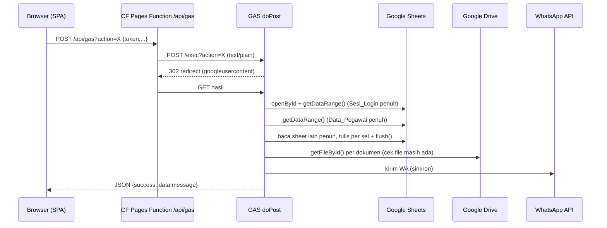

# SIKAP — Project Context, Analisa, Review & Audit

> Dokumen konteks untuk migrasi SIKAP dari Google Apps Script (GAS) ke Cloudflare (React 19 + Pages Functions + D1/R2).
> Dasar analisa: kode di branch `main` (commit `52e41f0`), `Blueprint Product/all_blueprints.txt` (STEP 00–06), dan mockup `UIUX Stitch/`.
> Tanggal analisa: 15 Oktober 2026. Rencana implementasi ada di [`MIGRATION_PLAN.md`](MIGRATION_PLAN.md).
> **Mulai penerusan Claude di “Checkpoint serah-terima Claude — terbaru” di bawah.** Status terakhir: HEAD patched menurut operator, deployment aktif masih141; NO-GO, A-version/repoint serta B/E/C belum diizinkan. Bagian tanggal lama adalah riwayat, bukan keadaan/izin terkini.
> Keputusan pemilik produk (D1+R2, Free plan PBKDF2 10k, matriks dokumen wajib + golongan PPPK, versi file 3 hari, soft delete pegawai 7 hari, pengajuan perubahan data kepegawaian, password default tidak wajib diganti) tercatat di awal `MIGRATION_PLAN.md`. Pekerjaan migrasi dilakukan di branch `feat/cloudflare-migration`.
> Pembaruan 16 Oktober 2026: pemilik mengonfirmasi deploy hotfix GAS sudah dijalankan (belum diverifikasi ulang terhadap produksi). NIK tetap dapat diubah pegawai; aturan restore dokumen terverifikasi hanya oleh admin, hapus/unggah ulang dokumen Menunggu, dan pencadangan NIP/NIK sampai purge disetujui. Detail ada di bagian konfirmasi lanjutan `MIGRATION_PLAN.md`.
> Fase 7: log admin, referensi pangkat/unit, jenis dokumen + matriks wajib, antrean purge exact-key, dan backup logis NDJSON bertahap sudah diimplementasikan, diuji pada snapshot terpisah, dan di-commit lokal pada `cb4fae7`. Belum ada push maupun deploy preview/produksi; cron tetap nonaktif.
> Fase 9 (**parsial, belum siap import**): resource terisolasi `sikap-uat`/`sikap-uat-db`/R2 UAT dibuat 17 Okt 2026 dengan schema 0001–0008. Deployment awal holding-only menolak semua rute dengan 503. Operator memasang Access (satu aplikasi root+wildcard, OTP, Allow satu penguji, sesi 6 jam) dan mengonfirmasi email diizinkan/ditolak; Team/AUD dicatat di plan. Aplikasi kosong `0adc7584` kemudian diterbitkan dengan secret UAT terpisah serta guard JWT Access untuk seluruh page/asset/API. Sesi pengembangan mengunduh konfigurasi remote UAT dan menjalankan 13 probe anonim root/hash yang semuanya mendapat challenge 302 Access. Fixture 3 akun sintetis (Admin/PNS/PPPK, password acak privat, NIK/email/HP kosong, arsip 0) dibuat khusus UAT; hash remote 3/3 terverifikasi. Operator kemudian **melaporkan** pemeriksaan setelah OTP, login/logout SIKAP, dan penolakan 403 berbasis role lulus; ini konfirmasi operator, bukan bukti control plane yang diverifikasi independen. Preflight remote read-only pada 17 Okt berakhir exit 2 dengan kode tunggal `TARGET_NOT_EMPTY` (sesuai harapan karena fixture ada); `readyForImport:false`.
>
> Tooling Fase 8–9 di-commit lokal pada `3a1f795`, tanpa push atau deploy sejak hardening. Importer remote belum diimplementasikan; database probe sintetis terpisah sudah dibuat dan diamati kosong melalui SELECT-only (kuota D1 Free 10/10). Run probe remote pertama telah disetujui dan dijalankan (riwayat run pertama dan cleanup, sebelum run kedua di bawah): kontrol positif dan guard-abort lulus, constraint-abort exit 1 tidak dikenali lalu eksekutor berhenti exit 2 tanpa retry/cleanup. Inspect independen SELECT-only menemukan 2 tabel milik kit dan 3 baris positif, tanpa baris fase gagal atau objek asing; residu ini kemudian dibersihkan dengan persetujuan cleanup terpisah, verifikasi kepemilikan ulang sebelum tiap DROP, dan inspeksi di antara keduanya. SELECT final membuktikan 0 objek pengguna/0 residu; database probe tetap ada (kuota 10/10).
>
> Bukti atomicity belum lengkap; diagnostik enum/boolean teredaksi ditambahkan dan diuji lokal tanpa melonggarkan classifier atau memulihkan penyebab error lama. Run kedua kemudian disetujui terpisah dan kembali berhenti exit 2 pada constraint: diagnostik API cocok endpoint/kode 7500 tetapi pesan tidak cocok pola (`MESSAGE_MISMATCH`). Inspect nonce kedua menemukan 2 tabel kit/3 baris positif tanpa baris fase gagal atau objek asing; database saat itu kembali tidak kosong dan residu dibiarkan selama analisis. Tidak ada retry; cleanup kedua dicatat setelah tahap diagnostik di bawah. Jangan mengulang run identik atau melonggarkan classifier berdasarkan tebakan.
>
> Analisis lokal menambahkan taksonomi diagnostik schema v2 berbasis 20 literal penuh tanpa mengubah classifier; variasi pesan remote tetap hipotesis. Reproduksi ad hoc awal gagal sebelum SQL; harness lokal beradapter Miniflare yang benar kemudian menjalankan semua fase, menolak batch constraint, dan mempertahankan state 3 baris positif. Bentuk lokal primary+extended PRIMARYKEY kemudian cocok whitelist literal penuh khusus lokal pada error/cause, dengan state identik dan status LOCAL_ROLLBACK_OBSERVED; classifier remote tetap identik dan hasil ini bukan bukti remote. Diagnostik schema v3 menambah label extended-code melalui 4 literal terpisah hanya untuk APIError bersih/terikat target; classifier tetap menolak bentuk itu sebagai bukti. Tahap diagnostik tidak mengakses remote. Tooling probe di-commit lokal pada `c9eed3e`; cleanup kedua kemudian disetujui terpisah dan selesai dengan verifikasi nonce/kepemilikan sebelum tiap DROP dan inspeksi independen di antaranya. SELECT final: 0 objek pengguna/0 residu, database tetap ada, kuota 10/10.
>
> Run ketiga kemudian disetujui terpisah: diagnostik v3 APIError bersih/target cocok/kode 7500 mengenali bentuk primary CONSTRAINT + extended PRIMARYKEY tanpa wrapper, tetapi classifier lama tetap MESSAGE_MISMATCH/exit 2. Inspect nonce ketiga menemukan 2 tabel kit/3 baris positif tanpa fase gagal/asing; database saat akhir run kembali tidak kosong, tanpa retry atau cleanup saat itu. Bentuk ini observasi run ketiga, bukan penetapan ulang pesan run pertama/kedua. Policy classifier v2 kemudian ditambahkan lokal: satu literal extended yang direkonstruksi tanpa wrapper, dengan tag ` [code: 7500]`, wajib APIError bersih endpoint dipatok dan own code angka 7500, tanpa perubahan regex lama. Tiga receipt historis tetap gagal; saat patch dibuat policy baru belum diuji remote. Patch di-commit lokal pada `8511abc`, lalu cleanup ketiga disetujui terpisah dan selesai dengan verifikasi kepemilikan sebelum tiap DROP serta inspeksi di antaranya. SELECT final 0 objek pengguna/0 residu, database tetap ada; saat cleanup tersebut run keempat belum dijalankan. Inventaris akun pada akhir cleanup 11 database (sebelumnya 10); perubahan di luar scope belum diinvestigasi, tanpa mengasumsikan plan/kuota terkini atau izin menghapus resource lain.
>
> Run keempat kemudian disetujui terpisah dan lulus exit 0: semua 11 langkah policy v2 berhasil, kedua error terikat target dan post-read cocok, observedTransportRollback:true. Inspect independen nonce keempat mengonfirmasi 2 tabel kit/3 baris positif tanpa fase gagal/asing; residu dibiarkan dan database kembali tidak kosong. Bukti hanya untuk satu run query Wrangler 4.151.0/policy v2, bukan Worker batch/file import atau kesiapan impor; readyForImport:false tetap. Tidak ada retry, cleanup keempat, commit, push, deploy atau import; inventaris tidak diperiksa ulang. Desain importer lokal kemudian dicatat: nilai PII harus melalui params/body REST query, bukan SQL/argv Wrangler; request shape baru butuh bukti sintetis terpisah. Tahap desain tidak membuat kode/operasi remote. Pure core kemudian diimplementasikan pada scripts/import/core.mjs (descriptor syntax/denylist, compiler statis-params/target binding, simulasi state dan resume non-authorizing); core lalu diperketat untuk tipe primary key dan epoch journal, dan mock adapter in-memory ditambahkan (18 core + 14 mock, total seluruh suite 999 tes lulus). Artifact privat tidak untuk log; semantic validation/target proof/REST atomicity tetap belum terbukti. Mock hanya simulasi tanpa SQL engine/jaringan, selalu non-authorizing; inspect privat dan summary counts/flags. Paket core/mock di-commit lokal pada `72f947f`. Ledger DDL terpisah dan kontrak hash kemudian tersedia; 14 tes integrasi Miniflare lokal lulus (total suite 1.013, importer 46), tanpa penerapan schema remote. Bukti SQL lokal meliputi CAS dan rollback data/journal/checkpoint serta constraint nyata, bukan atomicity REST parameterized.
>
> Adapter request D1 REST dan R2 S3 synthetic-only kemudian ditambahkan (13+15 tes fetch stub), tanpa pemanggilan layanan nyata atau credential nyata. Rehearsal terpadu lokal Miniflare+object store tiruan lulus 5/5; total 1.046 tes (importer 79), lint/typecheck/build lulus. Review PASS WITH NOTES tanpa blocker; saat itu gate pipeline masih helper tes, file tamper terdeteksi lewat GET tetapi bukan enforcement produksi. Reader full-row privat d1-readback kemudian ditambahkan dengan 9 tes fetch stub lulus. Runner sintetis `synthetic-runner.mjs` lalu memindahkan gate helper ke modul runner kandidat lokal (bukan enforcement produksi); snapshot awal 8 tes runner lulus (Miniflare + fetch stub), review PASS WITH NOTES setelah perbaikan row duplikat dan GET macet; saat itu total suite 1.063 tes (importer 96). Penguatan berikutnya menambah guard READBACK_CAPACITY sebelum request (budget JSON kanonik lokal 6 MiB, bukan jaminan respons remote), tes foto/urutan chunk/final GET dan kapasitas: 15 tes runner, total suite 1.070 tes (rerun final importer 103/103), lint/typecheck/build lulus. Review akhir PASS WITH NOTES tanpa Medium/High tersisa. Runner tetap synthetic-only dan non-authorizing.
>
> Audit dokumentasi publik kemudian menemukan kontrak REST `params` string-only, sedangkan compiler v1 masih mengirim angka/null; v1 belum sesuai kontrak tipe publik dan penerimaan aktual belum diuji. Rollback batch REST/kelanjutan `changes()` tetap belum terbukti; transport string-JSON v2 kemudian diimplementasikan lokal (compiler/mock/adapter, SQL json_extract, tanpa fallback v1); 107 tes importer lulus, total validasi per grup 1.074 tes, lint/typecheck/build lulus. Review PASS WITH NOTES tanpa Medium/High. Pada tahap implementasi v2, bukti tipe/full-row/rollback masih hanya Miniflare, bukan REST nyata.
>
> Harness proof D1 v2 terpisah kemudian tersedia untuk prepared synthetic target tanpa setup/cleanup/R2: 7 tes harness lulus, paket importer 114/114, full npm test final 1.081 tes lulus; review runtime PASS WITH NOTES tanpa temuan material. State yang diperiksa hanya ledger + tujuh tabel import, bukan seluruh DB; error provider tidak teridentifikasi. Status library sintetis tidak memberi otorisasi global untuk remote atau import.
>
> Pemilik kemudian menyetujui alur dipadatkan; DB proof baru sikap-import-proof-20261018 (e54f0a4a-27b3-412d-9ad0-ea8dd2c7b6c1) dibuat tanpa perubahan binding. UAT lama diinspeksi read-only dan tidak kosong; tidak dihapus/ditimpa. Gate wire baca dan proof remote kemudian lulus nyata: 94 request, 67 setup, 11 send/12 read cocok; fault state tidak berubah dan final lost response committed teramati tanpa resend. Proof DB dibiarkan berisi data sintetis; tidak untuk PII. Target nyata UAT baru D1 sikap-import-uat-20261018 (885b655b-3482-44fc-9d01-56ad0204bb35) dan bucket sikap-import-uat-20261018-files dibuat tanpa binding; plan privat dibangun ulang dengan pepper UAT (46 pegawai/akun, 63 arsip, 66 file, nol error; non-atomic UAT only). Kompatibilitas key document/photo/WEBP kemudian selesai lokal lewat satu adapter: runner 19/19 dan R2 17/17 lulus, review PASS; full suite final 1.094 tes (importer 127) lulus. Pin driver proof dipelihara setelah review tanpa remote rerun; hash eksekusi historis tetap dicatat. Import nyata masih tertahan gate real-data yang belum diimplementasikan dan credential S3 bucket-scoped yang belum tersedia; belum ada upload PII, cleanup atau perubahan binding. Belum ada CLI apply, dan real-data profile masih ditolak. Operasional saat ini tetap GAS untuk data nyata, Cloudflare hanya pilot sintetis sampai seluruh gerbang lulus. Proof D1 telah mengamati atomicity checkpoint+journal+data pada adapter sebenarnya untuk satu run sintetis; R2 GET SHA-256 tetap wajib sebelum referensi D1, tanpa blind retry/cleanup otomatis. Persetujuan alur UAT tetap berlaku pada target baru yang telah ditetapkan; cleanup, operasi di luar scope, dan cutover memerlukan keputusan terpisah. Data nyata belum diimpor ke remote, dan produksi tidak berubah. Detail di `MIGRATION_PLAN.md` dan `README.md`.
> Fase 8: alat migrasi **offline/local-only** di `scripts/migrate/` telah lolos 140 test baseline dan 34 test operator. Operator sudah menjalankan sandbox ekspor sintetis Fase 8 (bukan sandbox guard cutover) di GAS nyata; snapshot `de3a7790-d540-49b5-8838-cebfebb7b5e4` berhasil ditransformasi, diimpor, direkonsiliasi dan di-resume lokal (3 pegawai/akun, 2 arsip, 3/3 file cocok SHA-256, 739 byte). Alat penyalinan sumber terkontrol (`CopyPrivateSource.gs` v2: target spreadsheet baru dari empat tab nilai, salinan dokumen/foto, ID diperbarui hanya pada target) sudah diuji pada Google nyata dengan sumber sintetis pada 17 Okt 2026; snapshot hasil ekspor target `76fdd9e1-427f-4c15-aff7-36da5d5ce6db` lulus transform/apply/reconcile/resume lokal dengan hasil identik. Pada hari yang sama, dengan izin pemilik data, sumber nyata disalin secara privat (job `b8756cf1`, 66 file) dan diekspor (snapshot `039d8212`); dry-run lokal lulus penuh (46 pegawai/akun, 63 arsip, 66/66 file, apply/reconcile/resume ok) setelah dua perbaikan kualitas data (NIK placeholder dikosongkan pemilik, Pangkat_Golongan "-" dinormalisasi sebagai kosong). Langkah berikutnya adalah import ke target UAT privat yang terpisah dan kosong (bukan preview lama `sikap-v2`), setelah jalur penulisan remote diimplementasikan, dibuktikan, dan disetujui. Belum ada ekspor produksi untuk cutover atau migrasi data nyata/remote; tidak ada endpoint import publik. Prosedur operator ada di `README.md`, hasil rinci di `MIGRATION_PLAN.md`.

---

**Checkpoint 18 Oktober, setelah persiapan credential:** `.dev.vars` menyediakan pasangan R2;
GET signed read-only diterima. Gate real-data dan runner UAT sudah diimplementasikan lokal,
tetapi import ditahan: tes operator dengan fallback argumen `null` yang salah sempat menjangkau
dependency nyata. D1 UAT baru memiliki schema parsial 10 tabel/11 index; seluruh tabel yang
ditemukan nol row. Semua 66 tujuan file manifest diperiksa GET read-only dan menghasilkan 404.
Bug argumen diperbaiki, API tidak lagi memiliki default I/O nyata, tes diisolasi dan review
final PASS; tujuh tes tiruan dan check-only tanpa HTTP lulus. Jangan menjalankan ulang
driver, cleanup atau melanjutkan setup parsial sebelum keputusan pemulihan eksplisit. Snapshot
uji sebelumnya bukan bukti import selesai. GAS, binding app dan produksi tidak berubah.

**Setelah persetujuan pemulihan 12:37 UTC:** reset UAT baru berhasil (0 user object, UUID tetap),
setup 67 statement lulus. Import berhenti pada transfer R2 ke-55 yang ambigu. Observasi read-only
menemukan 55 file hash/MIME/size cocok (35.260.864 byte), 11 missing, nol mismatch; ordinal 55
tersimpan. D1 aplikasi/journal tetap kosong, receipt ordinal/stage 0, belum ada chunk D1 dikirim.
Tidak ada retry/cleanup/overwrite, binding atau deploy. Jangan ulang driver fresh; pemulihan
state parsial memerlukan keputusan eksplisit dan tidak boleh mengunggah ulang 55 file benar.
**55 file dokumen/foto pegawai nyata (PII) kini berada di bucket privat
`sikap-import-uat-20261018-files`; row aplikasi D1 belum diimpor.** Klaim sebelumnya belum ada
PII remote/hanya pilot sintetis merupakan status historis sebelum percobaan tersebut.
Tool pemulihan terkontrol belum tersedia; persetujuan reset 12:37 sudah dilaksanakan dan tidak
berlaku untuk reset/cleanup berikutnya. Jangan menjalankan driver fresh pada state parsial ini.
Verifier read-only independen kemudian mengonfirmasi `UAT_IMPORT_INCOMPLETE`: schema/reference/
row cocok dengan prefix ledger 0/157, nol FK/query mismatch, 55 file verified dan 11 missing.

**Checkpoint final recovery yang disetujui 13:09:** recovery selesai
`COMPLETE_UAT_RECONCILED`, 55 object reused/11 uploaded create-only, 157 chunk committed tanpa
resend. Verifier independen read-only **UAT_IMPORT_VERIFIED**: schema/ref cocok, nol FK/query
mismatch, pegawai/akun 46/46, arsip 63, riwayat 125, log 414, journal/ordinal 157, file manifest
66/66 hash/MIME/size cocok. PII nyata kini ada di D1 dan R2 UAT privat; binding/deployment app
belum berubah. Snapshot tetap UAT-only/non-atomic, bukan produksi. Driver ordinal-zero tidak
boleh dijalankan ulang. Status parsial pada checkpoint sebelumnya merupakan riwayat sebelum
recovery sukses; langkah berikutnya keputusan UAT binding, verifikasi pepper/login/Access dan
smoke test, bukan reset lagi.

**Checkpoint aplikasi UAT setelah persetujuan 14:14:** deployment
`08ccdbc2-7ab3-4533-8bb2-90eded79b485` berhasil ke `https://sikap-uat.pages.dev`, branch `uat`
project UAT, DB885/bucket import terpasang, BACKUPS dilepas, Access required dan dua secret
encrypted tetap ada. 39/39 HEAD anonim challenged; verifier pasca-deploy tetap
`UAT_IMPORT_VERIFIED` seluruh row dan 66 file cocok. Full npm test final 1.143 lulus, lint/type/
build lulus, review binding PASS WITH NOTES. Import/recovery tools fail-closed setelah binding;
old UAT deny pins tidak berubah. Pada checkpoint deployment ini smoke login/role/file dan runtime
pepper masih menunggu operator; hasil berikutnya dicatat di bawah. Jangan
menebak password, reset pepper/data atau rerun importer. Tidak ada cutover produksi; GAS tetap
operasional. Checkpoint sebelumnya "belum dibinding" adalah riwayat sebelum deployment ini.

**Konfirmasi smoke operator — 18 Oktober 2026, 20:42 UTC:** pemilik melaporkan login,
dashboard, dokumen dan logout berhasil/lulus. Bukti berasal dari operator, bukan eksekusi ulang
agen. Pepper/sesi bekerja untuk akun yang diuji; identitas/peran, angka dashboard, status health
dan isolasi antar-role tidak diberikan dan tidak diklaim terverifikasi. Tidak ada secret dicatat.
Baseline rekonsiliasi sebelumnya mendahului smoke; perubahan sesi/log/metadata akun normal
tidak boleh dipulihkan dengan rerun importer. Smoke dasar UAT selesai; belum cutover produksi,
GAS tetap operasional. Export final dari sumber beku dengan pemeriksaan awal/akhir,
backup/rollback dan persetujuan produksi
tetap diperlukan. Konfirmasi ini tidak mengizinkan deployment, cleanup atau migrasi tambahan.

**Persiapan cutover 21:01 UTC:** audit serta implementasi pengaman maintenance GAS dilakukan
lokal; belum ada deployment GAS, property freeze, import/deploy produksi atau pergantian domain.
Guard `SIKAP_CUTOVER_STATE` tidak menggantikan penghentian trigger/editor/writer eksternal dan
drain eksekusi lama. Exporter tetap non-atomic (`consistent:false`), bukan diperbaiki dengan
flag; bukti sumber stabil/final dan jalur permit produksi belum tersedia. Rollback sesudah
Cloudflare menerima write memerlukan rekonsiliasi perubahan, bukan hanya mengembalikan domain.
GAS tetap sistem operasional sampai keputusan cutover eksplisit.

**Hasil persiapan lokal cutover:** guard maintenance mencakup 122 deklarasi fungsi GAS pada
11 file backend + satu helper private; 20 tes VM/AST lulus, review PASS WITH NOTES. Full suite
terbaru 1.163 tes lulus (400 API/152 web/216 migrasi/224 staging/171 importer), lint/type/build
lulus. Tidak ada deployment GAS atau property freeze diaktifkan. Risiko quota pembacaan property
per fungsi perlu diukur di sandbox; account aktual dan live-source diff belum diverifikasi.
Produksi target/capability, bukti freeze/drain/fingerprint final, backup/rollback dan window
masih gate terbuka. Jangan memakai binding produksi historis atau retarget tool UAT.

**Audit read-only GAS live mulai 21:35 UTC:** clasp mengambil HEAD/v140/v76 ke TEMP privat di
luar repo, tanpa push/deploy/run/property write. HEAD dan v140 hanya berbeda pada Maintenance,
tetapi seluruh 10 backend file bersama berbeda dari repo lokal (meski baris guard diabaikan).
v140 memiliki 113 function/43 public dengan hotfix keamanan; lokal 123/122 public adalah fork
usang. Jangan push tree lokal yang dapat menghapus hotfix dan menghidupkan helper/test publik.
Guard lokal yang telah diuji merupakan prototipe, bukan kandidat deploy. Kandidat harus memakai
baseline v140 dan mempertahankan helper private, whitelist 40 action, lockout/upload validation
dan Maintenance. File Maintenance bukan freeze; belum ada guard live. Versi 76 masih terdaftar
tanpa freeze hook dan perlu keputusan penutupan/repoint sebelum window; reachability belum
dibuktikan. Produksi/GAS/property tetap tidak diubah, UAT tetap lulus.

Hasil pengukuran prototipe lokal (bukan live v140): mapper 22 property-read/row, 46 row 1.012,
admin-list dengan authorization tiruan 1.022 sebagai lower bound. Tiga tes quota dan total
23 tes freeze/AST/VM lulus; full suite terbaru 1.166 lulus, lint bersih. Quota/latency Google
aktual belum diukur. Jangan push legacy lokal; port berikutnya memakai baseline v140 terisolasi
dan mempertahankan hotfix. Inventaris trigger/properties/writer dan keputusan versi 76 belum
selesai; belum ada freeze live atau izin cutover produksi.

**Persiapan kandidat v140 22:03 UTC:** buat kandidat privat terisolasi dari baseline v140 yang
dipatok hash, bukan HEAD atau tree lokal usang. Pertahankan 41 file/hotfix/Maintenance; guard
hanya pada 43 entry publik dan satu helper private baru. Kandidat telah dibangun privat,
8 file berubah/33 raw-identik, 70 private tetap utuh; verifier **CANDIDATE_LOCAL_VERIFIED**
130/130 cek VM lulus. Tooling 16/16 unit dan full suite 1.182 tes lulus, lint/type/build lulus;
review PASS/PASS WITH NOTES, tanpa temuan material terbuka. Bukan uji open-state semua fitur
atau quota Google. Tidak ada clasp push/deploy/property freeze; kandidat tidak memuat konfigurasi
push. Masih perlu sandbox Google yang disetujui dan keputusan deployment lama/writer.

**Pemulihan sesi 19 Oktober 2026:** empat hash tooling kandidat dan tes cocok dengan pin
checkpoint. Regresi lokal diulang: **1.182 tes lulus** (400 API/152 web/235 migrasi/224
staging/171 importer), lint/typecheck/build/whitespace lulus. Review independen ulang
**PASS WITH NOTES**, tanpa Critical/High/Medium; batas assertion property-read diperjelas di
plan, catatan Low cakupan tes/receipt tetap tercatat. Log API memuat peringatan tool/NDJSON dan
`Network connection lost` meski seluruh tes lulus; tidak diperbaiki pada tahap ini. Kandidat
privat dan 130 cek aktual tidak dijalankan ulang. Tidak ada perubahan runtime atau remote,
freeze/deploy/cleanup/import ulang/commit/push; GAS tetap operasional.

**Langkah sandbox sintetis — 19 Oktober 2026:** arsitektur rehearsal guard ditetapkan:
helper dipatok sama, 43 direct stand-in/40 handler sintetis, tanpa source/data/ID produksi.
Generator privat dan harness selesai lokal; Test Engineer independen menjalankan **30/30 tes
baru lulus**, termasuk mutasi property asing yang tidak boleh ditimpa/dihapus dan output privat
Windows. Regresi final per grup **1.212 tes lulus** (400 API/152 web/265 migrasi/224 staging/171
importer), lint/typecheck/build/whitespace lulus. Pada akhir persiapan ini identitas project/account
Google, paket operator aktual dan eksekusi Google belum dilakukan; checkpoint berikutnya mencatat
pembuatan paket aktual. Ini bukan deployment kandidat v140, freeze atau
bukti fitur/API v140. Quota/runtime Google, v76, trigger/private editor dan drain writer tetap
belum dibuktikan. Prosedur operator/batas scope ada di README; jangan menyalin paket ke project
operasional. Helper/builder/verifier v140 tetap tidak berubah; tidak ada commit/push/deploy.

**Paket operator aktual — setelah permintaan 02:48 UTC:** generator dipatok dijalankan sekali
pada folder baru di luar repo dengan ACL privat, menghasilkan **SANDBOX_HARNESS_READY_LOCAL**,
tepat tiga file dan nol public function pada template. Helper tetap byte-identik. Hash rendered
harness `539f0c04fb0216c63f887ab147386f03eb0aa836125920f471c50b133e3f5ca1`, receipt
`cf263193ef264c970562e8961791279e3f714836e708d59c6b489b1f3d709813`. Verifikasi independen
paket aktual **PASS**: ACL/3 file/helper/receipt/hash/manifest cocok, rendered byte-identik,
30/30 tes target lulus ulang; nonce dicocokkan privat tanpa dicetak. Pada checkpoint paket
tersebut belum ada project/account Google yang ditetapkan atau eksekusi Google; hasil operator
berikutnya dicatat di bawah. Tidak ada freeze/deploy/live-property/import/cleanup/
commit/push; GAS tetap operasional. Paket yang telah dibuat tidak boleh digenerate ulang/ditimpa.

**Konfirmasi operator Google nyata — 19 Oktober 2026, 04:34 UTC:** pemilik melaporkan
rehearsal pada project standalone sintetis baru lulus: `CUTOVER_SANDBOX_PASSED`,
`stateAbsentAfterVerified:true`, **1.162/1.162 checks**, **996 denial tanpa efek samping**,
**14/14 state**, **7/7 no-cache**. Ini laporan operator atas execution log, bukan verifikasi
remote independen; file ringkasan privat belum dibaca agen. Hash kedua `.gs` dilaporkan cocok
sebelum run/setelah reload; tanpa izin tambahan/deployment/trigger/clasp/receipt upload.
`TmpRun.gs` dihapus, state absent, konfirmasi+pin tinggal untuk audit. Deviasi: jalur localhost
ditolak dan server dilaporkan dimatikan; harness bernonce melewati konteks operator; helper
sempat kosong lalu dipulihkan dengan hash final cocok menurut operator. Tidak mengklaim
integritas kontinu/nonce hanya di disk dan tidak merotasi/reset otomatis. Tidak ada bukti
UNAVAILABLE/non-string/exact read-count Google, fitur v140/quota/HTTP-RPC/freeze live/v76/drain.
Operator berhenti; tindak lanjut hanya dokumentasi. GAS tetap operasional; tanpa run ulang,
remote/property/cleanup/import/deploy/commit/push. Angka rehearsal terpisah dari tes lokal.

**Inventaris sebelum window — 19 Oktober, 05:29 UTC:** checklist W01–W15 dan keputusan
D01–D11 ditambahkan ke MIGRATION_PLAN, ringkasan langkah UI read-only ke README. Pada checkpoint
persiapan semua bukti live UNKNOWN; pembaruan metadata W07 dicatat berikut. **NO-GO** tetap. v140/v76/HEAD 18 Oktober hanya historis; perlu account
trigger lintas pemilik (termasuk historical creator), sharing/direct/external writer,
CI/Git integration, access deployment dan route aktual. `.github/workflows/ci.yml` lokal ada,
berisi test/build tanpa deploy; tidak membuktikan remote main/automasi lain nonaktif. Window
UTC/WITA, backup actual bytes+sheet/restore, target produksi/permit baru, custody secret dan
rollback pre/post-write belum diputuskan. Rencana drain bukan bukti quiescence. Pada checkpoint
persiapan itu tidak ada kode baru, remote read, credential/property/data access, penghentian writer, resource/deploy/freeze,
import/cleanup/commit/push; checklist bukan otorisasi operasi produksi.

**Metadata deployment aktual — 19 Oktober, 06:00:31 UTC / 14:00:31 WITA:** satu invocation
read-only `clasp --json list-deployments` versi 3.3.0 pada target legacy yang dipatok menemukan
3 entri: HEAD tanpa nomor, v140, v76. W07 **VERIFIED untuk metadata saja**, bukan source,
execute-as/access, route produksi, reachability/penutupan v76 atau trigger/writer. Output mentah
ditahan di memory dan hanya ringkasan teredaksi dicetak (versi/suffix/count dan boolean
ada-deskripsi, tanpa isi deskripsi). Tidak memanggil handler, membaca source/
property/data, login baru atau menambah scope; refresh cache autentikasi normal CLI tidak
diklaim byte-identik. Tidak ada push/deploy/archive/delete/freeze/import/cleanup/commit/push Git.
Gerbang lainnya tetap terbuka dan **NO-GO**; laporan UI lintas account serta keputusan owner
masih diperlukan.

**Serah-terima 20 Oktober pagi WITA (laporan 19 Oktober 23:24 UTC):** pemilik melaporkan A
sudah dijalankan dari sesi/operator lain: guard 43 entry dideploy v141 pada URL sama, v76
public diarsipkan, sharing link-editor sheet/Form ditutup, workflow/clasp credential dan Pages
auto-deploy dihentikan. Target D1/R2 produksi `sikap-import-prod-20261020*` dibuat kosong,
Access dipasang pada `sikap-v2`, secret disimpan privat belum dipasang app. Ini **laporan
operator**, bukan inspeksi remote independen sesi ini; perubahan control plane bukan lokal-only.
Driver/gate produksi tersedia lokal dengan pin PENDING; review/rehearsal belum selesai,
staging dilaporkan gagal/flaky belum didiagnosis. **NO-GO; B/E/C belum diberikan**.
Maintenance HEAD/wrapper `tmpRevoke`/`tmpCheck` ikut v141 menurut laporan, di luar kandidat yang
diverifikasi. Jangan menyatakan editor-only atau full freeze coverage tanpa review source
terikat versi. Backup/custody secret/runtime pepper/Access OTP/app config/window/drain masih
memerlukan bukti atau keputusan. Tidak ada secret/private runbook dibaca atau remote diakses
pada penerimaan ini. Detail audit penerimaan ada di MIGRATION_PLAN; GAS tetap otoritatif.

**Penilaian lokal serah-terima:** Test Engineer menjalankan driver/gate target **16/16 tes
lulus** tanpa skip/network/credential nyata; bukan rerun 182/full suite. Reviewer driver
**CHANGES REQUIRED** (1 High budget request, 5 Medium: binding scan, pin transitif, lifetime
credential, bare-CLI write, happy-path untested). PENDING masih menahan write; tidak diubah.
Audit gate juga menahan retirement UAT yang bergantung pin/config, penamaan permit/status dan
cakupan source v141 tambahan. Rencana koreksi/rehearsal lokal dicatat di MIGRATION_PLAN, belum
diimplementasikan; tidak ada remote/secret access atau B/E/C. Staging failure belum didiagnosis.

**Koreksi lokal 20 Oktober 00:16 UTC — progres parsial (riwayat, digantikan penutupan di bawah):** retirement lima driver UAT/proof/
reset/verifier disimpan: STOPPED_RETIRED sebelum options/static/private/credential/HTTP,
CLI selalu nonzero, tanpa flag re-enable/pin refresh. Source review retirement PASS WITH NOTES;
flag authority proof disamakan false sesudah review, tes owner retirement 26/26 lulus.
Driver produksi/seam rehearsal masih dikerjakan dan belum dinyatakan siap; production pins
PENDING. Staging224/224 dua run, web152/152, migrasi265/265, typecheck/build lulus. API sempat
macet inisialisasi worker, run dihentikan; rerun bounded Test Engineer **400/400 lulus**,
penyebab hang tidak terbukti. Jangan klaim seluruh regresi snapshot final importer lulus.
Tidak ada B/E/C atau remote/private secret/plan, freeze/deploy/import/cleanup/commit/push.

**Penutupan koreksi lokal 20 Oktober:** lima driver lama retired unconditional, 26 tes
independen lulus. Thin CLI produksi butuh flag write eksplisit, no overrides; orchestrator/pins
13 modul, inventory bounded lokal, exact budget/lease preflight dan credential snapshot frozen
selesai. Source review M1 ditutup; final **PASS WITH NOTES**, 0 Critical/High/Medium, 4 Low gap
tes orchestrator. Rehearsal nyata lokal Miniflare D1+fake R2 lulus **4/4**, happy 93 request
(3 file/3 chunk) tepat budget, no authority. Fault setup pre-commit saja, bukan commit-then-loss.
Parent suite importer final **204/204** tanpa skip/failure; API400/web152/migrasi265/staging224
per grup, lint/typecheck/build/whitespace lulus. API hang awal tidak direproduksi, sebab belum
terbukti. Pin runtime+plan produksi tetap PENDING; **NO-GO B/E/C tetap**. Lease merupakan blocker live:
contoh estimasi historis 807 request ditolak cap 4 jam dengan timeout 30 detik; bukan hasil
pengukuran plan final. Credential singkat juga gagal; perlu keputusan desain/review terpisah.
Remote binding/Access OTP/app runtime pepper/source v141 wrapper/W12/W15/custody masih gap. Tidak ada
private artefak/secret/remote/deploy/freeze/import/cleanup/commit/push. Detail hash+gap di plan.

**Review privat read-only — 20 Oktober 05:28 UTC:** runbook/inventaris privat dibaca oleh
System Architect; **CHANGES REQUIRED**, draft sebelum A usang dan W12-plan/W15/backup-final/
rollback belum operasional. Secret/plan pegawai tidak dibaca, berkas privat tidak diedit.
Reviewer+Test Engineer memeriksa backend HEAD/v140/candidate historis saja: AST parse bersih,
HEAD 45 public/0 guard, v140 43/0, candidate 43/43 first-guard. Maintenance HEAD berisi public tmpRevoke
(write Drive/Properties) dan tmpCheck (read/log), tanpa guard. Menghapus dua declaration+blank
line menghasilkan candidate byte-identik; belum melakukan patch. Exact snapshot v141 tidak
tersedia pada lokasi teridentifikasi, jadi coverage 43/45 hanyalah conditional atas laporan,
bukan fakta remote. Review coverage **CHANGES REQUIRED** (2H/1M/2L), validasi AST/hash **PASS
WITH NOTES** sebatas artefak historis. Snapshot version-bound memerlukan scope read-only
tersendiri; A tambahan patch/deploy disetujui terpisah. Runbook perlu revisi owner; smoke dapat first write
sebelum C. **NO-GO B/E/C, semua pin produksi PENDING.** Tidak ada fungsi/probe/property/control
plane/secret/data/deploy/freeze/import/cleanup/commit/push dijalankan; detail teredaksi di plan.

**Revisi runbook lokal — 20 Oktober 06:32 UTC:** permintaan lanjut ditindaklanjuti dengan
revisi in-place runbook privat existing. Bagian 0–3 riwayat superseded, bagian 4–12 draft
berlaku; writer register, drain/proof/fingerprint, backup, rollback/custody dan gate ditata.
Nilai keputusan masih UNKNOWN; review kualitas dokumen final PASS WITH NOTES (0 CHM,
2 Low kosmetik), bukan ready B. Hash final runbook di plan. Frozen continuity export→import
serta pre-import fingerprint wajib; reopen invalidasi backup/export/plan/pins tanpa cleanup. E-export dipisah E-import
atas final artifact/pins, smoke-write dapat mendahului C. Filename scope folder inventaris
tidak menemukan v141; UI exact-version operator masih diperlukan, HEAD tidak cukup. Jika
UI tidak menyediakan content exact-version, stop tanpa login clasp/credential baru. Source
mentah hanya privat karena mungkin memuat token/ID. Tidak ada remote/source/property GAS,
secret/credential/resource/pin/import/deploy/freeze/cleanup/commit/push diubah. Checkpoint
review sebelumnya "runbook tidak diubah" historis; sesi ini hanya mengubah runbook privat
existing dan checkpoint repo teredaksi.
NO-GO B/E/C, production pins PENDING tetap; detail/prosedur aman di README/MIGRATION_PLAN.

**Serah-terima source v141 — 20 Oktober, laporan 11:47 UTC:** operator kini melaporkan
salinan source+manifest tersimpan privat (menggantikan laporan awal hash-only): 42 file,
41 source+manifest, provenance UI berlabel Versi141, hash salinan42/42 cocok menurut operator.
Maintenance memuat tmpRevoke/tmpCheck, memperkuat ATTESTED 45public/43guarded; belum AST
independen exact-version. Source/bundle/provenance/evidence privat **tidak dibuka**, sesuai
larangan operator; tidak ada hash/ACL/version-binding diverifikasi ulang. Salinan UI dapat
menormalkan EOL, jadi bukan identitas byte Google. Properties/trigger/access/deployment/data
tidak tercakup. Angka total bytes dan timestamp perkiraan laporan belum diverifikasi; tidak
mengarang full bundle hash terpotong. Ketersediaan artifact ATTESTED, W11 bukan full VERIFIED.
Next scope pada checkpoint itu izin validasi lokal non-disclosing; patch/test wrapper tetap
memerlukan penugasan terpisah bersyarat hasil45/43, dan A perubahan/deploy terpisah; tidak meminta raw source. **NO-GO B/E/C, production pins PENDING**.
Hanya checkpoint repo diubah, tanpa private artifact/source/secret/remote/patch/deploy/freeze/
export/import/cleanup/commit/push pada penerimaan laporan.

**Validasi non-disclosing — 20 Oktober permintaan 12:21/12:24 UTC:** scope lanjutan hanya
pemrosesan artefak lokal private via tool untuk ACL/digest/AST teredaksi; raw source tidak
masuk chat/repo atau dibaca melalui tool output source. Tidak ada eksekusi GAS/remote/secret/
credential/probe. Setelah pemulihan timeout, hasil artifact lokal LOCAL_VERIFIED dengan
catatan:42file bundle/disk byte-match dan evidence42raw/LF, all12gs45public43guard71private,
handler40, unguardedtmpRevoke/tmpCheck. Provenance UI/deployment tetap ATTESTED. Digest lokal
bundle358df072…3348a527 prefixcocok, suffixlaporan27a527 vs48a527 tidak cocok (UNRESOLVED).
11backendrawmatch valid (8CRLF baselinejugaCRLF), MaintenanceLF inverse98ASCII raw/LFmatch
candidate.42/42source readonly, provenancewritable; numericcaps/ADS belumdirinci. Inverse
insert-roundtrip/digestrecord pada hasil awal masih klarifikasi; penutupan berikut menggantikannya.
Tidak ada patch saved.45/43 mengonfirmasi gap: full freeze coverage tetap CHANGES REQUIRED. Inverse wrapper memory bukan patch. Regresi sintetis
terpisah tooling v140 16/16 (termasuk di dalam suite migrasi 265/265) dan driver/gate produksi 16/16
lulus; lint/typecheck/build lulus, pin/tooling tidak berubah. Bukan full npm test atau evidence
source v141. A perubahan/deploy terpisah, B/E/C NO-GO dan
pins PENDING tetap; penerimaan sebelumnya tidak-open adalah riwayat.

**Penutupan validasi lokal — 20 Oktober 13:16 UTC:** full digest bundle cocok record penuh
PROVENANCE, tidak ada bundle digest pada evidence84hash per-file. Literal chat suffix27a527
tetap beda48a527; provenance writable bukan signature Google. Span98ASCII tepatdua wrapper+
whitespace, inverse remove/insert memory kembali raworiginal byte-exact, tidak patchsaved.
Capnode10000/45files, collision0, nlink1 dan reparse0; ADS UNVERIFIED/depth cap belumdirinci.
Integrity/AST LOCAL_VERIFIED atas salinan, version/deployment ATTESTED.45public43guard berarti
coverageCHANGESREQUIRED, bukan passfreeze. Futurelocalpatch butuh penugasan eksplisit baru,
Googlepatch/deploy Aterpisah; B/E/C NO-GO pinsPENDING. Checkpoint saja diubah, noartifactedit/
permission/sourceexecution/secret/remote/deploy/freeze/import/cleanup/commit/push.

**Patch lokal minimum — 20 Oktober 13:36 UTC:** owner meminta kelanjutan setelah validasi;
scope kandidat patch privat di output baru, bukan original/Google. Awal implementasi adalah
riwayat; builder+tes tersimpan, 14/14 tes baru serta migrasi279/279 lulus, eslint0. Source
review PASS WITH NOTES, tanpa Critical/High/Medium (Proxy closed). Actual build sekali memberi
LOCAL_WRAPPER_REMOVAL_PREPARED: 42 source+receipt=43 file, 41 raw-identik, Maintenance berkurang
98 byte, post43/43 dengan71 private/40 handler. Output aggregate c57e2ba8…1589be9, receipt
b5ac2586…888374; verifikasi independen actual **PASS lokal** (input/output pins cocok,
41 raw-identik, inverse98byte raw-exact, AST43/43/helper/EOL/receipt flags sesuai). ACL private,
link/reparse0 nlink1; ADS UNVERIFIED. Input current-match bukan continuous immutability.
Google/version binding ATTESTED, W11 live belum tertutup. Satu npm test final **1.259 lulus** (400/152/279/224/204), lint/typecheck/build/whitespace lulus; 14 baru
termasuk 279, bukan tambahan. Warning API tetap dicatat. Original tidak ditimpa, raw source
tidak masuk repo/chat, tidak mengeksekusi kandidat privat sebagai GAS. Tool v140/prod pins hash sama, tidak di-retarget.
Scope A Google HEAD/version/deploy terpisah; B/E/C NO-GO, pins PENDING. Private-editor writer,
W12/W15/lease/custody/pepper masih gap. Detail di plan.

**Kartu release A tambahan — 20 Oktober 14:54 UTC:** langkah terdekat operator A-read:
fresh HEAD42file termasuk manifest (bukan Histori141), Manage deployments metadata dan
caller/trigger disposition account-scoped, tanpa Run/Save/Restore/deploy/clasp/handler probe,
Sheet/Form/properties/trigger/sharing edit atau credential/scope baru. Efek live/prompt/
concurrent drift: STOP/cancel, jangan resave/restore/undo; catat UTC/state privat dan UNKNOWN
sampai owner memutuskan recovery, bukan auto-rollback. Belum
ada capture/remote/private source read baru sesi ini. Klasifikasi hasil: MATCH_INPUT,
MATCH_OUTPUT(STOPjanganunpatch), OTHER_DRIFT(source/metadata STOP), CAPTURE_INCOMPLETE/PARTIAL. EOL LF-only
bukan raw MATCH_INPUT. A-save/A-version/A-repoint write terpisah harus disebut eksplisit owner
setelah bukti/abort/recovery/caller/notifikasi ditentukan; kartu ini belum approval. Rollback
v141 dapat dipertimbangkan owner hanya di luar freeze dengan risiko wrapper eksplisit, bukan
full coverage atau izin dari kartu. V140 tanpa guard. W11live tetap terbuka, B/E/C NO-GO pinsPENDING. Tidak ada
source/resource/property/credential/patch/deploy/freeze/import/cleanup/commit/push baru.

**Fresh HEAD diterima — 20 Oktober 15:56 UTC:** operator menyatakan snapshot42file privat,
HEAD15:52:21UTC dan metadata active141 owner/anon15:53:45UTC. Capture terpisah84detik bukan
proof continuity. Bundle751847 prefix5b11204a…797e7b; saat penerimaan validasi berjalan,
belum MATCH_INPUT (digantikan hasil penutupan di bawah). Tidak dipindah/overwrite lagi: menurut laporan sudah privat dan unduhan
Downloads dihapus operator. Koordinat UI bukan izin klik A-write. Caller ABSENT kode hanya
referensi di luar declaration; wrapper declaration PRESENT. Editor16Okt adalah history,
bukan active caller; trigger0 scoped ACC-A, other-account/library UNKNOWN. Google provenance
ATTESTED; window/abort/recovery/caller decision A-write belum ditetapkan. B/E/C NO-GO,
pins PENDING. Checkpoint repo saja diubah, tanpa patch/source/remote/property/trigger/
credential/deploy/freeze/import/cleanup/commit/push baru. Detail di plan.

**HEAD lokal MATCH_INPUT — 20 Oktober 16:06 UTC:** hasil task kosong dipulihkan. Validator
PASS lokal: 42 raw file identik input/v141 df1dbf9c…258c5c6, bundle-disk42/42 serta42 raw/LF
hash evidence cocok. Bundle SHA5b11204abbe9f0aab8427a5a4db41d8bceb98093160d089bff3b99d228797e7b,
751847 byte cocok prefix/suffix laporan; metadata tanpa full64 bundle record. EOL37CRLF/5LF,
712335 byte, AST45 public/43 guard/71 private/40 handler; wrapper tetap unguarded. Callerref0
scoped source/frontend, public duplicate0 tetapi private `_formatDate_` duplicate1 unchanged.
ACL privat, source ADS0/bundle Zone.Identifier26B tercatat dan tidak dihapus; hash main stream
bukan seluruh streams. Google HEAD/version/deployment tetap ATTESTED, bukan live freshness
atau capture kontinu. MATCH_INPUT mendukung proposal saja, bukan A-save/version/repoint atau
B/E/C approval. Owner window/abort/caller/recovery/transfer/notifikasi masih gap; pins PENDING,
NO-GO. Source/artefak tidak diedit, dipindah, dibersihkan atau dieksekusi; checkpoint repo saja.

## Checkpoint serah-terima Claude — terbaru, 20 Oktober ±17:05 UTC / 21 Oktober ±01:05 WITA

**NO-GO; GAS tetap otoritatif.** Operator melaporkan A-save Maintenance HEAD sudah dilakukan:
exact98byte dua wrapper dihapus, Save/reload cocok output aggregatec57e2ba8…1589be9 dan
Maintenance1d46eadf…eb21bec. HEAD dilaporkan43public/43guard/71private,0unguarded. Snapshot
pasca-Save privat42file712237byte EOL37CRLF5LF,41filetermasukmanifest unchanged. Bundle751774
hashterpotongfb331b90…cbcb396, jangan lengkapi fullhash. Ini ATTESTED; artefak baru tidak
dibuka/diverifikasi independen pada update ini. Folder `head-after-wrapper-removal-20261021`
memuat files/bundle/evidence/provenance menurut operator; rawsource tidak masuk repo/chat.

**Deployment masih141**, belum versionbaru/repoint; source versionaktif tetap45/43 menurut
binding attestation sebelumnya. Klaim “tidak dapat dijangkau dari web” **tidak terbukti**:
whitelistdoPost/caller0 tidak meniadakan HtmlService/google.script.run public surface. HEAD Save
juga dapat memengaruhi HEAD-dev/editor/trigger terkait, bukan “semua produksi unaffected”.
W11live full coverage masih terbuka, no freeze/import/go-live, productionpinsPENDING.

**Lanjut di Claude (tidak membuat session/model baru dari sini):**
1. Baca checkpointterbaru MIGRATION_PLAN bagian “HEAD tersimpan menurut operator” dan
   “Serah-terima ke Claude”. Periksa gitstatus/diff tanpa reset/restore/commit/push; repo
   dilaporkan PUBLIC. Banyak perubahan pending, jangan publikasi private source/ID/secret.
2. Pastikan izin validasi lokal non-disclosing snapshot pasca-Save; cocok42files→c57e output,
   AST43/43/helper/EOL/manifestpreservation tanpa executeGAS atau rawsourcecontext.
3. Explicitowner A-version +freshness/riskwindowabort/caller/recovery, buatversionhanya jika
   scope disetujui, nomorGoogleunknown. Verifikasi contentversion sebelum A-repoint explicit.
   SameURL/access/execute-as, no probe/property/CI/clasp/credentialbaru. Belum ada approval
   A-version/A-repoint dan tidak retroactivelygrantA-save dari report.
4. Tutup B readiness: W12/W15/backup-ready+custody, trigger/Form/privatewriter, lease/credential
   blocker (historical807request×30s>4h), appconfig/AccessOTP/runtimepepperproofterisolasi.
   Jangan bindappwriter ke target kosong demi proof atau memperlonggar cap agar lewat.
5. B explicit freeze/drain/backupfinal; E-export explicit lalu finalplan/pinreview+E-import
   subapproval; reconcile lalu appbind/smoke yang bisa firstwrite sebelum C, C terpisah.
   WA/D10 aktivasi setelah produksi+migrasiselesai dan scope terpisah. Driver UAT retired
   tidak di-re-enable/retarget/re-pin; no auto cleanup30hari.

Hasil terakhir lokal historis: fullnpmtest1259(API400/web152/migrate279/staging224/import204),
14tesbuilder termasuk279, lint/typecheck/build/whitespace lulus; tidak rerun terhadap HEADbaru.
Buildereae398…134f9b8, prod-pins680a9b…55072b unchanged. Private runbook revisi bagian4–12
masih fieldUNKNOWN; approval milestone selalu owner, bukan agent/peer atau “hingga selesai”.
Update ini dokumen existing saja, tanpa artefakprivate/secret/source/runbook baru dibaca atau
Google/Cloudflare/save/version/repoint/freeze/import/cleanup/commit/push dioperasikan.

## 1. Ringkasan Eksekutif

SIKAP (Sistem Informasi Kepegawaian dan Arsip Pegawai) adalah aplikasi internal UPTD Pendapatan Daerah Wilayah Kota Kupang (SAMSAT). Aplikasi ini mendigitalisasi data pegawai (PNS/CPNS/PPPK) dan dokumen kepegawaian, dengan alur **self-service upload oleh pegawai** dan **verifikasi oleh Admin TU**, plus notifikasi WhatsApp.

| Aspek | Kondisi saat ini |
|---|---|
| Arsitektur | Frontend statis di Cloudflare Pages, proxy `/api/gas` (Pages Function), backend GAS `doPost`, database Google Sheets, file di Google Drive |
| Ukuran kode | Backend ±4.600 baris `.gs` (11 file), frontend ±8.500 baris HTML/JS (30 partial) |
| API | 38 action RPC via `POST /api/gas?action=<nama>` |
| Peran | `Admin` (TU) dan `Pegawai` |
| Masalah utama | **Lambat** (setiap request: cold start GAS + redirect 302 + baca seluruh sheet + cek Drive per file), dan **beberapa celah keamanan kritis** (lihat §8) |
| Rekomendasi | Pindah ke **Cloudflare D1 + R2** (bukan Google Sheets API), React 19 SPA, REST API di Pages Functions. Lakukan **hotfix keamanan GAS segera**, sebelum migrasi dimulai |

---

## 2. Tech Stack Saat Ini

| Layer | Teknologi | Catatan |
|---|---|---|
| Frontend | HTML + Vanilla JS (namespace global `SIKAP.*`), partial `<?!= include() ?>` | Semua view dimuat di satu `index.html` (±460 KB), lalu disembunyikan/ditampilkan |
| Styling | Tailwind CSS **v3.4.19** (npm build) + Play CDN `cdn.tailwindcss.com` saat dijalankan dari GAS | README menyebut "Tailwind v4"; kenyataannya v3 (`@tailwind base;` di `input.css`). Token warna Material 3 ada di `tailwind.config.js` dan `Index.html` |
| Ikon / font | Material Symbols, Google Fonts Inter (CDN) | |
| Library | Cropper.js 1.5.13 (CDN) untuk crop foto | |
| Gateway | Cloudflare Pages Function `functions/api/gas.js` | Proxy `POST` ke GAS `/exec`, `Content-Type: text/plain` |
| Backend | Google Apps Script V8, `executeAs: USER_DEPLOYING`, `access: ANYONE_ANONYMOUS` | Timezone `Asia/Makassar` (WITA) |
| Database | Google Sheets (5 tab) | Spreadsheet ID di-hardcode di `Database.gs` |
| Storage | Google Drive, folder `SIKAP_Dokumen_Kepegawaian/[Status]/[NIP]_[Nama]` | Root folder di-share `ANYONE_WITH_LINK` (lihat §8) |
| Notifikasi | WhatsApp via **Fonnte** atau **Meta Cloud API v21.0** (template `dokumen_terverifikasi`, `dokumen_ditolak`, `dokumen_baru_admin`) | Token disimpan di Script Properties |
| Build | `scripts/build-cloudflare.js` (resolve include via regex, build Tailwind, buang CDN), `npm run build:gas` (copy ke `gas-dist/`) | |
| CI/CD | GitHub Actions `gas-deploy.yml` (`clasp push` ke HEAD), Cloudflare Pages Git integration | Rilis Web App `/exec` masih manual (`clasp deploy`) |
| Repo | `github.com/ElwinMusadi/SIKAP` — **PUBLIC** | Berisi Spreadsheet ID, Script ID, URL `/exec`, data contoh |
| Domain | `https://sikap.uptdpenda-kupang.web.id` (dari `WhatsApp.gs`) | |

File sisa yang tidak dipakai: `Kode.js` (fungsi kosong), `jsconfig.json` (typing GAS), `scripts/test-*.js` (smoke test manual ke `wrangler pages dev`).

---

## 3. Arsitektur & Alur Request

- **Dispatcher**: `API.gs` punya whitelist `API_HANDLERS` dan `payloadMap` yang memetakan field JSON ke argumen posisional. Peta yang sama diduplikasi di `JS_Api.html` (versi frontend hanya berisi 26 dari 38 action, tapi mode `fetch` tidak memakainya).
- **Auth**: token UUID di `localStorage` (`sikap_session_token`), dikirim di body setiap request. `authorize(token, roles, allowForceChange)` dipanggil di awal setiap handler.
- **Response**: selalu HTTP 200. Error dibedakan lewat `success:false` + `message`. Deteksi sesi habis di frontend memakai pencocokan string `'Sesi'`.
- **Router frontend**: `SIKAP.Router.navigate(viewId)` dengan whitelist view per role, heartbeat `checkSession` setiap 5 menit, lifecycle `onViewEnter` yang memuat data per view.

### Penyebab lambat (root cause)
1. Cold start GAS dan redirect 302 per request (±1–3 detik sebelum logika berjalan).
2. `validateSession` membaca **seluruh** `Sesi_Login`, lalu seluruh `Data_Pegawai`, di **setiap** request terautentikasi.
3. Penulisan per sel (`updateRowFields` memanggil `setValue` per kolom, lalu `flush()`).
4. `getArsipDokumenPegawai` dan `adminGetVerificationQueue` memanggil `DriveApp.getFileById` **untuk setiap dokumen**, jadi N panggilan Drive per halaman.
5. Upload base64 (+33% ukuran) melewati dua hop, lalu WhatsApp dikirim sinkron sebelum response.
6. `adminGetLogAktivitas` mengembalikan seluruh log tanpa paging.

---

## 4. Model Data (Google Sheets)

### 4.1 `Data_Pegawai` (PK: NIP, 25 kolom, gabungan akun + biodata)
| # | Kolom | Tipe / nilai |
|---|---|---|
| 0 | NIP | 18 digit (teks) |
| 1 | Password_Hash | SHA-256 hex **tanpa salt** |
| 2 | Role | `Admin` \| `Pegawai` |
| 3 | Status_Akun | `Aktif` \| `Nonaktif` \| `Ganti_Password` |
| 4 | Nama_Lengkap | |
| 5 | Status_Kepegawaian | `PNS` \| `CPNS` \| `PPPK` (legacy `P3K`) |
| 6 | Pangkat_Golongan | lihat referensi §4.6 |
| 7 | Jabatan | teks bebas |
| 8 | No_HP | diawali `'` agar 0 tidak hilang |
| 9 | Alamat | |
| 10 | Folder_Drive_ID | |
| 11 | Email | |
| 12 | Golongan_Darah | `A`,`B`,`AB`,`O`,`Tidak Tahu` |
| 13 | NIK | 16 digit, diawali `'` |
| 14–15 | Tempat_Lahir, Tanggal_Lahir | tanggal `yyyy-MM-dd` |
| 16 | Jenis_Kelamin | `Laki-laki` \| `Perempuan` |
| 17 | Agama | Kristen Protestan, Kristen Katholik, Islam, Hindu, Buddha, Konghucu |
| 18 | Pendidikan_Terakhir | |
| 19 | Status_Pernikahan | `Belum Menikah` \| `Menikah` \| `Cerai` |
| 20 | TMT_Pangkat | tanggal |
| 21 | Jenis_Jabatan | `Fungsional` \| `Pelaksana` \| `Struktural` |
| 22 | TMT_Jabatan | tanggal |
| 23 | Unit_Organisasi | |
| 24 | Foto_Drive_ID | |

### 4.2 `Master_Dokumen` (PK: ID_Dokumen)
`ID_Dokumen, Nama_Dokumen, Kategori, Status_Wajib(Ya/Tidak)`. Seed berisi 11 jenis: 9 wajib (KTP, KK, NPWP, SK CPNS, SPMT CPNS, SK PNS, DRH, Ijazah, SKP) dan 2 opsional (KARPEG, Taspen). Tidak ada UI CRUD; data diubah langsung di sheet.

### 4.3 `Arsip_Dokumen` (PK: ID_Arsip UUID)
`ID_Arsip, NIP, ID_Dokumen, File_Drive_ID, File_URL, Status_Verifikasi, Catatan_Admin, Waktu_Upload, Waktu_Verifikasi, NIP_Verifier`.
- Status: `Menunggu` → `Terverifikasi` | `Ditolak`, serta `Belum_Unggah` (setelah hapus atau saat file Drive hilang).
- Secara logika satu baris per (NIP, ID_Dokumen). Upload ulang mengubah baris yang sama dan membuang file lama ke trash. Uniqueness ini **tidak dijamin** (tanpa lock).

### 4.4 `Sesi_Login`
`Token_ID (UUID plaintext), NIP, Waktu_Dibuat, Waktu_Expired` (12 jam). Pembersihan lewat `cleanExpiredSessions()` yang harus dipasang manual sebagai trigger.

### 4.5 `Log_Aktivitas`
`Log_ID, Timestamp, Actor_NIP, Actor_Role, Action, Target_Type, Target_ID, Description, Result`.
- Action yang tercatat: `LOGIN, LOGOUT, PASSWORD_CHANGE, FORCE_PASSWORD_CHANGE, PASSWORD_RESET, PROFILE_UPDATE, FOTO_PROFIL_UPLOAD, PEGAWAI_CREATE/UPDATE/DEACTIVATE/REACTIVATE/DELETE, DOKUMEN_UPLOAD/REUPLOAD/DELETE/APPROVE/REJECT/MISSING, CONFIG_UPDATE, BACKUP_DATABASE, BACKUP_FULL`.
- Login **gagal** tidak dicatat.

### 4.6 Data referensi (hardcoded di frontend dan backend)
- **Pangkat/Golongan**: `Juru Muda (I/a)` … `Pembina Utama (IV/e)` (17 nilai, ditambah `-`). Seed lama memakai format berbeda (`Penata / III.c`) sehingga ada mapping legacy di admin, tapi tidak di halaman profil. **Golongan PPPK (I–XVII, mis. `Ahli Pertama (IX)` di seed) tidak ada di dropdown**, sehingga pegawai PPPK tidak bisa memilih golongan yang benar.
- **Unit Organisasi**: `Subbagian Tata Usaha`, `Seksi Penetapan dan Penagihan`, `Seksi Verifikasi`.
- **Pendidikan**: `SMA / SMK / Sederajat`, `D-I`…`D-IV`, `S-1 / Sarjana`, `S-2 / Magister`, `S-3 / Doktoral`.
- Daftar enum lain sama dengan §4.1.

### 4.7 Konfigurasi (Script Properties)
`WA_PROVIDER` (`fonnte`|`meta`), `FONNTE_TOKEN`, `META_WA_TOKEN`, `META_WA_PHONE_ID`, `NOTIF_DOKUMEN_BARU`, `NOTIF_DOKUMEN_APPROVED`, `NOTIF_DOKUMEN_REJECTED` (default aktif, fail-open).

---

## 5. Fungsionalitas

### 5.1 Peta halaman & hak akses
| View | Admin | Pegawai | Fungsi |
|---|:-:|:-:|---|
| Login | ✓ | ✓ | NIP + password. Panel kiri berisi foto kantor SAMSAT |
| Ganti Password Wajib | ✓ | ✓ | Muncul jika `forceChangePassword`. **Saat ini nonaktif** (`ENABLE_FORCE_CHANGE_PASSWORD=false`) |
| Beranda Admin | ✓ | | Total pegawai, PNS/CPNS/PPPK, antrean verifikasi, % kelengkapan instansi, 7 aktivitas terakhir |
| Beranda Pegawai | | ✓ | % dokumen wajib terverifikasi, % kelengkapan profil (10 field), daftar prioritas (Ditolak, lalu Belum unggah, lalu Menunggu), dokumen ditolak beserta catatan. Cache 15 detik |
| Profil Pegawai | ✓ (diri sendiri) | ✓ | Lihat/edit biodata, crop dan upload foto (Cropper 1:1, 500×500), ringkasan dokumen. Dirty tracking |
| Arsip Dokumen | ✓ | ✓ | Ring progress, tab wajib/opsional, upload (PDF/JPG/PNG/WEBP ≤5 MB), preview iframe Drive, unduh, hapus, lihat alasan penolakan. Upload diblokir jika profil belum lengkap |
| Master Data Pegawai | ✓ | | Cari (nama/NIP), filter (status kepegawaian, status akun, kelengkapan), paging 15/20/30/50, panel tambah/edit (+ foto 600×600), aktif/nonaktif, hapus permanen, reset password, daftar dokumen pegawai |
| Verifikasi Dokumen | ✓ | | Antrean "Menunggu" urut terlama, split-view (preview + data pegawai), zoom, prev/next, Setujui, Tolak (alasan min. 5 karakter, counter 500) |
| Log Aktivitas | ✓ | | Pencarian (debounce 180 ms), filter kategori/hasil, "muat lagi" per 20. **Tidak ada link di sidebar**, hanya dari dashboard |
| Keamanan Akun | ✓ | ✓ | Ganti password (≥8 karakter, huruf besar+kecil, angka) |
| Pengaturan Sistem | ✓ | | Provider WA (Fonnte/Meta), simpan token, kirim pesan uji, toggle 3 jenis notifikasi, backup DB / backup penuh ke Drive `SIKAP_Backups` |

### 5.2 Aturan bisnis penting
- **Akun baru**: password default = 6 digit terakhir NIP. Folder Drive dibuat otomatis.
- **Login ditolak** jika `Status_Akun = Nonaktif`. Sesi aktif ikut tidak valid karena status dicek ulang di `validateSession`.
- **Admin** tidak bisa menonaktifkan atau menghapus dirinya sendiri.
- **Upload**:
  - Akun harus `Aktif`.
  - 10 field profil wajib terisi (HP, email, NIK, tempat/tgl lahir, jenis kelamin, agama, pendidikan, status nikah, alamat).
  - Tidak boleh upload jika status masih `Menunggu`.
  - File diberi nama otomatis `[NIP]_[Nama]_[ID_Dokumen].[ext]`.
  - Upload ulang: file lama dibuang ke trash dan status kembali `Menunggu`.
- **Verifikasi**: approve atau reject, alasan wajib saat reject. Notifikasi WA dikirim ke pegawai. Upload baru mengirim notifikasi WA ke semua Admin aktif.
- **Hapus pegawai**: hapus baris pegawai, arsip, dan sesi. Folder Drive di-rename `[DELETED] - Nama`, file tetap disimpan.
- **Kelengkapan**: dihitung dari dokumen `Wajib`. Ada definisi berbeda, lihat temuan F-12.
- **Self-heal**: jika file Drive hilang, status arsip otomatis jadi `Belum_Unggah` saat dibaca.

### 5.3 Fitur Blueprint/PRD yang belum atau berbeda implementasinya
| Requirement | Status |
|---|---|
| FR-01.2 Force change password | Ada, tapi dimatikan oleh flag |
| FR-03.1 NIP & Status Kepegawaian dikunci untuk pegawai | **Dilanggar**: pegawai bisa mengubah status, pangkat, jabatan, TMT, unit, NIK |
| FR-05.1 folder `[Tahun]/[Status]/[NIP]_[Nama]` | Tanpa `[Tahun]` |
| STEP 04: token "restricted" saat wajib ganti password | Ada (`allowForceChange`) |
| STEP 05: Admin menambah jenis dokumen | Hanya lewat sheet langsung, belum ada UI |
| Pencarian "siapa yang belum upload NPWP" | Belum ada (filter hanya agregat Lengkap/Belum/Perlu Revisi) |
| Notifikasi kenaikan pangkat (future) | Belum |
| Riwayat dokumen (versioning) | Tidak ada; overwrite |

---

## 6. Katalog API (38 action)

| Domain | Action | Akses |
|---|---|---|
| Auth | `login`, `logout`, `checkSession`, `changePassword`, `forceChangePassword`, `getUserProfile` | publik / login |
| Pegawai | `getMyProfile`, `updateMyProfile`, `uploadFotoProfil`, `getMyDashboard` | login |
| Dokumen | `getArsipDokumenPegawai(targetNip?)`, `getDokumenPreview`, `uploadDokumen`, `hapusDokumen` | login, dengan cek kepemilikan (Admin boleh semua) |
| Admin pegawai | `adminGetAllPegawai`, `adminGetPegawaiDetail`, `adminTambahPegawai`, `adminUpdatePegawai`, `adminSetStatusAkun`, `adminResetPassword`, `adminDeletePegawai`, `adminUploadFotoPegawai` | Admin |
| Admin verifikasi | `adminGetVerificationQueue`, `adminApproveDokumen`, `adminRejectDokumen` | Admin |
| Admin dashboard/log | `adminGetDashboardStats`, `adminGetLogAktivitas` | Admin |
| Sistem | `adminBackupDatabase`, `adminBackupFull`, `adminGetWaProvider`, `adminSetWaProvider`, `adminSaveFonnteToken`, `adminGetFonnteStatus`, `adminTestFonnteMessage`, `adminSaveMetaConfig`, `adminTestMetaMessage`, `adminGetNotifSettings`, `adminSaveNotifSettings` | Admin |

Bentuk response yang dipakai frontend (perlu dipertahankan secara semantik di API baru):
- `getMyDashboard`: `pct, wajibTotal, wajibVerified, wajibCounts, profilePct, profileMissingFields, counts, rejectedDocs, priorityRows, tableRows`.
- `getArsipDokumenPegawai`: `pct, totalDocs, availableCount, wajibTotal, wajibAvailable, wajibVerified, counts, tableRows, wajibRows, opsionalRows`.
- `adminGetAllPegawai`: `rows[] (profil + docPct + docLabel), summary{total, aktif, nonaktif}`.
- `adminGetVerificationQueue`: `[{idArsip, nip, idDokumen, previewUrl, waktuUpload, employee{}, masterDoc{}}]`.

---

## 7. Deployment Saat Ini

1. Push ke `main`:
   - GitHub Actions menjalankan `npm ci`, lalu `build:gas`, lalu `clasp push -f` (hanya HEAD/dev).
   - Secara paralel, Cloudflare Pages menjalankan `npm run build:cloudflare` ke `dist/`.
2. Rilis backend produksi manual: `clasp deploy -i <deploymentId>`. URL `/exec` ditulis di `wrangler.toml [vars]`.
3. Lokal: `wrangler pages dev dist` (port 8788). `.dev.vars` berisi `GAS_WEB_APP_URL`.
4. Tidak ada environment staging terpisah. Spreadsheet produksi juga dipakai untuk tes (`Tests_Integration.gs` menulis data mock ke sheet produksi).

---

## 8. Audit Keamanan & Kualitas

Severity: **Critical** (eksploitasi mudah, dampak besar), **High**, **Medium**, **Low**.

### 8.1 Keamanan

| ID | Sev | Temuan | Bukti | Dampak |
|---|---|---|---|---|
| S-01 | **Critical** | **Semua fungsi server GAS non-privat bisa dipanggil langsung lewat `google.script.run`.** `doGet` masih menyajikan SPA ke publik (`ANYONE_ANONYMOUS`). Di GAS, setiap fungsi top-level yang namanya tidak diakhiri `_` dapat dipanggil dari client HtmlService | `Main.gs:13`, `appsscript.json`, fungsi `seedData`, `updateCell`, `appendRow`, `getAllData`, `deleteByColumnValue` | Siapa pun yang membuka URL `/exec` dapat: `seedData()` (**menghapus seluruh database**), `updateCell('Data_Pegawai',r,3,'Admin')` (eskalasi hak), `appendRow('Sesi_Login',[…])` (memalsukan sesi admin), `getAllData(...)` (membaca hash password dan PII). Whitelist `doPost` tidak berlaku untuk jalur ini |
| S-02 | **Critical** | Folder root Drive di-share `ANYONE_WITH_LINK` (VIEW), dan semua subfolder serta file mewarisi akses ini | `Dokumen.gs:47` | KTP, KK, NPWP, SK dapat dibuka siapa pun yang tahu ID file atau folder. ID terekspos di response API dan URL preview. Berisiko melanggar UU PDP No. 27/2022 |
| S-03 | **Critical** | Password default = 6 digit terakhir NIP (NIP bersifat semi-publik), dan `ENABLE_FORCE_CHANGE_PASSWORD = false`. Tidak ada rate limit maupun lockout login | `Auth.gs:15`, `Utils.gs:51` | Akun yang belum ganti password dapat diambil alih dengan menebak satu kali. Brute force password lain tidak dibatasi |
| S-04 | High | Hash password SHA-256 tanpa salt dan tanpa iterasi | `Utils.gs:20` | Jika hash bocor (lihat S-01), password lemah mudah di-crack lewat rainbow table |
| S-05 | High | Pegawai dapat mengubah field kepegawaian sendiri (status, pangkat, jabatan, TMT, unit, NIK). Bertentangan dengan PRD FR-03.1 | `Pegawai.gs:134-142`, `View_ProfilPegawai.html:293` | Integritas data kepegawaian rusak. Admin tidak tahu ada perubahan, kecuali dari log |
| S-06 | High | XSS lewat `onclick='...'` yang dirangkai dari string: `escapeHtml` di-decode browser sebelum JS dieksekusi. Nama dengan apostrof juga merusak tombol | `JS_MasterDataPegawai.html:283,287`, `JS_ArsipDokumen.html:227` | Eksekusi script di sesi Admin (token ada di `localStorage`, sehingga bisa dicuri) |
| S-07 | High | Repo GitHub **publik** memuat Spreadsheet ID, Script ID, URL `/exec`, serta contoh NIP/NIK/nama/email/HP yang tampak nyata di placeholder | `Database.gs:6`, `.clasp.json`, `wrangler.toml`, `View_MasterDataPegawai.html:308…` | Memperbesar dampak S-01 dan S-02. Potensi kebocoran data pribadi |
| S-08 | Medium | Token sesi disimpan plaintext di sheet dan di `localStorage`. Ganti atau reset password **tidak** mencabut sesi lain. Reset password tidak memaksa ganti | `Auth.gs:61`, `Admin.gs:800` | Sesi yang dicuri tetap valid sampai 12 jam |
| S-09 | Medium | Gateway Cloudflare tidak menambah lapisan proteksi apa pun (tanpa shared secret ke GAS). GAS `/exec` dapat dipanggil langsung tanpa melalui gateway. `action` tidak di-encode di URL | `functions/api/gas.js:47` | Rate limit atau WAF di edge tidak bisa diterapkan |
| S-10 | Medium | Pesan error mengekspos `e.message` internal | `Admin.gs:450, 594…`, `Dokumen.gs:283, 696` | Information disclosure |
| S-11 | Medium | Token WhatsApp (Fonnte/Meta) disimpan plaintext. Pengiriman fail-open | `WhatsApp.gs` | |
| S-12 | Low | Validasi file hanya berdasarkan MIME dari client (tanpa magic bytes). URL `href`/`iframe` tidak dicek skemanya | `Dokumen.gs:552`, `JS_ArsipDokumen.html:576` | |
| S-13 | Low | Login gagal tidak dicatat di audit log | `Auth.gs:24-94` | Brute force tidak terdeteksi |

> README §18 menyatakan aplikasi "telah lulus Final Security Review". Temuan S-01 sampai S-03 membantah klaim tersebut.

### 8.2 Integritas data & bug fungsional (backend)

| ID | Sev | Temuan | Bukti |
|---|---|---|---|
| F-01 | **High** | **Backup penuh tidak menyalin dokumen apa pun.** `_copyDocumentsFolderToBackup` hanya iterasi 1 level (folder status), padahal file berada di level ke-2 (`[Status]/[NIP_Nama]/file`) | `Backup.gs:157-167` vs `Dokumen.gs:104-106` |
| F-02 | High | Tidak ada `LockService`. Pola "cari rowIndex, lalu tulis" rentan race: `deleteRow` menggeser indeks sehingga update bisa masuk ke **baris yang salah**. Upload ganda bisa membuat baris arsip duplikat | `Database.gs`, `Admin.gs:772-778`, `Dokumen.gs:578-661` |
| F-03 | High | NIK dari `updateMyProfile` disimpan dengan `escapeFormula` (tanpa prefix `'`), berbeda dari `formatNikForStorage`. Jika kolom tidak berformat Plain Text, NIK 16 digit dikonversi ke number dan **presisi hilang**. NIP dari `adminTambahPegawai` juga disimpan tanpa prefix, jadi bergantung pada format kolom | `Pegawai.gs:135`, `Admin.gs:401` |
| F-04 | Medium | Upload ulang membuang file lama ke trash **sebelum** file baru berhasil dibuat. Jika pembuatan gagal, dokumen hilang | `Dokumen.gs:600-626` |
| F-05 | Medium | Fungsi global `_formatDate` didefinisikan dua kali (`Dokumen.gs`: dengan jam, `Pegawai.gs`: tanpa jam). Di GAS yang menang adalah file yang dimuat terakhir, sehingga format tanggal tidak konsisten | `Dokumen.gs:709`, `Pegawai.gs:468` |
| F-06 | Medium | Operasi baca punya efek samping tulis (antrean verifikasi, arsip, dan preview mengubah status jadi `Belum_Unggah`), ditambah N panggilan Drive | `Admin.gs:919-944`, `Dokumen.gs:184-208` |
| F-07 | Medium | Pegawai dapat menghapus dokumen yang sudah `Terverifikasi`. Approve tidak memeriksa status `Menunggu` atau keberadaan file | `Dokumen.gs:294`, `Admin.gs:1007` |
| F-08 | Medium | Statistik dashboard: status selain PNS/CPNS (termasuk kosong) dihitung sebagai PPPK. Total juga mencakup akun Nonaktif | `Admin.gs:32-41` |
| F-09 | Medium | Notifikasi WA dikirim sinkron di jalur request (latensi bertambah, ada risiko timeout 6 menit pada backup) | `Admin.gs:1029`, `Dokumen.gs:675` |
| F-10 | Low | `Sesi_Login` dan `Log_Aktivitas` tumbuh tanpa batas. Log dikembalikan seluruhnya tanpa paging | `Admin.gs:137` |
| F-11 | Low | Fungsi tes (`test_*`, `runAllIntegrationTests`, `seedData`) ikut ter-deploy ke produksi dan menulis ke sheet produksi | `Tests_Integration.gs` |
| F-12 | Low | Definisi "% kelengkapan" berbeda: Arsip memakai *tersedia/wajib*, Dashboard pegawai dan admin memakai *terverifikasi/wajib* | `Dokumen.gs:258` vs `Pegawai.gs:417` |
| F-13 | Medium | Dokumen wajib berlaku sama untuk semua status. PPPK diwajibkan SK CPNS, SPMT CPNS, dan SK PNS; CPNS diwajibkan SK PNS. Akibatnya PPPK/CPNS **tidak pernah bisa mencapai 100%** | `Admin.gs:52-55`, `Pegawai.gs:309-314`, seed `Master_Dokumen` |

### 8.3 Bug frontend (hasil review)

| Sev | Temuan | Lokasi |
|---|---|---|
| High | Tombol aktif/nonaktif akun tetap `disabled` setelah sukses, sehingga toggle kedua gagal sampai reload | `JS_MasterDataPegawai.html:972-986` |
| High | `Settings.loadProfile` tidak punya `else`: saat sukses menampilkan toast error (dan bisa logout), saat gagal diam saja | `JS_Pengaturan.html:15-26` |
| Medium | Race di panel edit admin: klik pegawai B sebelum data A selesai dimuat bisa menyimpan data A ke B | `JS_MasterDataPegawai.html:651-725` |
| Medium | `profileComplete` tidak diperbarui setelah simpan profil, sehingga upload tetap terblokir | `View_ProfilPegawai.html:959-989` |
| Medium | `jenisKelamin` hilang dari `_original` setelah simpan (Cancel jadi `undefined`). Nilai pangkat legacy tampil kosong di profil | `View_ProfilPegawai.html:664, 964-982` |
| Medium | Upload foto memanggil `load()` sehingga perubahan profil yang belum disimpan tertimpa | `View_ProfilPegawai.html:829` |
| Medium | Deteksi sesi habis tidak konsisten (`indexOf('Sesi')`, regex, atau tidak ada sama sekali). Aturan NIK berbeda di tambah, edit, dan profil | beberapa file |
| Low | Fallback hardcoded `|| 11`, `|| 9`, `|| 2`. Teks "11 dokumen (9 Wajib & 2 Opsional)" di-hardcode | `JS_ArsipDokumen.html:84-86`, `View_ProfilPegawai.html:483` |
| Low | `toDataURL('image/jpg')` tidak valid (output PNG tapi dilabeli jpg). Hasil upload foto lanjutan diabaikan | Cropper flow |
| Low | Log Aktivitas tidak ada di sidebar. Teks UI mempublikasikan pola password default | `Component_Sidebar.html`, `View_MasterDataPegawai.html:594` |

### 8.4 Kualitas kode & maintainability
- Tanpa TypeScript, tanpa test otomatis yang berjalan di CI (tes GAS manual di editor dan menulis ke produksi).
- Index kolom hardcoded (`COL_*`) sehingga rapuh jika kolom sheet digeser. `_getColIdx` hanya dipakai di antrean verifikasi.
- Validasi enum diduplikasi di `Admin.gs`, `Pegawai.gs`, dan frontend.
- HTML dirangkai dengan string (`innerHTML +=`) di banyak tempat. State global mutable di `SIKAP.state`.
- Aset (logo, foto kantor) diambil dari repo GitHub pribadi `ElwinMusadi/app-assets`.
- Error dikembalikan sebagai HTTP 200, sehingga klien bergantung pada string pesan.

---

## 9. Aset Desain yang Dapat Dipakai Ulang

- `UIUX Stitch/*.html`: 17 mockup Google Stitch (Login, Beranda Pegawai/Admin, Profil, Arsip, Master Data, Tambah/Edit Pegawai, Verifikasi, modal Upload/Preview/Tolak/Penolakan/Nonaktifkan, Pengaturan, Ubah Password, Global UI Components).
- Token desain Material 3: `primary #00236f`, `primary-container #1e3a8a`, `surface #f8f9ff`, `error #ba1a1a`, font Inter, skala tipografi `h1 30/38`, `h2 24/32`, `body-md 14/20`.
- Warna status sesuai STEP 06: Merah = kosong, Kuning = menunggu, Hijau = terverifikasi, Oranye = ditolak.
- `Logo Pemprov NTT.png`, `Kantor-SAMSAT.png` (2,4 MB, perlu dikompresi ke WebP/AVIF).

---

## 10. Kesimpulan untuk Migrasi

1. **Domain sederhana dan stabil**: 4 entitas inti (pegawai/akun, jenis dokumen, arsip dokumen, log), ditambah sesi dan pengaturan. Sangat cocok untuk relasional (D1/SQLite).
2. **Kinerja** hanya bisa diperbaiki secara signifikan dengan meninggalkan GAS **dan** Sheets sebagai database utama. Google Sheets API dari Workers tetap lambat (±300–1000 ms per panggilan, quota per menit, perlu signing JWT service account).
3. **Volume kecil**: puluhan sampai ratusan pegawai × 11 dokumen × ≤5 MB masih masuk kuota **Free plan** D1/R2/Pages (detail di plan).
4. **Keamanan** harus didesain ulang: PBKDF2, cookie HttpOnly, lockout, file privat di R2 yang disajikan lewat endpoint terotorisasi, input yang di-whitelist per role, dan audit log lengkap.
5. Kontrak data (enum, aturan upload, alur verifikasi, notifikasi WA, perhitungan kelengkapan) sudah terdokumentasi di atas dan menjadi **acceptance criteria** parity.
6. **Hotfix S-01, S-02, S-03 wajib dilakukan sekarang** di GAS, karena migrasi membutuhkan beberapa minggu.
