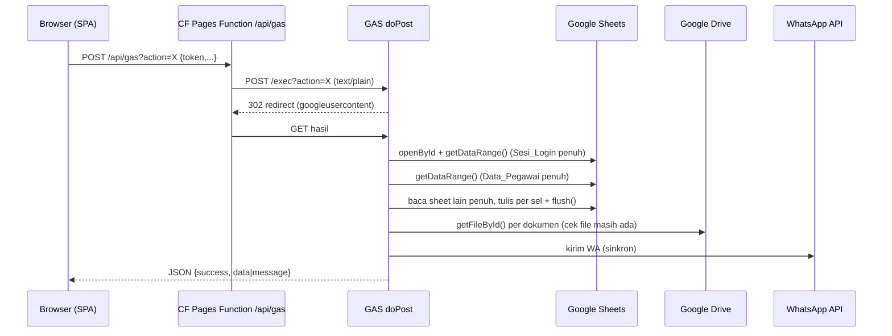

# SIKAP — Project Context, Analisa, Review & Audit

> Dokumen konteks untuk migrasi SIKAP dari Google Apps Script (GAS) ke Cloudflare (React 19 + Pages Functions + D1/R2).
> Dasar analisa: kode di branch `main` (commit `52e41f0`), `Blueprint Product/all_blueprints.txt` (STEP 00–06), dan mockup `UIUX Stitch/`.
> Tanggal analisa: 15 Oktober 2026. Rencana implementasi ada di [`MIGRATION_PLAN.md`](MIGRATION_PLAN.md).
> Keputusan pemilik produk (D1+R2, Free plan PBKDF2 10k, matriks dokumen wajib + golongan PPPK, versi file 3 hari, soft delete pegawai 7 hari, pengajuan perubahan data kepegawaian, password default tidak wajib diganti) tercatat di awal `MIGRATION_PLAN.md`. Pekerjaan migrasi dilakukan di branch `feat/cloudflare-migration`.
> Pembaruan 16 Oktober 2026: pemilik mengonfirmasi deploy hotfix GAS sudah dijalankan (belum diverifikasi ulang terhadap produksi). NIK tetap dapat diubah pegawai; aturan restore dokumen terverifikasi hanya oleh admin, hapus/unggah ulang dokumen Menunggu, dan pencadangan NIP/NIK sampai purge disetujui. Detail ada di bagian konfirmasi lanjutan `MIGRATION_PLAN.md`.
> Fase 7: log admin, referensi pangkat/unit, jenis dokumen + matriks wajib, antrean purge exact-key, dan backup logis NDJSON bertahap sudah diimplementasikan, diuji pada snapshot terpisah, dan di-commit lokal pada `cb4fae7`. Belum ada push maupun deploy preview/produksi; cron tetap nonaktif.
> Fase 9 (**parsial, belum siap import**): resource terisolasi `sikap-uat`/`sikap-uat-db`/R2 UAT dibuat 17 Okt 2026 dengan schema 0001–0008. Deployment awal holding-only menolak semua rute dengan 503. Operator memasang Access (satu aplikasi root+wildcard, OTP, Allow satu penguji, sesi 6 jam) dan mengonfirmasi email diizinkan/ditolak; Team/AUD dicatat di plan. Aplikasi kosong `0adc7584` kemudian diterbitkan dengan secret UAT terpisah serta guard JWT Access untuk seluruh page/asset/API. Sesi pengembangan mengunduh konfigurasi remote UAT dan menjalankan 13 probe anonim root/hash yang semuanya mendapat challenge 302 Access. Fixture 3 akun sintetis (Admin/PNS/PPPK, password acak privat, NIK/email/HP kosong, arsip 0) dibuat khusus UAT; hash remote 3/3 terverifikasi. Operator kemudian **melaporkan** pemeriksaan setelah OTP, login/logout SIKAP, dan penolakan 403 berbasis role lulus; ini konfirmasi operator, bukan bukti control plane yang diverifikasi independen. Preflight remote read-only pada 17 Okt berakhir exit 2 dengan kode tunggal `TARGET_NOT_EMPTY` (sesuai harapan karena fixture ada); `readyForImport:false`.
>
> Tooling Fase 8–9 di-commit lokal pada `3a1f795`, tanpa push atau deploy sejak hardening. Importer remote belum diimplementasikan; database probe sintetis terpisah sudah dibuat dan diamati kosong melalui SELECT-only (kuota D1 Free 10/10). Run probe remote pertama telah disetujui dan dijalankan (riwayat run pertama dan cleanup, sebelum run kedua di bawah): kontrol positif dan guard-abort lulus, constraint-abort exit 1 tidak dikenali lalu eksekutor berhenti exit 2 tanpa retry/cleanup. Inspect independen SELECT-only menemukan 2 tabel milik kit dan 3 baris positif, tanpa baris fase gagal atau objek asing; residu ini kemudian dibersihkan dengan persetujuan cleanup terpisah, verifikasi kepemilikan ulang sebelum tiap DROP, dan inspeksi di antara keduanya. SELECT final membuktikan 0 objek pengguna/0 residu; database probe tetap ada (kuota 10/10).
>
> Bukti atomicity belum lengkap; diagnostik enum/boolean teredaksi ditambahkan dan diuji lokal tanpa melonggarkan classifier atau memulihkan penyebab error lama. Run kedua kemudian disetujui terpisah dan kembali berhenti exit 2 pada constraint: diagnostik API cocok endpoint/kode 7500 tetapi pesan tidak cocok pola (`MESSAGE_MISMATCH`). Inspect nonce kedua menemukan 2 tabel kit/3 baris positif tanpa baris fase gagal atau objek asing; database saat itu kembali tidak kosong dan residu dibiarkan selama analisis. Tidak ada retry; cleanup kedua dicatat setelah tahap diagnostik di bawah. Jangan mengulang run identik atau melonggarkan classifier berdasarkan tebakan.
>
> Analisis lokal menambahkan taksonomi diagnostik schema v2 berbasis 20 literal penuh tanpa mengubah classifier; variasi pesan remote tetap hipotesis. Reproduksi ad hoc awal gagal sebelum SQL; harness lokal beradapter Miniflare yang benar kemudian menjalankan semua fase, menolak batch constraint, dan mempertahankan state 3 baris positif. Bentuk lokal primary+extended PRIMARYKEY kemudian cocok whitelist literal penuh khusus lokal pada error/cause, dengan state identik dan status LOCAL_ROLLBACK_OBSERVED; classifier remote tetap identik dan hasil ini bukan bukti remote. Diagnostik schema v3 menambah label extended-code melalui 4 literal terpisah hanya untuk APIError bersih/terikat target; classifier tetap menolak bentuk itu sebagai bukti. Tahap diagnostik tidak mengakses remote. Tooling probe di-commit lokal pada `c9eed3e`; cleanup kedua kemudian disetujui terpisah dan selesai dengan verifikasi nonce/kepemilikan sebelum tiap DROP dan inspeksi independen di antaranya. SELECT final: 0 objek pengguna/0 residu, database tetap ada, kuota 10/10.
>
> Run ketiga kemudian disetujui terpisah: diagnostik v3 APIError bersih/target cocok/kode 7500 mengenali bentuk primary CONSTRAINT + extended PRIMARYKEY tanpa wrapper, tetapi classifier lama tetap MESSAGE_MISMATCH/exit 2. Inspect nonce ketiga menemukan 2 tabel kit/3 baris positif tanpa fase gagal/asing; database saat akhir run kembali tidak kosong, tanpa retry atau cleanup saat itu. Bentuk ini observasi run ketiga, bukan penetapan ulang pesan run pertama/kedua. Policy classifier v2 kemudian ditambahkan lokal: satu literal extended yang direkonstruksi tanpa wrapper, dengan tag ` [code: 7500]`, wajib APIError bersih endpoint dipatok dan own code angka 7500, tanpa perubahan regex lama. Tiga receipt historis tetap gagal; saat patch dibuat policy baru belum diuji remote. Patch di-commit lokal pada `8511abc`, lalu cleanup ketiga disetujui terpisah dan selesai dengan verifikasi kepemilikan sebelum tiap DROP serta inspeksi di antaranya. SELECT final 0 objek pengguna/0 residu, database tetap ada; saat cleanup tersebut run keempat belum dijalankan. Inventaris akun pada akhir cleanup 11 database (sebelumnya 10); perubahan di luar scope belum diinvestigasi, tanpa mengasumsikan plan/kuota terkini atau izin menghapus resource lain.
>
> Run keempat kemudian disetujui terpisah dan lulus exit 0: semua 11 langkah policy v2 berhasil, kedua error terikat target dan post-read cocok, observedTransportRollback:true. Inspect independen nonce keempat mengonfirmasi 2 tabel kit/3 baris positif tanpa fase gagal/asing; residu dibiarkan dan database kembali tidak kosong. Bukti hanya untuk satu run query Wrangler 4.151.0/policy v2, bukan Worker batch/file import atau kesiapan impor; readyForImport:false tetap. Tidak ada retry, cleanup keempat, commit, push, deploy atau import; inventaris tidak diperiksa ulang. Desain importer lokal kemudian dicatat: nilai PII harus melalui params/body REST query, bukan SQL/argv Wrangler; request shape baru butuh bukti sintetis terpisah. Tahap desain tidak membuat kode/operasi remote. Pure core kemudian diimplementasikan pada scripts/import/core.mjs (descriptor syntax/denylist, compiler statis-params/target binding, simulasi state dan resume non-authorizing); core lalu diperketat untuk tipe primary key dan epoch journal, dan mock adapter in-memory ditambahkan (18 core + 14 mock, total seluruh suite 999 tes lulus). Artifact privat tidak untuk log; semantic validation/target proof/REST atomicity tetap belum terbukti. Mock hanya simulasi tanpa SQL engine/jaringan, selalu non-authorizing; inspect privat dan summary counts/flags. Belum ada client HTTP/R2 nyata, ledger DDL atau CLI apply. Checkpoint+journal+data satu request atomik yang terbukti, R2 GET SHA-256 sebelum referensi D1, dan tanpa blind retry/cleanup otomatis. Cleanup/operasi remote baru perlu persetujuan terpisah. Data nyata belum diimpor ke remote, dan produksi tidak berubah. Detail di `MIGRATION_PLAN.md` dan `README.md`.
> Fase 8: alat migrasi **offline/local-only** di `scripts/migrate/` telah lolos 140 test baseline dan 34 test operator. Operator sudah menjalankan sandbox sintetis di GAS nyata; snapshot `de3a7790-d540-49b5-8838-cebfebb7b5e4` berhasil ditransformasi, diimpor, direkonsiliasi dan di-resume lokal (3 pegawai/akun, 2 arsip, 3/3 file cocok SHA-256, 739 byte). Alat penyalinan sumber terkontrol (`CopyPrivateSource.gs` v2: target spreadsheet baru dari empat tab nilai, salinan dokumen/foto, ID diperbarui hanya pada target) sudah diuji pada Google nyata dengan sumber sintetis pada 17 Okt 2026; snapshot hasil ekspor target `76fdd9e1-427f-4c15-aff7-36da5d5ce6db` lulus transform/apply/reconcile/resume lokal dengan hasil identik. Pada hari yang sama, dengan izin pemilik data, sumber nyata disalin secara privat (job `b8756cf1`, 66 file) dan diekspor (snapshot `039d8212`); dry-run lokal lulus penuh (46 pegawai/akun, 63 arsip, 66/66 file, apply/reconcile/resume ok) setelah dua perbaikan kualitas data (NIK placeholder dikosongkan pemilik, Pangkat_Golongan "-" dinormalisasi sebagai kosong). Langkah berikutnya adalah import ke target UAT privat yang terpisah dan kosong (bukan preview lama `sikap-v2`), setelah jalur penulisan remote diimplementasikan, dibuktikan, dan disetujui. Belum ada ekspor produksi untuk cutover atau migrasi data nyata/remote; tidak ada endpoint import publik. Prosedur operator ada di `README.md`, hasil rinci di `MIGRATION_PLAN.md`.

---

## 1. Ringkasan Eksekutif

SIKAP (Sistem Informasi Kepegawaian dan Arsip Pegawai) adalah aplikasi internal UPTD Pendapatan Daerah Wilayah Kota Kupang (SAMSAT). Aplikasi ini mendigitalisasi data pegawai (PNS/CPNS/PPPK) dan dokumen kepegawaian, dengan alur **self-service upload oleh pegawai** dan **verifikasi oleh Admin TU**, plus notifikasi WhatsApp.

| Aspek | Kondisi saat ini |
|---|---|
| Arsitektur | Frontend statis di Cloudflare Pages, proxy `/api/gas` (Pages Function), backend GAS `doPost`, database Google Sheets, file di Google Drive |
| Ukuran kode | Backend ±4.600 baris `.gs` (11 file), frontend ±8.500 baris HTML/JS (30 partial) |
| API | 38 action RPC via `POST /api/gas?action=<nama>` |
| Peran | `Admin` (TU) dan `Pegawai` |
| Masalah utama | **Lambat** (setiap request: cold start GAS + redirect 302 + baca seluruh sheet + cek Drive per file), dan **beberapa celah keamanan kritis** (lihat §8) |
| Rekomendasi | Pindah ke **Cloudflare D1 + R2** (bukan Google Sheets API), React 19 SPA, REST API di Pages Functions. Lakukan **hotfix keamanan GAS segera**, sebelum migrasi dimulai |

---

## 2. Tech Stack Saat Ini

| Layer | Teknologi | Catatan |
|---|---|---|
| Frontend | HTML + Vanilla JS (namespace global `SIKAP.*`), partial `<?!= include() ?>` | Semua view dimuat di satu `index.html` (±460 KB), lalu disembunyikan/ditampilkan |
| Styling | Tailwind CSS **v3.4.19** (npm build) + Play CDN `cdn.tailwindcss.com` saat dijalankan dari GAS | README menyebut "Tailwind v4"; kenyataannya v3 (`@tailwind base;` di `input.css`). Token warna Material 3 ada di `tailwind.config.js` dan `Index.html` |
| Ikon / font | Material Symbols, Google Fonts Inter (CDN) | |
| Library | Cropper.js 1.5.13 (CDN) untuk crop foto | |
| Gateway | Cloudflare Pages Function `functions/api/gas.js` | Proxy `POST` ke GAS `/exec`, `Content-Type: text/plain` |
| Backend | Google Apps Script V8, `executeAs: USER_DEPLOYING`, `access: ANYONE_ANONYMOUS` | Timezone `Asia/Makassar` (WITA) |
| Database | Google Sheets (5 tab) | Spreadsheet ID di-hardcode di `Database.gs` |
| Storage | Google Drive, folder `SIKAP_Dokumen_Kepegawaian/[Status]/[NIP]_[Nama]` | Root folder di-share `ANYONE_WITH_LINK` (lihat §8) |
| Notifikasi | WhatsApp via **Fonnte** atau **Meta Cloud API v21.0** (template `dokumen_terverifikasi`, `dokumen_ditolak`, `dokumen_baru_admin`) | Token disimpan di Script Properties |
| Build | `scripts/build-cloudflare.js` (resolve include via regex, build Tailwind, buang CDN), `npm run build:gas` (copy ke `gas-dist/`) | |
| CI/CD | GitHub Actions `gas-deploy.yml` (`clasp push` ke HEAD), Cloudflare Pages Git integration | Rilis Web App `/exec` masih manual (`clasp deploy`) |
| Repo | `github.com/ElwinMusadi/SIKAP` — **PUBLIC** | Berisi Spreadsheet ID, Script ID, URL `/exec`, data contoh |
| Domain | `https://sikap.uptdpenda-kupang.web.id` (dari `WhatsApp.gs`) | |

File sisa yang tidak dipakai: `Kode.js` (fungsi kosong), `jsconfig.json` (typing GAS), `scripts/test-*.js` (smoke test manual ke `wrangler pages dev`).

---

## 3. Arsitektur & Alur Request

- **Dispatcher**: `API.gs` punya whitelist `API_HANDLERS` dan `payloadMap` yang memetakan field JSON ke argumen posisional. Peta yang sama diduplikasi di `JS_Api.html` (versi frontend hanya berisi 26 dari 38 action, tapi mode `fetch` tidak memakainya).
- **Auth**: token UUID di `localStorage` (`sikap_session_token`), dikirim di body setiap request. `authorize(token, roles, allowForceChange)` dipanggil di awal setiap handler.
- **Response**: selalu HTTP 200. Error dibedakan lewat `success:false` + `message`. Deteksi sesi habis di frontend memakai pencocokan string `'Sesi'`.
- **Router frontend**: `SIKAP.Router.navigate(viewId)` dengan whitelist view per role, heartbeat `checkSession` setiap 5 menit, lifecycle `onViewEnter` yang memuat data per view.

### Penyebab lambat (root cause)
1. Cold start GAS dan redirect 302 per request (±1–3 detik sebelum logika berjalan).
2. `validateSession` membaca **seluruh** `Sesi_Login`, lalu seluruh `Data_Pegawai`, di **setiap** request terautentikasi.
3. Penulisan per sel (`updateRowFields` memanggil `setValue` per kolom, lalu `flush()`).
4. `getArsipDokumenPegawai` dan `adminGetVerificationQueue` memanggil `DriveApp.getFileById` **untuk setiap dokumen**, jadi N panggilan Drive per halaman.
5. Upload base64 (+33% ukuran) melewati dua hop, lalu WhatsApp dikirim sinkron sebelum response.
6. `adminGetLogAktivitas` mengembalikan seluruh log tanpa paging.

---

## 4. Model Data (Google Sheets)

### 4.1 `Data_Pegawai` (PK: NIP, 25 kolom, gabungan akun + biodata)
| # | Kolom | Tipe / nilai |
|---|---|---|
| 0 | NIP | 18 digit (teks) |
| 1 | Password_Hash | SHA-256 hex **tanpa salt** |
| 2 | Role | `Admin` \| `Pegawai` |
| 3 | Status_Akun | `Aktif` \| `Nonaktif` \| `Ganti_Password` |
| 4 | Nama_Lengkap | |
| 5 | Status_Kepegawaian | `PNS` \| `CPNS` \| `PPPK` (legacy `P3K`) |
| 6 | Pangkat_Golongan | lihat referensi §4.6 |
| 7 | Jabatan | teks bebas |
| 8 | No_HP | diawali `'` agar 0 tidak hilang |
| 9 | Alamat | |
| 10 | Folder_Drive_ID | |
| 11 | Email | |
| 12 | Golongan_Darah | `A`,`B`,`AB`,`O`,`Tidak Tahu` |
| 13 | NIK | 16 digit, diawali `'` |
| 14–15 | Tempat_Lahir, Tanggal_Lahir | tanggal `yyyy-MM-dd` |
| 16 | Jenis_Kelamin | `Laki-laki` \| `Perempuan` |
| 17 | Agama | Kristen Protestan, Kristen Katholik, Islam, Hindu, Buddha, Konghucu |
| 18 | Pendidikan_Terakhir | |
| 19 | Status_Pernikahan | `Belum Menikah` \| `Menikah` \| `Cerai` |
| 20 | TMT_Pangkat | tanggal |
| 21 | Jenis_Jabatan | `Fungsional` \| `Pelaksana` \| `Struktural` |
| 22 | TMT_Jabatan | tanggal |
| 23 | Unit_Organisasi | |
| 24 | Foto_Drive_ID | |

### 4.2 `Master_Dokumen` (PK: ID_Dokumen)
`ID_Dokumen, Nama_Dokumen, Kategori, Status_Wajib(Ya/Tidak)`. Seed berisi 11 jenis: 9 wajib (KTP, KK, NPWP, SK CPNS, SPMT CPNS, SK PNS, DRH, Ijazah, SKP) dan 2 opsional (KARPEG, Taspen). Tidak ada UI CRUD; data diubah langsung di sheet.

### 4.3 `Arsip_Dokumen` (PK: ID_Arsip UUID)
`ID_Arsip, NIP, ID_Dokumen, File_Drive_ID, File_URL, Status_Verifikasi, Catatan_Admin, Waktu_Upload, Waktu_Verifikasi, NIP_Verifier`.
- Status: `Menunggu` → `Terverifikasi` | `Ditolak`, serta `Belum_Unggah` (setelah hapus atau saat file Drive hilang).
- Secara logika satu baris per (NIP, ID_Dokumen). Upload ulang mengubah baris yang sama dan membuang file lama ke trash. Uniqueness ini **tidak dijamin** (tanpa lock).

### 4.4 `Sesi_Login`
`Token_ID (UUID plaintext), NIP, Waktu_Dibuat, Waktu_Expired` (12 jam). Pembersihan lewat `cleanExpiredSessions()` yang harus dipasang manual sebagai trigger.

### 4.5 `Log_Aktivitas`
`Log_ID, Timestamp, Actor_NIP, Actor_Role, Action, Target_Type, Target_ID, Description, Result`.
- Action yang tercatat: `LOGIN, LOGOUT, PASSWORD_CHANGE, FORCE_PASSWORD_CHANGE, PASSWORD_RESET, PROFILE_UPDATE, FOTO_PROFIL_UPLOAD, PEGAWAI_CREATE/UPDATE/DEACTIVATE/REACTIVATE/DELETE, DOKUMEN_UPLOAD/REUPLOAD/DELETE/APPROVE/REJECT/MISSING, CONFIG_UPDATE, BACKUP_DATABASE, BACKUP_FULL`.
- Login **gagal** tidak dicatat.

### 4.6 Data referensi (hardcoded di frontend dan backend)
- **Pangkat/Golongan**: `Juru Muda (I/a)` … `Pembina Utama (IV/e)` (17 nilai, ditambah `-`). Seed lama memakai format berbeda (`Penata / III.c`) sehingga ada mapping legacy di admin, tapi tidak di halaman profil. **Golongan PPPK (I–XVII, mis. `Ahli Pertama (IX)` di seed) tidak ada di dropdown**, sehingga pegawai PPPK tidak bisa memilih golongan yang benar.
- **Unit Organisasi**: `Subbagian Tata Usaha`, `Seksi Penetapan dan Penagihan`, `Seksi Verifikasi`.
- **Pendidikan**: `SMA / SMK / Sederajat`, `D-I`…`D-IV`, `S-1 / Sarjana`, `S-2 / Magister`, `S-3 / Doktoral`.
- Daftar enum lain sama dengan §4.1.

### 4.7 Konfigurasi (Script Properties)
`WA_PROVIDER` (`fonnte`|`meta`), `FONNTE_TOKEN`, `META_WA_TOKEN`, `META_WA_PHONE_ID`, `NOTIF_DOKUMEN_BARU`, `NOTIF_DOKUMEN_APPROVED`, `NOTIF_DOKUMEN_REJECTED` (default aktif, fail-open).

---

## 5. Fungsionalitas

### 5.1 Peta halaman & hak akses
| View | Admin | Pegawai | Fungsi |
|---|:-:|:-:|---|
| Login | ✓ | ✓ | NIP + password. Panel kiri berisi foto kantor SAMSAT |
| Ganti Password Wajib | ✓ | ✓ | Muncul jika `forceChangePassword`. **Saat ini nonaktif** (`ENABLE_FORCE_CHANGE_PASSWORD=false`) |
| Beranda Admin | ✓ | | Total pegawai, PNS/CPNS/PPPK, antrean verifikasi, % kelengkapan instansi, 7 aktivitas terakhir |
| Beranda Pegawai | | ✓ | % dokumen wajib terverifikasi, % kelengkapan profil (10 field), daftar prioritas (Ditolak, lalu Belum unggah, lalu Menunggu), dokumen ditolak beserta catatan. Cache 15 detik |
| Profil Pegawai | ✓ (diri sendiri) | ✓ | Lihat/edit biodata, crop dan upload foto (Cropper 1:1, 500×500), ringkasan dokumen. Dirty tracking |
| Arsip Dokumen | ✓ | ✓ | Ring progress, tab wajib/opsional, upload (PDF/JPG/PNG/WEBP ≤5 MB), preview iframe Drive, unduh, hapus, lihat alasan penolakan. Upload diblokir jika profil belum lengkap |
| Master Data Pegawai | ✓ | | Cari (nama/NIP), filter (status kepegawaian, status akun, kelengkapan), paging 15/20/30/50, panel tambah/edit (+ foto 600×600), aktif/nonaktif, hapus permanen, reset password, daftar dokumen pegawai |
| Verifikasi Dokumen | ✓ | | Antrean "Menunggu" urut terlama, split-view (preview + data pegawai), zoom, prev/next, Setujui, Tolak (alasan min. 5 karakter, counter 500) |
| Log Aktivitas | ✓ | | Pencarian (debounce 180 ms), filter kategori/hasil, "muat lagi" per 20. **Tidak ada link di sidebar**, hanya dari dashboard |
| Keamanan Akun | ✓ | ✓ | Ganti password (≥8 karakter, huruf besar+kecil, angka) |
| Pengaturan Sistem | ✓ | | Provider WA (Fonnte/Meta), simpan token, kirim pesan uji, toggle 3 jenis notifikasi, backup DB / backup penuh ke Drive `SIKAP_Backups` |

### 5.2 Aturan bisnis penting
- **Akun baru**: password default = 6 digit terakhir NIP. Folder Drive dibuat otomatis.
- **Login ditolak** jika `Status_Akun = Nonaktif`. Sesi aktif ikut tidak valid karena status dicek ulang di `validateSession`.
- **Admin** tidak bisa menonaktifkan atau menghapus dirinya sendiri.
- **Upload**:
  - Akun harus `Aktif`.
  - 10 field profil wajib terisi (HP, email, NIK, tempat/tgl lahir, jenis kelamin, agama, pendidikan, status nikah, alamat).
  - Tidak boleh upload jika status masih `Menunggu`.
  - File diberi nama otomatis `[NIP]_[Nama]_[ID_Dokumen].[ext]`.
  - Upload ulang: file lama dibuang ke trash dan status kembali `Menunggu`.
- **Verifikasi**: approve atau reject, alasan wajib saat reject. Notifikasi WA dikirim ke pegawai. Upload baru mengirim notifikasi WA ke semua Admin aktif.
- **Hapus pegawai**: hapus baris pegawai, arsip, dan sesi. Folder Drive di-rename `[DELETED] - Nama`, file tetap disimpan.
- **Kelengkapan**: dihitung dari dokumen `Wajib`. Ada definisi berbeda, lihat temuan F-12.
- **Self-heal**: jika file Drive hilang, status arsip otomatis jadi `Belum_Unggah` saat dibaca.

### 5.3 Fitur Blueprint/PRD yang belum atau berbeda implementasinya
| Requirement | Status |
|---|---|
| FR-01.2 Force change password | Ada, tapi dimatikan oleh flag |
| FR-03.1 NIP & Status Kepegawaian dikunci untuk pegawai | **Dilanggar**: pegawai bisa mengubah status, pangkat, jabatan, TMT, unit, NIK |
| FR-05.1 folder `[Tahun]/[Status]/[NIP]_[Nama]` | Tanpa `[Tahun]` |
| STEP 04: token "restricted" saat wajib ganti password | Ada (`allowForceChange`) |
| STEP 05: Admin menambah jenis dokumen | Hanya lewat sheet langsung, belum ada UI |
| Pencarian "siapa yang belum upload NPWP" | Belum ada (filter hanya agregat Lengkap/Belum/Perlu Revisi) |
| Notifikasi kenaikan pangkat (future) | Belum |
| Riwayat dokumen (versioning) | Tidak ada; overwrite |

---

## 6. Katalog API (38 action)

| Domain | Action | Akses |
|---|---|---|
| Auth | `login`, `logout`, `checkSession`, `changePassword`, `forceChangePassword`, `getUserProfile` | publik / login |
| Pegawai | `getMyProfile`, `updateMyProfile`, `uploadFotoProfil`, `getMyDashboard` | login |
| Dokumen | `getArsipDokumenPegawai(targetNip?)`, `getDokumenPreview`, `uploadDokumen`, `hapusDokumen` | login, dengan cek kepemilikan (Admin boleh semua) |
| Admin pegawai | `adminGetAllPegawai`, `adminGetPegawaiDetail`, `adminTambahPegawai`, `adminUpdatePegawai`, `adminSetStatusAkun`, `adminResetPassword`, `adminDeletePegawai`, `adminUploadFotoPegawai` | Admin |
| Admin verifikasi | `adminGetVerificationQueue`, `adminApproveDokumen`, `adminRejectDokumen` | Admin |
| Admin dashboard/log | `adminGetDashboardStats`, `adminGetLogAktivitas` | Admin |
| Sistem | `adminBackupDatabase`, `adminBackupFull`, `adminGetWaProvider`, `adminSetWaProvider`, `adminSaveFonnteToken`, `adminGetFonnteStatus`, `adminTestFonnteMessage`, `adminSaveMetaConfig`, `adminTestMetaMessage`, `adminGetNotifSettings`, `adminSaveNotifSettings` | Admin |

Bentuk response yang dipakai frontend (perlu dipertahankan secara semantik di API baru):
- `getMyDashboard`: `pct, wajibTotal, wajibVerified, wajibCounts, profilePct, profileMissingFields, counts, rejectedDocs, priorityRows, tableRows`.
- `getArsipDokumenPegawai`: `pct, totalDocs, availableCount, wajibTotal, wajibAvailable, wajibVerified, counts, tableRows, wajibRows, opsionalRows`.
- `adminGetAllPegawai`: `rows[] (profil + docPct + docLabel), summary{total, aktif, nonaktif}`.
- `adminGetVerificationQueue`: `[{idArsip, nip, idDokumen, previewUrl, waktuUpload, employee{}, masterDoc{}}]`.

---

## 7. Deployment Saat Ini

1. Push ke `main`:
   - GitHub Actions menjalankan `npm ci`, lalu `build:gas`, lalu `clasp push -f` (hanya HEAD/dev).
   - Secara paralel, Cloudflare Pages menjalankan `npm run build:cloudflare` ke `dist/`.
2. Rilis backend produksi manual: `clasp deploy -i <deploymentId>`. URL `/exec` ditulis di `wrangler.toml [vars]`.
3. Lokal: `wrangler pages dev dist` (port 8788). `.dev.vars` berisi `GAS_WEB_APP_URL`.
4. Tidak ada environment staging terpisah. Spreadsheet produksi juga dipakai untuk tes (`Tests_Integration.gs` menulis data mock ke sheet produksi).

---

## 8. Audit Keamanan & Kualitas

Severity: **Critical** (eksploitasi mudah, dampak besar), **High**, **Medium**, **Low**.

### 8.1 Keamanan

| ID | Sev | Temuan | Bukti | Dampak |
|---|---|---|---|---|
| S-01 | **Critical** | **Semua fungsi server GAS non-privat bisa dipanggil langsung lewat `google.script.run`.** `doGet` masih menyajikan SPA ke publik (`ANYONE_ANONYMOUS`). Di GAS, setiap fungsi top-level yang namanya tidak diakhiri `_` dapat dipanggil dari client HtmlService | `Main.gs:13`, `appsscript.json`, fungsi `seedData`, `updateCell`, `appendRow`, `getAllData`, `deleteByColumnValue` | Siapa pun yang membuka URL `/exec` dapat: `seedData()` (**menghapus seluruh database**), `updateCell('Data_Pegawai',r,3,'Admin')` (eskalasi hak), `appendRow('Sesi_Login',[…])` (memalsukan sesi admin), `getAllData(...)` (membaca hash password dan PII). Whitelist `doPost` tidak berlaku untuk jalur ini |
| S-02 | **Critical** | Folder root Drive di-share `ANYONE_WITH_LINK` (VIEW), dan semua subfolder serta file mewarisi akses ini | `Dokumen.gs:47` | KTP, KK, NPWP, SK dapat dibuka siapa pun yang tahu ID file atau folder. ID terekspos di response API dan URL preview. Berisiko melanggar UU PDP No. 27/2022 |
| S-03 | **Critical** | Password default = 6 digit terakhir NIP (NIP bersifat semi-publik), dan `ENABLE_FORCE_CHANGE_PASSWORD = false`. Tidak ada rate limit maupun lockout login | `Auth.gs:15`, `Utils.gs:51` | Akun yang belum ganti password dapat diambil alih dengan menebak satu kali. Brute force password lain tidak dibatasi |
| S-04 | High | Hash password SHA-256 tanpa salt dan tanpa iterasi | `Utils.gs:20` | Jika hash bocor (lihat S-01), password lemah mudah di-crack lewat rainbow table |
| S-05 | High | Pegawai dapat mengubah field kepegawaian sendiri (status, pangkat, jabatan, TMT, unit, NIK). Bertentangan dengan PRD FR-03.1 | `Pegawai.gs:134-142`, `View_ProfilPegawai.html:293` | Integritas data kepegawaian rusak. Admin tidak tahu ada perubahan, kecuali dari log |
| S-06 | High | XSS lewat `onclick='...'` yang dirangkai dari string: `escapeHtml` di-decode browser sebelum JS dieksekusi. Nama dengan apostrof juga merusak tombol | `JS_MasterDataPegawai.html:283,287`, `JS_ArsipDokumen.html:227` | Eksekusi script di sesi Admin (token ada di `localStorage`, sehingga bisa dicuri) |
| S-07 | High | Repo GitHub **publik** memuat Spreadsheet ID, Script ID, URL `/exec`, serta contoh NIP/NIK/nama/email/HP yang tampak nyata di placeholder | `Database.gs:6`, `.clasp.json`, `wrangler.toml`, `View_MasterDataPegawai.html:308…` | Memperbesar dampak S-01 dan S-02. Potensi kebocoran data pribadi |
| S-08 | Medium | Token sesi disimpan plaintext di sheet dan di `localStorage`. Ganti atau reset password **tidak** mencabut sesi lain. Reset password tidak memaksa ganti | `Auth.gs:61`, `Admin.gs:800` | Sesi yang dicuri tetap valid sampai 12 jam |
| S-09 | Medium | Gateway Cloudflare tidak menambah lapisan proteksi apa pun (tanpa shared secret ke GAS). GAS `/exec` dapat dipanggil langsung tanpa melalui gateway. `action` tidak di-encode di URL | `functions/api/gas.js:47` | Rate limit atau WAF di edge tidak bisa diterapkan |
| S-10 | Medium | Pesan error mengekspos `e.message` internal | `Admin.gs:450, 594…`, `Dokumen.gs:283, 696` | Information disclosure |
| S-11 | Medium | Token WhatsApp (Fonnte/Meta) disimpan plaintext. Pengiriman fail-open | `WhatsApp.gs` | |
| S-12 | Low | Validasi file hanya berdasarkan MIME dari client (tanpa magic bytes). URL `href`/`iframe` tidak dicek skemanya | `Dokumen.gs:552`, `JS_ArsipDokumen.html:576` | |
| S-13 | Low | Login gagal tidak dicatat di audit log | `Auth.gs:24-94` | Brute force tidak terdeteksi |

> README §18 menyatakan aplikasi "telah lulus Final Security Review". Temuan S-01 sampai S-03 membantah klaim tersebut.

### 8.2 Integritas data & bug fungsional (backend)

| ID | Sev | Temuan | Bukti |
|---|---|---|---|
| F-01 | **High** | **Backup penuh tidak menyalin dokumen apa pun.** `_copyDocumentsFolderToBackup` hanya iterasi 1 level (folder status), padahal file berada di level ke-2 (`[Status]/[NIP_Nama]/file`) | `Backup.gs:157-167` vs `Dokumen.gs:104-106` |
| F-02 | High | Tidak ada `LockService`. Pola "cari rowIndex, lalu tulis" rentan race: `deleteRow` menggeser indeks sehingga update bisa masuk ke **baris yang salah**. Upload ganda bisa membuat baris arsip duplikat | `Database.gs`, `Admin.gs:772-778`, `Dokumen.gs:578-661` |
| F-03 | High | NIK dari `updateMyProfile` disimpan dengan `escapeFormula` (tanpa prefix `'`), berbeda dari `formatNikForStorage`. Jika kolom tidak berformat Plain Text, NIK 16 digit dikonversi ke number dan **presisi hilang**. NIP dari `adminTambahPegawai` juga disimpan tanpa prefix, jadi bergantung pada format kolom | `Pegawai.gs:135`, `Admin.gs:401` |
| F-04 | Medium | Upload ulang membuang file lama ke trash **sebelum** file baru berhasil dibuat. Jika pembuatan gagal, dokumen hilang | `Dokumen.gs:600-626` |
| F-05 | Medium | Fungsi global `_formatDate` didefinisikan dua kali (`Dokumen.gs`: dengan jam, `Pegawai.gs`: tanpa jam). Di GAS yang menang adalah file yang dimuat terakhir, sehingga format tanggal tidak konsisten | `Dokumen.gs:709`, `Pegawai.gs:468` |
| F-06 | Medium | Operasi baca punya efek samping tulis (antrean verifikasi, arsip, dan preview mengubah status jadi `Belum_Unggah`), ditambah N panggilan Drive | `Admin.gs:919-944`, `Dokumen.gs:184-208` |
| F-07 | Medium | Pegawai dapat menghapus dokumen yang sudah `Terverifikasi`. Approve tidak memeriksa status `Menunggu` atau keberadaan file | `Dokumen.gs:294`, `Admin.gs:1007` |
| F-08 | Medium | Statistik dashboard: status selain PNS/CPNS (termasuk kosong) dihitung sebagai PPPK. Total juga mencakup akun Nonaktif | `Admin.gs:32-41` |
| F-09 | Medium | Notifikasi WA dikirim sinkron di jalur request (latensi bertambah, ada risiko timeout 6 menit pada backup) | `Admin.gs:1029`, `Dokumen.gs:675` |
| F-10 | Low | `Sesi_Login` dan `Log_Aktivitas` tumbuh tanpa batas. Log dikembalikan seluruhnya tanpa paging | `Admin.gs:137` |
| F-11 | Low | Fungsi tes (`test_*`, `runAllIntegrationTests`, `seedData`) ikut ter-deploy ke produksi dan menulis ke sheet produksi | `Tests_Integration.gs` |
| F-12 | Low | Definisi "% kelengkapan" berbeda: Arsip memakai *tersedia/wajib*, Dashboard pegawai dan admin memakai *terverifikasi/wajib* | `Dokumen.gs:258` vs `Pegawai.gs:417` |
| F-13 | Medium | Dokumen wajib berlaku sama untuk semua status. PPPK diwajibkan SK CPNS, SPMT CPNS, dan SK PNS; CPNS diwajibkan SK PNS. Akibatnya PPPK/CPNS **tidak pernah bisa mencapai 100%** | `Admin.gs:52-55`, `Pegawai.gs:309-314`, seed `Master_Dokumen` |

### 8.3 Bug frontend (hasil review)

| Sev | Temuan | Lokasi |
|---|---|---|
| High | Tombol aktif/nonaktif akun tetap `disabled` setelah sukses, sehingga toggle kedua gagal sampai reload | `JS_MasterDataPegawai.html:972-986` |
| High | `Settings.loadProfile` tidak punya `else`: saat sukses menampilkan toast error (dan bisa logout), saat gagal diam saja | `JS_Pengaturan.html:15-26` |
| Medium | Race di panel edit admin: klik pegawai B sebelum data A selesai dimuat bisa menyimpan data A ke B | `JS_MasterDataPegawai.html:651-725` |
| Medium | `profileComplete` tidak diperbarui setelah simpan profil, sehingga upload tetap terblokir | `View_ProfilPegawai.html:959-989` |
| Medium | `jenisKelamin` hilang dari `_original` setelah simpan (Cancel jadi `undefined`). Nilai pangkat legacy tampil kosong di profil | `View_ProfilPegawai.html:664, 964-982` |
| Medium | Upload foto memanggil `load()` sehingga perubahan profil yang belum disimpan tertimpa | `View_ProfilPegawai.html:829` |
| Medium | Deteksi sesi habis tidak konsisten (`indexOf('Sesi')`, regex, atau tidak ada sama sekali). Aturan NIK berbeda di tambah, edit, dan profil | beberapa file |
| Low | Fallback hardcoded `|| 11`, `|| 9`, `|| 2`. Teks "11 dokumen (9 Wajib & 2 Opsional)" di-hardcode | `JS_ArsipDokumen.html:84-86`, `View_ProfilPegawai.html:483` |
| Low | `toDataURL('image/jpg')` tidak valid (output PNG tapi dilabeli jpg). Hasil upload foto lanjutan diabaikan | Cropper flow |
| Low | Log Aktivitas tidak ada di sidebar. Teks UI mempublikasikan pola password default | `Component_Sidebar.html`, `View_MasterDataPegawai.html:594` |

### 8.4 Kualitas kode & maintainability
- Tanpa TypeScript, tanpa test otomatis yang berjalan di CI (tes GAS manual di editor dan menulis ke produksi).
- Index kolom hardcoded (`COL_*`) sehingga rapuh jika kolom sheet digeser. `_getColIdx` hanya dipakai di antrean verifikasi.
- Validasi enum diduplikasi di `Admin.gs`, `Pegawai.gs`, dan frontend.
- HTML dirangkai dengan string (`innerHTML +=`) di banyak tempat. State global mutable di `SIKAP.state`.
- Aset (logo, foto kantor) diambil dari repo GitHub pribadi `ElwinMusadi/app-assets`.
- Error dikembalikan sebagai HTTP 200, sehingga klien bergantung pada string pesan.

---

## 9. Aset Desain yang Dapat Dipakai Ulang

- `UIUX Stitch/*.html`: 17 mockup Google Stitch (Login, Beranda Pegawai/Admin, Profil, Arsip, Master Data, Tambah/Edit Pegawai, Verifikasi, modal Upload/Preview/Tolak/Penolakan/Nonaktifkan, Pengaturan, Ubah Password, Global UI Components).
- Token desain Material 3: `primary #00236f`, `primary-container #1e3a8a`, `surface #f8f9ff`, `error #ba1a1a`, font Inter, skala tipografi `h1 30/38`, `h2 24/32`, `body-md 14/20`.
- Warna status sesuai STEP 06: Merah = kosong, Kuning = menunggu, Hijau = terverifikasi, Oranye = ditolak.
- `Logo Pemprov NTT.png`, `Kantor-SAMSAT.png` (2,4 MB, perlu dikompresi ke WebP/AVIF).

---

## 10. Kesimpulan untuk Migrasi

1. **Domain sederhana dan stabil**: 4 entitas inti (pegawai/akun, jenis dokumen, arsip dokumen, log), ditambah sesi dan pengaturan. Sangat cocok untuk relasional (D1/SQLite).
2. **Kinerja** hanya bisa diperbaiki secara signifikan dengan meninggalkan GAS **dan** Sheets sebagai database utama. Google Sheets API dari Workers tetap lambat (±300–1000 ms per panggilan, quota per menit, perlu signing JWT service account).
3. **Volume kecil**: puluhan sampai ratusan pegawai × 11 dokumen × ≤5 MB masih masuk kuota **Free plan** D1/R2/Pages (detail di plan).
4. **Keamanan** harus didesain ulang: PBKDF2, cookie HttpOnly, lockout, file privat di R2 yang disajikan lewat endpoint terotorisasi, input yang di-whitelist per role, dan audit log lengkap.
5. Kontrak data (enum, aturan upload, alur verifikasi, notifikasi WA, perhitungan kelengkapan) sudah terdokumentasi di atas dan menjadi **acceptance criteria** parity.
6. **Hotfix S-01, S-02, S-03 wajib dilakukan sekarang** di GAS, karena migrasi membutuhkan beberapa minggu.
